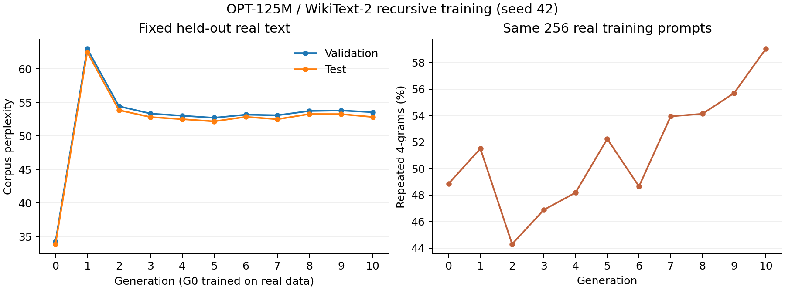

# Model collapse in synthetic-data training

Cambridge Engineering IIB, Week 1. A recursive OPT-125M / WikiText-2 experiment following [Shumailov et al. (2024)](https://doi.org/10.1038/s41586-024-07566-y).

Two explicit modes share the same data preparation, generation, evaluation and cloud controls. The original `fresh_base` experiment reloads the pretrained weights each generation. The new `continued` mode carries the previous selected model's weights forward. Evaluation text remains fixed. The remote worker, backups, reports and GPU shutdown operate independently of the laptop.

## Continued training on the model's own output

This separate variant starts from the saved **real-data-trained G0** of `20261020T211121Z-full`, rather than its final synthetic G10. The private Hugging Face commit, checkpoint file checksums and model tensor hash are pinned in `configs/full-continued.yaml` and `configs/smoke-continued.yaml`.

```text
S0 = saved real-data G0
S0 generates D1; train S0 on D1 -> S1
S1 generates D2; train S1 on D2 -> S2
... S9 generates D10; train S9 on D10 -> S10
```

Each training cycle loads the preceding selected checkpoint: it does **not** reload the original pretrained weights. AdamW and the epoch cosine schedule restart each cycle. The same five-epoch full-data training settings and lowest fixed-real-validation-loss checkpoint selection remain in use; test text never selects checkpoints. Each selected epoch is a newly trained model, not a rollback candidate to the untrained parent. This is a documented continued-weight variant, not a claim of exact paper reproduction. Only the mode of weight initialization changes relative to the previous training protocol.

The ten-cycle configuration generates 37,946 continuations of 64 tokens for every training dataset: **2,428,544 synthetic tokens per cycle**, exactly the previous real-data training budget. All cycles use the same 64-token real training prompts, five deterministic beams and continuation-only training targets. S10 generates an additional 256-continuation measurement probe; no S11 is trained. S0 is recorded as `gen_00`, S1 as `gen_01`, and so on, in a new experiment directory. Existing full-run results are preserved.

Validate this mode independently:

```powershell
python -m model_collapse smoke --mode continued
python -m model_collapse status RUN_ID
python -m model_collapse fetch RUN_ID --metadata-only
python -m model_collapse validate RUN_ID
python -m model_collapse report RUN_ID
python -m model_collapse cleanup RUN_ID
```

The small test uses 256 training blocks, 64 validation/test blocks, one epoch and two actual continued-training cycles. It injects two worker exits, checks both weight/data handoffs, resumes saved generation shards, and verifies that completed cycle 1 remains unchanged. Before shutdown, the GPU downloads all smoke backups from private Hugging Face storage, verifies every checksum, reloads the restored S2 and re-evaluates it. A direct next-token log-probability calculation checks the loss accounting. The independent budget watchdog then stops the GPU and local validation confirms the provider's stopped state.

`--metadata-only` downloads reports, examples and manifests while leaving tensor/token files in the cloud. Smoke cleanup accepts this only when the remote restore audit verifies the skipped bulk objects. For a full run, `fetch RUN_ID` downloads **all** artifacts (several GB); retrieve and verify those before deleting its retained volume. A metadata-only fetch alone does not authorize full-run cleanup.

The full command is separate and must be explicitly requested:

```powershell
python -m model_collapse launch --mode continued --generations 10
```

The launcher requires a completed **continued-mode** smoke validation for the current source version; the old fresh-base test cannot authorize this mode. After it returns `detached_supervisor_and_watchdog_verified: true`, the laptop and browser can close. Each cycle saves weights, synthetic token IDs, text examples, fixed-real-text loss/perplexity, diversity/repetition, frozen-S0 scores, timing and provenance hashes. Completion creates CSVs and plots automatically and shuts down compute. Use the same `status`, `resume`, `fetch`, `report` and `cleanup` commands with its new run ID.

**Validated, full run not started:** [26 October continued-mode acceptance report](reports/20261026T182856Z-smoke-continued/report.md). All 26 local tests and 13 GPU acceptance checks passed. The observed setup account debit was $0.02655; its temporary Pod and volume were removed. The measured conservative ten-cycle forecast is 14.92 hours / $3.67 at the tested rate, including a 1.5x compute margin; this is an estimate, not a completed experiment.

## Completed Week 1 results

The first full-data experiment, `20261020T211121Z-full` (seed 42), completed G0-G10 on 21 October 2026. It took 9.02 hours from provisioning to completion, with an observed Runpod account debit of approximately $2.23 through the subsequent status check. GPU compute stopped automatically; retained storage continues to accrue a small charge.

[Results report](reports/20261020T211121Z-full/report.md) | [Metrics CSV](reports/20261020T211121Z-full/metrics.csv) | [Consistency audit](reports/20261020T211121Z-full/consistency_audit.json)



Test corpus perplexity changed from **33.88 (G0)** to **62.49 (G1)**, then broadly plateaued around **52-54**, reaching **52.83 at G10**. Repeated 4-grams on the fixed 256-prompt probe increased overall from **48.87% to 59.05%**. This is one preliminary run: the measurements show a lasting performance loss relative to real-data fine-tuning, not worsening test perplexity at every generation.

Small results, figures, configuration and provenance records are included here. The complete artifact index points to private Hugging Face backups containing all 11 model checkpoints and synthetic token datasets; bulk weights/data remain outside ordinary Git history.

## Install on Windows

Python 3.12 is the tested version. A working PyTorch installation is required locally; the official Runpod image supplies remote GPU PyTorch. If local PyTorch is absent, CPU wheels suffice for launch/reporting: after creating the venv, run `uv pip install --python .venv\Scripts\python.exe torch==2.8.0 --index-url https://download.pytorch.org/whl/cpu`. Retain an existing working CUDA installation.

```powershell
uv venv --system-site-packages .venv
uv pip install --python .venv\Scripts\python.exe -e '.[test]'
.venv\Scripts\Activate.ps1
python -m pytest -q
```

Put `RUNPOD_API_KEY` in the ignored `.env`. Hugging Face uses `HF_TOKEN` if set, otherwise the existing saved Hub token. Optional `HF_MODEL_REPO` and `HF_DATASET_REPO` select PRIVATE owner/name repositories. Defaults are `iib-model-collapse-week1-models` and `iib-model-collapse-week1-data` under the authenticated user. The token needs repository write/create access. Never commit credentials. GitHub authentication stays local.

## Validate, then launch

```powershell
python -m model_collapse preflight --probe
python -m model_collapse smoke
```

The smoke test uses 256 training blocks, 64 validation/test blocks each, one epoch and G0-G2. It deliberately exits after a saved generation shard and after G1, resumes each, checks G1 files are unchanged, uploads artifacts, builds plots, then exercises actual budget-guard shutdown. **Smoke results validate plumbing; they are not evidence of collapse.**

Before a full-data launch, fetch and validate a completed smoke run. Validation checks provenance, re-evaluates a restored checkpoint, and reads the provider's stopped-Pod state. The launcher requires this validation for the current source version. This setup passed: [validation report, metrics and graphs](reports/week1_validation.md). The first full experiment subsequently completed; the commands below are for a new, explicitly requested run.

The full experiment is a separate command:

```powershell
python -m model_collapse launch --generations 10
```

Use `--generations 5` for a shorter chain. G10 means ten synthetic generations after real-data G0. The launcher checks live stock/prices, the measured benchmark and remaining budget. Keep the laptop awake until it returns `detached_supervisor_and_watchdog_verified: true`. Then no browser, SSH, Codex session or local process needs to stay open.

## Monitor and retrieve

Replace `RUN_ID` with the ID returned by the launcher.

```powershell
python -m model_collapse status RUN_ID
python -m model_collapse fetch RUN_ID
python -m model_collapse validate RUN_ID  # Smoke audit and restored checkpoint evaluation
python -m model_collapse report RUN_ID
python -m model_collapse cleanup RUN_ID
```

Fetch downloads all indexed artifacts from private Hugging Face repositories and checks SHA-256 hashes. Report rebuilds figures and CSV. Cleanup removes only the registered task Pod and network volume, and requires successful recovery first. The retained volume continues to bill after GPU shutdown: 30 GB Standard storage is approximately $2.10/month. Seven days of storage are reserved in the budget. No additional credits, automatic payments or paid Hugging Face services are used.

For interrupted work with its retained network volume:

```powershell
python -m model_collapse resume RUN_ID
```

Use the original source version and configuration. Resume reuses verified completed generations/shards and the last saved epoch of unfinished training. It provisions a new Pod beside the retained volume. It does not extend the configured generation count or overwrite completed stages.

## Protocol and artifacts

`configs/full.yaml` uses all original WikiText-2 raw splits and pinned model/tokenizer/dataset revisions; five epochs; AdamW LR 2e-5, betas (0.9,0.999), epsilon 1e-8, weight decay 0.01; cosine decay by epoch towards 1e-6; effective batch 128; seed 42; BF16 autocast with FP32 parameters. Best real validation epoch supplies generation. Five-beam deterministic decoding generates exactly 64 new tokens after each fixed 64-token real training prompt, repetition penalty 1.0 and no repetition constraint. Only continuation token IDs train the next model.

Preserve source row strings including newlines/blank rows, add OPT default special tokens per row, concatenate once within each split and divide into non-overlapping 64-token blocks. Discard each split's final incomplete block. The authors group map batches instead, so this packing is a documented deviation. Their released generation call hardcodes repetition penalty 3.0; this run uses 1.0 for the paper's main condition. Explicit fresh-base initialization, mixed precision, corrected corpus perplexity, modern libraries and one seed also limit exact numerical comparability. Published perplexities are reference context, not acceptance targets.

Corpus perplexity = exp(total NLL / scored shifted targets). Each unpadded 64-token block scores 63 targets. Mean sequence perplexity and its actual standard deviation are separately labelled. Diversity compares continuations for the same first 256 training prompts, excluding prompt tokens. Frozen G0 scores evaluate each continuation alone with 63 targets.

`runs/RUN_ID/` contains config/environment/resource records, manifests, frozen token arrays, generation shards, selected model checkpoints, per-sequence losses, samples and report. Private Hub repositories mirror recoverable artifacts. Large files, caches, credentials and local proposal/paper stay out of Git. CSV and PNG plots cover perplexity, diversity/repetition, G0 reference scores and timing.

The modular implementation separates preparation (`data.py`), training/generation/evaluation (`engine.py`), recursion (`pipeline.py`), reporting (`report.py`), lifecycle (`remote.py`) and independent supervision (`supervisor.py`). Completed stages are verified before reuse; unfinished training resumes at epoch boundaries. Fixed seeds do not guarantee bitwise equality across different GPU/library versions.

For individual local stages, use `prepare --root PATH --config configs/smoke.yaml`, followed by `train`, `generate` or `evaluate` with `--root PATH --generation 0`. Use `evaluate --generation -1` for the untouched pretrained model. These commands reuse the same functions; use `launch` for remotely supervised execution. Remote dependencies install on local container disk for speed; all research artifacts and caches remain on the network volume. Transfers use the pinned native Hub client and bounded retries for transient HTTP failures.

The cumulative ceiling is $25, including the $3 setup allocation; $2 is held back for shutdown/storage. The independent watchdog enforces a price-derived deadline that does not reset across trainer restarts. A provider/API outage can delay shutdown despite retries; validation proves the tested path, not a provider billing guarantee. Partial or budget-paused chains are reported honestly. Mitigation methods and extra seeds are outside this setup.
