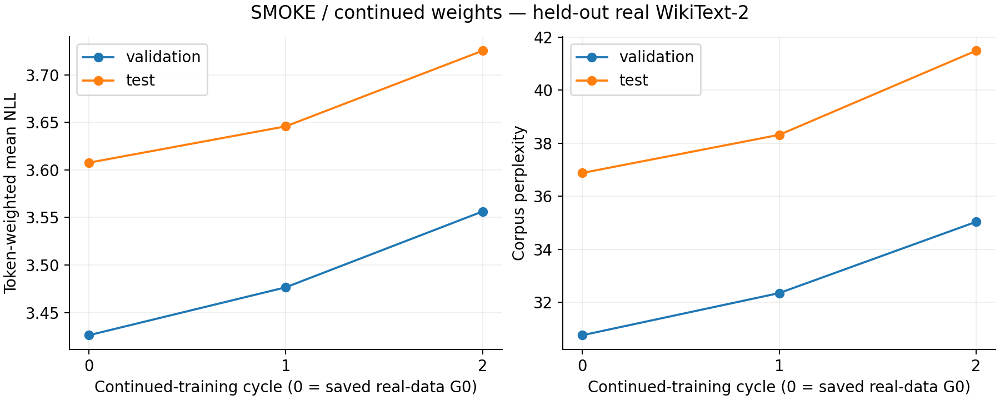
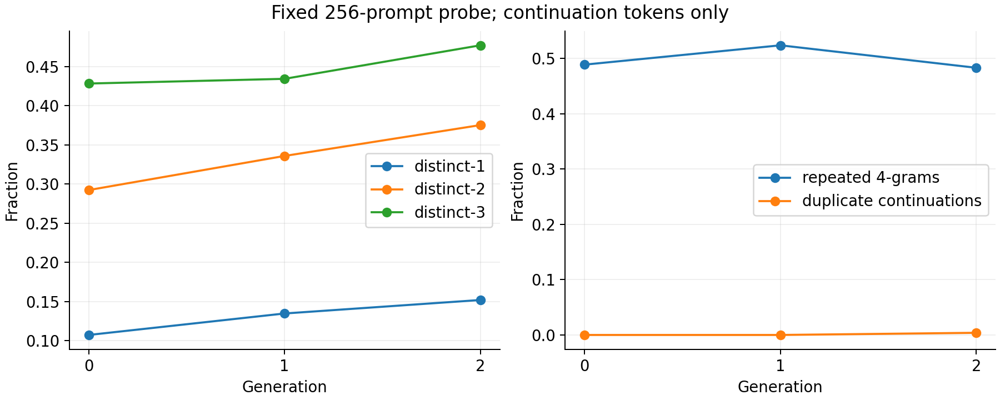

# Continued-weight pipeline: setup validation

**Ready for a separately requested full run. The ten-cycle full-data experiment has not started.**

Experiment `20261026T182856Z-smoke-continued`, seed 42, 26 October 2026. This is a small engineering validation, not evidence establishing model collapse.

## What the new loop does

S0 is the saved real-WikiText-trained G0 from `20261020T211121Z-full`, pinned to a private Hugging Face commit and verified by file and model-tensor SHA-256 hashes. S0 generates D1 and supplies the initial weights for training on D1, producing S1. S1 generates D2 and supplies the initial weights for training on D2, producing S2. The full configuration repeats this through S10.

Weights carry forward between cycles. AdamW and its cosine schedule restart each cycle. The previous five-epoch full-data settings, fixed real validation/test splits, lowest-validation-loss checkpoint selection and deterministic five-beam decoding remain unchanged. This is a separate continued-weight variant; it is not presented as exact reproduction of the paper. The existing fresh-base results are preserved.

The test used **256 training blocks, 64 validation blocks, 64 test blocks and one epoch per cycle**. Every dataset contains 256 continuation-only blocks of exactly 64 tokens (16,384 input tokens, 16,128 shifted targets per training epoch). Each original real training prompt has 64 tokens. S2's extra 256-continuation probe is measured but does not train S3. S0 already contains full real-data training from the earlier experiment; it was not retrained on the small subset here.

## Measured validation results

| Model | Validation loss | Validation PPL | Test loss | Test PPL | Distinct-2 | Repeated 4-grams |
|---|---:|---:|---:|---:|---:|---:|
| S0: saved real-data G0 | 3.4262 | 30.7601 | 3.6075 | 36.8755 | 0.2923 | 0.4887 |
| S1: first continued cycle | 3.4766 | 32.3485 | 3.6458 | 38.3117 | 0.3359 | 0.5236 |
| S2: second continued cycle | 3.5563 | 35.0340 | 3.7253 | 41.4817 | 0.3752 | 0.4830 |

The evaluation subset is small and differs in size from the original full experiment. These values must not be compared directly with its full-test perplexities or interpreted as a ten-cycle result. Corpus PPL is `exp(total shifted-token NLL / total scored targets)`; every 64-token block scores 63 targets. Diversity uses the same 256 prompts and continuation-only tokens.





[Full metric CSV](figures/metrics.csv), [frozen-reference distributions](figures/reference_scores.png), [runtime](figures/runtime.png), [forecasts](figures/forecast.json).

## What passed

All **26 local tests** and **13 GPU acceptance checks** passed. The local tests use real tiny OPT models to exercise updates, beam generation, wrong-parent rejection and exact five-epoch optimizer/scheduler recovery. The existing fresh-base tests also pass. Mocked full-launch checks exercise budget/validation admission for five and ten cycles without provisioning a full run.

The real OPT-125M GPU test verified:

- S1's initial tensor hash equals S0's final hash; S2's initial hash equals S1's final hash. Training changes the weights in both cycles.
- Each training array hashes exactly to the dataset produced by that same parent model. Prompts stay fixed and only 64-token continuations become training data.
- Two deliberate worker exits recover automatically: one after an atomic generation shard and one after completed S1. The saved shard is reused and every completed S1 file remains unchanged.
- Progress continues after the launcher closes SSH. Independent remote supervisor/watchdog heartbeats remain live.
- All **121 pre-completion artifacts, 1,514,437,305 bytes**, download from private Hugging Face storage onto the Pod and pass checksum verification. The restored S2 tensor hash matches, and re-evaluation reproduces test PPL **41.481705720741815** exactly. A direct log-softmax calculation matches shifted-token cross-entropy with maximum absolute error **0.0**.
- A deliberately small additional budget allowance triggers the independent guard. Runpod confirms the actual Pod state `EXITED`. After backup verification, the test Pod `fojtwmsdsiwr02` and temporary volume `o85qysxvua` are deleted, confirmed by provider read-back.

The complete hashes, checks and restore measurements are in [validation_results.json](records/validation_results.json); raw metrics, training histories, dataset manifests, events and artifact index are under [records](records). Selected weights and token arrays remain in private repositories `Bill11235813/iib-model-collapse-week1-models` and `Bill11235813/iib-model-collapse-week1-data`, under this experiment ID. Local metadata retrieval verified **11,018,971 bytes**; no new multi-GB checkpoint download to the laptop was needed.

## Runtime, cost and later launch

The RTX 2000 Ada cost **$0.24/hour**. Pipeline completion took **6.11 minutes** from provisioning; the guard requested shutdown at **6.54 minutes**. The observed account balance decrease through cleanup was **$0.0265468815**, including concurrent retained storage. This is an account debit, not an itemized invoice. No new GPU or volume remains; the original full experiment's retained volume `wortjkxvr7` remains at the previously agreed approximately $2.10/month. Final provider account spend rate: **$0.003/hour**, with no GPU running. See [execution receipt](execution_receipt.json).

Warmed production batches measured **18,118.59 training target tokens/second** and **916.03 generated new tokens/second** with five beams. The conservative ten-cycle full-data forecast is **14.92 hours / $3.67** at the tested rate, including a 1.5x compute margin and setup/checkpoint/upload allowance. Retained-storage reserve and prior task spend are separate. Actual runtime, availability and pricing can differ; the launcher rechecks them against the persistent $25 task ceiling.

The later command is:

```powershell
python -m model_collapse launch --mode continued --generations 10
```

Keep the laptop awake until the launcher returns `detached_supervisor_and_watchdog_verified: true`. Then it can close. The cloud loop records S0-S10 metrics, saves each selected model and generated dataset, backs up artifacts, creates CSV/plots and stops compute automatically. All ten training datasets contain **37,946 blocks / 2,428,544 synthetic tokens**, matching the original training token budget. No full-data continued experiment was launched during this setup.

For a running full experiment use `status RUN_ID`; for an interruption use `resume RUN_ID`. Use `fetch RUN_ID --metadata-only` for small results or `fetch RUN_ID` to retrieve all bulk artifacts. Run `report RUN_ID` to rebuild figures. Full-run `cleanup RUN_ID` requires a complete verified recovery copy before deleting its retained volume.
