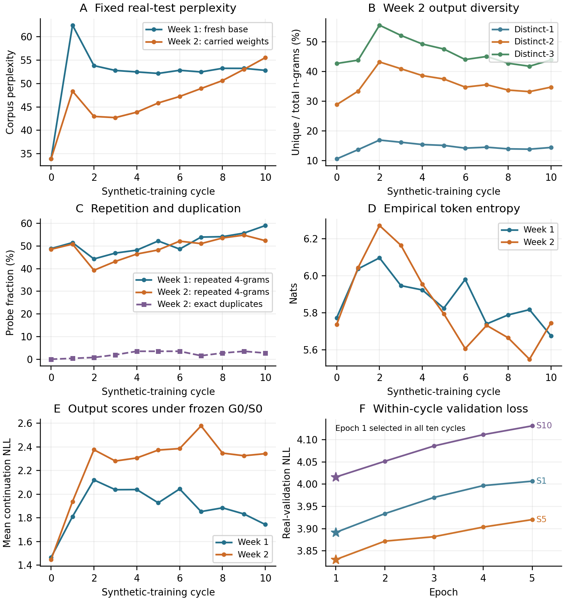

# Week 2: Continued training on synthetic data

OPT-125M / WikiText-2. Experiment 20261026T192740Z-full-continued; seed 42. Completed 27 October 2026.

## 1. Objective and methodology

We tested a second recursive protocol in which the model continues learning from its own generated text. Week 1 used the preceding model’s data but reloaded original pretrained weights each generation. Week 2 carries the preceding selected weights forward. We use S0–S10 to distinguish this chain from Week 1’s G0–G10.

S0 is the exact saved real-data-trained G0 from Week 1, verified by model-tensor and checkpoint-file hashes; it is not retrained here. Model, tokenizer and WikiText-2 raw revisions, split packing and the fixed real evaluation arrays are unchanged. This is a continued-weight variant, not a claim of exact paper replication.

### Recursive protocol

```text
S0 = saved real-data G0 from Week 1
D(k+1) = generate(Sk, fixed real training prompts)
S(k+1) = fine-tune(Sk, D(k+1)), k = 0,...,9
```

Each selected model receives the same 37,946 real training blocks as 64-token prompts and generates exactly 64 new tokens per prompt. Only continuation token IDs train the next cycle; prompts are excluded. Every cycle starts from the model that generated its training data, with a fresh AdamW optimizer and scheduler.

| Setting | Recorded value |
| --- | --- |
| Model / data | OPT-125M / WikiText-2 raw; pinned Week 1 revisions |
| Training | Full-parameter fine-tuning; five epochs/cycle; seed 42 |
| Optimizer / schedule | Fresh AdamW each cycle; LR 2e-5; betas (0.9, 0.999); WD 0.01; epoch cosine towards 1e-6 |
| Batch / precision | Microbatch 32 × accumulation 4 = 128; BF16 autocast, FP32 weights |
| Decoding | Five deterministic beams; 64 new tokens; repetition penalty 1.0 |
| Checkpoint | Lowest fixed real validation loss among trained epochs |
| Environment | RTX PRO 4000 Blackwell; PyTorch 2.8.0+cu128; Transformers 4.37.2; Datasets 3.4.1 |

### Execution and checks

The full chain finished in 6.77 hours on one RTX PRO 4000 Blackwell. The observed account debit was about $3.99, including retained storage; this is not an itemized compute invoice. GPU shutdown was confirmed. Saved records verify all ten weight/data handoffs; statistics and probe-token checksums were checked, and diversity was recalculated from all 11 probes. Bulk checkpoints were not downloaded or re-evaluated for this report.

## 2. Data accounting and evaluation

The synthetic training budget is constant: each D1–D10 has exactly the same block/token count as Week 1’s real training set. Each split is concatenated independently; incomplete final blocks are discarded. These real arrays match Week 1 byte-for-byte.

| Corpus | 64-token blocks | Input tokens/pass | Targets/pass |
| --- | --- | --- | --- |
| Real prompt pool / prior G0 | 37,946 | 2,428,544 | 2,390,598 |
| Synthetic D1–D10 (each) | 37,946 | 2,428,544 | 2,390,598 |
| Fixed real validation | 3,922 | 251,008 | 247,086 |
| Fixed real test | 4,494 | 287,616 | 283,122 |
| S10 output probe only | 256 | 16,384 | 16,128 |

Ten complete training datasets contain 24,285,440 generated tokens. Five epochs in each of ten cycles execute 121,427,200 input-token exposures. S10 generates only a final 256-output measurement probe, not another full training dataset or an S11 model.

### Metric definitions

Corpus perplexity = exp(total next-token NLL / scored targets). A 64-token block scores 63 shifted targets, so evaluation has 247,086 validation and 283,122 test targets. P95 is the 95th percentile of mean test-block NLL. Arithmetic mean/SD of passage perplexities are separate quantities, not the corpus perplexity or across-seed uncertainty.

Generated-text metrics use the same first 256 prompts: 16,384 continuation tokens and 15,616 within-continuation 4-gram positions. Distinct-n and repeated-4-gram rates pool occurrences across the probe without creating n-grams across boundaries. Exact duplicates compare whole continuations; entropy is empirical unigram entropy in nats. Frozen-S0 NLL scores each continuation alone, with 63 targets and no original prompt; it is not a KL divergence.

| Measure | S0 | S1 | S5 | S10 |
| --- | --- | --- | --- | --- |
| Test corpus perplexity | 33.89 | 48.38 | 45.85 | 55.56 |
| P95 test-block NLL | 4.478 | 4.841 | 4.753 | 4.998 |
| Distinct-1 (%) | 10.57 | 13.67 | 15.11 | 14.40 |
| Distinct-2 (%) | 28.81 | 33.35 | 37.44 | 34.71 |
| Distinct-3 (%) | 42.66 | 43.79 | 47.53 | 43.88 |
| Repeated 4-grams (%) | 48.55 | 50.85 | 48.26 | 52.36 |
| Duplicate outputs (%) | 0.00 | 0.39 | 3.52 | 2.73 |
| Token entropy (nats) | 5.736 | 6.043 | 5.794 | 5.745 |
| Frozen-S0 NLL | 1.446 | 1.938 | 2.373 | 2.343 |

Checkpoint selection matters: epoch 1 had the lowest real validation loss in every cycle. All five epochs ran, but the next cycle inherited the epoch-1 checkpoint. Thus the final selected chain carries ten additional training epochs after S0, rather than all fifty executed epochs.

## 3. Quantitative results



Figure 2. Real-test perplexity (A), diversity (B), repetition (C), entropy (D), frozen-reference output NLL (E), and within-cycle validation loss (F). Stars mark selected epochs. One chain per protocol; no across-run error bars.

Test perplexity rises from 33.89 to 48.38 at S1, recovers to 42.72 at S3, then rises at every cycle to 55.56 at S10: +64.0% from S0 and +30.1% from S3. P95 test-block NLL rises from 4.478 to 4.998.

Repeated 4-grams rise from 48.55% to 52.36%; final duplicates are 7/256 (2.73%). Yet final distinct-n ratios exceed S0 and entropy is similar. Distinct-2 falls 19.6% from its S2 peak. Real-text prediction deteriorates without uniform decline in every diversity measure.

## 4. Examples, comparison and limitations

The following are the complete saved 64-token continuations for fixed prompt 0, also used in Week 1. The prompt ends “…commonly referred to as Valkyria Chronicles III outside”. Generated claims are unverified; fixed token limits can leave incomplete sentences or a replacement glyph. Display whitespace is normalized; metrics use the original token IDs.

| Model | Complete saved 64-token continuation |
| --- | --- |
| S0 | Japan as Valkyria Chronicles III, is the third game in the Valkyria Chronicles series of games. It was released in Japan on November 21, 2011, and in the United States on November 28, 2011. The game was released in Japan on November 21, 2011, and in the United States on November 28 |
| S1 | of Japan, was the first game in the Valkyria Chronicles series to be released in the United States. It was the first game in the series to be released in Japan, and the first game in the series to be released in the United Kingdom. It was the first game in the series to be released in the |
| S5 | Japan as Valkyria Chronicles : Unrecorded Chronicles ( Japanese : 戦場のヴァルキュリア3, lit. Valkyria of the Battlefield 3 ), commonly referred to as Valkyria Chronicles III outside Japan as Valkyria Chronicles : Unrecorded Chronicles ( Japanese : � |
| S10 | Japan. It was released for the PlayStation 3, PlayStation 4, Xbox 360, Nintendo 3DS, Nintendo 3DS, Nintendo 3DS, Nintendo 3DS, Nintendo 3DS, Nintendo 3DS, Nintendo 3DS, Nintendo 3DS, Nintendo 3DS, Nintendo 3DS, Nintendo 3DS, Nintendo 3DS, |

### Comparison with Week 1

Week 1’s test perplexity jumped to 62.49 at G1 and then stayed near 52–54. Continued training has a smaller first-cycle spike, lower perplexity through cycle 9, and a sustained rise after S3, ending at 55.56 versus Week 1’s 52.83. Final repeated 4-grams are lower here (52.36% versus 59.05%). The two protocols therefore differ in trajectory; the continued variant is not consistently worse on every measure.

### Interpretation and limits

Fitting synthetic targets while real validation loss worsens within a cycle is consistent with a mismatch between synthetic and real text. Carrying weights may accumulate that mismatch, but this run does not establish its cause. Both experiments use one seed, fixed real prompts and real-validation checkpoint selection. Week 2 used Blackwell rather than RTX 2000 Ada; BF16 kernels can change outputs even with identical starting weights. This is not a perfectly hardware-matched causal comparison or proof of complete collapse or loss of rare events.

Sources and reproducibility: Week 1 sources [1–3] remain applicable. Week 2 report, complete metric table, saved histories and consistency audit are linked below; private backups retain all 11 checkpoints and synthetic datasets.

[Metric CSV](metrics.csv) · [Consistency audit](consistency_audit.json) · [Reproducible analysis](analyse_week2.py)

## Reproduce and inspect the complete statistics

The [epoch history CSV](training_history.csv) contains all fifty executed epochs. Per-block losses, all 256 decoded outputs per model, and frozen-reference scores are in the checksummed [records](records/); the private artifact index retains recovery paths for bulk weights and token arrays. The [execution receipt](execution_receipt.json) distinguishes observed account debit from estimated compute costs.

```powershell
python reports/20261026T192740Z-full-continued/analyse_week2.py --figures-only
```

This figure-only command uses committed statistics and needs no GPU or network. The default analysis also audits the retrieved cloud metadata and small probe-token arrays in `runs/`. It does not re-evaluate the bulk checkpoints.

## References

[1] [Shumailov et al. (2024), Nature](https://doi.org/10.1038/s41586-024-07566-y). [2] [OPT-125M model card](https://huggingface.co/facebook/opt-125m). [3] [WikiText dataset card](https://huggingface.co/datasets/Salesforce/wikitext). [Week 1 report and reconstruction choices](../20261020T211121Z-full/report.md).
