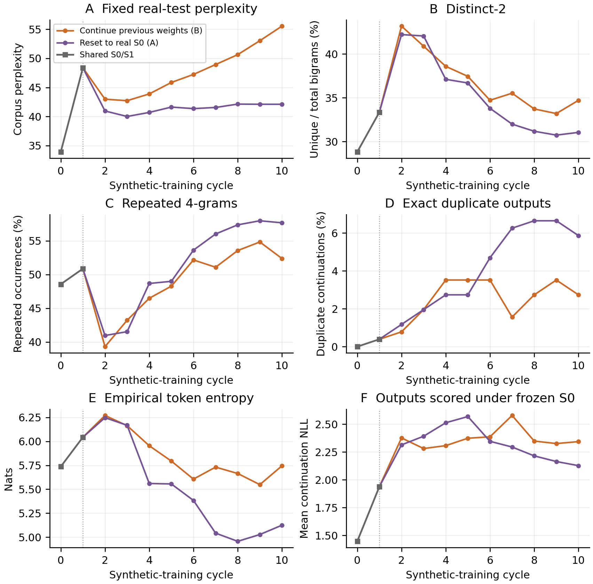
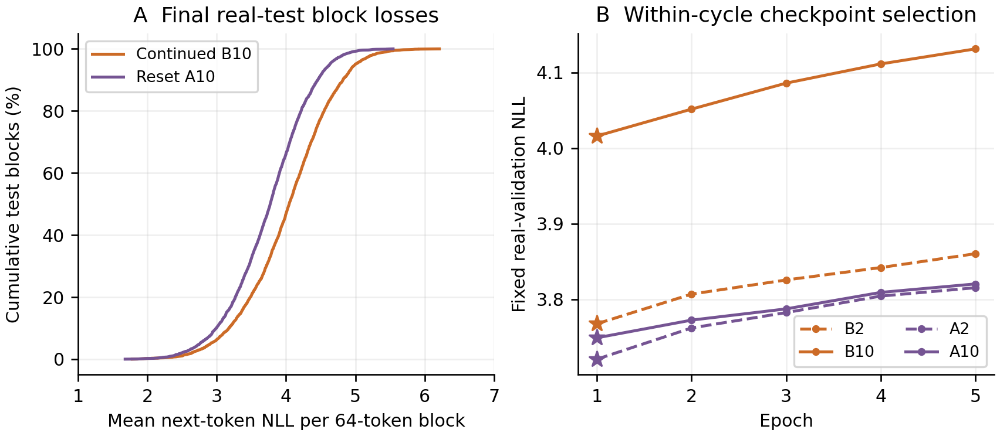

# Week 2 supplement: a shared-start reset-versus-continue comparison

This continues [Week 2 Sections 1–4](../20261026T192740Z-full-continued/report.md). [Comparison definition and reproduction commands](../../comparisons/shared_s0_s1_reset_vs_continue/README.md).

## 5. Shared-start comparison: reset versus continue

OPT-125M / WikiText-2. New reset run: 20261027T211852Z-full-reset-s0. Completed 28 October 2026; seed 42.

To make the first synthetic-training step identical, we reused the continued run’s exact saved S0, S1 and D2. S0 is the real-data-trained checkpoint; S1 was trained from S0 on S0-generated D1. The two curves therefore share the same saved S0/S1 evaluations, rather than two independent measurements. B2–B10 below are the previously reported S2–S10; A2–A10 are the new reset branch.

The first new training is cycle 2: both arms consume exactly D2 generated by S1. A2 starts from S0; B2 starts from S1. From cycle 3 onward, each arm generates its own next dataset, so both weight history and synthetic content can diverge. Reset here means the fixed real-trained S0, whereas Week 1 reset to untouched pretrained OPT.

### Shared prefix and branch

```text
Shared: S0 -> generate D1 -> train S0 on D1 -> S1 -> generate D2
Cycle 2: A2 = train(S0, D2); B2 = train(S1, D2)
Later: A(k+1) = train(S0, generate(Ak))
       B(k+1) = train(Bk, generate(Bk))
```

Both arms use the same fixed real prompts, split arrays, 64-token continuations, five deterministic beams and repetition penalty 1.0. Training settings remain five epochs, fresh AdamW/scheduler, LR 2e-5 with epoch cosine towards 1e-6, effective batch 128, BF16 and seed 42. Recorded GPU class, driver, Python and primary library versions match: RTX PRO 4000 Blackwell and PyTorch 2.8.0+cu128.

| Corpus | 64-token blocks | Input tokens/pass | Targets/pass |
| --- | --- | --- | --- |
| Each full training dataset / prompt pool | 37,946 | 2,428,544 | 2,390,598 |
| Fixed real validation | 3,922 | 251,008 | 247,086 |
| Fixed real test | 4,494 | 287,616 | 283,122 |
| Final output probe | 256 | 16,384 | 16,128 |

Every training dataset contains only continuation IDs and has the same 2,428,544 tokens as the real training pool. Nine new stages, A2–A10, execute 45 epochs / 109,284,480 input-token exposures. D2 is imported; eight new full datasets, DA3–DA10, contain 19,428,352 generated tokens. A10 adds only a 16,384-token probe. Shared work is not executed or charged again.

The new run completed in 5.62 hours and GPU shutdown was verified. Observed account debit was about $3.36 including retained storage, not an itemized compute invoice. Checkpoint hashes, all nine handoffs, frozen real splits and primary environments were checked; all 20 distinct saved model probes were recalculated. Bulk checkpoints were not re-evaluated for this analysis.

## 6. Results from the shared starting point



Figure 3. The grey prefix is the single shared S0/S1 measurement pair. Purple resets to real-trained S0 (A); orange continues the previous weights (B). Curves first diverge at cycle 2. Real-test scoring and the first 256 output prompts are fixed. One seeded pair; no across-run error bars.

Both arms share the first jump, 33.89 -> 48.38 test perplexity. At cycle 2, A2 is 40.95 versus B2 at 42.97, 4.72% lower. Reset reaches 40.00 at A3 and stays within 40.00–42.13 through A10. Continued rises from 42.72 at B3 to 55.56 at B10. Final reset perplexity is 42.10: 24.22% below continued, but still 24.25% above S0.

Output concentration follows a different trajectory. Reset distinct-2 falls from 42.22% at A2 to 31.05% at A10, while repeated 4-grams rise from 40.95% to 57.66% and entropy falls by 1.123 nats. Reset therefore preserves real-text prediction better without preserving every aspect of generated-text diversity.

## 7. Summary statistics and generated text

Metric definitions are unchanged from Section 2. Validation/test perplexities use 247,086 / 283,122 shifted targets. Diversity, repetition and entropy use 256 fixed 64-token continuations. Repeated 4-grams include phrases shared across different outputs; duplicate rates compare complete continuation rows.

| Measure | Shared S0 | Shared S1 | Reset A10 | Continue B10 |
| --- | --- | --- | --- | --- |
| Test corpus perplexity | 33.89 | 48.38 | 42.10 | 55.56 |
| Validation perplexity | 34.21 | 48.99 | 42.49 | 55.49 |
| P95 test-block NLL | 4.478 | 4.841 | 4.629 | 4.998 |
| Distinct-1 (%) | 10.57 | 13.67 | 13.09 | 14.40 |
| Distinct-2 (%) | 28.81 | 33.35 | 31.05 | 34.71 |
| Distinct-3 (%) | 42.66 | 43.79 | 39.02 | 43.88 |
| Repeated 4-grams (%) | 48.55 | 50.85 | 57.66 | 52.36 |
| Duplicate outputs (%) | 0.00 | 0.39 | 5.86 | 2.73 |
| Token entropy (nats) | 5.736 | 6.043 | 5.125 | 5.745 |
| Frozen-S0 output NLL | 1.446 | 1.938 | 2.127 | 2.343 |

A10 has 15 duplicate outputs among 256 (5.86%), versus 7 at B10 (2.73%). These are excess copies beyond the first occurrence. Distinct-1/2 remain above S0 in the reset arm, but distinct-3 and entropy are lower: diversity does not deteriorate uniformly across all measures.

### Same-prompt examples

Complete saved 64-token continuations for prompt 0, whose last words are “…Valkyria Chronicles III outside”. Only display whitespace is normalized. Generated factual claims are unverified; these examples illustrate behaviour and do not establish aggregate frequencies.

| Model | Complete saved 64-token continuation |
| --- | --- |
| Shared S1 | of Japan, was the first game in the Valkyria Chronicles series to be released in the United States. It was the first game in the series to be released in Japan, and the first game in the series to be released in the United Kingdom. It was the first game in the series to be released in the |
| Reset A10 | Japan as Valkyria of the Battlefield 3, is a Japanese action role @-@ playing game developed by Capcom and published by Capcom. It was released in the United States in the United Kingdom in the United States in the United States in the United Kingdom in the United Kingdom in the United Kingdom in the United Kingdom in |
| Continue B10 | Japan. It was released for the PlayStation 3, PlayStation 4, Xbox 360, Nintendo 3DS, Nintendo 3DS, Nintendo 3DS, Nintendo 3DS, Nintendo 3DS, Nintendo 3DS, Nintendo 3DS, Nintendo 3DS, Nintendo 3DS, Nintendo 3DS, Nintendo 3DS, Nintendo 3DS, |

## 8. Interpretation and reproducibility



Figure 4. A: final real-test block-loss distributions; reset has lower loss on 4,340/4,494 matched blocks (96.57%), a descriptive paired result. B: real-validation loss across five epochs for cycles 2/10; stars mark the selected checkpoint. These are within-cycle measurements, not independent replicates.

Final mean real-test NLL is 3.740 for A10 versus 4.017 for B10, a difference of 0.277 nats per target. P95 block NLL is 4.629 versus 4.998. This improvement extends across most fixed test blocks and is not explained solely by a few extreme passages; block observations still do not replace independent training seeds.

Epoch 1 was selected in every new reset stage, as in the continued arm. All 45 new epochs ran, but A10 starts from S0 and retains only its selected first synthetic-training epoch; it does not inherit the earlier A-model weight updates. Its training data still carry the recursive history. B10 instead inherits the ten selected synthetic-training epochs after S0. Selection compared epochs 1–5; the unmodified S0 was not a checkpoint candidate.

These results are consistent with fixed-S0 initialization limiting accumulated weight drift while deterministic synthetic feedback still concentrates generated text. That mechanism is an interpretation, not directly isolated here. Lower frozen-S0 output NLL at A10 (2.127 versus 2.343) means its continuations are more predictable under S0; it does not measure factuality, prompt relevance or KL divergence. Lower perplexity alone is insufficient evidence that collapse has been prevented.

This is one seed with a historical continued arm. Matching the starting artifacts, data, GPU class and recorded environment removes the earlier first-cycle mismatch but does not guarantee bitwise equivalence across launches or establish statistical significance. Both arms use real prompts at every cycle and real-validation checkpoint selection. The probe is a fixed 256-prompt slice, and tail block loss does not identify rare-token loss. This is a comparison of two defined protocols, not an exact reproduction of every paper condition.

Reproducibility: 1,392 metadata files (41.51 MB) were checksum-verified; nine new probe arrays added 590,976 bytes. The comparison audit checks 170 statistics files, all 95 executed historical/new epoch records and the exact common prefix. The complete per-cycle CSV, all 256 saved outputs per model, figures and audit are retained with pinned private backup revisions.

[Complete metrics](analysis/metrics.csv) · [Cycle contrasts](analysis/cycle_comparison.csv) · [All outputs](analysis/generated_examples.json) · [Epoch histories](analysis/training_history.csv) · [Consistency audit](analysis/consistency_audit.json) · [Analysis manifest](analysis/analysis_manifest.json) · [Reproducible script](../../comparisons/shared_s0_s1_reset_vs_continue/analyse.py)
