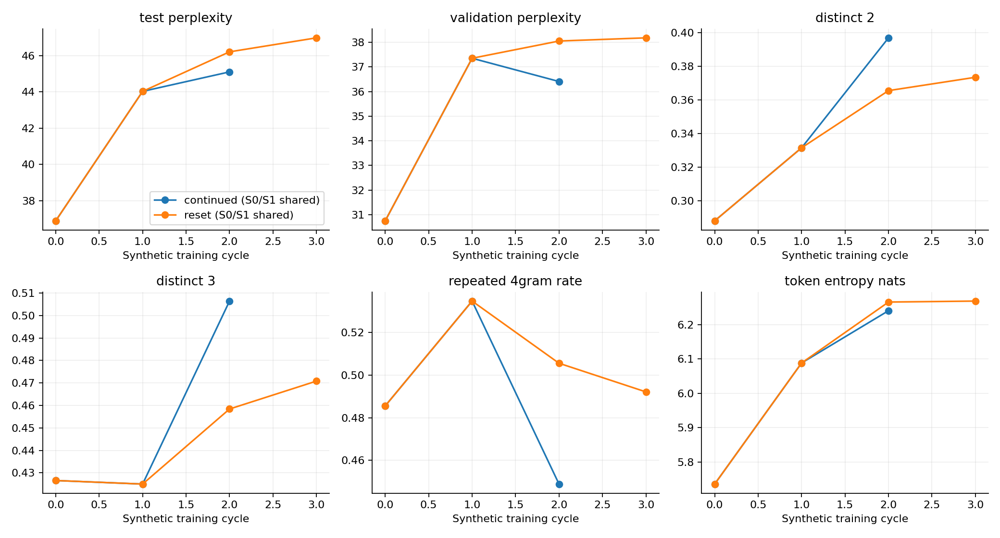

# Matched final-epoch comparison

S0 and the newly trained S1 are shared. Every synthetic stage executes and retains epoch 5; validation is diagnostic. Continued weights carry five updates per cycle; reset always initializes from S0.

Complete metric tables and existing graph families: [continued](continued/report.md), [reset](reset/report.md). The CSV includes corpus NLL/PPL, diversity, duplicates, entropy, repetition, frozen-S0 scores, token counts, selected epochs and timing.

Smoke results validate the pipeline and do not establish model collapse. Full results use one seed and are descriptive. Token entropy measures pooled token frequencies; it is not predictive entropy or within-output repetition.
