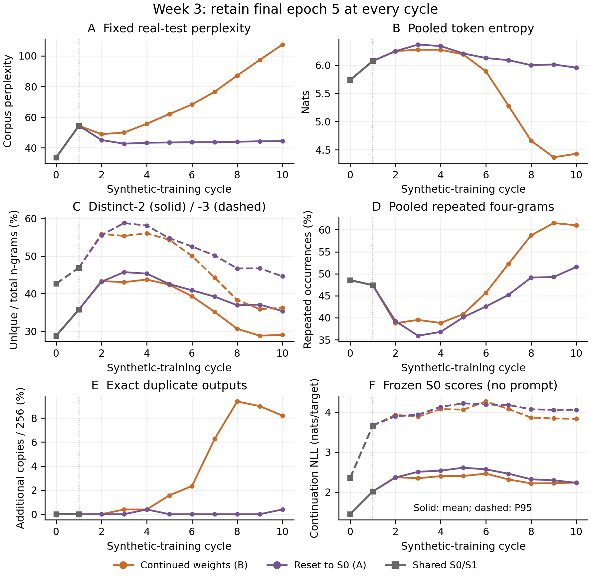
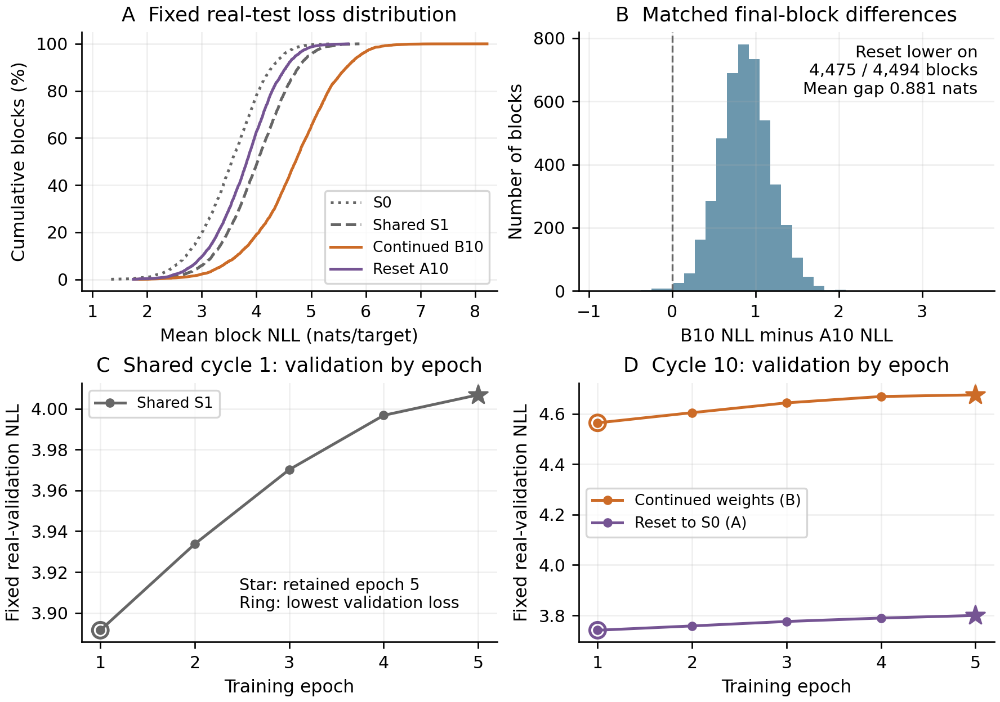
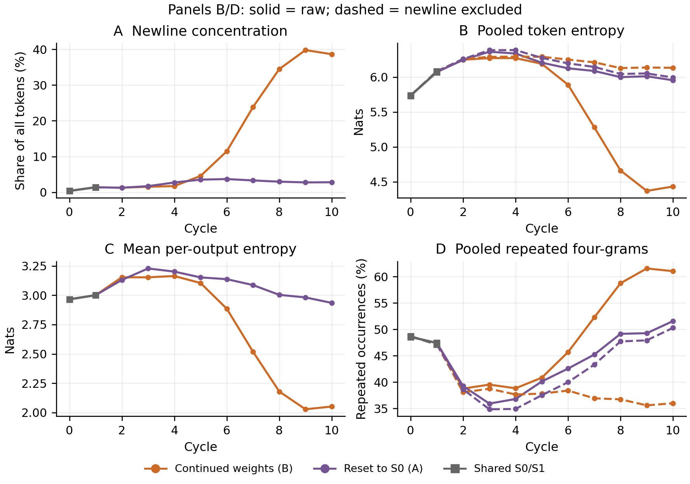

# Week 3: Matched training with final-epoch checkpoints

OPT-125M / WikiText-2; seed 42. Paired experiment 20261030T180755Z-full-paired-final5. Completed 31 October 2026.

## 1. Objective and methodology

We repeated the shared-start reset-versus-continue comparison, changing checkpoint selection: every synthetic stage now retains epoch 5. Historical Week 2 also executed five epochs, but selected epoch 1 using real validation loss. This is a checkpoint-policy comparison, not one executed epoch versus five.

- Shared beginning: reuse the exact historical real-trained S0 and its synthetic D1. Train S0 on D1 for five epochs to obtain a NEW shared S1, then generate NEW shared D2.

- First divergence: both cycle-2 models learn from the same D2. Reset A2 initializes from S0; continued B2 initializes from S1. From cycle 3 onward, each arm generates its own next dataset.

- Weight inheritance: B10 carries 50 selected synthetic epochs after S0. A10 carries its own five epochs from S0; earlier A-model updates survive through synthetic data, not inherited weights.

### Recursive protocol

```text
Shared: S1 = train5(S0, historical D1); D2 = generate(S1)
Reset: A2 = train5(S0, D2); A(k+1) = train5(S0, generate(Ak))
Continue: B2 = train5(S1, D2); B(k+1) = train5(Bk, generate(Bk))
```

Table 12. Matched settings; retain the fifth checkpoint even when real validation loss worsens.

| Setting | Both arms |
| --- | --- |
| Model / corpus | Pinned facebook/opt-125m / WikiText-2 raw; existing real-trained S0 |
| Training / selection | Five full epochs; always retain epoch 5; no validation-based early stopping |
| Generation | Fixed 64-token real prompts -> exactly 64 new tokens; five deterministic beams; repetition penalty 1.0; EOS suppressed |
| Optimization | Fresh AdamW/scheduler each cycle; LR 2e-5, epoch cosine towards 1e-6; weight decay 0.01 |
| Batch / precision | Microbatch 32 x accumulation 4 = 128; generation/evaluation batch 32; BF16; seed 42 |
| Environment | One RTX PRO 4000 Blackwell; PyTorch 2.8.0+cu128, Transformers 4.37.2, Datasets 3.4.1 |
| Evaluation | Same real validation/test arrays throughout; validation diagnostic only; test never selects checkpoints |

- Equal data: each dataset contains 37,946 continuation-only blocks, or 2,428,544 input tokens. Each epoch scores 2,390,598 shifted targets. Across 19 unique stages / 95 epochs: 230,711,680 input-token exposures and 227,106,810 target exposures.

## 2. Results from the shared starting point



Figure 6. Grey squares are the single shared S0/S1 pair; purple resets to S0 (A), orange continues weights (B). Branches diverge at cycle 2. Output statistics use the same first 256 prompts; formatting is included. Frozen-S0 scores omit the generation prompt. One seeded pair; no independent-run error bars. F shows mean/P95 across 256 continuations, each scored on 63 shifted targets.

### Key findings

- Real-test perplexity: common S0 -> S1 is 33.89 -> 54.46. Continued improves to 48.97 at B2, then rises to 107.37. Reset reaches 42.75 at A3 and ends at 44.50: 58.56% below continued, but 31.32% above S0.

- Generated text: after an early diversity peak, continued develops lower entropy, more repeated four-grams and more duplicates than reset. These are raw token statistics; Section 5 identifies a strong newline effect.

- Mixed baseline changes: continued distinct-2 is still 29.03%, slightly above S0's 28.81%, despite much worse PPL. Reset entropy and distinct-1/2/3 also remain above S0. Neither curve supports 'every metric deteriorates monotonically'.

## 3. Summary statistics and metric definitions

Prediction and generation answer different questions. Real-text NLL measures surprise on fixed WikiText targets; corpus PPL = exp(mean NLL). Output diversity measures the continuations produced for fixed real prompts, not predictive accuracy or factual correctness.

Table 13. The same saved S0/S1 measurements and final models. Lower real-text loss/PPL is better; diversity statistics describe different, dependent aspects of output behaviour.

| Measure | Shared S0 | Shared S1 | Reset A10 | Continue B10 |
| --- | --- | --- | --- | --- |
| Test corpus perplexity | 33.89 | 54.46 | 44.50 | 107.37 |
| Validation perplexity | 34.21 | 54.97 | 44.70 | 107.28 |
| Mean test NLL (nats) | 3.523 | 3.998 | 3.795 | 4.676 |
| P95 test-block NLL | 4.478 | 4.968 | 4.726 | 5.891 |
| Distinct-1 (%) | 10.57 | 14.42 | 14.47 | 12.45 |
| Distinct-2 (%) | 28.81 | 35.75 | 35.35 | 29.03 |
| Distinct-3 (%) | 42.66 | 46.88 | 44.60 | 36.23 |
| Pooled repeated 4-grams (%) | 48.55 | 47.41 | 51.56 | 61.02 |
| Mean within-output repeated 4-grams (%) | 40.45 | 42.67 | 43.44 | 57.03 |
| Duplicate outputs / 256 | 0 | 0 | 1 | 21 |
| Pooled token entropy (nats) | 5.736 | 6.072 | 5.954 | 4.431 |
| Mean within-output entropy | 2.966 | 3.001 | 2.935 | 2.051 |
| Frozen-S0 mean NLL | 1.446 | 2.014 | 2.233 | 2.238 |
| Frozen-S0 P95 NLL | 2.355 | 3.665 | 4.059 | 3.834 |

### Definitions and interpretation

- Real evaluation: fixed 4,494 test blocks / 283,122 shifted targets; validation uses 3,922 blocks / 247,086 targets. P95 is the 95th percentile of mean block NLL, not rare-token loss.

- Pooled metrics: entropy uses token frequencies across 16,384 generated tokens. Distinct-2/3 divide unique windows by 16,128 / 15,872. Repeated-four-gram rate counts excess occurrences after the first across 15,616 windows, including phrases shared between outputs; it equals 1 - distinct-4.

- Within-output metrics: compute entropy or repeated-four-gram rate within each 64-token continuation, then average. Duplicate counts are excess identical complete outputs after the first copy.

## 4. Checkpoint selection and real-text deterioration



Figure 7. A: real-test block-loss distributions; B: continued-minus-reset loss for matched final test blocks. C/D: real-validation loss across epochs; stars retain epoch 5, hollow markers identify the minimum. Within-cycle curves and test blocks are not independent training replicates.

### What the diagnostics show

- Coverage: reset has lower final NLL on 4,475/4,494 blocks (99.58%); the mean gap is 0.881 nats/target. Both remain worse than S0 on most blocks: 4,198 for reset and 4,465 for continued.

- All 19 stages: the lowest real validation loss occurs at epoch 1, but epoch 5 is intentionally retained. In shared cycle 1, validation NLL rises from 3.892 to 4.007. Additional optimization on synthetic targets can reduce synthetic training loss while worsening prediction of real text.

- Cross-week control: historical and new cycle-1 train/validation losses match exactly at all five epochs with identical S0 and D1. Selecting epoch 5 instead of 1 creates the new S1 and subsequent data chain; historical S1/D2 were not reused.

- Historical context: final continued PPL is now 107.37 versus 55.56 under Week 2's selected-epoch-1 policy; reset is 44.50 versus 42.10. These are descriptive policy trajectories, not independent-seed significance tests.

- Possible explanation: continued weights repeatedly reinforce their own preferred synthetic distribution. Reset removes direct inheritance of earlier synthetic weight updates and may constrain real-text drift; its recursively generated data can still deteriorate. Neither mechanism is isolated by independent interventions here.

## 5. Why entropy and repetition need a formatting check



Figure 8. Primary metrics include formatting. B/D dashed curves are post-hoc newline-exclusion diagnostics: entropy removes newline tokens and renormalizes; four-gram counts retain only original contiguous windows without a newline. Tokens are never joined into new windows. Denominators differ between arms, so dashed curves do not replace the raw comparison.

### Measured findings

- Newline concentration: continued B10 has 6,327/16,384 newline tokens (38.62%), versus 459/16,384 (2.80%) for reset A10. Of 256 outputs, 111 continued outputs are at least half newlines and ten contain only newlines; reset has none in either category.

- Raw within-output behaviour: continued entropy is 2.051 versus reset 2.935 nats, and repeated-four-gram rate is 57.03% versus 43.44%. The aggregate gap therefore also appears within responses, but blank-line loops contribute to it.

- Sensitivity: excluding newlines reverses pooled entropy to 6.132 continued versus 5.994 reset. Repeated-four-gram rates on retained original windows become 35.99% versus 50.27%, with 9,286 versus 14,573 windows. These describe unequal retained samples, not improved output quality after filtering.

- Frozen-S0 score: final mean NLL is almost equal (2.238 continued; 2.233 reset) despite very different real-test PPL. The ten all-newline outputs score only 0.465 on average under S0. Familiar or easy text can be degenerate; this score is not a factuality, relevance or quality judge.

- Interpretation: the raw continued probe is strongly concentrated on blank-line output, not necessarily a smaller substantive vocabulary after formatting is removed. This is a measured output failure; why this training trajectory favours newlines remains untested.

## 6. Saved text examples, scope and reproducibility

Use the same historical anchor, prompt 0, ending '...Valkyria Chronicles III outside'. These are complete saved 64-token continuations with display whitespace normalized. This prompt is fixed for continuity, not chosen as representative; generated claims are unverified.

Table 14. Shared S1 and both final models for the same prompt. Both final examples loop, despite reset's better aggregate scores. A separate saved output (prompt 52) contains exactly 64 newline tokens under continued training.

| Model | Complete saved continuation |
| --- | --- |
| Shared S1 | Japan, was the first game in the Valkyria Chronicles series of games. It was the first game in the series to be released in Japan, and the first game in the series to be released in the United States. The game was the first game in the series to be released in the United Kingdom, and the |
| Reset A10 | Japan, was the first of its kind in the world, and the first of its kind in the world in the world in the world in the world in the world in the world in the world in the world in the world in the world in the world in the world in the world in the world in the world in |
| Continue B10 | Japan ) is a video game in the Valkyria Chronicles series of video games in the Valkyria Chronicles series of video games in the Valkyria Chronicles series of video games in the Valkyria Chronicles series of video games in the Valkyria Chronicles series of video games in the Valkyria Chronicles series of |

### Interpretation and limitations

- Example versus population: continued has more within-output four-gram repetition on 142 prompts, reset on 76, with 38 ties. Prompt 0 is a tie on that metric; its passages cannot explain or validate the entire entropy curve.

- Probe coverage: the first 256 consecutive prompts cover six adjacent training articles, not a random full-corpus sample. Real-text evaluation covers the fixed full held-out split. One seed, OPT-125M, WikiText-2, five-beam deterministic decoding and fixed real-training prompts reused every cycle constrain generalization.

- Conclusion: retaining final-epoch weights exposes substantially greater real-text deterioration in the continued trajectory. Reset limits that deterioration here, but retains repetitive outputs and does not establish that collapse has been prevented.

- Generation accounting: D1 is imported; 17 new full datasets contain 41,285,248 tokens. Each final model adds only a 256-output probe; no full D11 is generated. Shared work is counted once.

Execution: 11.97 hours; GPU shutdown verified. Account debit through the completion check was $7.07, including concurrent storage and billing timing, not an itemized compute invoice.

Evidence: 259 selectively recovered files / 13,094,380 bytes, including 20 unique 256x64 probes / 1,313,280 bytes, were checksum-verified. Diversity, decoded examples and saved NLL/PPL arithmetic were recalculated; no new model forward pass or bulk checkpoint/full-dataset download was performed. Recovery volumes remain preserved.

[Full metrics](analysis/results/metrics.csv) | [Saved examples](analysis/results/examples.json) | [Epoch histories](analysis/results/training_history.csv) | [Evidence audit](analysis/audit/audit.json) | [Analysis manifest](analysis/results/analysis_manifest.json) | [Reproducible analysis](../../comparisons/shared_start_final_epoch5/analyse.py) | [Evidence recovery](../../comparisons/shared_start_final_epoch5/analyse_evidence.py)
