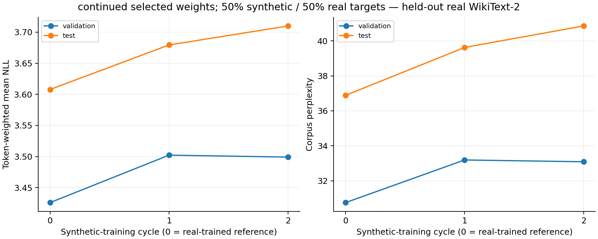
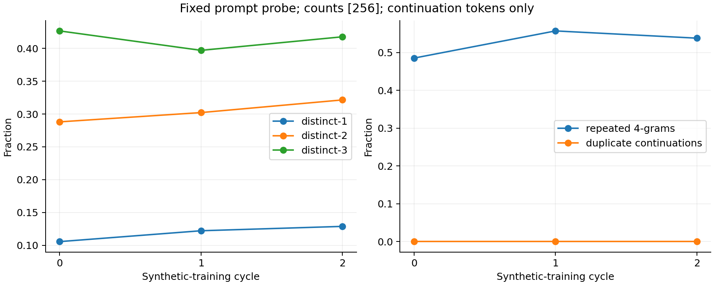
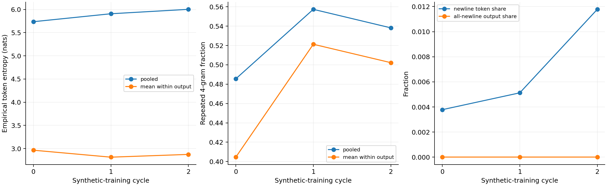

# Mixed-data continued training: GPU acceptance

Experiment: `20261031T153536Z-smoke-continued`.

**Pipeline validation only. The full ten-cycle experiment remains unlaunched. These tiny-data results are not evidence of collapse prevention.**

## Verified behaviour

- 162 offline tests passed. A further targeted budget-admission regression passed after acceptance; it changes tests only. A fresh independent reviewer found no material blockers and also checked the final evidence/handoff.
- All 16 GPU/provider checks passed, including continued-weight/data handoffs, both injected worker exits, generation-shard reuse, detached progress, private bulk restore/re-evaluation and actual watchdog shutdown.
- Two new stages executed five epochs each and retained terminal epoch-5 weights. Each mixed dataset has 128 real + 128 synthetic blocks, 8,192 tokens per source.
- Both mixtures were reconstructed independently on the laptop from the saved source indices, permutation and small token arrays. Validation/test arrays remained fixed.
- S0 and historical D1 were pinned and imported; new S1/S2 were trained from their correct preceding checkpoints. No historical synthetic-trained checkpoint was reused.
- The run completed in 8.23 minutes; provider shutdown was verified at 15:44:29 UTC on 31 October 2026. Temporary Pod and volume were deleted; all four historical recovery volumes remain.

## Smoke measurements

| Cycle | Selected epoch | Validation NLL | Validation PPL | Test NLL | Test PPL |
|---|---:|---:|---:|---:|---:|
| 0 | imported S0 | 3.425930 | 30.7512 | 3.607844 | 36.8864 |
| 1 | 5 | 3.502258 | 33.1903 | 3.679434 | 39.6239 |
| 2 | 5 | 3.499151 | 33.0874 | 3.710056 | 40.8561 |

The test has only 64 held-out blocks and two tiny training cycles; compare full-data trajectories only after the later experiment.

## Recovery and dataset evidence

- The GPU restored and verified 118 files / 1,514,647,725 bytes from private backups, including all three checkpoints and mixed token datasets.
- Restored S2 test loss matches exactly; direct shifted-token NLL calculation error is zero.
- Local recovery verified 93 metadata files / 11,165,147 bytes, then 24 small arrays / 560,128 bytes. No checkpoint weights were downloaded to the laptop.
- [Dataset preview](dataset_preview.json) contains two real and two synthetic 64-token rows per cycle, with source indices and token IDs. Source/mixture manifests and selection records are in `records/`.

## Cost and full-run readiness

- Observed account debit through cleanup: **$0.051330**, including concurrent storage and provider billing timing; not an itemized compute invoice.
- Conservative campaign ledger estimate: **$0.0976**, below the combined $0.75 allowance.
- Warmed production-batch throughput: **34,047 training target tokens/s** and **1,306 five-beam generated tokens/s**.
- Conservative ten-cycle forecast: **9.33 hours / $5.37**, including margins and checkpoint/upload overhead. Historical actual throughput suggests about 6-8 hours; neither is a completed full mixed experiment.
- The cumulative conservative ledger is $20.7854; only $2.2146 remains after the existing $2 reserve. **Technical acceptance passed, but the full run is budget-blocked under the unchanged $25 ceiling.**
- No full launch command was executed. No credits were purchased and automatic payments remain disabled.

## Reproduction and operations

See the [experiment definition](../../experiments/opt125m_wikitext2/continued_mixed_50_final5/README.md) for commands and protocol.

Accepted runtime SHA-256: `266afa984a2a51b63f850390232a12b3ec98a93975ad27f9401983d1afc060c5`. Full/smoke protocol fingerprint: `539b6d8bb4c1afddecf0ebeb1e8b0694a9417cb1c997b0d607ebe6fb065e0c8c`.
The source bundle records its base Git commit and exact runtime file hashes; the implementation was supplied from the working tree. Documentation-only changes do not alter runtime acceptance.
