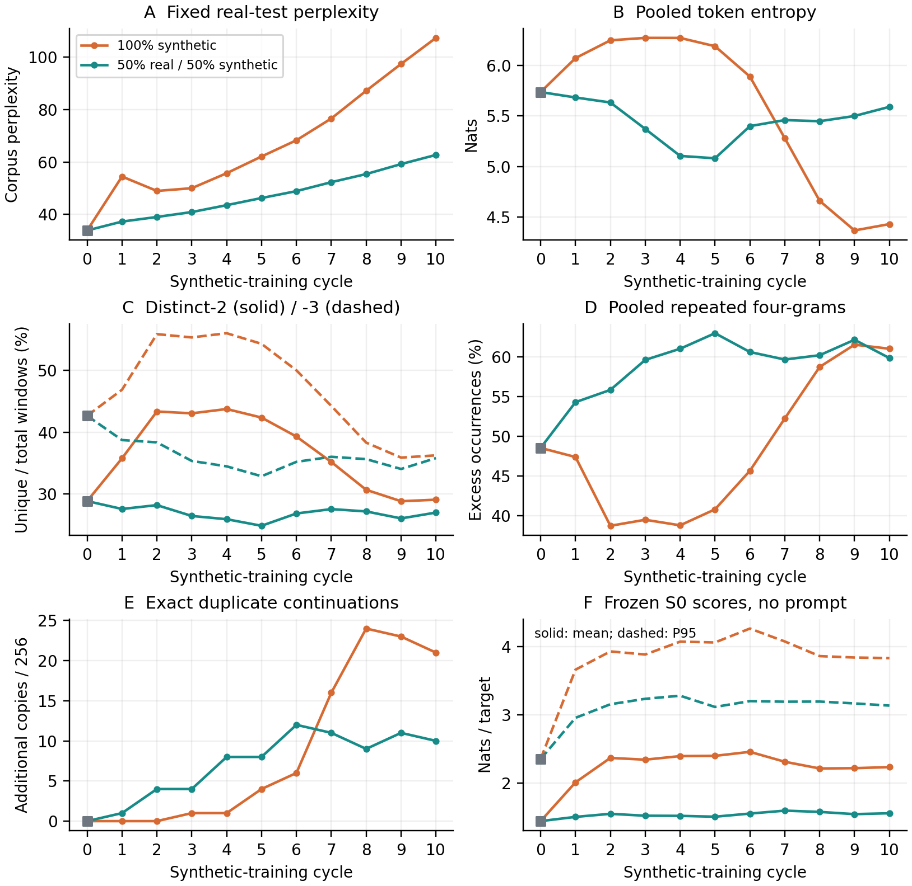
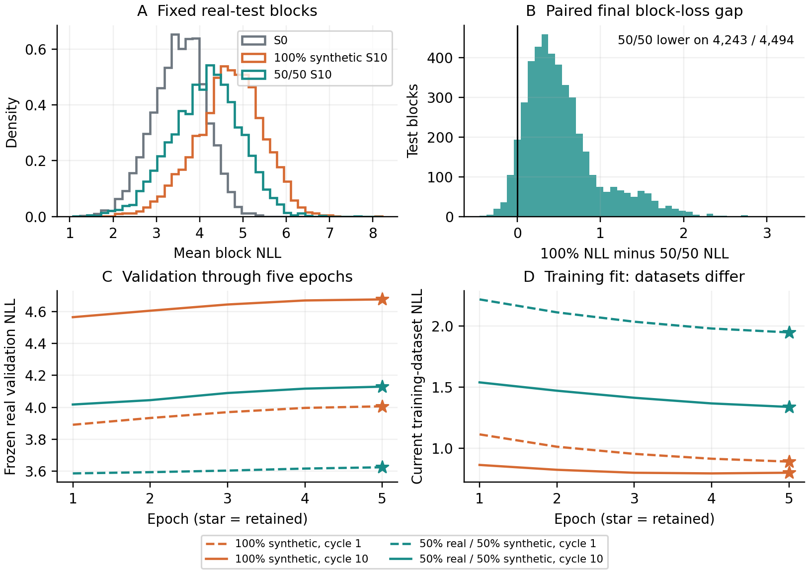
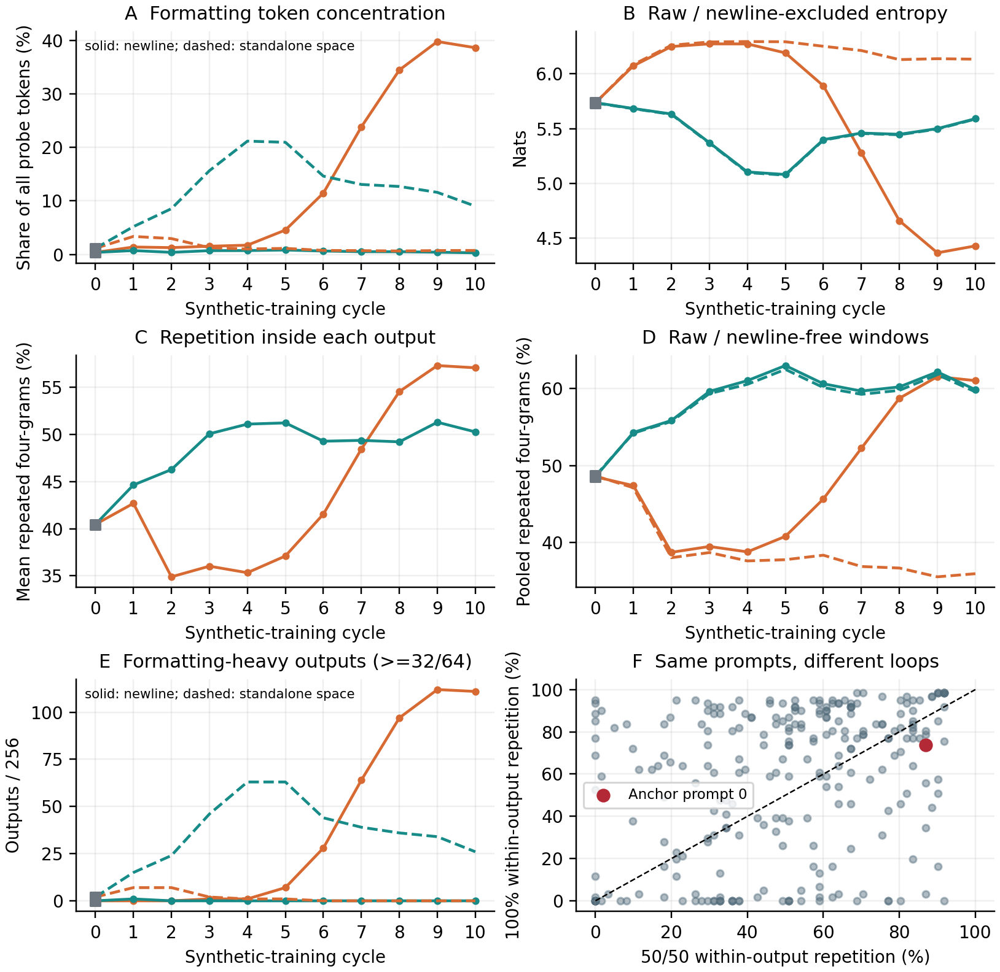

# Week 3, Part 2: Real/synthetic data mixing

OPT-125M / WikiText-2; seed 42. Mixed run completed 31 October 2026; comparison analysed 1 November.

## 1. Objective and matched methodology

We tested whether retaining real text in every recursive training dataset reduces deterioration relative to five-epoch synthetic-only continued training. Both conditions carry the preceding weights and always retain epoch 5; the reset arm is outside this comparison.

- Shared start: exact historical real-trained S0 and its D1 pool. Model/data revisions, optimizer restarts, learning-rate schedule, token budget, evaluation, decoding and recorded GPU/software match. The common training/data engine is unchanged; the new selection contract adds the mixture fraction to its integrity hash.

- Deliberate change: replace half of each synthetic training dataset with randomly selected real training blocks. S1 therefore differs from the first update; only S0 and the initial source pool are shared.

Table 15. The comparator is the final-epoch-5 continued arm. Equal total training budgets isolate the mixture condition within these seeded trajectories.

| Setting | 100% synthetic | 50/50 mixture |
| --- | --- | --- |
| Model / corpus | Pinned OPT-125M / WikiText-2 raw | Identical |
| Start / weights | Exact real S0 and D1; previous selected weights thereafter | Identical S0/D1; mixed S1 onward |
| Blocks / tokens per dataset | 37,946 synthetic / 2,428,544 tokens | 18,973 real + 18,973 synthetic / same total tokens |
| Training / selection | Five epochs per cycle; retain epoch 5 | Identical; ten cycles per arm |
| Generation | Same real 64-token prompts -> 64 new tokens; five beams, penalty 1.0, EOS suppressed | Identical full source pool, then sample half |
| Optimization | Fresh AdamW/cosine per cycle; LR 2e-5; seed 42; batch 128; BF16 | Identical |
| Evaluation | 3,922 real validation / 4,494 real test blocks; no test selection | Identical frozen arrays |
| Environment | RTX PRO 4000 Blackwell; torch 2.8.0+cu128; Transformers 4.37.2; Datasets 3.4.1 | Identical recorded driver/software |

- Sampling: without replacement within each source/cycle; independently seeded selection/shuffle. Reuse the same finite real split across cycles and freeze each mixture for five epochs/resume. Across ten cycles, 37,909/37,946 real blocks appear at least once.

- Token accounting: 121,427,200 input-token exposures per arm over fifty epochs. D1 is imported; nine new full pools and a final probe are generated. Prompts are excluded from synthetic targets; validation/test remain held out.

## 2. Prediction and generation trajectories

Figure 9. Orange: 100% synthetic; teal: 50/50 mixture; grey: common S0. A uses fixed real-test text; B-E describe the fixed 256-output probe, including formatting. C distinguishes bigrams/trigrams; F scores each continuation alone under frozen S0 (solid mean, dashed P95). No independent-run error bars.

- Real-text prediction: first-update PPL is 54.46 for synthetic-only versus 37.27 for mixing. Final values are 107.37 versus 62.71: mixing is 41.60% lower, but still 85.06% above S0 (33.89). Mixing rises every cycle; synthetic-only first overshoots, partially recovers, then rises.

- Likely interpretation: repeated real targets counteract some synthetic-distribution drift, limiting the initial jump and later deterioration. This is consistent with the matched comparison, not a demonstrated causal mechanism. The full synthetic source pool remains generated each cycle, even though only half is sampled for mixed training.

## 3. Endpoint statistics and interpretation

Prediction loss and output diversity answer different questions. Lower held-out NLL/PPL means the model assigns higher probability to real WikiText targets; generated-text statistics describe the text produced for our fixed prompts.

Table 16. Same S0, then the final model in each continued-weight condition. Fractions are reported as percentages; duplicate/blank counts are among 256 outputs.

| Measure | S0 | 100% S10 | 50/50 S10 |
| --- | --- | --- | --- |
| Test corpus perplexity | 33.89 | 107.37 | 62.71 |
| Validation perplexity | 34.21 | 107.28 | 62.16 |
| Mean test NLL (nats) | 3.523 | 4.676 | 4.138 |
| P95 test-block NLL | 4.478 | 5.891 | 5.388 |
| Distinct-1 (%) | 10.57 | 12.45 | 11.10 |
| Distinct-2 (%) | 28.81 | 29.03 | 26.94 |
| Distinct-3 (%) | 42.66 | 36.23 | 35.78 |
| Pooled repeated 4-grams (%) | 48.55 | 61.02 | 59.85 |
| Mean within-output repeated 4-grams (%) | 40.45 | 57.03 | 50.24 |
| Duplicate outputs / 256 | 0 | 21 | 10 |
| Pooled token entropy (nats) | 5.736 | 4.431 | 5.590 |
| Mean within-output entropy | 2.966 | 2.051 | 2.660 |
| Frozen-S0 mean NLL | 1.446 | 2.238 | 1.562 |
| Frozen-S0 P95 NLL | 2.355 | 3.834 | 3.139 |
| Newline tokens (%) | 0.38 | 38.62 | 0.31 |
| Standalone-space tokens (%) | 1.14 | 0.75 | 9.02 |
| Whitespace-only outputs / 256 | 0 | 14 | 0 |
| Space-heavy outputs (>=32/64) | 2 | 0 | 26 |

- Distinct-n: mixing has fewer unique two-/three-token combinations across the whole probe, despite lower average within-output repetition. Both use identical denominators (16,128 bigram and 15,872 trigram positions). These are different properties, not an arithmetic inconsistency: fewer types can coexist with more balanced token frequencies and less severe loops.

- Frozen-S0 scores: mixed outputs are less surprising to S0 (mean 1.562 versus 2.238 nats/target), consistent with retaining more familiar patterns. This scores different generated texts, omitting their original prompts; it is not model distance, factuality or real-test accuracy. Predictable repetition can also score well.

## 4. Where real-text performance deteriorates

Figure 10. A: common-bin distributions of mean real-test block NLL; B: synthetic-only minus mixed final NLL on the same blocks. C/D: cycle 1 (dashed) and 10 (solid) across five epochs; stars retain epoch 5. Training losses use different target datasets and are not interchangeable quality scores.

- Coverage: mixing has lower final loss on 4,243/4,494 test blocks (94.41%), with mean gap 0.538 nats/target. This is a descriptive paired-block result, not 4,494 independent training replicates. Mixing remains worse than S0 on 4,389 blocks; synthetic-only on 4,465.

- Five-epoch effect: epoch 1 has the lowest real validation loss in all twenty stages, but both conditions intentionally retain epoch 5. In cycle 10, validation NLL rises from 4.018 to 4.130 for mixing and 4.564 to 4.675 for synthetic-only while their training losses fall.

- Likely cause: the models increasingly fit their current, partly or wholly self-generated targets without improving generalization to held-out real text. Real-data mixing reduces that gap here but does not remove it. Different training losses also reflect the mixtures' different difficulty, not simply better or worse language modelling.

## 5. Diversity, repetition and formatting failures

Figure 11. A/E distinguish newline token 50118 from standalone-space token 1437. B/D dashed curves exclude newline tokens/original windows containing them, respectively; unequal retained counts make these sensitivity checks. C averages repetition within outputs. F pairs the same final prompts; red marks anchor prompt 0.

- Formatting: synthetic-only ends with 38.62% newline tokens, 111 newline-heavy outputs and 14 decoded whitespace-only outputs (ten consist solely of token 50118). Mixing has 0.31% newline tokens and no whitespace-only outputs, but 26 outputs contain at least 32 standalone-space tokens; these tokens account for 9.02% of its probe.

- Unexpected rankings: removing newlines changes entropy from 4.431 to 6.132 for synthetic-only, versus 5.590 to 5.586 for mixing. Non-newline four-gram repetition is 35.99% versus 59.57%, on 9,286 versus 15,435 retained original windows. Raw rankings therefore partly reflect blank-line concentration; filtered rankings describe unequal survivors, not overall quality.

## 6. Saved examples, conclusion and limitations

Fixed anchor: prompt 0, selected before this comparison; factual claims in generated text are unverified.

> </s></s> = Valkyria Chronicles III = \n</s></s> Senjō no Valkyria 3 : Unrecorded Chronicles ( Japanese : 戦場のヴァルキュリア3, lit. Valkyria of the Battlefield 3 ), commonly referred to as Valkyria Chronicles III outside

Table 17. Complete 64-token continuations for that same prompt. Both final models loop; the example illustrates a counterexample to an aggregate ranking rather than typical quality. Original whitespace is retained in the raw samples.

| Model | Complete saved continuation |
| --- | --- |
| S0 |  Japan as Valkyria Chronicles III, is the third game in the Valkyria Chronicles series of games. It was released in Japan on November 21, 2011, and in the United States on November 28, 2011. The game was released in Japan on November 21, 2011, and in the United States on November 28 |
| 100% synthetic S10 |  Japan ) is a video game in the Valkyria Chronicles series of video games in the Valkyria Chronicles series of video games in the Valkyria Chronicles series of video games in the Valkyria Chronicles series of video games in the Valkyria Chronicles series of video games in the Valkyria Chronicles series of |
| 50/50 S10 |  Japan as Valkyria Chronicles 3 : Valkyria Chronicles 3 : Valkyria Chronicles 3 : Valkyria Chronicles 3 : Valkyria Chronicles 3 : Valkyria Chronicles 3 : Valkyria Chronicles 3 : Valkyria Chronicles 3 : Valkyria Chronicles 3 : Valkyria Chronicles 3 : Valky |

- Repetition is not uniformly better: synthetic-only has greater within-output repetition on 145 prompts, mixing on 93, with 18 ties. Anchor prompt 0 is more repetitive under mixing. The aggregate improvements coexist with worse individual examples and lower pooled distinct-2/3.

- Conclusion: 50/50 mixing attenuates real-test deterioration and the blank-line failure in this continued-weight experiment. It does not preserve S0 performance, remove repetitive output or improve every diversity measure. This is evidence of a relative benefit under this protocol, not prevention of model collapse.

- Limits: one seed, ten cycles, OPT-125M, WikiText-2, deterministic five-beam decoding and a fixed total training budget. The probe covers the same first 256 consecutive prompts from six adjacent articles, not a random full-corpus sample. Resampling an existing finite real split is not fresh external data, and these results establish no universal safe synthetic fraction.

Execution: mixed run 6.29 hours; automatic GPU shutdown verified. Observed account debit $3.75, including concurrent storage and billing timing, not an itemized compute invoice. Recovery volumes remain preserved.

Evidence: all 1,563 small metadata files / 52,418,722 bytes were recovered and checksum-verified, plus ten new 256x64 probe arrays / 656,640 bytes. The shared S0 probe and existing comparator evidence were reused. Twenty-one unique probes, NLL/PPL arithmetic, all 100 epoch records, handoffs and mixture-selection hashes were checked; no weights/full training arrays were downloaded or models re-evaluated.

[Per-cycle metrics](analysis/metrics.csv) | [Epoch histories](analysis/training_history.csv) | [Examples](analysis/examples.json) | [Audit and provenance](analysis/publication_reproduction.json) | [Analysis script](../../comparisons/continued_mixed50_vs_synthetic_final5/analyse.py)
