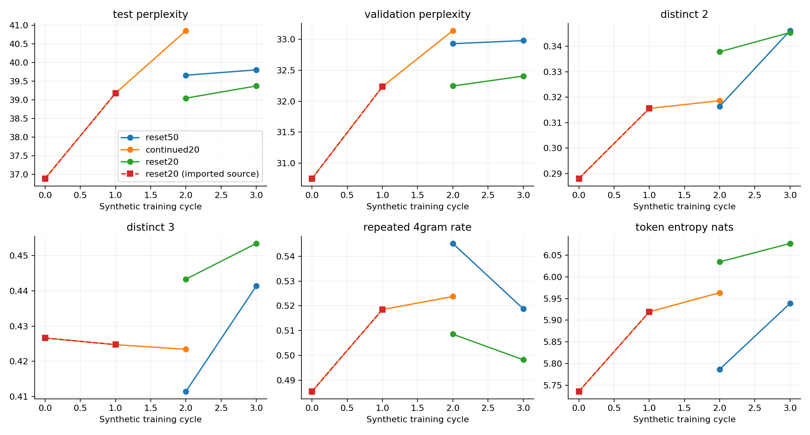

# Mixed-fraction final-epoch campaign

Three sequential logical jobs share one GPU session. Reset50 imports the historical 50/50 S0/S1/D2; continued20 and reset20 share their newly trained S1, generated D2 and exact cycle-2 mixture. Every new stage executes five epochs and retains epoch 5. Imported work is not new execution.

Imported points retain their original evaluation scope and execution identity. In smoke reports, reset50's full-data S0/S1 points remain in the CSV but are omitted from the combined plot; the newly executed reset50 points use the small active evaluation split. They must not be read as one matched evaluation trajectory.

Per-job tables and graph families: [50/50 reset](reset50/report.md), [20/80 continued](continued20/report.md), [20/80 reset](reset20/report.md).

Smoke trajectories validate the pipeline; full trajectories describe one seed. Pooled diversity, within-output repetition, formatting sensitivity and real-text prediction are distinct measurements.
