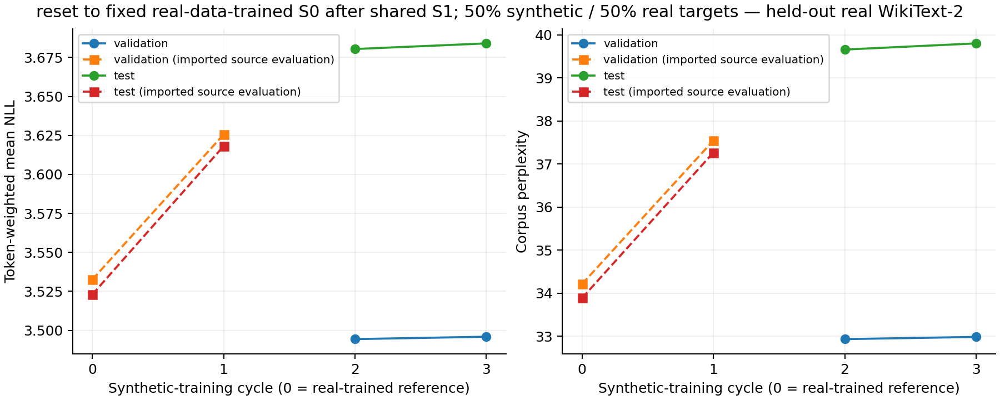
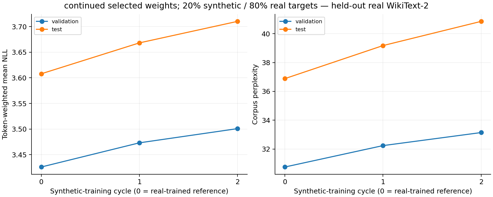
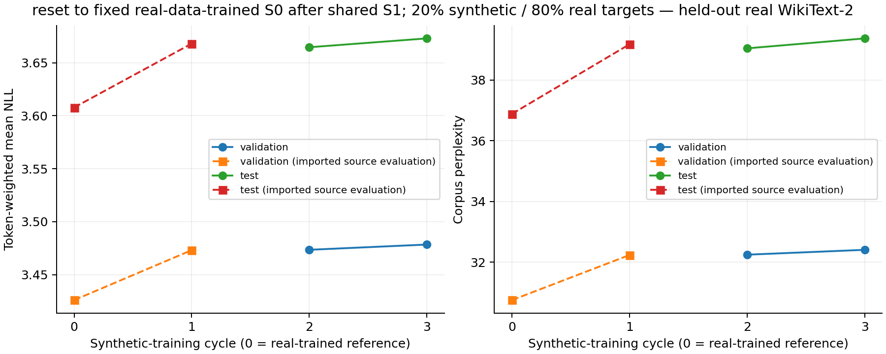
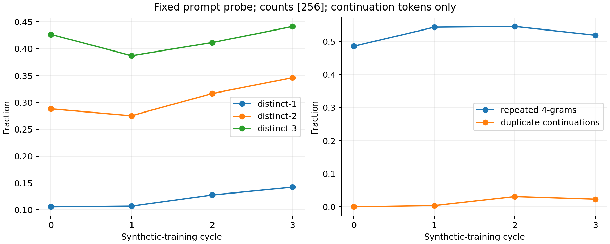
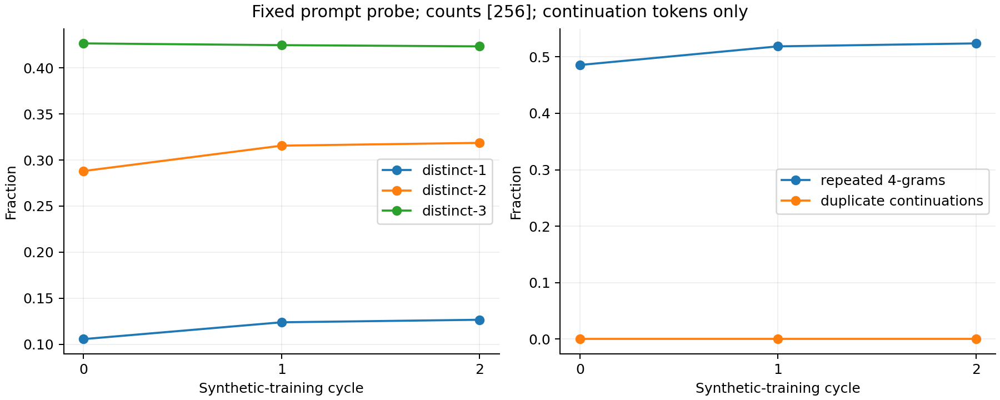
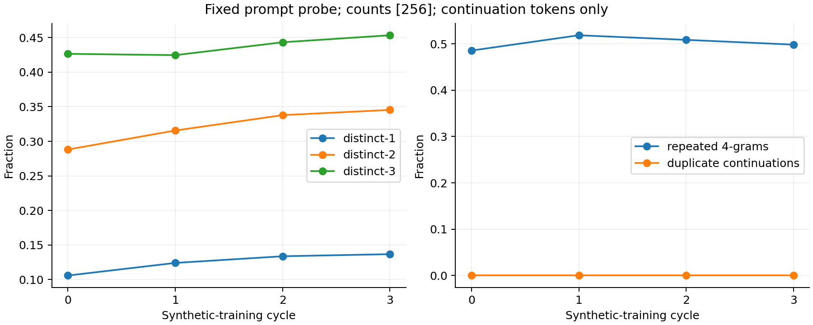
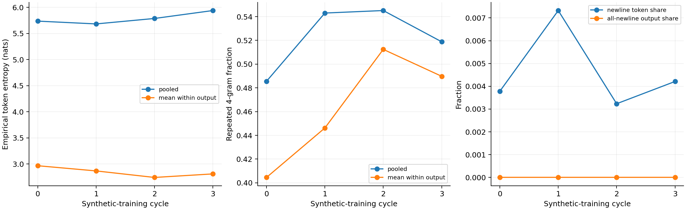
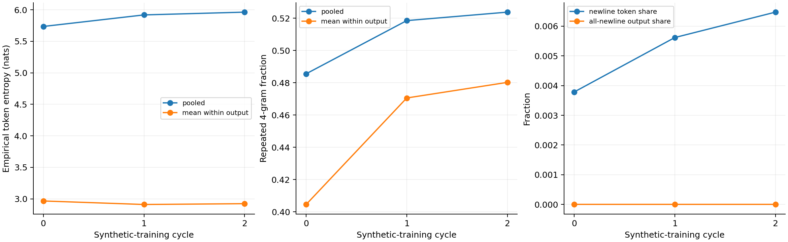
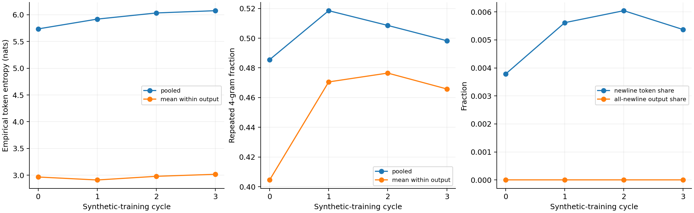

# Three-experiment mixed-data campaign: GPU acceptance

Campaign: `20261101T022210Z-smoke-mixed-campaign`.

**Pipeline validation only. This report summarizes saved smoke evidence, not a full experiment, current cloud state or a new GPU validation.**

## Verified execution

- One sequential campaign executed six new training stages / thirty actual epochs, retaining epoch 5 throughout.
- Every job's recorded runtime matches the accepted campaign. The saved acceptance reports successful private restore/re-evaluation, interruption recovery, detached progress and provider-confirmed shutdown.
- Reset50 imports historical full-data S0/S1/D2. Its active 256-block mixture uses a reduced population and is not historical full M2; full-source reconstruction is a separate recorded worker check.
- Continued20 and reset20 share exact S0/S1 measurements, D2 and cycle-2 mixed token/selection identities. Their new stage initializers follow continued versus fixed-S0 policies.

## New-stage measurements

| Job | Cycle | Selected epoch | Validation PPL | Test PPL |
| --- | --- | --- | --- | --- |
| reset50 | 2 | 5 | 32.930828 | 39.661102 |
| reset50 | 3 | 5 | 32.981139 | 39.804322 |
| continued20 | 1 | 5 | 32.236912 | 39.179303 |
| continued20 | 2 | 5 | 33.142470 | 40.859119 |
| reset20 | 2 | 5 | 32.247634 | 39.045173 |
| reset20 | 3 | 5 | 32.407484 | 39.372292 |

These rows describe only newly executed stages on the frozen 64-block smoke evaluation sets. Imported full-source measurements retain their original scope in the per-job records and plots.

## Training mixtures

| Job | Cycle | Real blocks | Synthetic blocks | Real tokens | Synthetic tokens |
| --- | --- | --- | --- | --- | --- |
| reset50 | 2 | 128 | 128 | 8192 | 8192 |
| reset50 | 3 | 128 | 128 | 8192 | 8192 |
| continued20 | 1 | 205 | 51 | 13120 | 3264 |
| continued20 | 2 | 205 | 51 | 13120 | 3264 |
| reset20 | 2 | 205 | 51 | 13120 | 3264 |
| reset20 | 3 | 205 | 51 | 13120 | 3264 |

## Figure families

### Fixed real-text evaluation

### Pooled diversity and repetition

### Within-output and formatting diagnostics

## Evidence and limitations

The export verifies indexed selected JSON, finite NLL/PPL arithmetic, epoch selection and saved mixture/selection consistency. It copies no model weights, token arrays, tokenizers or resource registries. Remote bulk restoration/re-evaluation is recorded evidence; this offline export does not repeat it or reconstruct absent full arrays.

Recorded runtime: `35c89c3b9fb78c7967c4f62f07972739eabbe57b353a0360749eba71d1af2171`. Protocol: `770a627c02821b1301f3194268e65fb9635eccdc6a43e639477d886f26dac377`.

Original publications and recovered source files are unchanged. Per-job saved metric tables/figures are in `analysis/`; selected records and their hashes are preserved alongside this report. Acceptance spending and full-run affordability require the separate dated operational receipt.
