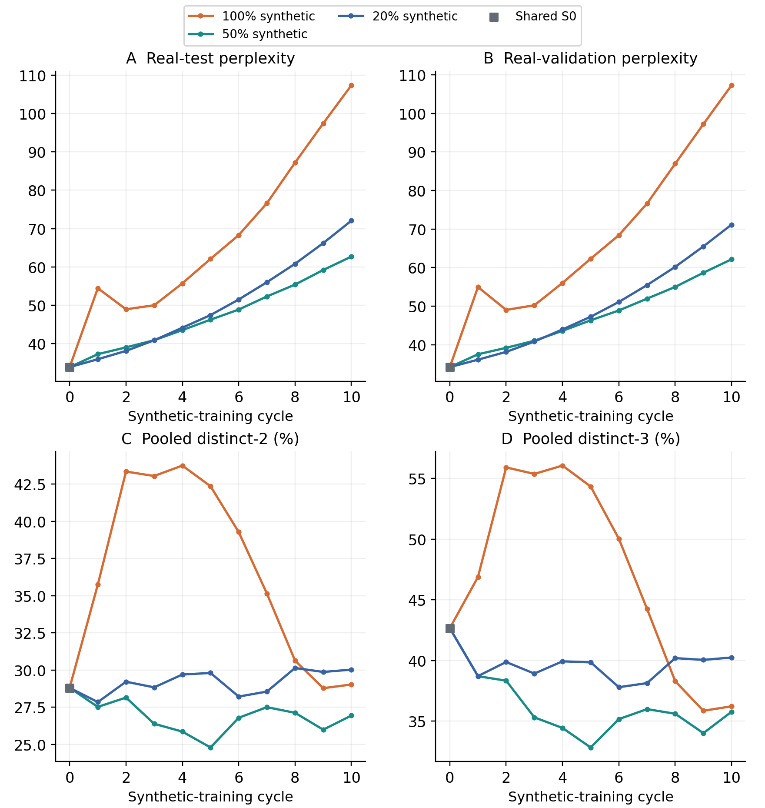
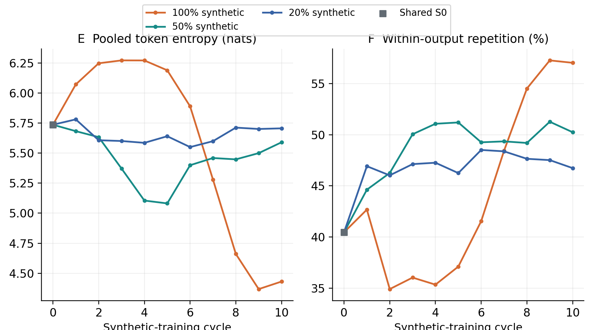
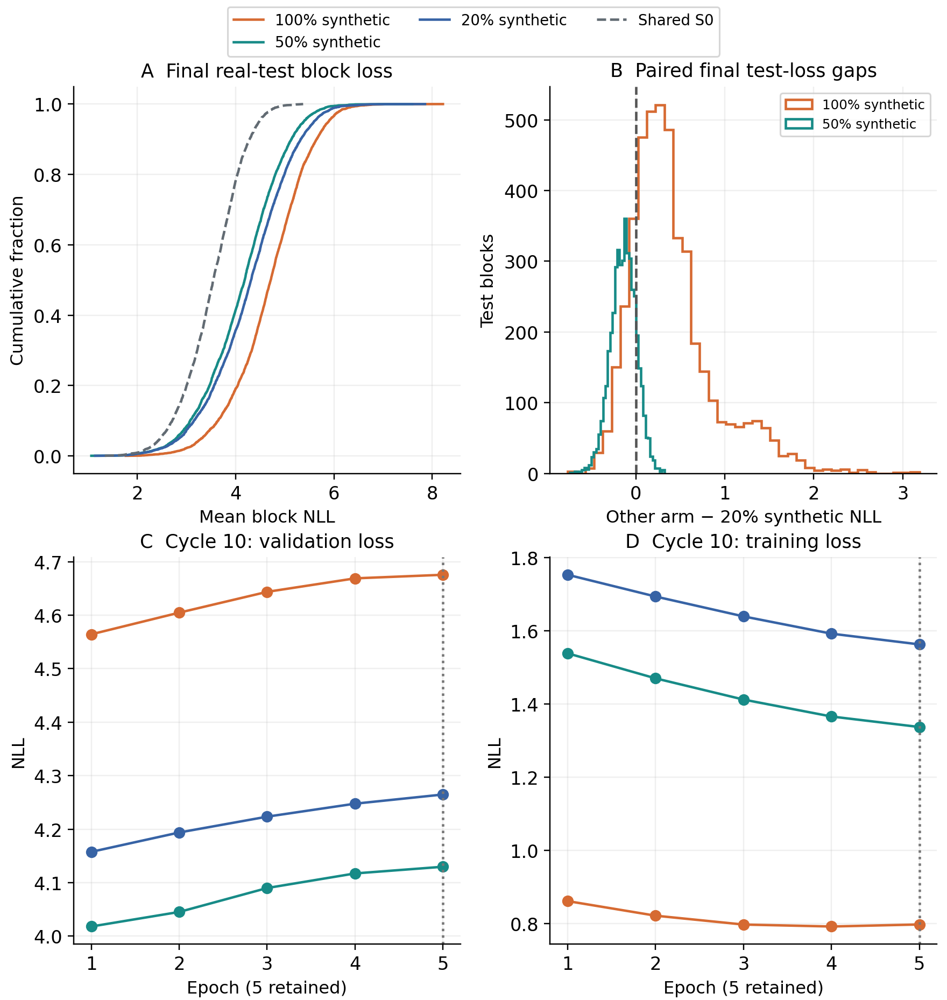
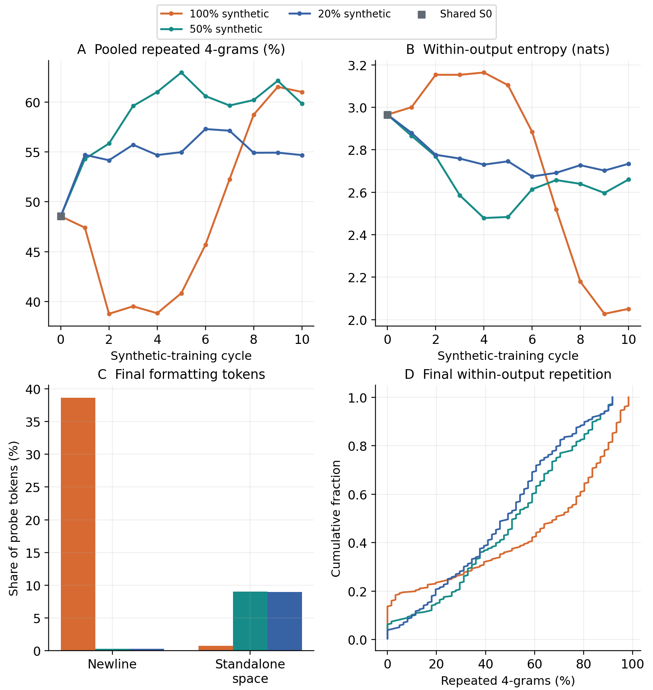
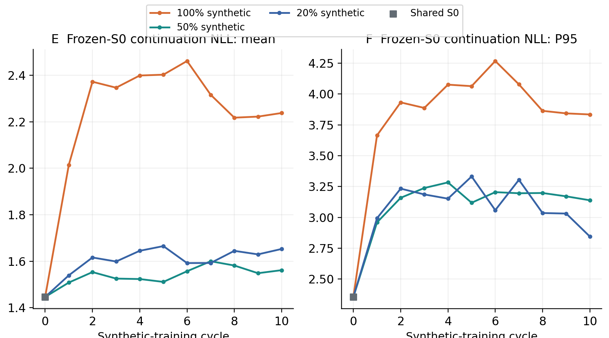

# Week 3, Part 4: Continued training across synthetic fractions

OPT-125M / WikiText-2; seed 42. Completed 20% synthetic / 80% real continued run, compared with the preserved 50/50 and synthetic-only continued runs.

## 1. Objective and controlled methodology

We tested whether replacing more synthetic targets with real training text consistently limits recursive deterioration. All three arms carry their preceding weights, execute five epochs per cycle and retain epoch 5.

- Shared start: exact pinned real-trained S0 and its historical D1 synthetic pool. Model/data revisions, real split packing, fixed prompts/evaluation, optimizer/scheduler restarts, seed, batches, precision, decoding and recorded GPU/software match. S1 differs across ratios because their training targets already differ.

- Loop: form M1 = mix(real, D1), train S0 → S1; S1 generates D2, form M2 = mix(real, D2), train S1 → S2; continue through S10. No resetting to S0 in any arm. A full synthetic pool is generated before sampling the required fraction; prompts are excluded from targets.

- Sampling: independent deterministic cycle-specific source selections and shuffle; no replacement within a source/cycle, real blocks may recur across cycles. Each mixture is frozen for its five epochs. Only the original real training split is eligible, never validation/test.

Table 21. Equal total blocks, training exposures and evaluation context. “20%” rounds to 7,589/37,946 = 19.99947% synthetic blocks; S1 onward is newly trained for this ratio.

| Setting | Common protocol / change |
| --- | --- |
| Model / source | Pinned OPT-125M / WikiText-2 raw; exact shared real-trained S0 and D1 |
| Weights / selection | Continue previous epoch-5 weights; fresh AdamW/cosine each cycle; five epochs always, no early stopping |
| Training size | 37,946 blocks × 64 tokens = 2,428,544 tokens in every arm |
| Source counts: real / synthetic | 100%: 0 / 37,946; 50%: 18,973 / 18,973; 20%: 30,357 / 7,589 |
| 20% source tokens | 1,942,848 real + 485,696 synthetic per cycle; source pool is still 37,946 synthetic blocks |
| Decoding / optimization | Fixed real 64-token prompts → 64 new tokens; five beams, penalty 1.0. LR 2e-5; seed 42; batch 128; BF16 |
| Evaluation / environment | 3,922 validation / 4,494 test real blocks; fixed 256-output probe. Same RTX PRO 4000 Blackwell and recorded software |

## 2. Real-text prediction and phrase diversity

Figure 15a. Larger square panels: fixed real-test/validation PPL (A/B) and pooled distinct-2/3 (C/D). Orange: 100% synthetic; teal: 50%; blue: 20%; grey marker: shared S0. Lines join one-seed observations, with no independent-run uncertainty bands.

- Observed PPL: 20% starts closest to S0 after one update (35.95 versus 37.27 at 50%, 54.46 at 100%). It then rises every cycle, crosses 50% between cycles 3 and 4, and ends at 72.06 versus 62.71 and 107.37. Thus the endpoint ranking is not monotonic in synthetic fraction.

- At cycle 10, 20% PPL is 32.88% lower than synthetic-only, 14.92% higher than 50/50 and 112.67% above S0 (33.89). The validation curve agrees with the test comparison. The three trajectories support relative benefits of mixing, not the claim that reducing synthetic fraction always improves prediction.

## 3. Generated-text diversity and repetition

Figure 15b. Pooled token entropy (E) and mean within-output repeated four-grams (F). All fractions use the same 256×64 output probe and token/window definitions. Output-frequency entropy is not predictive entropy or accuracy.

- The 20% endpoint has the largest pooled distinct-2/3 of the three final models (30.03% / 40.25%) and less mean within-output repetition (46.73%) than both comparators. Its pooled entropy is 5.706 nats, close to S0’s 5.736; that does not mean its real-text prediction is preserved.

- Why this can disagree with PPL: held-out loss checks probabilities assigned to fixed real targets; these diversity statistics count patterns emitted for a small set of prompts under beam decoding. Broader phrase variety or fewer loops can coexist with worse probability calibration on actual held-out text.

- Distinct-n counts unique token phrases divided by all windows, never spanning outputs. All arms use 16,128 bigram, 15,872 trigram and 15,616 four-gram positions. Pooled repeated-4 is 1 − distinct-4, so these two are complementary, not independent findings.

## 4. Endpoint statistics

The table separates real-text prediction, pooled diversity, within-output repetition and formatting. Lower NLL/PPL is better on held-out real text; the remaining columns describe generated output rather than a single overall quality score.

Table 22. Shared S0 and final S10 for all three continued-weight conditions. Natural-log units; percentages are fractions of tokens/windows. Duplicate counts are copies beyond the first among 256 outputs.

| Measure | S0 | 100% | 50% | 20% |
| --- | --- | --- | --- | --- |
| Real-test PPL | 33.89 | 107.37 | 62.71 | 72.06 |
| Validation PPL | 34.21 | 107.28 | 62.16 | 71.15 |
| Test NLL (nats) | 3.523 | 4.676 | 4.138 | 4.278 |
| P95 block NLL | 4.478 | 5.891 | 5.388 | 5.593 |
| Distinct-1 (%) | 10.57 | 12.45 | 11.10 | 11.92 |
| Distinct-2 (%) | 28.81 | 29.03 | 26.94 | 30.03 |
| Distinct-3 (%) | 42.66 | 36.23 | 35.78 | 40.25 |
| Distinct-4 (%) | 51.45 | 38.98 | 40.15 | 45.31 |
| Pooled repeated-4 (%) | 48.55 | 61.02 | 59.85 | 54.69 |
| Mean within repeated-4 (%) | 40.45 | 57.03 | 50.24 | 46.73 |
| Duplicate outputs / 256 | 0 | 21 | 10 | 9 |
| Pooled entropy (nats) | 5.736 | 4.431 | 5.590 | 5.706 |
| Within entropy (nats) | 2.966 | 2.051 | 2.660 | 2.734 |
| Frozen-S0 mean NLL | 1.446 | 2.238 | 1.562 | 1.653 |
| Frozen-S0 P95 NLL | 2.355 | 3.834 | 3.139 | 2.845 |
| Newline tokens (%) | 0.38 | 38.62 | 0.31 | 0.31 |
| Space tokens (%) | 1.14 | 0.75 | 9.02 | 8.97 |
| Whitespace-only / 256 | 0 | 14 | 0 | 0 |

The 20% model has nine duplicate outputs, versus ten for 50/50 and the larger synthetic-only count shown above. Neither mixed condition reproduces the major synthetic-only newline concentration, but both retain space-heavy outputs. All per-cycle measurements are saved alongside this report.

## 5. Real-text coverage and training dynamics

Figure 16. A: cumulative final test-block NLL, S0 dashed. B: other arm minus 20% loss on identical blocks; positive favours 20%. C/D: cycle-10 validation/training loss over five epochs. D compares different arm-specific target datasets.

- Paired blocks: 20% has lower final NLL than synthetic-only on 3,750/4,494 blocks (83.44%), but lower NLL than 50/50 on only 737 (16.40%). It remains worse than S0 on 4,410 blocks. These are descriptive corpus-block counts, not independent model replicates.

- Five-epoch effect: epoch 1 minimizes real validation loss in all thirty unique stages, but epoch 5 is intentionally retained. For 20% cycle 10, training NLL falls 1.753 → 1.563 while validation NLL rises 4.158 → 4.265. Better fitting of the current mixture does not improve real-text generalization here.

- Possible cause of the 20%/50% reversal: stronger repeated fitting of the same finite real corpus, combined with different self-generated trajectories. Each real block is selected on average about eight times across the 20% mixtures, versus five at 50%, before five epoch passes. This is a plausible overfitting explanation, not a demonstrated mechanism; no real-only or multi-seed control isolates it.

## 6. Repetition and formatting diagnostics

Figure 17a. A/B: pooled phrase repetition and within-output entropy. C: endpoint newline/space token shares. D: cumulative within-output four-gram repetition; curves farther left have less repetition. Original unfiltered output statistics are retained.

- On paired prompts, synthetic-only is more repetitive than 20% on 165 outputs, 20% on 78, with 13 ties. Against 50/50, 50/50 is more repetitive on 130, 20% on 90, with 36 ties. Aggregate improvements are not universal prompt-level improvements.

- The 20% probe has 0.31% newline tokens, no newline-heavy or whitespace-only decoded outputs, but 8.97% standalone-space tokens and 26 space-heavy outputs. Synthetic-only has 38.62% newlines and 111 newline-heavy outputs. Entropy and pooled phrase rankings can therefore reflect formatting as well as substantive vocabulary.

## 7. Frozen-S0 continuation scores

Figure 17b. E/F: mean and 95th-percentile continuation NLL under the same frozen real-trained S0. Each 64-token output is teacher-forced on its own, scoring 63 targets; the original prompt is omitted. Lower means easier for S0 to predict.

- The 20% mean score is 1.653 nats/target versus 1.562 at 50% and 2.238 for synthetic-only; its P95 is 2.845 versus 3.139 and 3.834. Mean and tail can rank differently. This metric evaluates different generated strings, not prediction of one fixed real dataset.

- Predictable repetition can receive a low S0 loss. Conversely, more varied output may be less predictable to S0 without having worse factuality or real-test behaviour. These scores cannot be read as model distance or a second accuracy measure; compare them with the held-out losses and formatting diagnostics.

## 8. Same-prompt examples

Prompt 0 is the fixed historical anchor, not chosen to represent typical quality. Generated factual claims are unverified. The full 64-token outputs are reproduced below.

> </s></s> = Valkyria Chronicles III = \n</s></s> Senjō no Valkyria 3 : Unrecorded Chronicles ( Japanese : 戦場のヴァルキュリア3, lit. Valkyria of the Battlefield 3 ), commonly referred to as Valkyria Chronicles III outside

Table 23. Final checkpoints on the exact same 64-token prompt. Within-output repeated-4 is 73.77% (100%), 86.89% (50%) and 37.70% (20%) here. All still repeat; this example does not establish factual correctness or aggregate typicality.

| Final model | Complete saved continuation |
| --- | --- |
| 100% synthetic |  Japan ) is a video game in the Valkyria Chronicles series of video games in the Valkyria Chronicles series of video games in the Valkyria Chronicles series of video games in the Valkyria Chronicles series of video games in the Valkyria Chronicles series of video games in the Valkyria Chronicles series of |
| 50% synthetic |  Japan as Valkyria Chronicles 3 : Valkyria Chronicles 3 : Valkyria Chronicles 3 : Valkyria Chronicles 3 : Valkyria Chronicles 3 : Valkyria Chronicles 3 : Valkyria Chronicles 3 : Valkyria Chronicles 3 : Valkyria Chronicles 3 : Valkyria Chronicles 3 : Valky |
| 20% synthetic |  Japan ) is the third entry in the Valkyria Chronicles series of video games. It was released for the PlayStation 3, PlayStation 4, Xbox 360, Nintendo 3DS, Nintendo 3DS XL, Nintendo 3DS XL, Nintendo 3DS XL, Nintendo 3DS XL, Nintendo 3DS XL, Nintendo 3DS XL |

Additional formatting example: prompt 52 gives an all-newline synthetic-only output, while both mixed arms emit “References :” followed by spaces. Those mixed outputs contain alphabetic characters and are not counted as whitespace-only; they remain degenerate completions. Exact token arrays and original whitespace are preserved in the saved examples.

## 9. Findings, limits and evidence

- Main finding: both real-data mixtures reduce final real-test deterioration relative to synthetic-only continued training. Among these seeded trajectories, 50/50 has lower final PPL than 20/80, while 20/80 has stronger endpoint phrase-diversity and repetition statistics. There is no single ranking across all metrics.

- Limits: one seed, OPT-125M, WikiText-2, ten updates and deterministic five-beam decoding. The fixed probe is the first 256 consecutive training prompts from six adjacent articles, not a random full-corpus sample. More real means repeatedly sampling the same finite split, not acquiring new external data. No optimum or universal safe synthetic percentage is established.

- Accounting: all arms train 37,946×64 input tokens per cycle, fifty epochs total: 121,427,200 input-token exposures per arm. At 20%, 97,142,400 are real and 24,284,800 synthetic. S0/D1 are imported; each continued arm adds ten stages, nine full next pools and a final probe.

Evidence: recovered and checksum-verified 1,560 metadata files / 52,452,006 bytes, plus ten new probes / 656,640 bytes. Shared S0 and preserved comparator evidence are reused. The audit checks 33 metric rows, 31 unique probes, 150 epoch entries, all thirty model/data handoffs and exact deterministic source-selection hashes. The selected-record publication lists 117 scientific files / 5,291,854 bytes, including its probes.

This analysis used pinned Hugging Face backups and offline records only: no Runpod API calls, SSH sessions, worker/resource changes, model forward passes or full checkpoint/training-array downloads. The completed 20/80 continued child is one job in a larger campaign; this report does not claim that the final reset job or GPU shutdown has completed.

[Metrics](analysis/metrics.csv) | [Epoch histories](analysis/training_history.csv) | [Examples](analysis/examples.json) | [Audit/provenance](analysis/publication_reproduction.json)
