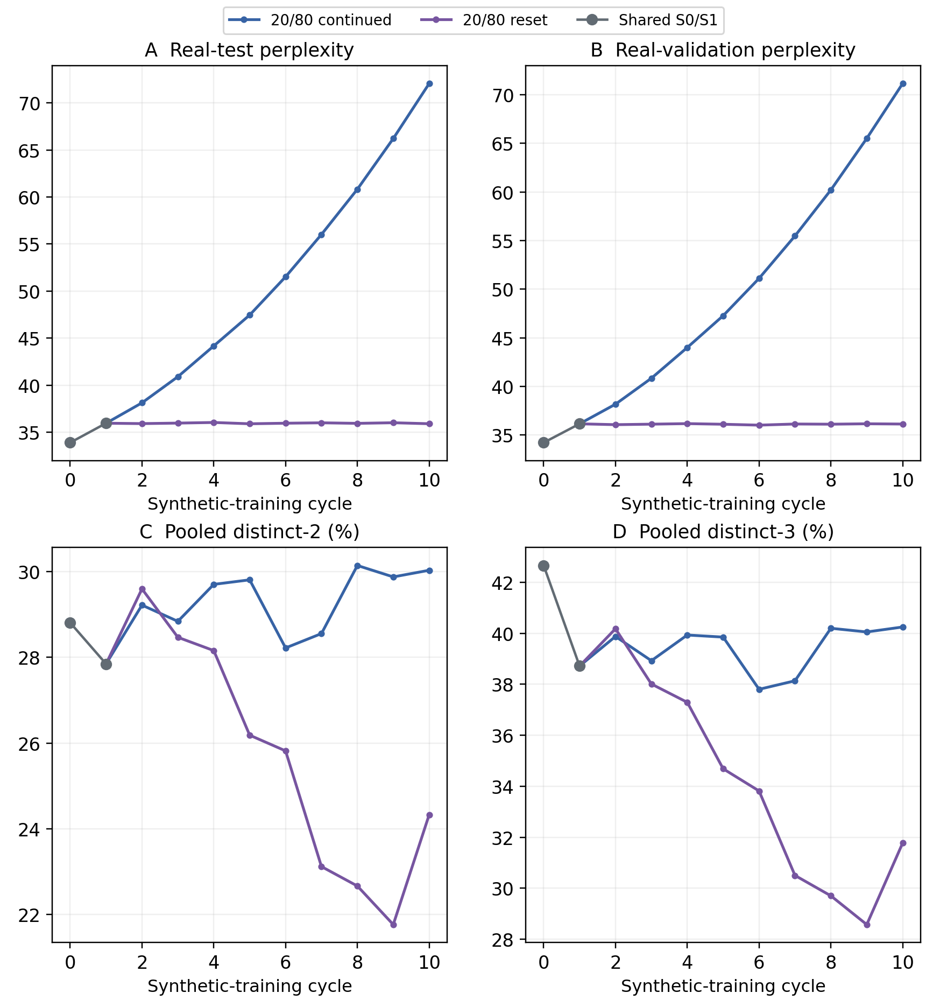
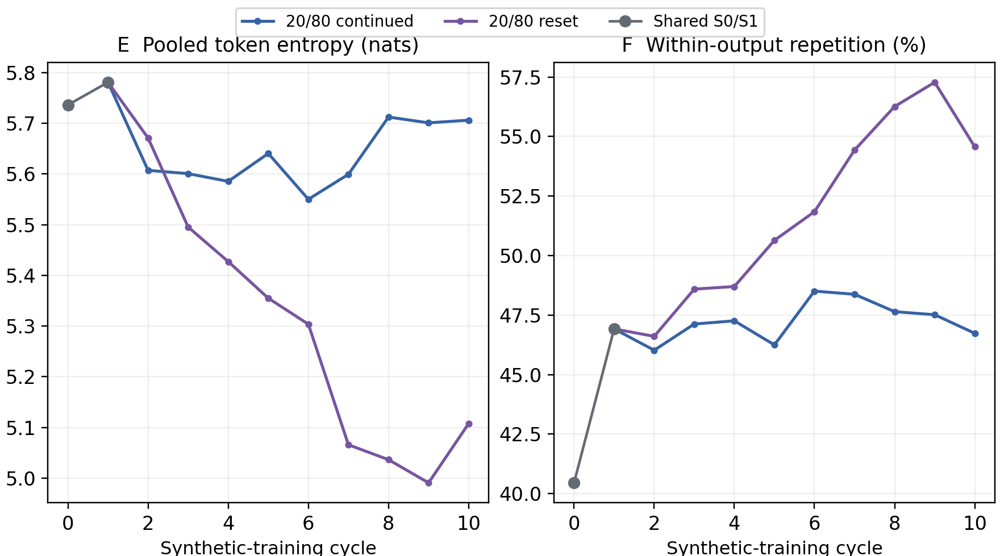
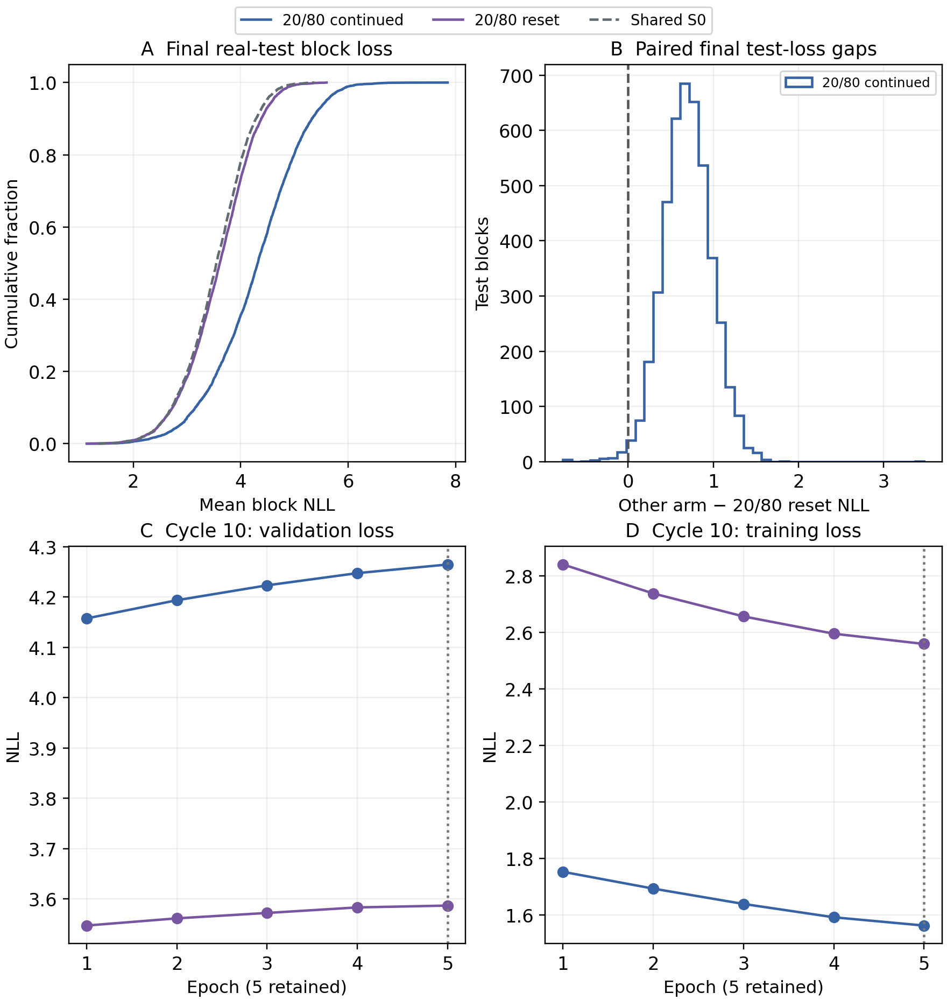
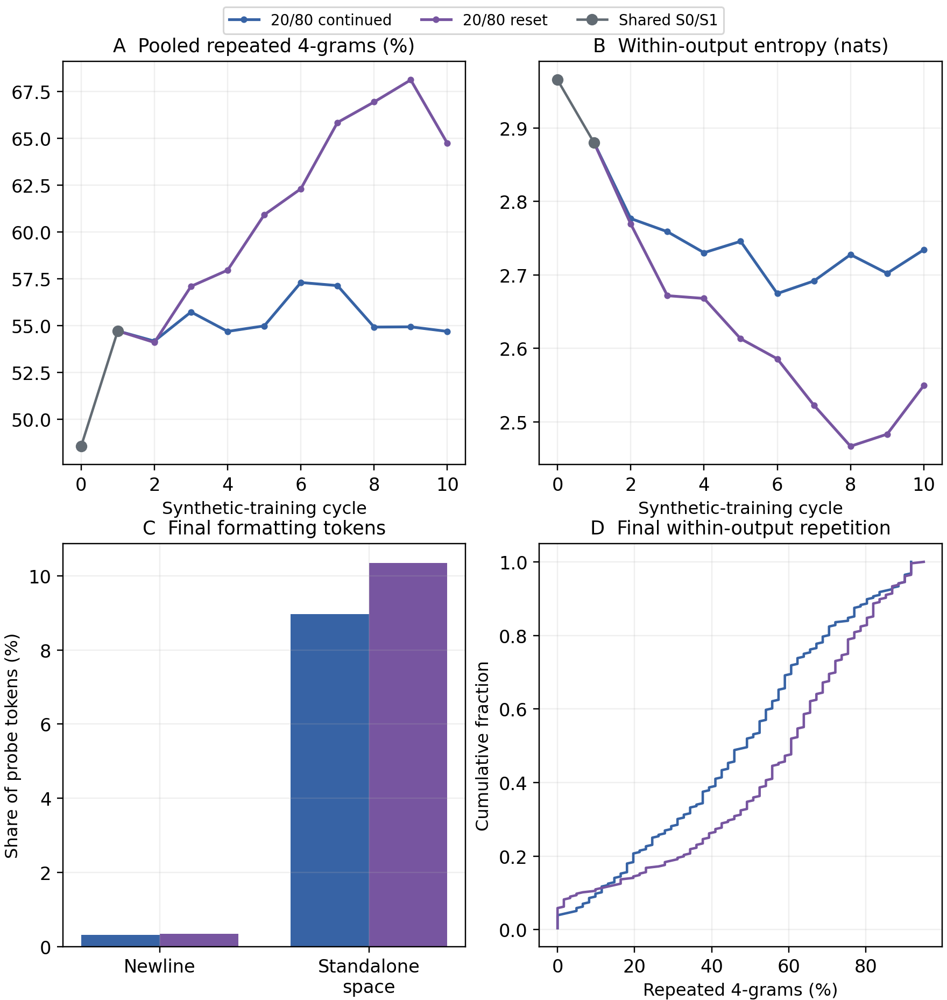
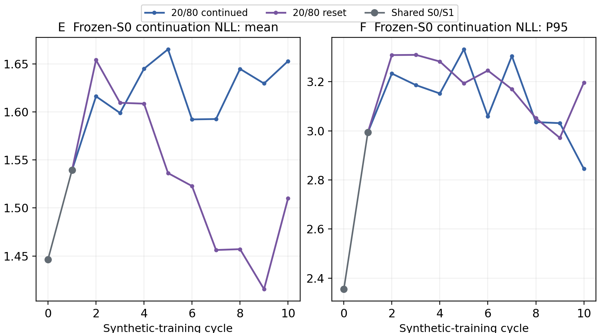
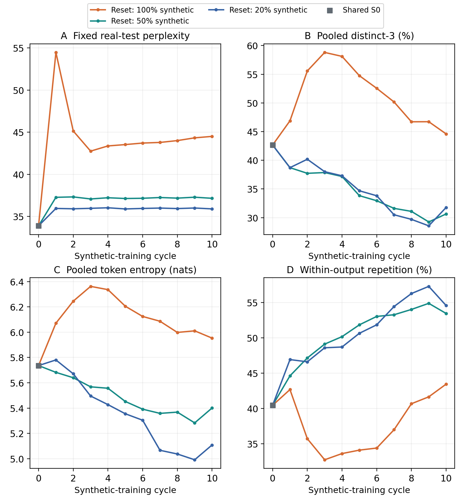

# Week 3, Part 5: Matched 20/80 reset and continued training

OPT-125M / WikiText-2; seed 42. 20% synthetic / 80% real. Reset branch completed 1 November 2026; sealed results analysed 2 November.

## 1. Objective and exact shared beginning

We test whether resetting to the fixed real-trained S0 limits deterioration when synthetic text is only one fifth of the training mixture. The main comparison holds the entire first update fixed against the completed 20/80 continued arm.

- Shared start: S0 generates historical D1; train S0 on M1 = mix(real, D1) for five epochs → shared S1; S1 generates D2. Both arms import exactly that S0/S1/D2 and the identical cycle-2 mixture M2, including token IDs, selected rows and shuffle. Shared points are reused observations, not independent repetitions.

- From cycle 2, continued trains its preceding epoch-5 checkpoint; reset trains fixed S0. The preceding model in each arm still generates that arm’s next synthetic pool. Resetting weights therefore removes accumulated parameter updates while retaining recursive data feedback.

- Each mixture samples 30,357 real and 7,589 synthetic blocks without replacement within each source/cycle, then shuffles. Selection streams are matched across arms; later synthetic contents differ. Freeze each mixture for all five epochs. Real text is reused from the training split only; prompts and held-out real text never enter synthetic targets.

Table 24. Matched protocol. The deliberate difference is the initializer for cycles 2–10. Synthetic fraction is 7,589/37,946 = 19.99947% after block rounding.

| Setting | Matched 20/80 arms |
| --- | --- |
| Model / corpus | Pinned OPT-125M / WikiText-2 raw; identical real row/split packing |
| Common prefix | Exact real-trained S0, new 20/80 epoch-5 S1, D2 and M2; imported, not retrained |
| Dataset per cycle | 30,357 real + 7,589 synthetic blocks × 64 tokens; 2,428,544 total tokens |
| Source tokens | 1,942,848 real + 485,696 synthetic. Full synthetic source pool: 37,946 blocks before sampling |
| Training / decoding | Five epochs, always retain fifth; fresh AdamW/cosine; LR 2e-5; batch 128; BF16; seed 42. Fixed 64-token prompts → 64 new tokens, five beams, penalty 1.0 |
| Evaluation | 3,922 real validation / 4,494 real test blocks; 63 scored targets/block; fixed 256-output probe |
| Environment | Same RTX PRO 4000 Blackwell; PyTorch 2.8.0+cu128, Transformers 4.37.2, Datasets 3.4.1 |

## 2. Real-text prediction and phrase diversity

Figure 18a. Large square panels: fixed real-test/validation perplexity (A/B), pooled distinct-2/3 (C/D). Blue: 20/80 continued; purple: reset to S0; grey: exact shared S0/S1. One seeded trajectory per arm; no independent-run error bars.

- The common test-PPL jump is 33.89 → 35.95. Reset then stays approximately 35.9–36.0, ending at 35.89; continued rises to 72.06. Reset is 50.19% lower at cycle 10, but still 5.93% above S0.

- Interpretation: restarting from S0 prevents accumulated weight changes from carrying forward; the high real-data fraction also anchors each new update. These results are consistent with reduced cumulative drift, but do not identify its exact cause. Stable held-out PPL does not establish stable generated-text quality.

## 3. Output entropy and repetition

Figure 18b. Pooled token entropy (E) and mean repeated four-gram rate inside individual outputs (F), measured on the same 256 fixed prompts and 64-token continuations. These describe emitted token frequencies/loops, not predictive uncertainty.

- At cycle 10, reset has lower distinct-2/3 (24.33% / 31.77%) than continued (30.03% / 40.25%). Reset entropy is 5.108 versus 5.706 nats, while within-output repetition is 54.57% versus 46.73%.

- Why this can coexist with much lower PPL: real-test loss measures probabilities assigned to actual held-out text. Distinct-n and repetition count what deterministic beam decoding emits for a small, fixed prompt set. A model can predict real targets better yet choose narrower, more repetitive high-probability completions.

- A plausible mechanism is repeated selection of familiar templates under deterministic beams, carried forward through the synthetic pools even when weights reset. Formatting and token-frequency concentration also affect entropy. The data show these effects on the outputs; they do not prove a particular internal mechanism.

## 4. Endpoint statistics

Prediction and generated-text statistics are separate outcomes. Lower real-test NLL/PPL means less surprise at unseen real targets; a diversity ranking is not a general ranking of factuality or model quality.

Table 25. Common S0 and final checkpoints C10 (continued) / A10 (reset). Natural-log units. Percentages use identical token/window denominators; duplicate counts are copies beyond the first among 256 outputs. Shared S1 test PPL is 35.95.

| Measure | S0 | Continued C10 | Reset A10 |
| --- | --- | --- | --- |
| Real-test PPL | 33.89 | 72.06 | 35.89 |
| Validation PPL | 34.21 | 71.15 | 36.12 |
| Test NLL (nats) | 3.523 | 4.278 | 3.581 |
| P95 block NLL | 4.478 | 5.593 | 4.593 |
| Distinct-1 (%) | 10.57 | 11.92 | 10.35 |
| Distinct-2 (%) | 28.81 | 30.03 | 24.33 |
| Distinct-3 (%) | 42.66 | 40.25 | 31.77 |
| Distinct-4 (%) | 51.45 | 45.31 | 35.27 |
| Pooled repeated-4 (%) | 48.55 | 54.69 | 64.73 |
| Mean within repeated-4 (%) | 40.45 | 46.73 | 54.57 |
| Duplicate outputs / 256 | 0 | 9 | 9 |
| Pooled entropy (nats) | 5.736 | 5.706 | 5.108 |
| Within entropy (nats) | 2.966 | 2.734 | 2.549 |
| Frozen-S0 mean NLL | 1.446 | 1.653 | 1.510 |
| Frozen-S0 P95 NLL | 2.355 | 2.845 | 3.197 |
| Newline tokens (%) | 0.38 | 0.31 | 0.34 |
| Space tokens (%) | 1.14 | 8.97 | 10.35 |
| Space-heavy outputs / 256 | 2 | 26 | 31 |

Pooled repeated-4 = 1 − distinct-4, so those entries are complementary. Within-output repetition instead averages excess four-gram occurrences separately inside each continuation. Token entropy uses emitted-token frequencies, not the model’s softmax distribution.

## 5. Real-text coverage and five-epoch training

Figure 19. A: cumulative real-test block NLL, with S0 dashed. B: continued minus reset loss on identical blocks; positive favours reset. C/D: cycle-10 validation/training losses over five epochs. Epoch 5 is retained regardless of validation.

- Reset has lower final NLL on 4,450/4,494 blocks (99.02%), continued on 44, with no ties. Mean continued-minus-reset gap is 0.697 nats/target. Reset still exceeds S0 loss on 3,622 blocks, versus 4,410 for continued.

- Epoch 1 gives the lowest fixed real-validation loss in all 19 unique stages, but all execute five epochs and retain the fifth. In cycle 10, validation NLL rises 3.547 → 3.587 for reset and 4.158 → 4.265 for continued; training NLL falls 2.841 → 2.560 and 1.753 → 1.563.

- These histories show that fitting the current mixture more strongly does not improve held-out generalization. Training losses are online averages over different arm-specific targets, not final-checkpoint real-training loss, so they do not independently prove real-data memorization.

## 6. Repetition and formatting diagnostics

Figure 20a. A/B: pooled four-gram repetition and within-output entropy. C: endpoint newline/space token shares. D: final within-output repetition distributions. Pooled statistics and within-output loops are kept separate.

- Reset is more repetitive on 158 paired prompts, continued on 65, with 33 ties. Both end with nine duplicate outputs. The reset repetition curve generally worsens even while its real-test PPL remains nearly flat.

- Newlines are only 0.34% (reset) and 0.31% (continued), with no newline-heavy or whitespace-only outputs. Standalone-space tokens are 10.35% versus 8.97%, with 31 versus 26 space-heavy outputs. Newline exclusion leaves the entropy/repetition ranking unchanged; blank-line collapse is not the explanation here.

## 7. Frozen-S0 continuation scores

Figure 20b. Frozen-S0 NLL mean (E) and P95 (F). Feed each generated continuation alone to S0 and score its 63 shifted next-token targets; omit the original prompt. Lower means more predictable to S0, not necessarily better text.

- Reset has lower mean frozen-S0 NLL (1.510 versus 1.653) but higher P95 (3.197 versus 2.845). A lower average can coexist with a more surprising upper tail. These are scores of different generated strings, not a comparison on one fixed real target set.

- Repeated familiar phrases may be easy for S0 to predict. That can keep the mean score low despite visibly poor completions and lower diversity. Frozen-S0 scoring therefore cannot be interpreted as model distance, factuality or an independent accuracy score.

## 8. Context: all three fixed-S0 reset fractions

Figure 21. Reset conditions at 100%, 50% and 20% synthetic: real-test PPL, pooled distinct-3, token entropy and within-output repetition. Only S0 is shared across ratios; S1 and later synthetic pools differ. Settings/evaluation and recorded environments match.

- Reset endpoint PPL decreases as real fraction increases: 44.50 → 37.15 → 35.89. This differs from continued training, where 20% synthetic ends worse than 50%. The initializer/cumulative-training condition matters; no universal optimum follows from these single-seed trajectories.

- The continued-only reversal is consistent with accumulated parameter changes contributing to the outcome. It does not establish whether the cause is real-data overfitting, generated-data feedback or another optimization effect. Reset also changes the generators and later datasets, so it is not a perfectly isolated test of one mechanism.

- Diversity is not monotonically better with more real data: 20% reset has lower entropy and slightly higher within-output repetition than 50% reset, despite slightly higher distinct-3. The synthetic-only reset has higher phrase diversity but worse real-test PPL.

## 9. Same-prompt output examples

Fixed historical anchor, prompt 0. This example is retained across comparisons rather than selected for typicality. Generated factual claims are unverified.

> </s></s> = Valkyria Chronicles III = \n</s></s> Senjō no Valkyria 3 : Unrecorded Chronicles ( Japanese : 戦場のヴァルキュリア3, lit. Valkyria of the Battlefield 3 ), commonly referred to as Valkyria Chronicles III outside

Table 26. Complete saved 64-token continuations. Here within-output repeated-4 is 37.70% continued versus 50.82% reset. Both loop; this example illustrates, but does not establish, the aggregate result.

| Checkpoint | Complete saved continuation |
| --- | --- |
| Shared S1 |  Japan, is a video game developed by Capcom and published by Capcom for the PlayStation 3 and PlayStation Vita in Japan. The game was released for the PlayStation 3 and PlayStation Vita in Japan on November 7, 2008. The game was released for the PlayStation 3 and PlayStation Vita in Japan on November 7, 2008. The game was |
| Continued C10 |  Japan ) is the third entry in the Valkyria Chronicles series of video games. It was released for the PlayStation 3, PlayStation 4, Xbox 360, Nintendo 3DS, Nintendo 3DS XL, Nintendo 3DS XL, Nintendo 3DS XL, Nintendo 3DS XL, Nintendo 3DS XL, Nintendo 3DS XL |
| Reset A10 |  Japan as Valkyria Chronicles II, is the fourth entry in the Valkyria Chronicles series. It was released in the United States in the United Kingdom in the United States in the United States in the United States in the United States in the United States in the United States in the United States in the United States in |

A second saved comparison, prompt 116, also loops on repeated ordnance/ammunition phrases: within-output repeated-4 is 80.33% continued and 86.89% reset. It was selected as the first prompt nearest the median paired repetition gap; all 256 raw outputs remain available.

## 10. Findings, accounting and limitations

- Main finding: at 20/80, fixed-S0 reset largely stabilizes real-text likelihood after the common first update, whereas continued training deteriorates. Yet reset loses phrase diversity and becomes more repetitive on the fixed probe. Low and stable PPL is therefore insufficient evidence that collapse has been prevented.

- Accounting: this branch imports S0/S1/D2, then adds nine stages / forty-five epochs for cycles 2–10. Together with its continued arm there are 19 unique stages / 95 epochs; the 100 saved epoch entries include the shared first stage twice. A10 inherits its own five-epoch update from S0, while C10 carries all fifty; data history is recursive in both.

- Limits: one seed, OPT-125M, WikiText-2, ten cycles and deterministic five-beam decoding. The probe covers the first 256 consecutive training prompts from six adjacent articles, not a random corpus sample. Corpus-block comparisons are descriptive, not independent training replicates. Real text is resampled from a finite existing split, not newly collected.

Evidence: recovered and checksum-verified 1,421 metadata files / 53,710,269 bytes plus nine new probe arrays / 590,976 bytes. The main pair audit checks 22 metric rows, twenty unique probes, 100 saved epoch entries (95 unique), exact S0/S1/D2/M2, initializer/generator/data handoffs and terminal checkpoint selection. Saved probe metrics and real-test NLL/PPL were recalculated; source/shared observations are reused. Exact file hashes and the separate reset-fraction context are preserved alongside the report.

The campaign’s recorded completion is 1 November 23:20:44 UTC/London, with provider-confirmed GPU shutdown at 23:21:09 and watchdog reason complete. This analysis made no Runpod calls, SSH connections or resource changes. Bulk weights/full training arrays were not restored or models re-evaluated; recovery storage remains preserved.

[Metrics](analysis/metrics.csv) | [Epoch histories](analysis/training_history.csv) | [Examples](analysis/examples.json) | [Context](analysis/reset_fraction_context.json) | [Audit/provenance](analysis/publication_reproduction.json)
