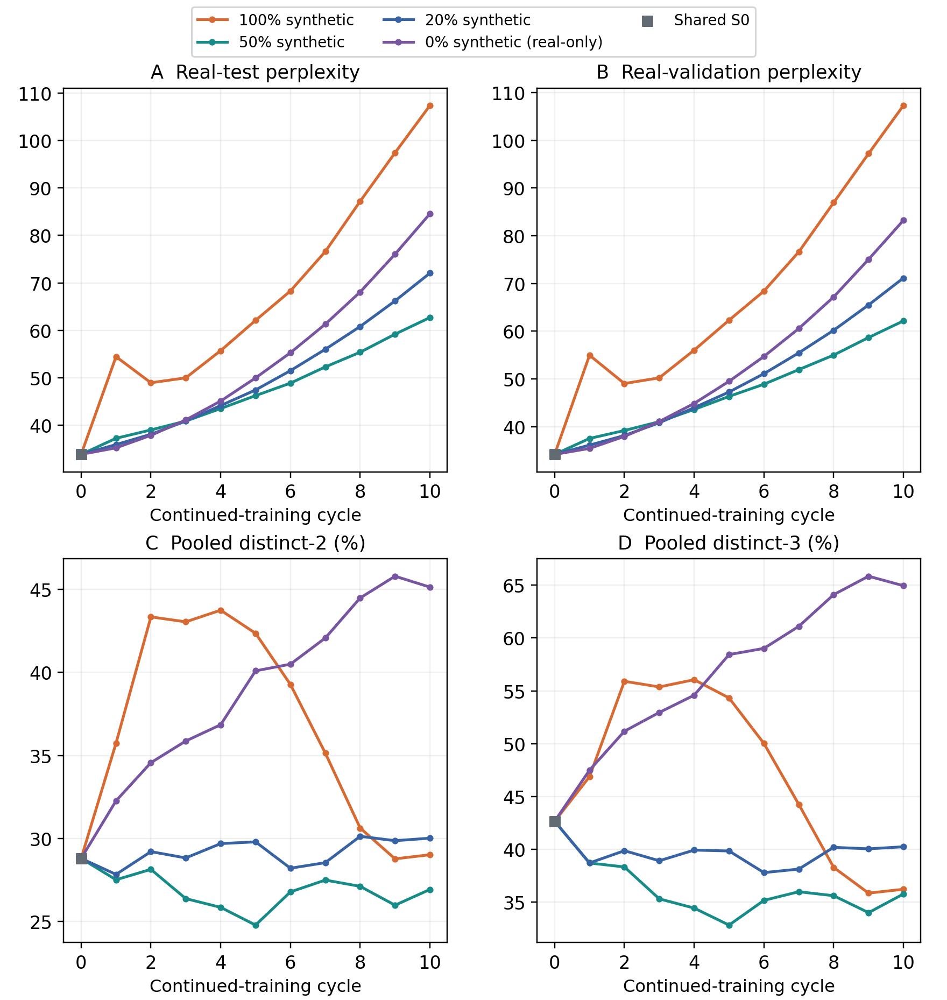
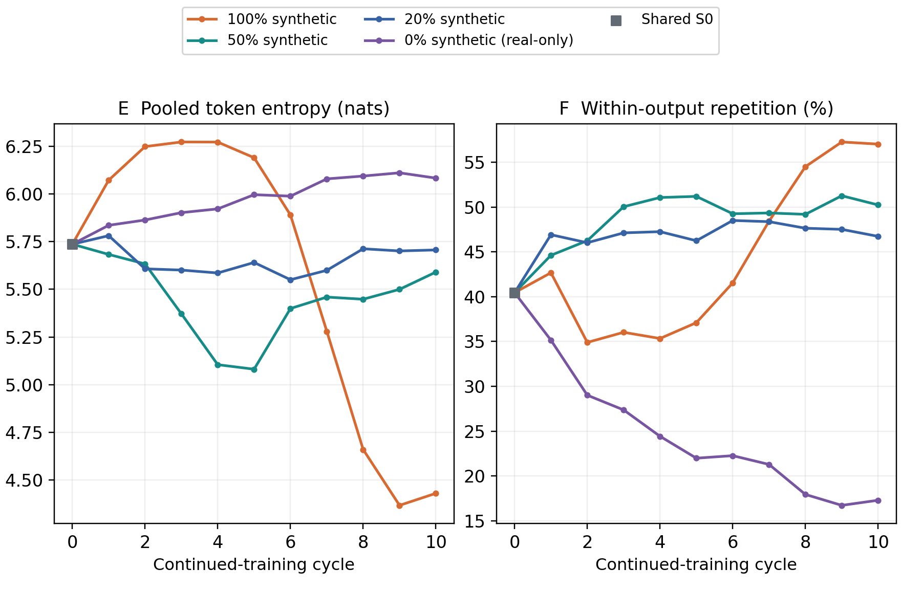
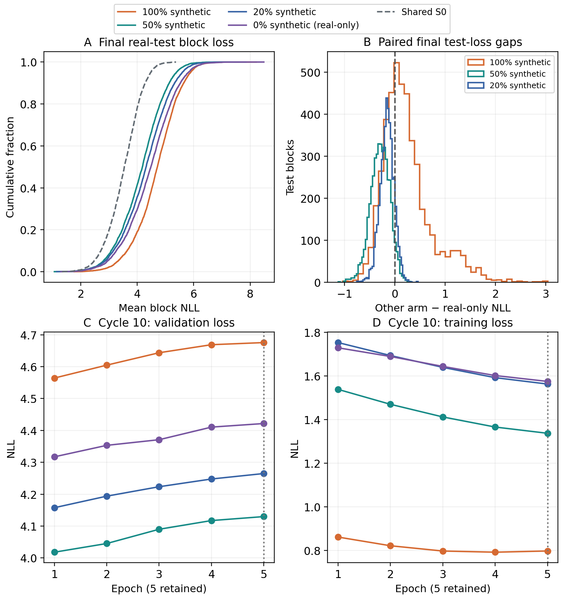
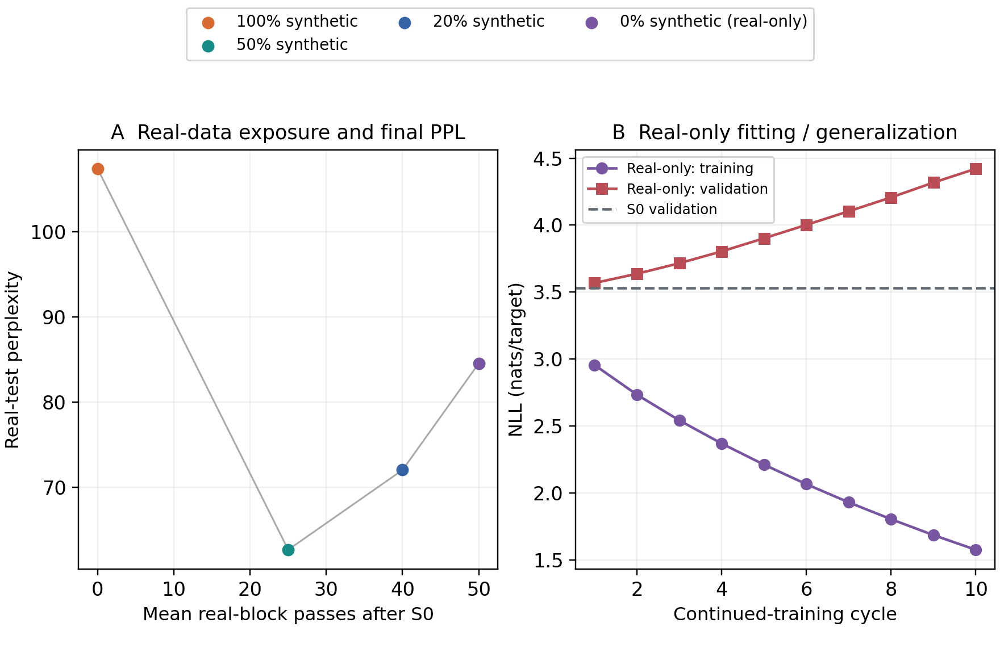
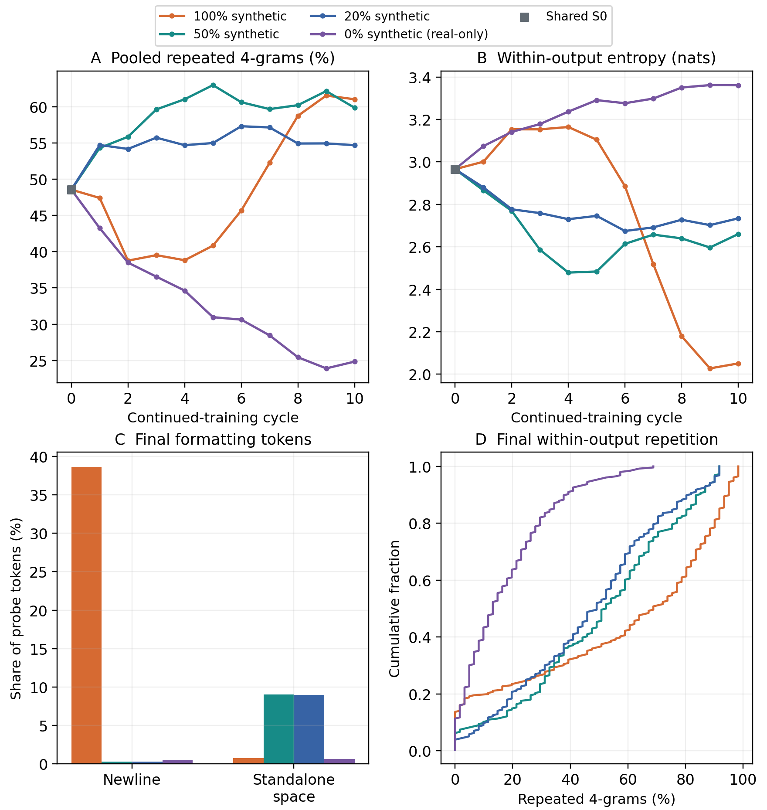
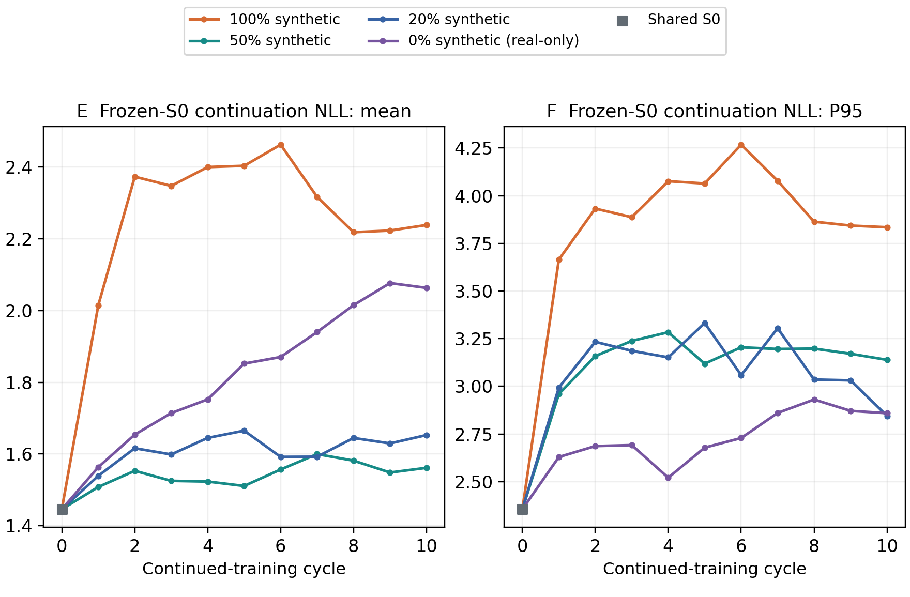
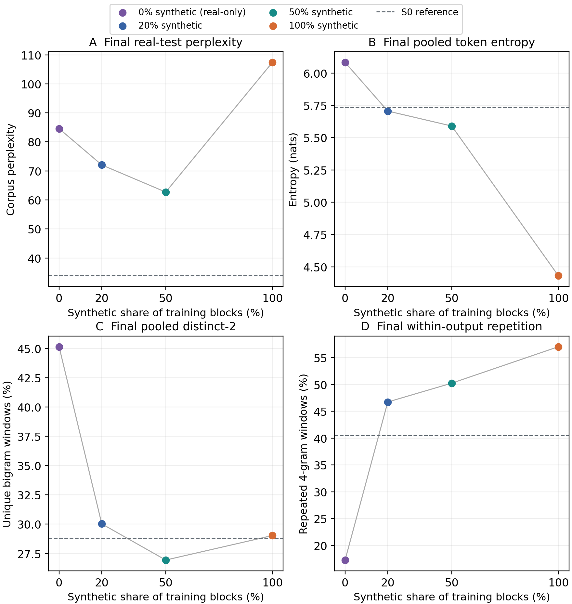

# Week 3, Part 6: Real-only continued-training control

OPT-125M / WikiText-2; seed 42. Ten continued updates, five epochs each, retaining epoch 5. Comparison with the completed 100%, 50% and 20% synthetic continued runs.

## 1. Question and controlled methodology

Can repeated training on the same finite real corpus worsen held-out prediction without any synthetic training targets? This control tests a possible contributor to the earlier 20%/50% reversal.

- Shared start and training: use the exact pinned real-trained S0, then carry the preceding selected weights through ten cycles. Restart AdamW/cosine each cycle; train five epochs and always retain epoch 5. Model/data revisions, seed 42, learning rate 2e-5, batch 128, microbatch 32 and BF16 match the earlier arms.

- Real-only selection: use all 37,946 blocks from the real training split each cycle, with a new deterministic selection order/shuffle. Sampling the entire pool changes order, not contents. The dataset remains frozen across its five epochs. No validation or test blocks are eligible.

- Fixed measurements: 3,922 real validation and 4,494 real test blocks; corpus NLL/PPL scores 63 next-token targets per block. Generated-text metrics use the same 256 fixed training prompts and 64-token continuations, five deterministic beams and repetition penalty 1.0. No prompt tokens enter synthetic targets.

- Execution difference: the real-only run uses RTX PRO 4500 Blackwell Server Edition rather than RTX PRO 4000. Recorded software/driver settings match; archived training, data, metric and checkpoint-selection code agree. Only measurement probes are generated at 0% synthetic, since full synthetic pools would supply no training targets.

Table 27. Training composition per cycle. Every arm uses 37,946×64 = 2,428,544 input tokens, repeated for fifty epochs. Mean real passes are additional average exposures per original real block after S0, not fresh independently collected data.

| Synthetic / real | Real blocks | Synthetic blocks | Input tokens | Mean real passes |
| --- | --- | --- | --- | --- |
| 100% / 0% | 0 | 37,946 | 2,428,544 | 0.0 |
| 50% / 50% | 18,973 | 18,973 | 2,428,544 | 25.0 |
| 20% / 80% | 30,357 | 7,589 | 2,428,544 | 40.0 |
| 0% / 100% | 37,946 | 0 | 2,428,544 | 50.0 |

The frozen-array audit found zero exact 64-token overlaps between the training split and either held-out split. This does not establish absence of shorter shared passages or pretrained-model contamination.

## 2. Held-out prediction and phrase diversity

Figure 22a. Fixed real-test/validation PPL (A/B) and pooled distinct-2/3 (C/D). Orange: 100% synthetic; teal: 50%; blue: 20%; purple: real-only. Grey marks the exact common S0. Lines join one-seed measurements.

- The real-only test curve rises every cycle: 33.89 at S0, 35.26 after one update, 49.99 at cycle 5 and 84.56 at cycle 10. Validation PPL also rises, ending at 83.23. Repeated continued training can therefore deteriorate on real held-out text even without synthetic targets.

- Final test PPL ranks 50% synthetic (62.71), 20% (72.06), real-only (84.56), then synthetic-only (107.37). Real-only is 34.85% worse than 50/50 and 17.35% worse than 20/80, but 21.24% lower than synthetic-only. None preserves S0 prediction.

## 3. Output diversity is a separate outcome

Figure 22b. Pooled token-frequency entropy (E) and mean repeated four-gram rate within individual outputs (F), using equal 256×64-token probes. Higher frequency entropy is not lower held-out error or higher factual accuracy.

- Real-only ends with pooled entropy 6.082 nats and distinct-2 of 45.14%, both higher than S0 (5.736; 28.81%) and all three final comparators. Mean within-output repetition falls to 17.28%, versus S0 40.45%, 20/80 46.73%, 50/50 50.24% and synthetic-only 57.03%.

- Meaning: the real-only outputs use a wider collection of token patterns and fewer local loops on this probe. A model can do that while assigning worse probabilities to unseen real text. Real-test PPL and generated-text diversity measure different behaviours; their rankings need not agree.

- Interpretation: the real-only control shows predictive deterioration with expanding probe diversity, whereas synthetic-only also shows narrowing entropy, loops and formatting failures. PPL increase alone is insufficient to attribute every deterioration curve to recursive synthetic-data collapse.

## 4. Endpoint statistics

S0 is a single common starting observation. The four S10 columns are separately trained endpoints; percentages describe identical output-token/window denominators. Distinct-n and repetition describe output patterns, not a universal quality score.

Table 28. S0 and cycle-10 endpoints. 100/50/20/0 denote the percentage of synthetic training blocks; 0 is entirely real. NLL/entropy use natural-log units. Duplicate counts are copies beyond the first among 256 outputs.

| Measure | S0 | 100% | 50% | 20% | 0% (real) |
| --- | --- | --- | --- | --- | --- |
| Real-test PPL | 33.89 | 107.37 | 62.71 | 72.06 | 84.56 |
| Validation PPL | 34.21 | 107.28 | 62.16 | 71.15 | 83.23 |
| Test NLL | 3.523 | 4.676 | 4.138 | 4.278 | 4.438 |
| Distinct-2 (%) | 28.81 | 29.03 | 26.94 | 30.03 | 45.14 |
| Distinct-3 (%) | 42.66 | 36.23 | 35.78 | 40.25 | 64.94 |
| Pooled entropy | 5.736 | 4.431 | 5.590 | 5.706 | 6.082 |
| Within-output entropy | 2.966 | 2.051 | 2.660 | 2.734 | 3.361 |
| Within repeated-4 (%) | 40.45 | 57.03 | 50.24 | 46.73 | 17.28 |
| Pooled repeated-4 (%) | 48.55 | 61.02 | 59.85 | 54.69 | 24.83 |
| Duplicates / 256 | 0 | 21 | 10 | 9 | 0 |
| Newline tokens (%) | 0.38 | 38.62 | 0.31 | 0.31 | 0.52 |
| Space tokens (%) | 1.14 | 0.75 | 9.02 | 8.97 | 0.62 |
| Frozen-S0 mean NLL | 1.446 | 2.238 | 1.562 | 1.653 | 2.063 |
| Frozen-S0 P95 NLL | 2.355 | 3.834 | 3.139 | 2.845 | 2.859 |

Pooled repeated-4 is exactly 1−distinct-4. Within-output repetition counts repeated windows separately inside each continuation; it must not be interpreted as pooled vocabulary entropy. All original outputs, including formatting tokens, remain in these statistics.

## 5. Generalization and fitting dynamics

Figure 23. A: final real-test block-loss distributions, with S0 dashed. B: each other arm minus real-only loss on identical blocks; positive favours real-only. C/D: cycle-10 validation/training losses across five epochs. D compares different target datasets across arms.

- The 50/50 model has lower final NLL than real-only on 4,257/4,494 test blocks (94.73%); 20/80 does so on 3,941 (87.69%). Real-only outperforms synthetic-only on 2,935 blocks (65.31%), while remaining worse than S0 on 4,436 (98.71%). These are descriptive corpus-block counts, not independent model replications.

- In all ten real-only cycles, epoch 1 has the lowest validation loss, but epoch 5 is deliberately retained. At cycle 10, continued fitting lowers training loss while validation loss rises. This is the intended final-epoch condition, not an accidental early-stop or checkpoint-selection error.

## 6. What the real-only control adds

Figure 24. A: final PPL versus mean additional real-block exposure; fraction changes together with exposure, so this is not an independently identified dose-response curve. B: real-only epoch-5 training and fixed validation NLL across cycles, with S0 validation dashed.

- Observed overfitting pattern: real-only training loss falls from 3.239 at the first new epoch to 1.575 at the final epoch, while validation loss rises from S0 3.533 to 4.422. The model fits the finite training pool better and generalizes to held-out text worse.

- This supports repeated finite-corpus fitting as a contributor to the 20%/50% reversal. The 20% mixtures expose each real block about forty additional times on average, versus twenty-five at 50% and fifty in the real-only control. These are repeated passages, not ever-growing supplies of fresh real text.

- It does not prove repetition is the sole cause or that 50/50 is optimal. Mixture fraction also changes self-generated targets; each cycle restarts optimization at the original learning rate, and epoch 5 is retained despite worsening validation. The real-only GPU differs, and only one seed was run.

## 7. Repetition and formatting diagnostics

Figure 25a. Pooled repeated four-grams (A), mean within-output entropy (B), endpoint formatting-token shares (C) and within-output repetition distributions (D). More lexical variety can coexist with worse real-test probabilities.

- Real-only has no duplicate or whitespace-only outputs in the probe; newline and standalone-space shares are 0.52% and 0.62%. Synthetic-only has 21 duplicate outputs and 38.62% newline tokens. The mixed endpoints avoid the large newline concentration but retain roughly 9% standalone-space tokens.

- Real-only is less repetitive on the same prompt than synthetic-only in 197/256 cases, 50/50 in 220 and 20/80 in 217. It is still not free of repetition, and this prompt-level advantage establishes neither factual correctness nor broad task competence.

## 8. Frozen-S0 continuation scores

Figure 25b. Mean (E) and 95th-percentile (F) NLL assigned by frozen S0 to each generated continuation alone. Teacher-force its 64 tokens, score 63 targets and omit the original prompt. Lower means more predictable to S0.

- Real-only mean NLL is 2.063 versus 2.238 for synthetic-only, 1.562 for 50/50 and 1.653 for 20/80. Its P95 is 2.859. The mean and tail assess different aspects of the distribution and can rank conditions differently.

- S0 judges different strings produced by each endpoint. Varied text may be harder to predict than a repetitive loop; a low score can therefore reward predictable degeneration. This is not a distance between model weights, a factuality score or a second measurement on the fixed real test set.

## 9. Exact same-prompt examples

Prompt 0 is the historical fixed anchor, chosen before seeing these results. Factual claims in all continuations are unverified; reduced looping is not evidence that dates, platforms or developers are correct.

> </s></s> = Valkyria Chronicles III = \n</s></s> Senjō no Valkyria 3 : Unrecorded Chronicles ( Japanese : 戦場のヴァルキュリア3, lit. Valkyria of the Battlefield 3 ), commonly referred to as Valkyria Chronicles III outside

Table 29. Complete saved 64-token continuations at cycle 10. Within-output repeated-4 is 73.77% (100%), 86.89% (50%), 37.70% (20%) and 4.92% (real-only) on this prompt. It illustrates a local result, not aggregate representativeness.

| Final model | Complete saved continuation |
| --- | --- |
| 100% synthetic |  Japan ) is a video game in the Valkyria Chronicles series of video games in the Valkyria Chronicles series of video games in the Valkyria Chronicles series of video games in the Valkyria Chronicles series of video games in the Valkyria Chronicles series of video games in the Valkyria Chronicles series of |
| 50% synthetic |  Japan as Valkyria Chronicles 3 : Valkyria Chronicles 3 : Valkyria Chronicles 3 : Valkyria Chronicles 3 : Valkyria Chronicles 3 : Valkyria Chronicles 3 : Valkyria Chronicles 3 : Valkyria Chronicles 3 : Valkyria Chronicles 3 : Valkyria Chronicles 3 : Valky |
| 20% synthetic |  Japan ) is the third entry in the Valkyria Chronicles series of video games. It was released for the PlayStation 3, PlayStation 4, Xbox 360, Nintendo 3DS, Nintendo 3DS XL, Nintendo 3DS XL, Nintendo 3DS XL, Nintendo 3DS XL, Nintendo 3DS XL, Nintendo 3DS XL |
| 0% synthetic / real-only |  Japan and as Valkyria Chronicles III in North America ) is the fourth entry in the Valkyria Chronicles series of video game video games. It was released in Japan on June 29, 2003 by Capcom. It is the third game in a three @-@ part series between Valkyria Chronicles III and Valky |

The real-only text is less trapped in a repeated phrase here, but it still contains suspicious factual claims and ends mid-word/token sequence. Fixed-length generation does not guarantee a complete sentence. Full prompt-level examples and original token IDs are saved.

## 10. Cycle-10 outcomes versus synthetic fraction

Figure 26. Requested endpoint summary: final real-test PPL (A), pooled token entropy (B), pooled distinct-2 (C) and mean within-output repeated four-grams (D) versus synthetic block fraction. Dashed lines mark S0. Connecting segments join four measured points; no optimum is fitted.

- Among these four seeded endpoints, 50% has the lowest test PPL. Moving from 100% toward 50% helps prediction, but continuing to 20% and 0% reverses that direction. The result is non-monotonic; the unsampled fractions and other seeds remain unknown.

- Output statistics tell a different story: pooled entropy decreases as synthetic share increases (6.082 → 5.706 → 5.590 → 4.431 nats), while within-output repetition rises (17.28 → 46.73 → 50.24 → 57.03%). Distinct-2 has a non-monotonic intermediate ordering. These output trends coexist with the non-monotonic PPL result.

## 11. Conclusions, limits and reproducibility

- Finding 1: synthetic data are not required for deterioration under this repeated five-epoch continued-training schedule. Real-only test PPL increases by 149.56% relative to S0.

- Finding 2: the 50/50 and 20/80 mixtures outperform both extremes on final real-test PPL in this comparison. This is consistent with a trade-off between fitting the finite real pool and learning from evolving synthetic targets, but does not identify the mechanism or establish that synthetic data are universally beneficial.

- Finding 3: predictive generalization and output diversity must be reported separately. The real-only control is the least repetitive endpoint on the fixed probe despite its worse PPL than either mixture.

- Limits: one seed per condition, deterministic beam decoding, short contexts and a probe made from the first 256 consecutive training prompts spanning six adjacent articles. Hardware differs for real-only. No statistical significance or universally safe mixture fraction is claimed.

- To identify the mechanism more sharply, useful controls are additional seeds and matched-hardware runs, and independently varying the amount of reused versus fresh real text while holding the total training budget fixed. None was run for this report.

Execution audit: all fifty full-pool epochs ran in 48.54 minutes wall-clock, including 37.47 minutes of training loops. The earlier 8.51-hour estimate counted unused full synthetic generation; removing it yields 2.22 hours on the old benchmark and 1.71 hours on the actual GPU, both with conservative overhead. Compute stopped automatically at 16:37:06 UTC on 2 November.

Evidence: all 44 per-cycle metric rows, 200 epoch histories, 41 unique fixed probes, matching S0/evaluation arrays, deterministic mixture selections and model/data handoffs were audited. Ten new probes total 656,640 bytes. Earlier publications and report pages remain preserved.

This section was prepared from pinned backups and offline records. No Runpod/SSH, training, paid compute or cloud-resource changes were used. A separate timing audit reconstructed all real training datasets. Full checkpoint restoration and independent model re-evaluation remain outside this analysis.

[Metrics](analysis/metrics.csv) | [Epoch histories](analysis/training_history.csv) | [Examples](analysis/examples.json) | [Timing audit](timing_audit.md)
