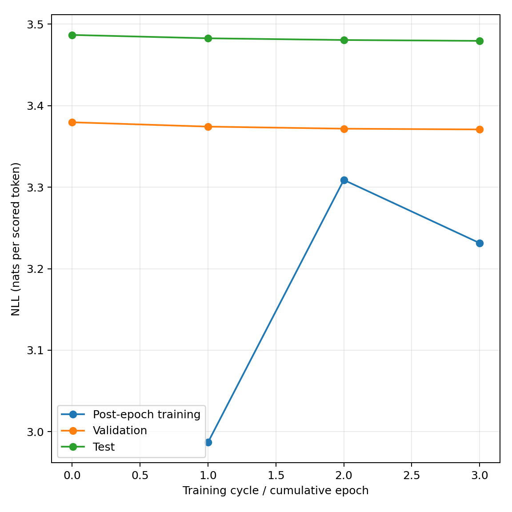
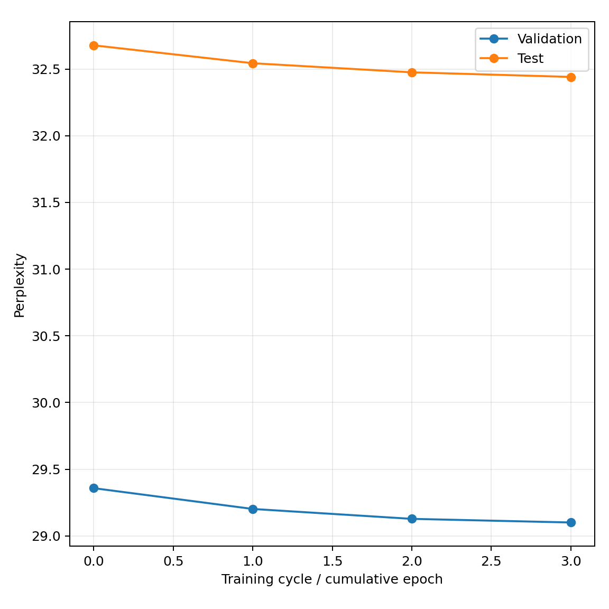
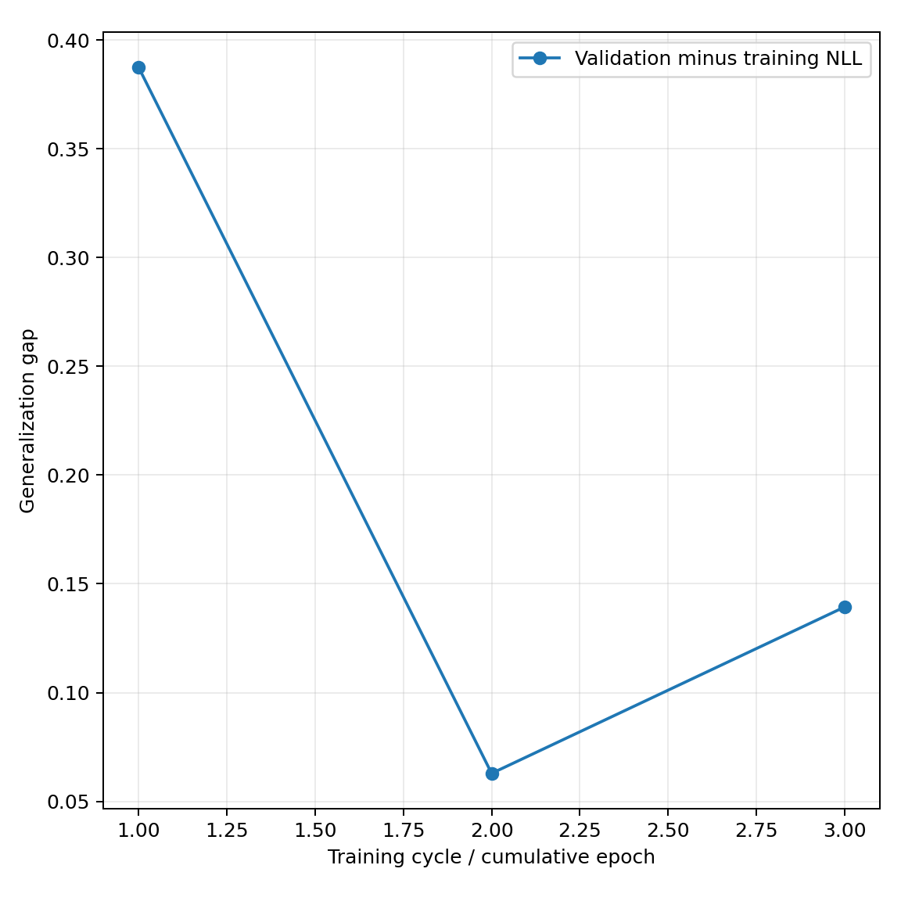
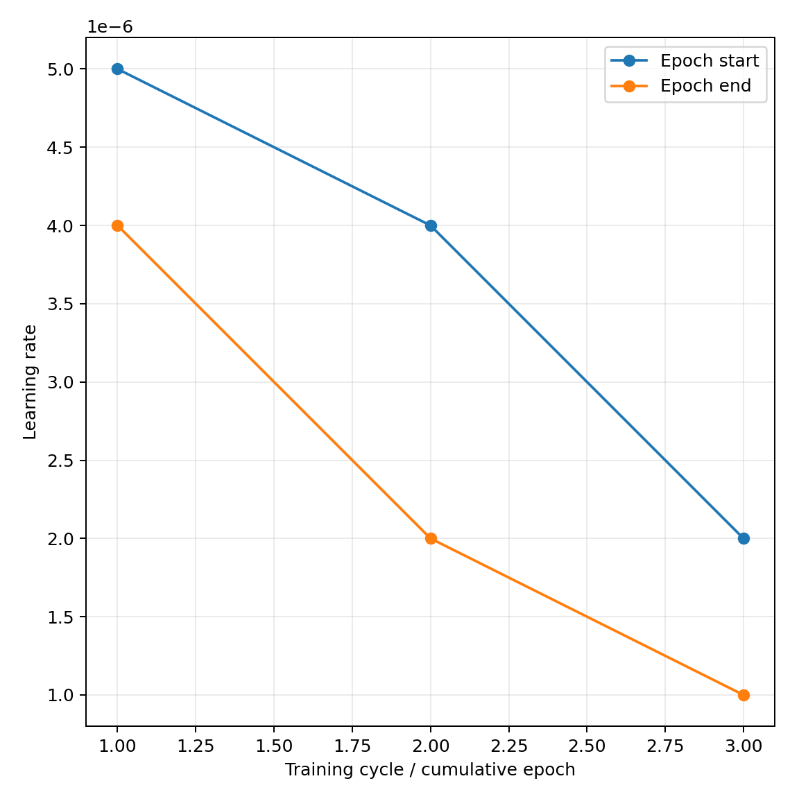
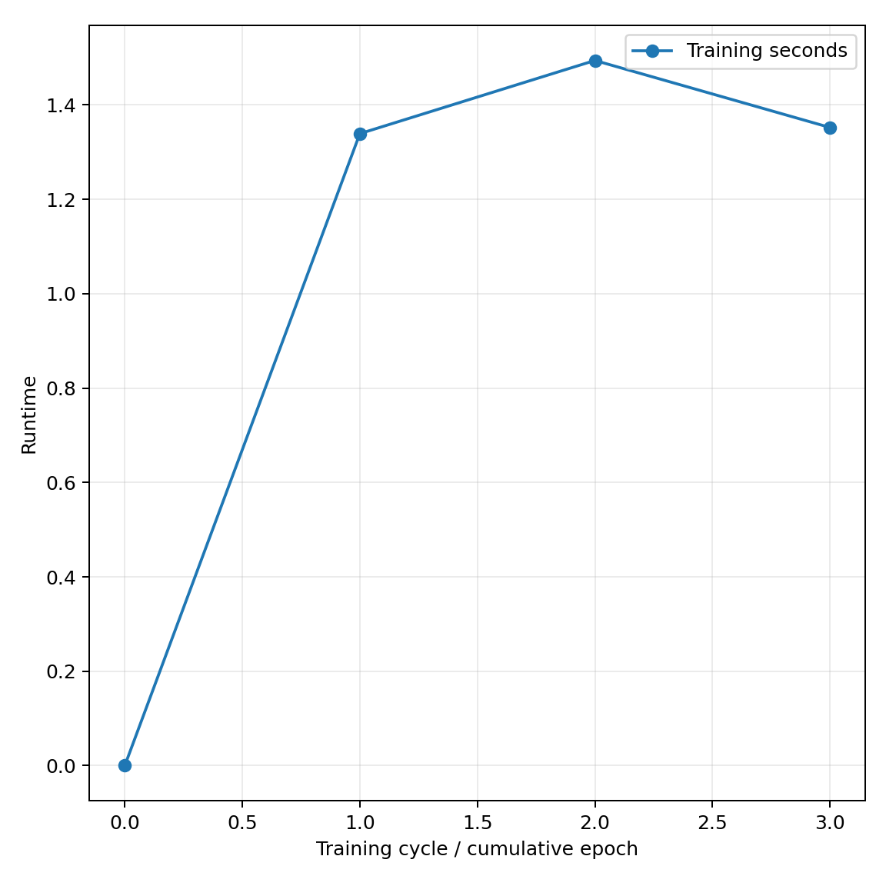

# FineWeb-Edu real-only pipeline validation

OPT-125M, seed 42, one epoch per cycle, variable sequences up to 512 tokens. Model, AdamW and global cosine scheduler continue across cycles. Data come from disjoint sampled documents.

Completed cycles 3. Initial validation PPL 29.3578. Latest validation PPL 29.1006.

| Cycle | Source tokens | Validation PPL | Test PPL |
|---|---|---|---|
| 0 | 0 | 29.3578 | 32.6774 |
| 1 | 16384 | 29.2020 | 32.5433 |
| 2 | 16384 | 29.1278 | 32.4750 |
| 3 | 16384 | 29.1006 | 32.4406 |

Training corpora change each cycle. Post-epoch training NLL uses evaluation mode. Padding is excluded from all scored-token counts.
