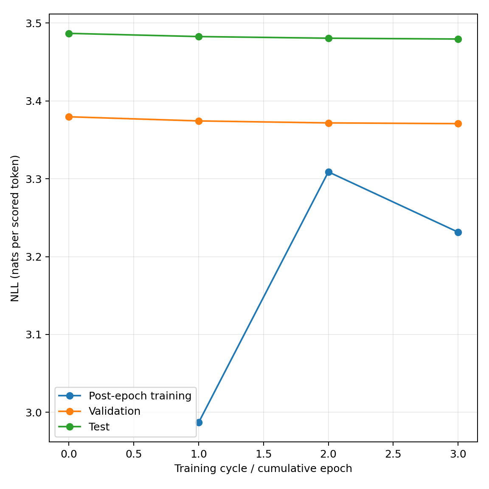
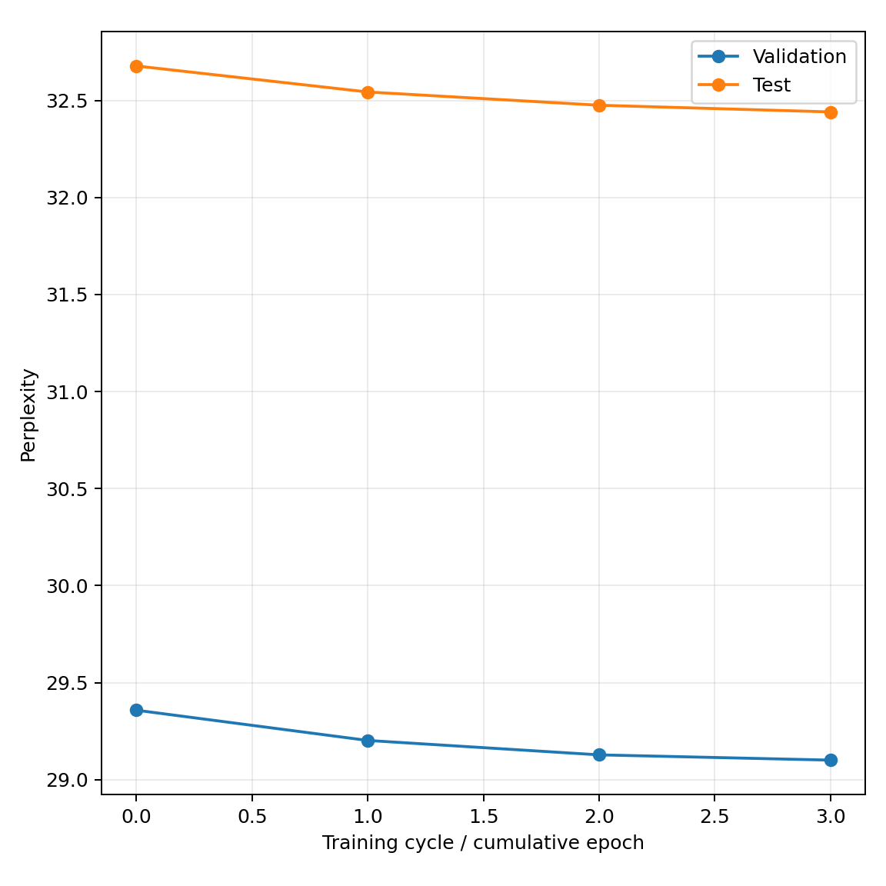
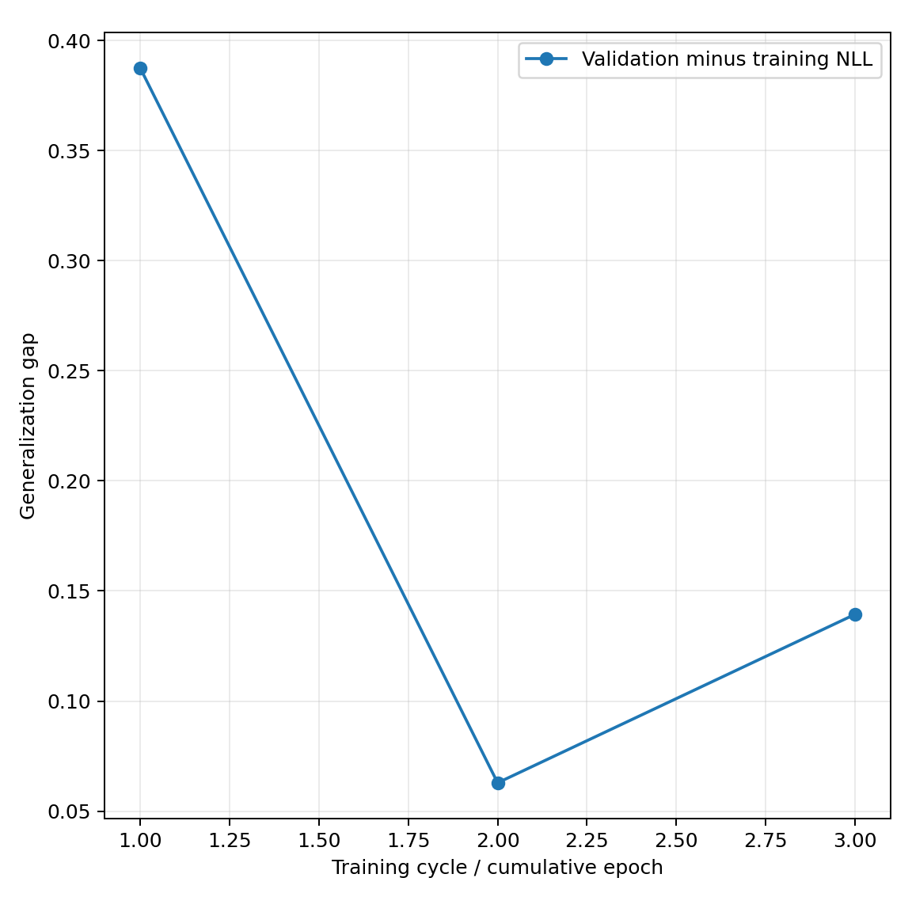
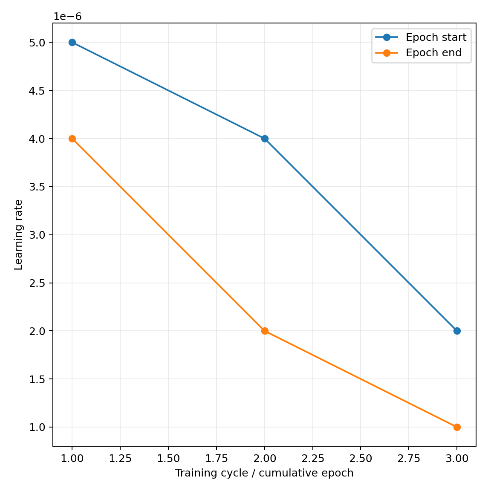
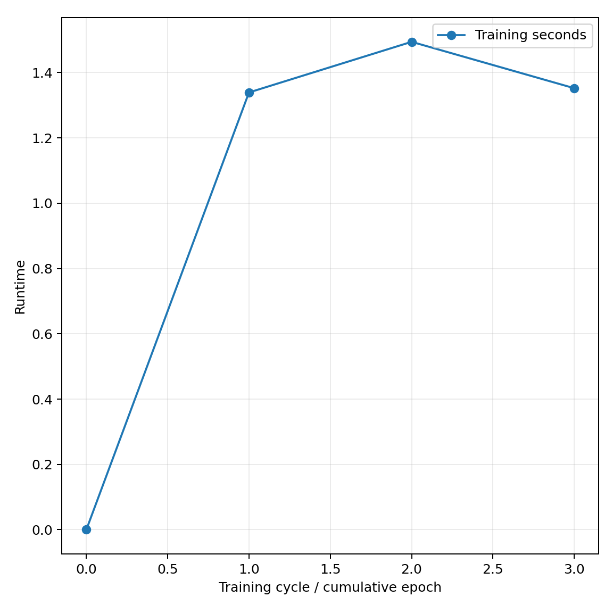

# FineWeb-Edu real-only pipeline validation

Run `20261106T143315Z-smoke-fresh-real` validates three actual OPT-125M training cycles and recovery. The full ten-cycle pilot awaits a separate launch instruction.

## Method

- Original pretrained OPT-125M, pinned model revision, FineWeb-Edu `sample-10BT` pinned revision, seed 42.
- Three disjoint collections of 16,384 source-text tokens, one terminal epoch each. Fixed 64-document validation and test collections are reserved first.
- Sequences contain at most 512 tokens. BOS starts every sequence; EOS marks genuine document endings. Padding is masked from attention and targets.
- AdamW moments, model weights and a global cosine schedule continue across cycles. LR falls from 5e-6 to 1e-6 across nine optimizer updates.
- Microbatch 4, effective batch 16 sequences, BF16 autocast with FP32 parameters. Accumulated gradients are weighted by scored-target counts.
- Evaluate the untouched baseline and each terminal model. Training NLL is measured after the epoch with dropout disabled.

## Data accounting

| Collection | Documents | Sequences | Source tokens | Specials | Non-padding | Scored targets |
| --- | ---: | ---: | ---: | ---: | ---: | ---: |
| validation | 64 | 149 | 59209 | 213 | 59422 | 59273 |
| test | 64 | 226 | 98931 | 290 | 99221 | 98995 |
| cycle_01 | 17 | 42 | 16384 | 58 | 16442 | 16400 |
| cycle_02 | 8 | 36 | 16384 | 43 | 16427 | 16391 |
| cycle_03 | 24 | 44 | 16384 | 67 | 16451 | 16407 |

The source quota excludes BOS, EOS and padding. Every source token is scored after a BOS or earlier source context. Genuine document-ending EOS targets explain scored counts slightly above the source counts.

The deterministic shuffled stream read 10,177 rows, including the 10,000-document buffer. Coverage is recorded in [the data manifest](records/data/manifest.json). The selected collections passed identity and sliding-64-token-passage separation checks. [Short public-source examples](dataset_preview.json) identify source rows and quota trimming.

## Measurements

| Cycle | Optimization NLL | Post-epoch training NLL | Validation NLL | Validation PPL | Test PPL |
| --- | ---: | ---: | ---: | ---: | ---: |
| 0 | — | — | 3.37956 | 29.35776 | 32.67738 |
| 1 | 3.08833 | 2.98687 | 3.37424 | 29.20198 | 32.54326 |
| 2 | 3.38351 | 3.30882 | 3.37169 | 29.12779 | 32.47501 |
| 3 | 3.28961 | 3.23141 | 3.37076 | 29.10061 | 32.44062 |

Corpus NLL sums masked next-token negative log-probabilities and divides by the actual scored-target count. Corpus perplexity is the exponential of that mean. The generalization gap is validation NLL minus post-epoch training NLL.

Validation PPL decreases slightly in this small run. Three short training collections and 64-document held-out sets establish execution behaviour; the predeclared 5% criterion is assessed on the full ten-cycle, 1,000-document-evaluation pilot.



Post-epoch training and held-out NLL.



Fixed validation/test corpus perplexity.



Validation minus current-collection post-epoch training NLL. The training corpus changes each cycle.



Epoch-start and epoch-end LR under the continuous global schedule.



Measured training-loop seconds per completed cycle.

## Acceptance and recovery

- All 402 offline tests passed, including historical compatibility and new quota, masking, optimization continuity and recovery regressions.
- Three actual cycles changed weights. Reloaded terminal checkpoint tensors and carried AdamW/global-step state matched their recorded identities.
- A deliberate exit after cycle 1 and another inside cycle 2 recovered successfully. Cycle 1 artifacts remained unchanged.
- Detached progress continued across closed SSH connections. The separate budget watchdog triggered real provider shutdown.
- Restored 92 pinned private backup objects / 5,027,103,384 bytes remotely, including model/optimizer tensors. The restored test NLL reproduced within 1e-7; direct shifted masked NLL maximum error was 0.
- The first attempt exposed a local resource-record serialization mismatch. The fix reuses verified historical control-file redirects and preserves the authoritative registry. The corrected runtime passed a new GPU run, reproducing data bytes and selected tensor hashes.
- Both temporary Pods and volumes were deleted after verified recovery. Historical recovery resources were preserved; no GPU is active at the final inventory check.

## Cost, forecast and future launch

RTX 4000 Ada Generation, 20 GB, USD 0.28/hour, with a 30 GB Standard network volume and pinned official PyTorch image. Both validation attempts together cost USD 0.11383 conservatively, within USD 0.50. Observed combined account debit was USD 0.09545, including other retained storage and billing timing.

The full ten-cycle forecast is 50.4 minutes / USD 0.240 compute and running storage, plus approximately USD 0.024 concurrent historical storage. Seven days retaining the new volume adds USD 0.483. The launcher requires matching stock and a fresh budget check.

```powershell
python -m model_collapse launch --config experiments/opt125m_fineweb_edu/fresh_real_one_epoch/full.yaml --generations 10
```

See the [handoff](../../docs/fineweb-real-only-handoff.md) for status, recovery, reporting and cleanup commands. The full pilot uses ten fresh 640,000-source-token collections and fixed 1,000-document validation/test collections.

## Reproduction and scope

Small original records are copied byte-for-byte under `records/`. Model weights, optimizer tensors, token arrays and complete document text remain private. The published file manifest binds this report and analysis. Regeneration uses a new destination.

```powershell
python scripts/analysis/build_fresh_real_validation.py --out .state/fineweb-report-review
```

One seed is descriptive. Sampling uses a shuffled stream with finite recorded coverage. Exact passage checks address 64-token matches, while shorter/semantic overlap, human authorship and pretraining contamination remain outside this audit.
