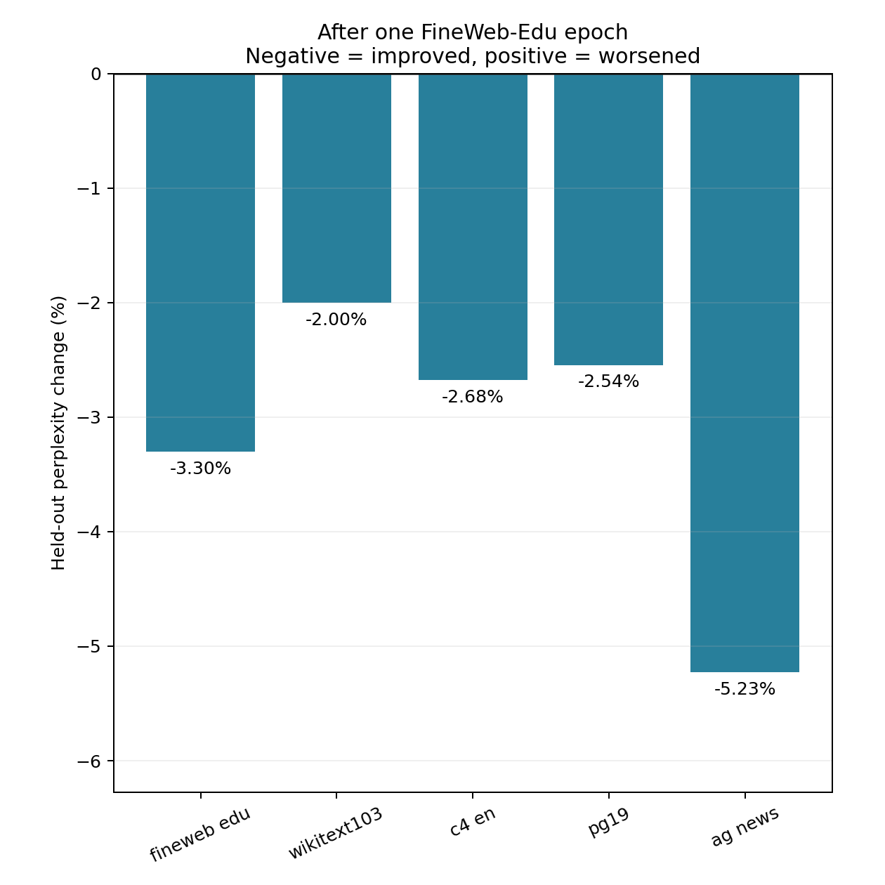

# One-epoch FineWeb-Edu cross-corpus evaluation

Completed 6 November 2026. Evaluation ID `20261106T171304Z-cross-corpus-evaluation`.

## Question and result

The proposed prediction was that one FineWeb epoch would reduce in-domain perplexity and increase out-of-domain perplexity. **Perplexity instead decreased on all five selected test collections.** The largest relative decrease was on AG News.

## Method

- Reuse the exact original pretrained OPT-125M checkpoint and its checkpoint after the first 640,000-source-token FineWeb-Edu epoch from `20261106T151257Z-full-fresh-real`.
- This first epoch used 583 documents, 1,544 model sequences and 97 optimizer updates. It belongs to the original ten-cycle global learning-rate schedule, beginning at 5e-6. No new training updates were executed for this comparison.
- Load both checkpoints in FP32 and evaluate with BF16 autocast on the same RTX 4090, PyTorch 2.8.0+cu128 and the same pinned dependencies. Every checkpoint tensor hash must match the historical record.
- Use the identical OPT tokenizer, BOS/EOS policy, right-padding masks and maximum 512-token sequence length for every source. Each model sees precisely the same test arrays and target counts.
- Compute token-weighted corpus NLL, then exponentiate once to obtain corpus perplexity. Padding and initial BOS tokens are excluded from scored targets. Genuine EOS targets are included.

$$NLL = -\frac{1}{N}\sum_{i=1}^{N}\log p_\theta(x_i\mid x_{<i}),\qquad PPL=\exp(NLL).$$

### Prepared source bank

The table gives source-text token counts. FineWeb retains its exact historical held-out arrays. The four new sources each reserve 128,000 validation and 128,000 test source tokens. Each source also has a frozen two-million-token training pool for a later mixture protocol.

| Source | Train tokens | Validation tokens | Test tokens | Test documents/books |
|---|---:|---:|---:|---:|
| FineWeb-Edu | 2,000,000 | 1,000,439 | 978,319 | 1,000 |
| WikiText-103 raw | 2,000,000 | 128,000 | 128,000 | 34 |
| English C4 | 2,000,000 | 128,000 | 128,000 | 274 |
| PG-19 books | 2,000,000 | 128,000 | 128,000 | 8 |
| AG News | 2,000,000 | 128,000 | 128,000 | 2,451 |

Selection revisions, native split rules, stream coverage and exclusions are documented in the [corpus bank](../../corpora/README.md). Training pools total ten million source tokens and occupy approximately 421 MB with original texts, masks and provenance. The FineWeb training pool reuses earlier training selections. Future use of an adapted starting checkpoint must account for that history.

## Held-out results

Every percentage compares the same corpus before and after the FineWeb epoch. Different corpora have different intrinsic predictability, so absolute perplexities need that context.

| Test collection | Scored targets | Pretrained PPL | After one epoch PPL | Relative change | NLL change |
|---|---:|---:|---:|---:|---:|
| FineWeb-Edu | 979,319 | 28.34553 | 27.40898 | -3.304% | -0.033599 |
| WikiText-103 raw | 128,033 | 39.52300 | 38.73086 | -2.004% | -0.020246 |
| English C4 | 128,273 | 28.98583 | 28.20983 | -2.677% | -0.027136 |
| PG-19 books | 128,000 | 75.86166 | 73.93155 | -2.544% | -0.025772 |
| AG News | 130,450 | 54.62946 | 51.77332 | -5.228% | -0.053698 |

Figure 1. Relative perplexity change after the first FineWeb-Edu epoch. Negative values indicate better next-token prediction on that held-out collection.

## Interpretation

- The FineWeb improvement extends to Wikipedia, general web text, books and news in these measurements. The predicted out-of-domain deterioration was absent at this checkpoint.
- A plausible explanation is positive transfer from additional broad English-language training. FineWeb-Edu includes varied topics and writing patterns shared with the other collections. The update is also small, with 97 low-learning-rate optimizer steps.
- The measurements establish the direction of this checkpoint's changes. They do not isolate which linguistic features caused the improvement. AG News has the largest relative gain, and its short-document evaluation structure differs from the longer book/web contexts.
- This is one seed and one training dose on finite held-out subsets. Later epochs, other learning rates and future mixtures require their own trajectories. PG-19 evaluation covers eight book windows, so its genre coverage is limited.
- Document identities, normalized URLs/text, canonical Wikipedia titles and exact 64-token passages are separated across the bank. Every held-out collection also excludes the earlier FineWeb training history. Semantic/shorter approximate overlap and original OPT pretraining exposure were outside this verification scope.

## Example held-out passages

The excerpts below are the first fixed seeded preview selection for each test source. The full local preview contains three excerpts per source/split. Original document identities and source URLs are retained in the private bank and the small [example record](examples.json).

| Source | Short excerpt |
|---|---|
| FineWeb-Edu | Good community engagement is fundamental to effective and responsive development. It gives legitimacy to the project process, ensuring proposed development serves the |
| WikiText-103 raw | = Battle of Dürenstein = The Battle of Dürenstein ( also known as the Battle of Dürrenstein, Battle of Dürnstein and Battle |
| English C4 | Extends DocumentCollection API along with specific methods for io.cozy.apps. Main API against the cozy-stack server. Abstracts a collection of documents of the |
| PG-19 books | of his moral worth. This defense is vehemently seconded in the same magazine by Joseph von Retzer. The one great opponent of |
| AG News | MOFA releases new names of Indonesian hostages JAKARTA (Antara): The Ministry of Foreign Affairs offered up on Tuesday yet new names of |

## Verification and operations

- All 414 offline tests passed on the final evaluation code. The shared accepted training runtime remains unchanged.
- Exact historical FineWeb validation/test array file hashes were reproduced. An independent audit verified all 206 bank files and found zero document-identity conflicts across 52,530 selected records.
- All 209 private bank objects were verified using their LFS SHA-256 or Git blob hashes, and the immutable bank manifest was downloaded and checked.
- The first RTX 2000 Ada attempt failed a strict historical-loss reproduction check before result backup. Its model/input evidence was preserved. A host-capacity rejection prevented restarting that Pod, so the retry used an RTX 4090 and recorded cross-GPU numerical drift separately.
- The successful retry retained exact checkpoint/input hashes. Historical FineWeb NLL differences were 0.000006565 before training and 0.000003423 after training, both below the declared 0.0001 tolerance. Direct teacher-forced masked NLL calculations agreed exactly with the shared evaluator.
- Private result restoration verified 33 indexed files / 24,115,389 bytes, including every evaluation input array. Selected model weights were downloaded and checked remotely, with their authoritative source checkpoints preserved in the original private backup.
- The independent watchdog requested completion shutdown. Provider shutdown was verified at 17:25:25 UTC. Both temporary Pods and the 10 GB temporary volume were deleted after recovery. Historical recovery resources remain intact.
- Conservative compute estimate across all attempts was USD 0.08299, plus USD 0.00020 temporary storage, within the USD 0.50 evaluation cap. These are rate/time estimates. The early account debit receipt includes billing lag and concurrent historical storage.

The [dated receipt](../../docs/validation/2026-11-06_cross-corpus-evaluation.json) records runtime identities, backup commits, offline checks and recovery scope. The [manual evaluation launcher](../../scripts/operations/cross_corpus_evaluation.py) remains separate from training workflows.
