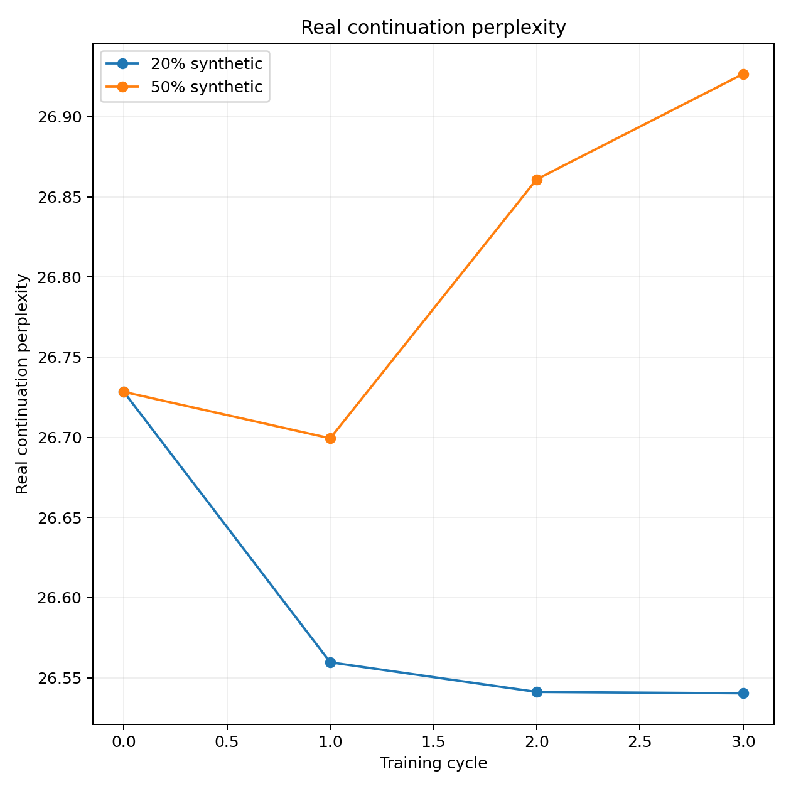
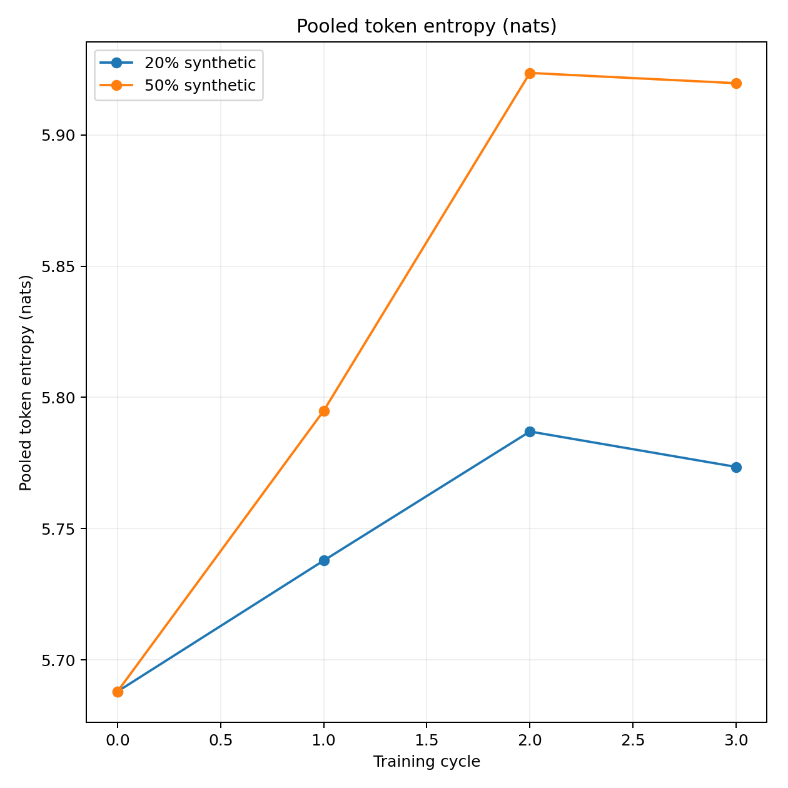
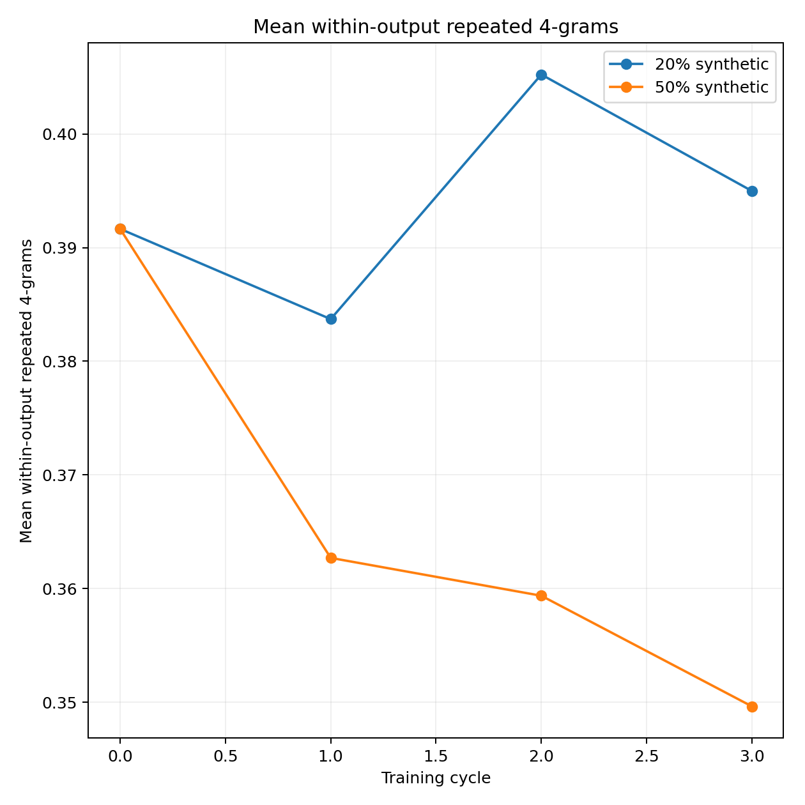

# Matched FineWeb mixtures — setup validation

The 50/50 and 20/80 continuation conditions passed the small production-path GPU comparison. Full-data training awaits a separate launch instruction.

## Methodology

- Both arms start independently from original pretrained OPT-125M and carry model, AdamW, global cosine schedule and training RNG state.
- Each selected synthetic continuation is generated by that arm's own preceding checkpoint. Remaining targets retain their original FineWeb continuation.
- Seeded nested selections preserve original prompt rows. Attention covers BOS, 64 prompt tokens and 64 continuation tokens. Only the continuation is scored.
- Smoke scope is three cycles per arm, 320 training pairs per cycle, 64 validation/test pairs and a fixed 64-prompt probe.

## Acceptance results

| Check | Result |
| --- | --- |
| direct masked nll | Passed |
| generation shard recovery | Passed |
| all handoffs and optimizer states | Passed |
| sealed private stage restores | Passed |
| nested selections | Passed |
| both private restores | Passed |
| six terminal epochs | Passed |
| coordinator recovery | Passed |
| completed stages unchanged | Passed |
| training recovery | Passed |
| continuation only loss | Passed |
| matched initial weights and prompts | Passed |
| exact mixture reconstruction | Passed |
| restored evaluation | Passed |
| detached progress verified | Passed |
| independent budget guard and provider stop verified | Passed |

The full offline suite passed 466 tests. An additional matched-reference report regression passed, including square figures and preserved evidence hashes. Independent review passed 51 targeted checks and 10 follow-up checks.

Both private trained-arm backups were cold-restored and every sealed stage verified, covering 9,022,500,703 bytes. Restored checkpoints reproduced held-out evaluation. The shared baseline was verified locally using existing checksum-matched files.

Provider shutdown was verified at 2026-11-07T00:18:22+00:00, after 19.28 minutes of validation compute. The temporary Pod and 60 GB volume were removed. The existing full comparison was independently observed as RUNNING.

## Smoke measurements

| Condition | Cycle | Validation PPL | Test PPL | Real pairs | Synthetic pairs |
| --- | ---: | ---: | ---: | ---: | ---: |
| mixed50 | 0 | 39.27858 | 26.72833 | 0 | 0 |
| mixed50 | 1 | 39.38117 | 26.69936 | 160 | 160 |
| mixed50 | 2 | 39.75631 | 26.86092 | 160 | 160 |
| mixed50 | 3 | 39.88092 | 26.92661 | 160 | 160 |
| mixed20 | 0 | 39.27858 | 26.72833 | 0 | 0 |
| mixed20 | 1 | 39.13097 | 26.55962 | 256 | 64 |
| mixed20 | 2 | 39.17742 | 26.54115 | 256 | 64 |
| mixed20 | 3 | 39.21705 | 26.54029 | 256 | 64 |

These trajectories describe the small acceptance dataset. Full-data scientific analysis follows the later launch.

## Figures

Primary perplexity scores the same 64 real held-out continuation pairs throughout this smoke.



Probe entropy pools token frequencies across the fixed generated outputs. Within-output repetition counts duplicated four-token phrases inside each continuation.





## Training examples

### mixed50

Original row 127.

**Prompt**

>  udayagiri and khandagiri caves, bhubaneshwar get visiting hours, entry fees, ticket price, authorization information. The capital of odisha, bhubaneshwar is home to the famed jain cave temples of khandagiri and udayagiri unfortunately these have not been

**Original real continuation**

> . The caves at udayagiri were numbered in the 19th century these caves is a'must see' udayagiri and khandagiri - the city of bhubaneswar in orissa.
> Just 7 kms west of bhubaneswar are the twin hills of khandagiri

**Generated training continuation**

>  updated in the last few years.
> 
> The cave temples of udayagiri and bhubaneshwar have been updated in the last few years. The cave temples of udayagiri and bhubaneshwar have been updated in the last few years. The cave temples of udayagiri and

### mixed20

Original row 127.

**Prompt**

>  udayagiri and khandagiri caves, bhubaneshwar get visiting hours, entry fees, ticket price, authorization information. The capital of odisha, bhubaneshwar is home to the famed jain cave temples of khandagiri and udayagiri unfortunately these have not been

**Original real continuation**

> . The caves at udayagiri were numbered in the 19th century these caves is a'must see' udayagiri and khandagiri - the city of bhubaneswar in orissa.
> Just 7 kms west of bhubaneswar are the twin hills of khandagiri

**Generated training continuation**

>  updated in the last few years.
> 
> The cave temples of udayagiri and bhubaneshwar have been updated in the last few years. The cave temples of udayagiri and bhubaneshwar have been updated in the last few years. The cave temples of udayagiri and

## Full-run forecast and cost

| Condition | Hours | Running cost estimate |
| --- | ---: | ---: |
| mixed50 | 1.81 | USD 1.05 |
| mixed20 | 1.19 | USD 0.69 |
| Combined | 3.01 | USD 1.74 |

The benchmark used production batches. The forecast includes 20 training epochs, 70,000 generated training continuations, fixed probes, primary/secondary evaluation and backup overhead, with a 1.5 runtime margin. Shared baseline/setup overhead is split equally between arms for the per-arm accounting. Seven days of a later 60 GB volume adds USD 0.97.

Validation cost is estimated conservatively at USD 0.21386, within USD 0.50. Provider itemized billing has not settled. The account-wide debit also includes the concurrently running protected comparison and retained storage. The separate USD 10 allocation and USD 2 reserve cover the measured forecast.

## Windows operation

Hugging Face artifact paths exceeded the default Windows cache length during recovery. The user-level `HF_HUB_CACHE` setting now points to `C:\hf`. Existing terminals can set the same variable before Python starts. The recovered reports and checksums passed with that configuration.

```powershell
$env:HF_HUB_CACHE = "C:\hf"
$comparison = "comparisons/fineweb_completion64_mixtures"
python -m model_collapse launch --config "$comparison/full.yaml" --generations 10
```

Full training remains pending. Launch checks the active-resource guard, matching stock, accepted runtime/protocol, private capacity and budget. One seed yields descriptive trajectories.
