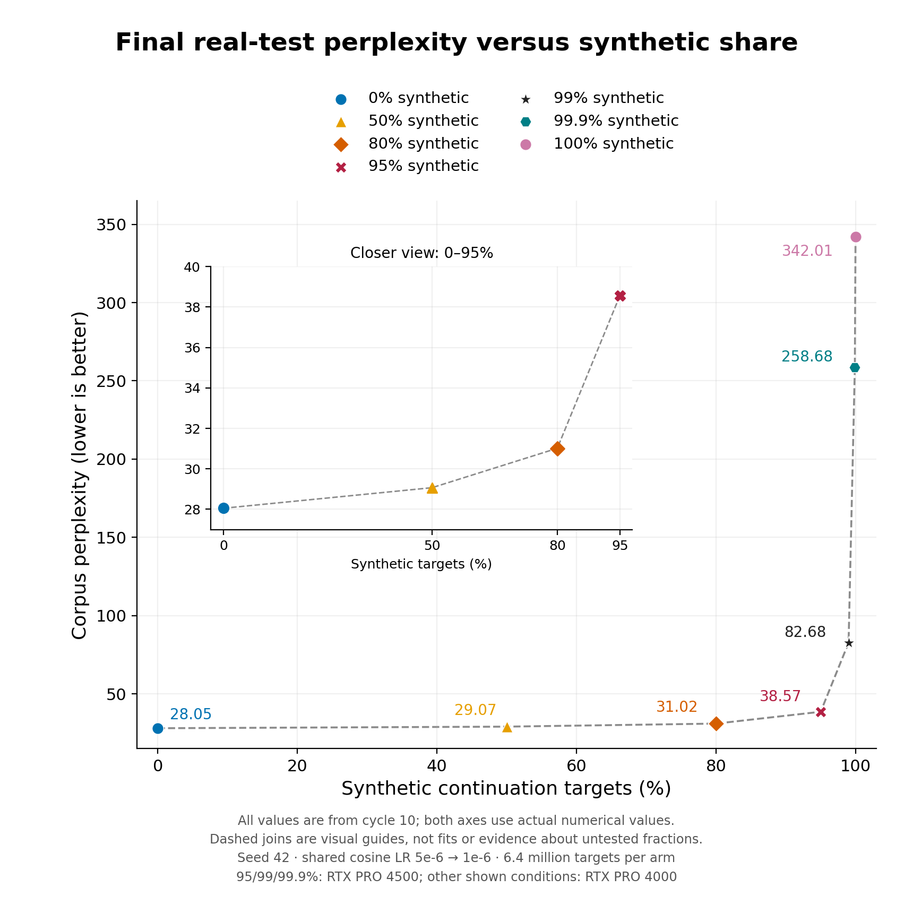
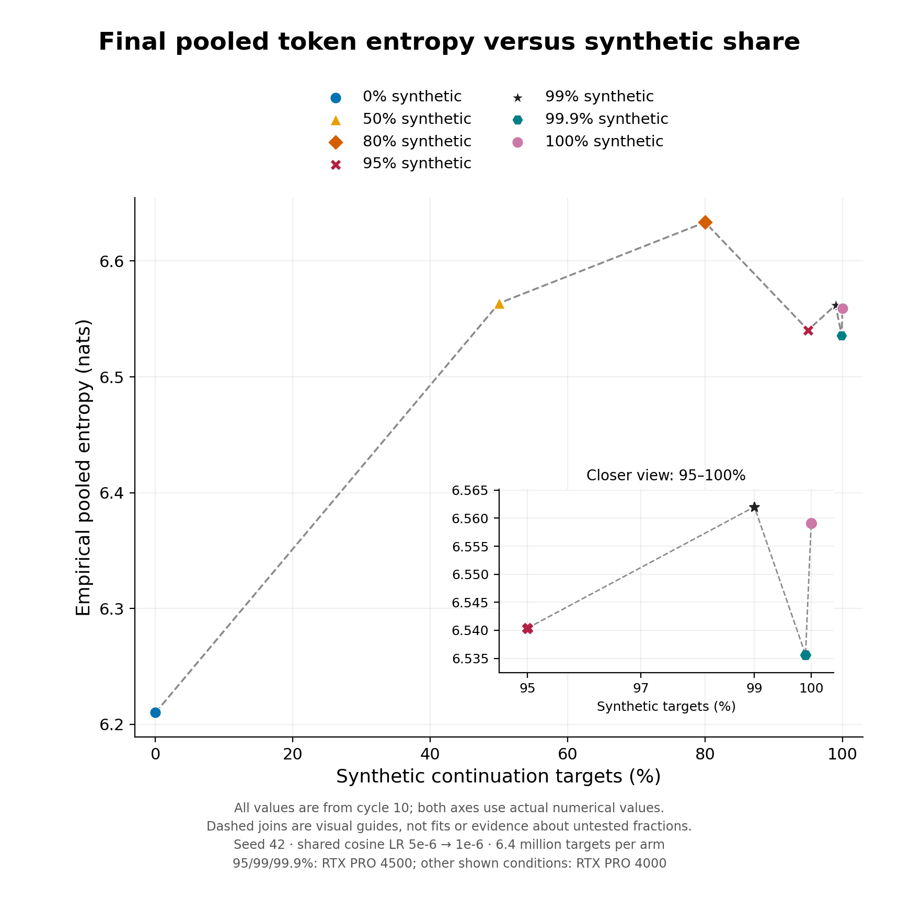
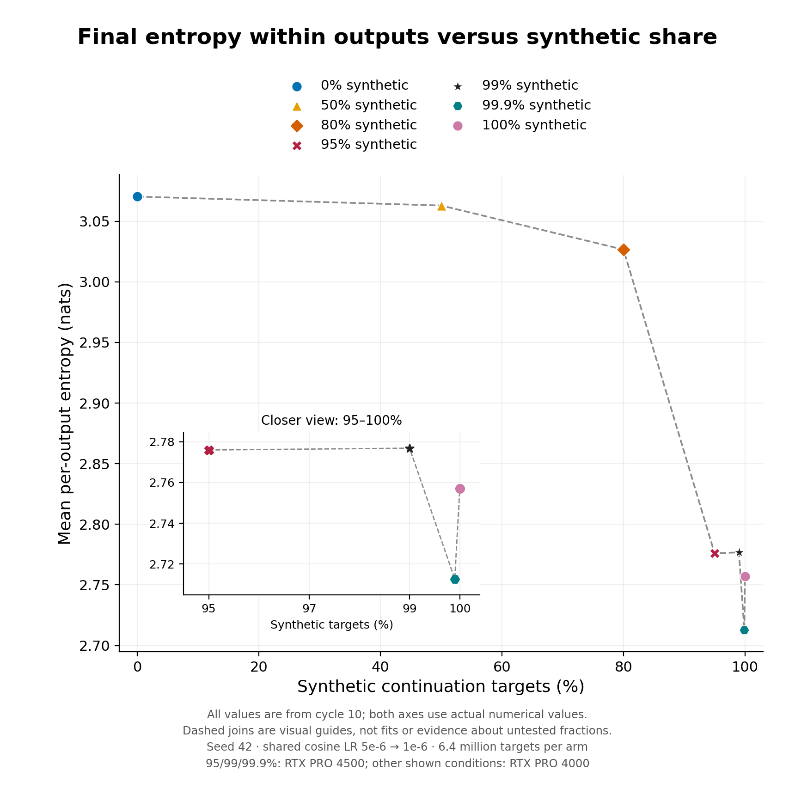
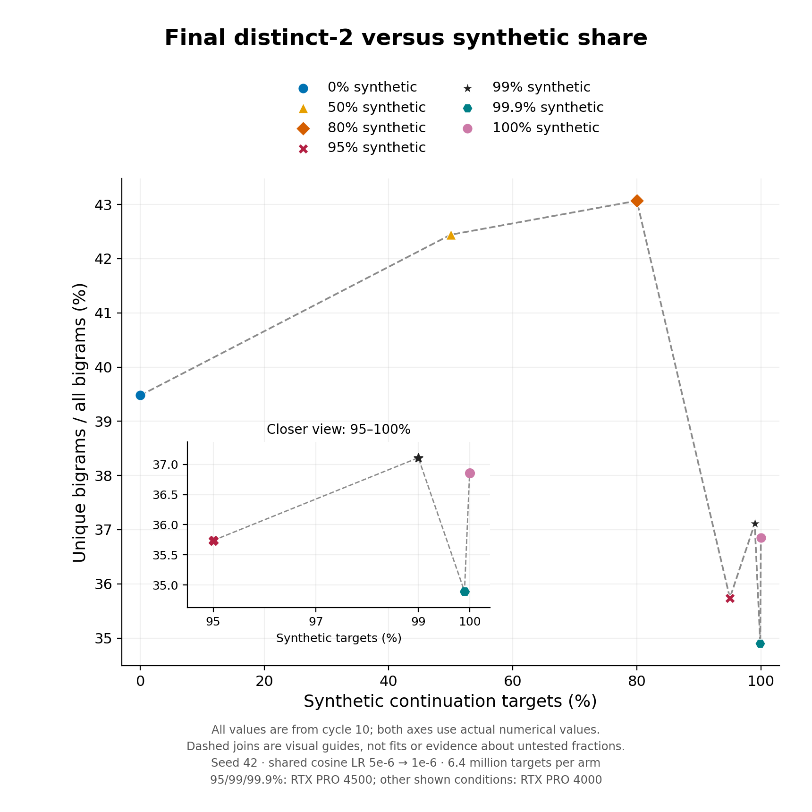
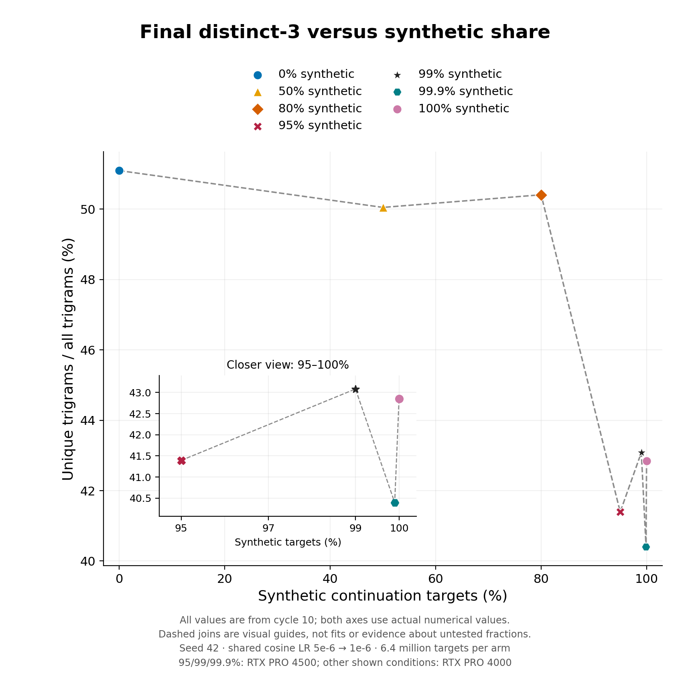
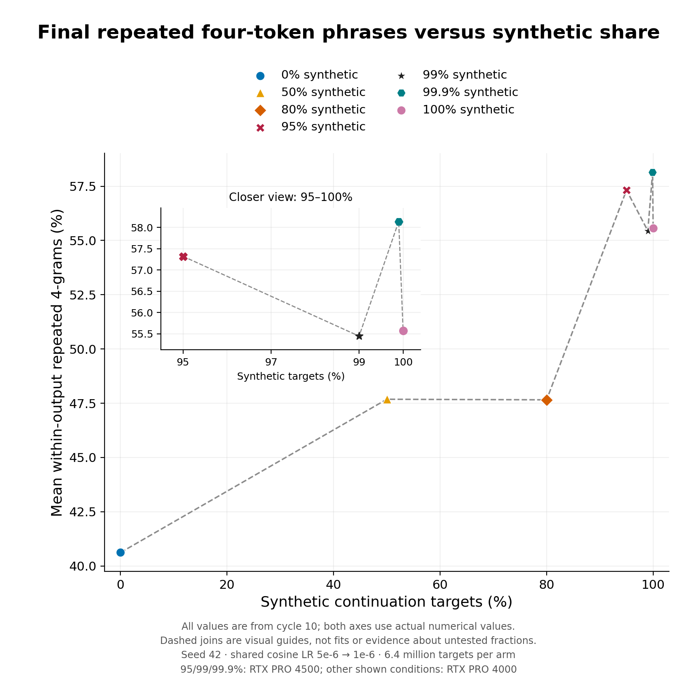

# Cycle-10 endpoints versus synthetic fraction

Supplement to the [seven-fraction report](../../report.md); Google Doc pages 79–84.

## 13. Cycle-10 endpoints: perplexity versus synthetic share

This summary holds training duration fixed: ten fresh chunks, ten terminal epochs, 790 updates and 6.4 million scored target exposures per condition. The remaining continuation targets are real.

*Figure 34. Final real-test corpus perplexity versus the percentage of synthetic continuation targets. Each point is the terminal cycle-10 checkpoint, not the best score along its trajectory. Both axes use actual numerical spacing; the inset expands the low-perplexity 0–95% conditions. Dashed joins are visual guides, not fitted curves.*

- Final test PPL rises across these measured fractions: 28.05, 29.07, 31.02, 38.57, 82.68, 258.68 and 342.01 for 0%, 50%, 80%, 95%, 99%, 99.9% and 100%, respectively.
- The increase is especially steep near 100% synthetic. These seven single-seed endpoints do not locate a universal threshold or determine the outcome at untested fractions.

## 14. Cycle-10 endpoints: pooled token entropy

*Figure 35. Final empirical token entropy after pooling all 16,384 generated probe tokens. The x-axis is the synthetic training-target percentage; the y-axis is entropy in nats. The inset expands the measured 95–100% conditions. This is observed token-frequency entropy, not model predictive entropy.*

- Pooled entropy is 6.210 nats for real-only and 6.536–6.633 across the synthetic mixtures shown. Its higher values coexist with worse real-test perplexity.
- Different prompts can trigger different repetitive vocabularies. Pooling them increases apparent vocabulary diversity without guaranteeing varied, useful or correct individual answers.

## 15. Cycle-10 endpoints: entropy within outputs

*Figure 36. Final entropy calculated separately within every 64-token generated continuation, then averaged across the same 256-prompt probe. Actual percentage spacing is retained; the inset expands 95–100%. This has a different denominator and interpretation from pooled entropy.*

- Mean within-output entropy is 3.070 nats at 0%, 3.063 at 50% and 3.027 at 80%. At 95–100%, it is lower, at 2.713–2.777 nats.
- The high-synthetic models generally use a narrower token mixture within each output. The fine ordering is non-monotonic: 99.9% has lower within-output entropy than 100%, despite its better test perplexity.

## 16. Cycle-10 endpoints: distinct-2

*Figure 37. Final pooled distinct-2: unique two-token phrases divided by all 16,128 bigram positions in the fixed probe, expressed as a percentage. N-grams do not cross output boundaries. The inset makes the nearby high-synthetic conditions readable.*

- Distinct-2 is 39.48% for real-only, 42.44% at 50% and 43.07% at 80%. It is lower at the very high synthetic fractions, with non-monotonic differences between them.
- This surface-diversity ranking differs from the perplexity ranking. New token combinations across different outputs can raise distinct-2 even when real-text prediction is worse.

## 17. Cycle-10 endpoints: distinct-3

*Figure 38. Final pooled distinct-3: unique three-token phrases divided by all 15,872 trigram positions in the same fixed probe. The x-axis uses actual percentages; the inset expands 95–100%. Higher values indicate more observed phrase variety, not necessarily better language modelling.*

- Real-only ends at 51.10%, while 50% and 80% end at 50.05% and 50.41%. The 95–100% endpoints are lower, at 40.40–43.08%.
- Trigram diversity and bigram diversity need not give identical rankings: an output can vary individual words or word pairs while repeatedly using a smaller set of longer phrases.

## 18. Cycle-10 endpoints: within-output repetition

*Figure 39. Final mean repeated four-token-phrase rate within each continuation: 1 minus unique 4-grams divided by 61 available positions, averaged across 256 outputs. Lower values mean less local repetition. This is distinct from repetition pooled across different outputs.*

- Real-only ends at 40.62%, 50–80% at about 47.7%, and 95–100% at 55.4–58.1%. Repetition was already present in the pretrained beam-decoded probe; these endpoints do not imply that all repetition was caused by synthetic training.
- Together, the endpoint plots show steeply worse likelihood near 100% synthetic and reduced local output diversity at high fractions, with non-monotonic surface statistics. The shared declining LR, GPU grouping and one-seed scope still apply.
