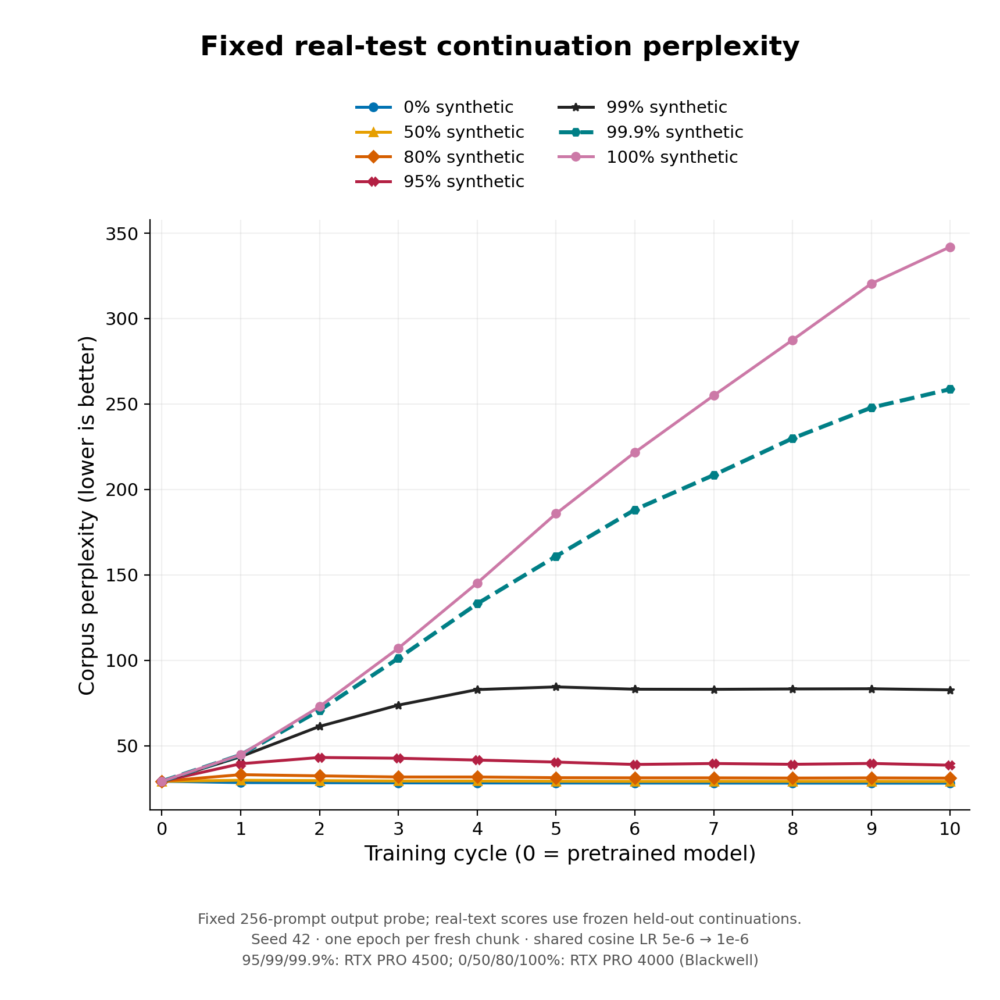
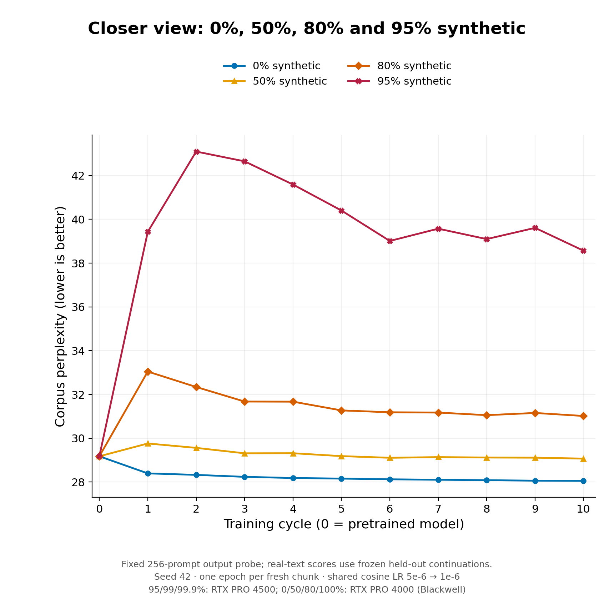
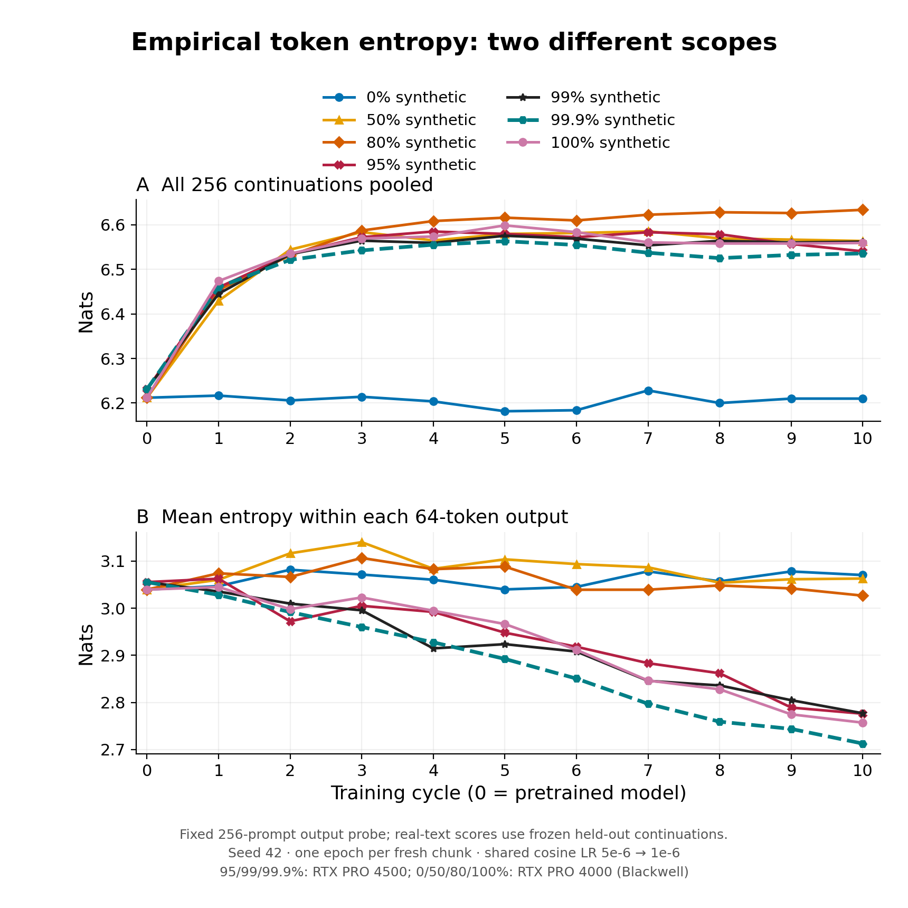
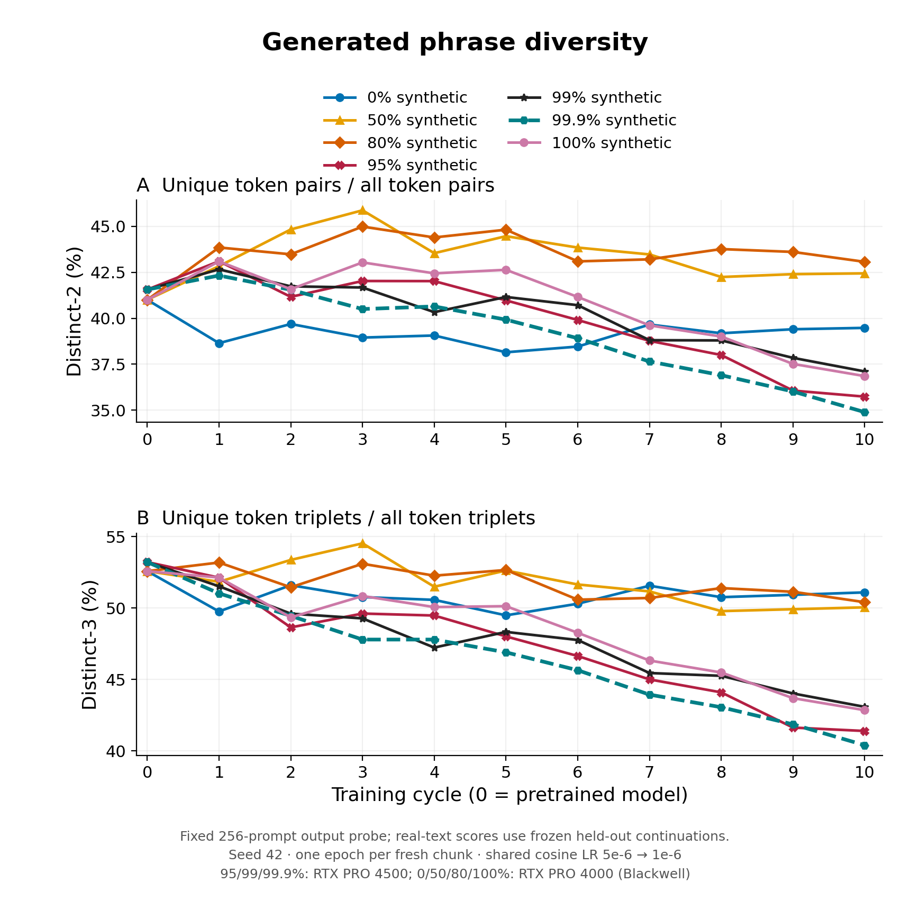
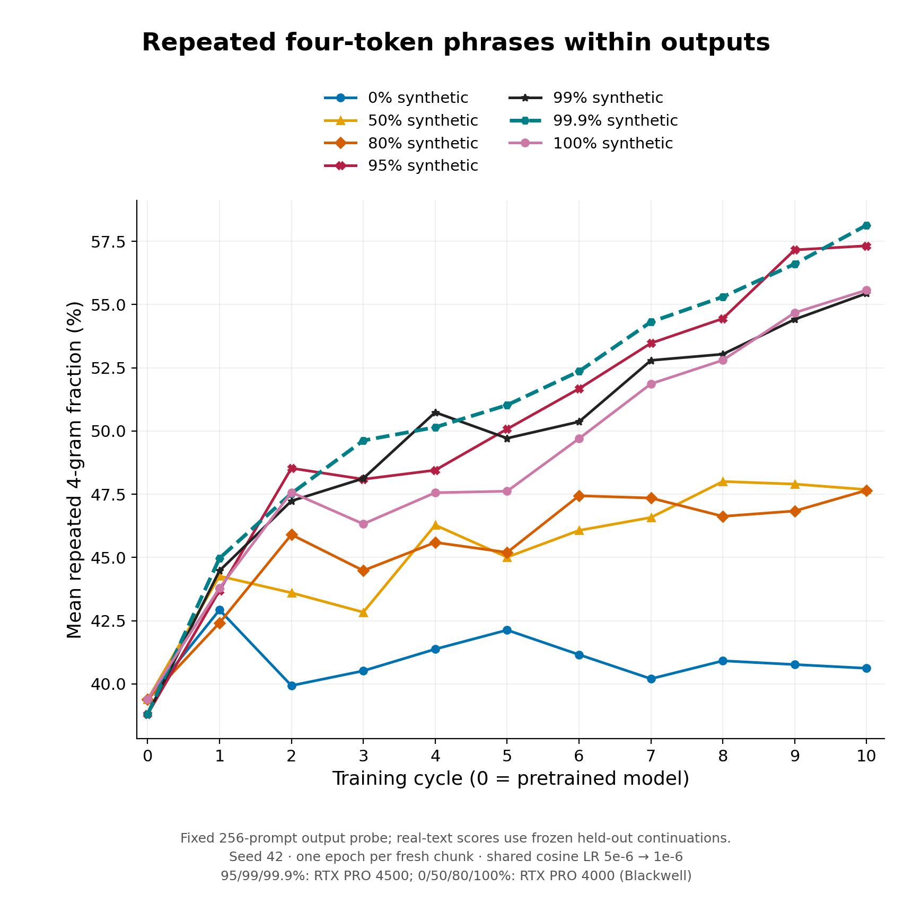
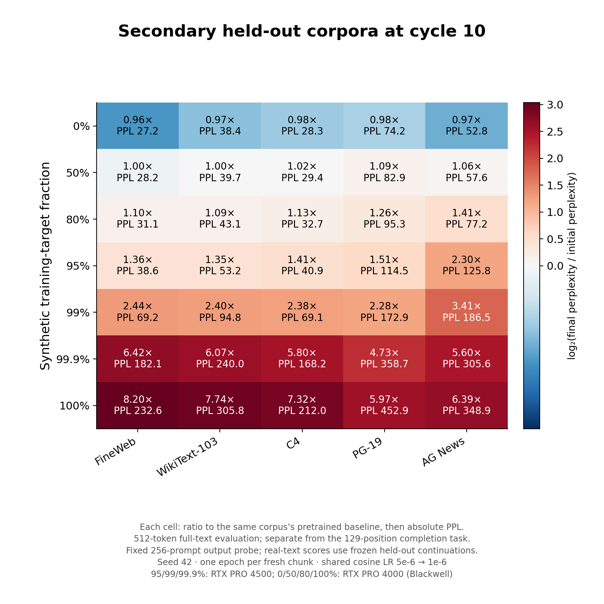
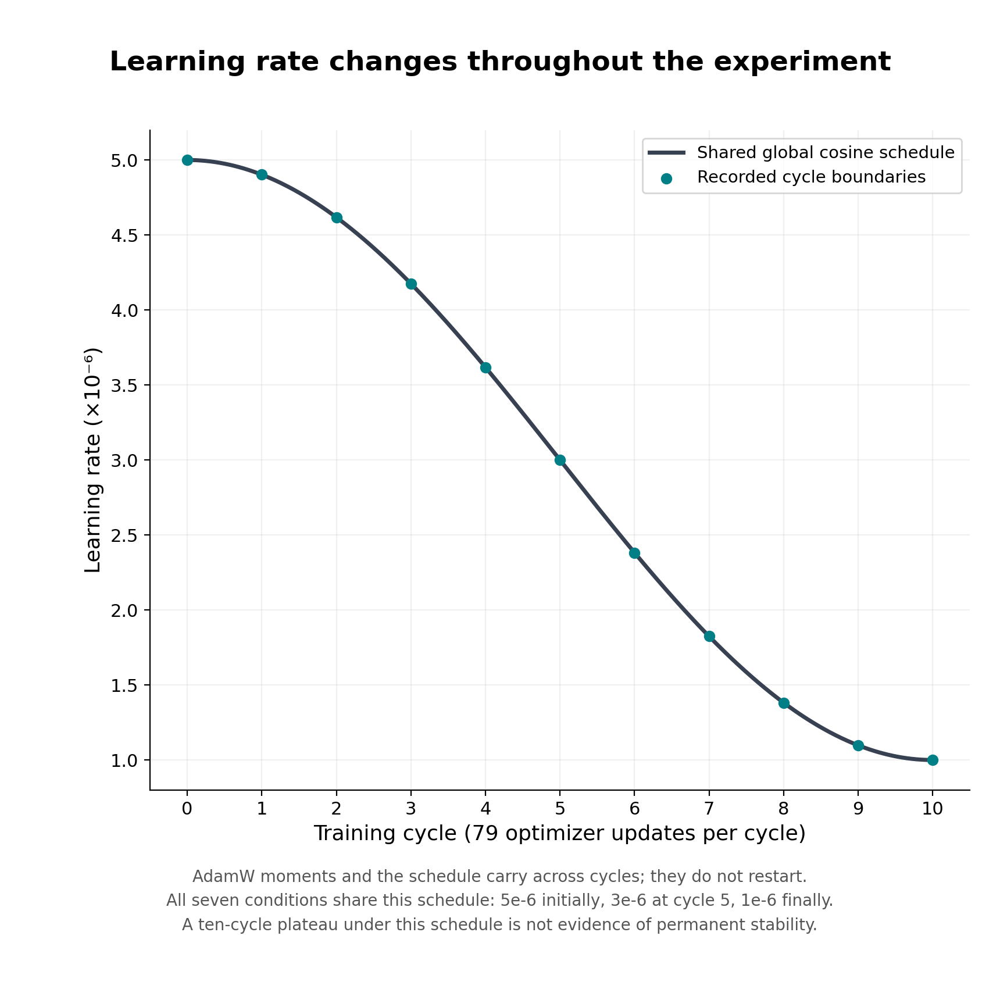

# Week 4: Fresh FineWeb real–synthetic continuation mixtures

## 1. Question and matched training protocol

Does a small amount of fresh real continuation text prevent the deterioration seen during recursive synthetic training? We compare 0%, 50%, 80%, 95%, 99%, 99.9% and 100% synthetic targets. Each condition starts independently from the same original pretrained OPT-125M weights.

- Data: pinned FineWeb-Edu sample-10BT. We freeze ten document-disjoint chunks of 10,000 examples. Each example is a 64-token natural-text prompt followed by its next 64 source tokens; these are text completions, not annotated question–answer pairs.
- At cycle k, select the synthetic rows using the same seeded, nested permutation. The condition’s own checkpoint M(k−1) generates exactly 64 tokens for those prompts using five deterministic beams, no sampling and repetition penalty 1. Keep the real continuation on every other row.
- Freeze the resulting 10,000 pairs, train M(k−1) for one complete epoch, retain terminal weights as Mk, then use the next fresh chunk. Prompts and row positions match across conditions; synthetic answers evolve separately within each condition.
- Every input is BOS + 64 prompt tokens + 64 continuation tokens (129 positions). Prompts remain visible to attention, but loss scores only the 64 continuation targets. Even the 100% synthetic condition receives real prompts.
- Each arm has ten epochs on ten different chunks: 640,000 scored targets per cycle, 6.4 million in total and 790 optimizer updates. AdamW weights, moments, scheduler and training RNG carry across cycles; there is no reset to the initial model.

*Table F1. Training composition in every 10,000-pair cycle; only continuation targets are replaced.*

| Synthetic targets | Real pairs | Synthetic pairs | Real target tokens |
| --- | --- | --- | --- |
| 0% | 10,000 | 0 | 640,000 |
| 50% | 5,000 | 5,000 | 320,000 |
| 80% | 2,000 | 8,000 | 128,000 |
| 95% | 500 | 9,500 | 32,000 |
| 99% | 100 | 9,900 | 6,400 |
| 99.9% | 10 | 9,990 | 640 |
| 100% | 0 | 10,000 | 0 |

## 2. Fixed evaluation and endpoint results

- Validation and test continuations always remain real and unchanged. The validation set has 7,322 pairs / 468,608 scored targets; test has 7,151 pairs / 457,664 scored targets. Checkpoints are terminal, so neither split chooses an earlier epoch.
- Evaluation is teacher-forced: the model receives the real prompt and the preceding real target tokens, then assigns a probability to each next real token. We sum token negative log-probabilities before averaging and exponentiating; we do not average passage perplexities.

NLL = −(1 / 64N) Σᵢ Σⱼ log pθ(yᵢⱼ | xᵢ, yᵢ,<ⱼ)       PPL = exp(NLL)

- Generated-text metrics use the same fixed, document-stratified 256 validation prompts: 256 × 64 = 16,384 generated tokens at each checkpoint. They describe decoded outputs, whereas test perplexity describes probability assigned to held-out real text.
- Training/evaluation documents were separated by IDs, normalized URLs/text and exact sliding 64-token passage checks. The bank uses 12,537 training documents; 980 validation and 976 test documents supply complete windows. Reserved documents too short for a complete window contribute no pairs.

*Table F2. Cycle-10 real-continuation prediction. Percentage change is relative to the shared initial test PPL of 29.17632. P95 is the 95th percentile of per-example mean NLL, in nats per target.*

| Condition | Validation PPL | Test PPL | Test change | P95 NLL |
| --- | --- | --- | --- | --- |
| Pretrained | 28.91 | 29.18 | — | 4.408 |
| 0% | 27.83 | 28.05 | -3.85% | 4.349 |
| 50% | 28.82 | 29.07 | -0.37% | 4.385 |
| 80% | 30.69 | 31.02 | +6.31% | 4.444 |
| 95% | 38.06 | 38.57 | +32.19% | 4.671 |
| 99% | 81.75 | 82.68 | +183.37% | 5.511 |
| 99.9% | 259.76 | 258.68 | +786.60% | 6.812 |
| 100% | 346.17 | 342.01 | +1072.22% | 7.150 |

## 3. Perplexity across the full synthetic range

*Figure 27. Fixed real-test corpus perplexity over ten cycles for all seven conditions. Cycle 0 is original pretrained OPT; every later point follows one epoch on a fresh chunk. Lower is better. The shared starting point is reused evidence, not seven independent baseline replicates.*

- The real-only control improves slightly: 29.18 → 28.05. Increasing synthetic share raises the cycle-10 endpoint, reaching 82.68 at 99%, 258.68 at 99.9% and 342.01 at 100%.
- The 99% curve flattens during this schedule. The 99.9% and 100% curves keep rising through cycle 10; ten real examples per chunk reduce deterioration but do not reproduce the 100-real-example trajectory.
- This supports a strong mixture-dependent effect under the tested protocol. It does not establish a universal 1% threshold or prove that the 99% plateau would persist with more updates or a constant learning rate.

## 4. The lower-synthetic conditions at a readable scale

*Figure 28. Enlarged view of the same measured 0%, 50%, 80% and 95% trajectories. No observations are rescaled or refitted; the high-perplexity conditions are omitted only in this closer view.*

- The 50% condition ends close to its initial score (29.07; −0.37%), while 80% ends 6.31% above initial and 95% ends 32.19% above initial. An early rise can therefore be followed by partial recovery.
- Unlike the earlier repeated-pool WikiText experiments, the real training documents change each cycle. Real-only deterioration is not inevitable here. The protocol also differs in context, loss masks, learning rate and optimizer continuity, so absolute scores should not be compared directly with the older experiments.

## 5. Entropy: pooled vocabulary versus individual outputs

*Figure 29. Empirical token-frequency entropy, H = −Σ p(t) ln p(t). Panel A pools all 16,384 probe tokens; panel B calculates entropy separately within each 64-token output and then averages. Both are in nats. Neither is the model’s predictive/logit entropy.*

- Pooled entropy is higher at the synthetic endpoints: 6.54–6.63 nats versus 6.21 for real-only. Yet individual outputs become less varied at high fractions: mean within-output entropy is 3.070 for real-only, 2.713 at 99.9% and 2.757 at 100%.
- There is no contradiction: different prompts can trigger different repetitive phrases. Combining those outputs creates a varied overall vocabulary even when each individual continuation uses a narrower set of tokens.
- Pooled entropy alone therefore gives a misleading quality ranking. Its increase does not offset worsening real-text prediction, and similar entropy at 99% and 100% does not imply similar model performance.

## 6. Distinct-2 and distinct-3

*Figure 30. Pooled distinct-n = unique n-token sequences / all n-token occurrences. The fixed probe contains 16,128 bigram and 15,872 trigram positions. N-grams never cross continuation boundaries; higher percentages mean more observed token-combination diversity.*

- The endpoint ordering is not strictly monotonic. Distinct-2 is 39.48% for real-only and 43.07% at 80%, even though 80% has worse test PPL. Distinct-3 is 51.10% and 50.41%, respectively.
- At 99.9%, distinct-2/3 fall to 34.90% / 40.40%. But 99% and 100% remain quite similar on these counts despite their very different perplexities.
- These metrics count surface phrases, not correct or useful answers. Altering word choice across prompts can create new bigrams while the model still repeats phrases locally or assigns poor probabilities to real continuations.

## 7. Repetition within outputs

*Figure 31. For each 64-token output, repeated 4-gram rate = 1 − unique four-token phrases / 61 available four-token positions; we then average across 256 outputs. Repetitions here occur inside a continuation, rather than merely between different outputs.*

- Mean within-output repetition ends at 40.62% for real-only, about 47.7% for 50–80%, and 55.4–58.1% for 95–100%. The pretrained beam-decoded probe already has roughly 39% repetition, so the initial decoder baseline matters.
- The 99.9% endpoint is more repetitive on this probe than 100%, despite better real-test PPL. There is no requirement that local repetition and held-out prediction rank every model identically.
- Whole-continuation duplicates are 0% at every recorded checkpoint. Outputs can therefore contain serious internal loops without becoming exact copies of one another. Final newline shares remain 1.64–2.50%, rather than dominating these outputs.

## 8. Endpoint output statistics

All rows below use the same 256-prompt probe and 64-token output length. Percentage denominators are fixed. The entropy and distinctness metrics include the original generated token IDs, including formatting; no newline filtering is applied.

*Table F3. Final decoded-output diagnostics. Hpool is pooled token entropy; Hwithin is mean per-output entropy. Rep-4 is mean within-output repetition, not pooled repetition across the corpus.*

| Synthetic | D2 % | D3 % | Hpool | Hwithin | Rep-4 % | Newline % |
| --- | --- | --- | --- | --- | --- | --- |
| 0% | 39.48 | 51.10 | 6.210 | 3.070 | 40.62 | 2.50 |
| 50% | 42.44 | 50.05 | 6.564 | 3.063 | 47.68 | 2.50 |
| 80% | 43.07 | 50.41 | 6.633 | 3.027 | 47.66 | 2.43 |
| 95% | 35.74 | 41.39 | 6.540 | 2.776 | 57.32 | 1.74 |
| 99% | 37.11 | 43.08 | 6.562 | 2.777 | 55.44 | 1.64 |
| 99.9% | 34.90 | 40.40 | 6.536 | 2.713 | 58.14 | 1.84 |
| 100% | 36.86 | 42.85 | 6.559 | 2.757 | 55.57 | 1.86 |

Baseline scope: the pretrained weights and held-out scores match, but deterministic beam outputs differ slightly between GPU types. Initial pooled H is 6.2119 on RTX PRO 4000 and 6.2310 on RTX PRO 4500; initial within-output H is 3.0395 and 3.0554. The plots retain each measured baseline. These are execution differences, not different pretrained models.

The apparent disagreement between metrics is informative: high synthetic fractions strongly worsen conditional real-text likelihood and reduce within-output variety, while preserving or increasing vocabulary variety across the combined prompt set. These are different aspects of behaviour, not interchangeable definitions of collapse.

Post-epoch NLL on each arm’s own training targets decreases from 3.314 nats in real-only to 0.064 at 99%, 0.022 at 99.9% and 0.015 at 100%. These targets differ across arms: confident fitting of the model’s own deterministic outputs is not evidence of improved generalization.

## 9. Does deterioration extend beyond FineWeb completions?

*Figure 32. Secondary cycle-10 perplexity on fixed 512-token full-text arrays from FineWeb-Edu, WikiText-103, C4, PG-19 and AG News. Each cell gives final/initial PPL for that corpus and its absolute final PPL. Colour represents log₂ of the ratio; values above 1× indicate deterioration.*

- Real-only improves on all five secondary collections. At 99.9%, final perplexity is 4.73–6.42 times its pretrained value across them; 100% is worse on all five.
- The 50% endpoint is near initial FineWeb prediction but worsens on some other corpora, especially PG-19 and AG News. Staying near baseline on one evaluation distribution does not establish broad stability.
- This is a separate evaluation objective and context length from the primary 64-token continuation task. Compare changes within each corpus, rather than treating absolute PPL values across corpora or objectives as directly equivalent.

## 10. Learning rate and limits on the interpretation

*Figure 33. Recorded cycle-boundary learning rates and the shared cosine schedule over 790 optimizer updates. LR begins at 5 × 10⁻⁶, reaches 3 × 10⁻⁶ after cycle 5 and finishes at 1 × 10⁻⁶. This schedule is shared by all seven conditions.*

- Later updates are smaller. The flattening at 99% could reflect an interaction between fresh real supervision, changed synthetic targets, optimizer history and the declining LR; this experiment does not isolate those contributions.
- The 99.9% and 100% curves still rise under the same decay, so LR alone does not explain the difference between conditions. A matched constant-LR control and additional seeds would test whether the apparent plateaus persist.
- Hardware is partly confounded with fraction: 95/99/99.9% used RTX PRO 4500; 0/50/80/100% used RTX PRO 4000, with matching software/settings. The observed baseline decoding differences show that GPU effects should not simply be assumed zero.

## 11. Same-prompt example and conclusions

Illustration: the first fixed probe prompt is used here by index, rather than selected to maximize a difference. All outputs below are the complete saved 64-token continuations; they are illustrative, not a prevalence estimate.

**Shared real prompt**

> The U.S. Food and Drug Administration (FDA) announced today it will convene its Veterinary Medicine Advisory Committee (VMAC) to consider a salmon that has been genetically engineered to reach its market weight in half the time of conventionally raised salmon.
> The VMAC meeting, part of a rigorous regulatory process

**Cycle-10 real-only continuation**

> , is expected to take place in Washington, D.C., this fall. ↵ The genetically engineered salmon, which has been genetically engineered to reach its market weight in half the time of conventionally raised salmon, has been genetically engineered to reach its market weight in half the time of conventionally raised salmon. ↵ The genetically

**Cycle-10 100% synthetic continuation**

> , will consider a salmon that has been genetically engineered to reach its market weight in half the time of conventionally raised salmon. The VMAC meeting, part of a rigorous regulatory process, will consider a salmon that has been genetically engineered to reach its market weight in half the time of conventionally raised salmon. The VMAC

The 95%, 99% and 99.9% continuations for this exact prompt match the saved 100% continuation. This is a concrete reason why a few generated examples or surface-diversity scores can look similar while held-out likelihood differs substantially.

- Main finding: with fresh, disjoint prompt chunks and matched target exposure, real-only stays close to or improves on baseline, while increasing synthetic share produces a steeply worse cycle-10 real-test endpoint.
- Small real fractions matter under this protocol: 100 real answers per 10,000-pair chunk behave very differently from ten. This is evidence of sensitivity near the synthetic extreme, not a proven universal threshold or asymptotic guarantee.
- The proposed mechanism is feedback from deterministic self-generated targets, with real targets supplying corrective supervision. The likelihood, repetition and training-loss observations are consistent with this account, but do not identify it as the unique cause.

## 12. Scope and reproducibility

- One seed (42) per condition; no across-seed uncertainty, significance claim or permanent-stability claim. Short continuations, deterministic beam decoding, the decreasing learning rate and GPU grouping limit generalization.
- The frozen bank samples a seeded shuffled stream, not uniform random token addresses across all 10B tokens. Preparation read 24,950 rows from one shuffled source shard, with a 10,000-document buffer. Source windows and document identities are disjoint across training cycles and evaluation; pretrained exposure and human authorship were not audited.
- FineWeb-Edu revision: 87f09149ef4734204d70ed1d046ddc9ca3f2b8f9; OPT revision: 27dcfa74d334bc871f3234de431e71c6eeba5dd6. Bank manifest SHA-256 begins b5b598ae4a53. The saved evidence contains the complete revisions and hashes.
- Optimization is AdamW (β₁ = 0.9, β₂ = 0.999, ε = 10⁻⁸, weight decay 0.01), microbatch 32 with accumulation 4, effective batch 128; the final partial batch has 16 examples. BF16 autocast uses FP32 parameters. There is no validation-based early stopping or checkpoint selection.

Evidence for this analysis: 77 checkpoint metric records from pinned private snapshots, 231 checksum-verified small files, and independent recomputation of the output metrics from all 70 trained probe arrays. Prior reports and raw measurements are preserved. Full trained-checkpoint restoration and independent held-out re-evaluation were not performed for this report.

Condition/run provenance: 0% and 100% — 20261106T193918Z-full-completion64; 50% — 20261107T004033Z-full-completion64-mixtures; 80% — 20261107T113638Z-full-completion64-mixed80; 95% — 20261107T151610Z-full-completion64-mixed95; 99% — 20261107T183326Z-full-completion64-mixed99; 99.9% — 20261107T214406Z-full-completion64-mixed99p9.

The real-only control and synthetic conditions support a cleaner comparison than repeated training on the same small real pool. The next scientific question is whether the observed stabilization survives a constant LR, longer horizons and replication; those follow-up experiments have not been run here.
