# Week 4 extension: repeated data, overfitting and recursive synthetic feedback

## 1. Question and main findings

Does deterioration on synthetic continuations resemble ordinary overfitting from repeatedly using the same real data? We compare a 2 × 2 design: fresh versus repeated prompts, crossed with real versus recursively generated continuation targets. The fresh-data controls are completed historical runs; both repeated-data arms are new.

- Fresh real improves from 29.18 to 28.05 test perplexity. Repeated real reaches its minimum of 28.35 at epoch 2, then rises to 28.61. The latter is mild late overfitting, while remaining better than the untouched model.
- Fresh synthetic ends at 342.01; repeated synthetic ends at 215.39. Both are evaluated on exactly the same real continuations. Synthetic targets are regenerated before every epoch, including in the repeated-prompt condition.
- All four conditions continue the weights and optimizer. None resets to the pretrained checkpoint between epochs. The real fresh/repeated pair has identical epoch-1 tensors; the synthetic fresh/repeated pair also has identical epoch-1 tensors and generated targets. Their data policies diverge from epoch 2.
- The result separates target source from data reuse under this particular protocol. It does not establish that overfitting and model collapse are mutually exclusive mechanisms, or that a single statistic diagnoses either one.

## 2. Four conditions and frozen data

FineWeb-Edu sample-10BT is natural web text, not labelled questions and answers. Each example is a non-overlapping, within-document 128-token window: its first 64 tokens are the prompt and its next 64 tokens are the real continuation. Both new arms independently start from the exact original pretrained OPT-125M checkpoint.

- Fresh-data controls: ten frozen document-disjoint chunks, each containing 10,000 pairs. The next chunk is used once at each epoch. The synthetic arm generates new continuation targets using its own preceding checkpoint and that next chunk’s real prompts.
- Repeated real: reuse all 10,000 prompt/real-continuation pairs in chunk 1 for every epoch. Carry weights, AdamW moments, scheduler and training RNG forward. The seeded training order changes; the underlying prompt and target content does not.
- Repeated synthetic: reuse the same 10,000 chunk-1 prompts, but regenerate every continuation using this arm’s preceding checkpoint. Freeze that complete generated dataset, train once on it, and repeat. This is not ten epochs on one frozen synthetic dataset.
- The repeated chunk contains 1,176 source documents. Held-out documents were reserved before allocation; document IDs, normalized URLs/text identities and exact sliding 64-token passage exclusions are inherited from the frozen bank. Only the original training documents enter these two runs.
- Sampling scope: the frozen bank was built through a deterministic shuffled stream, reading 24,950 source rows from one source shard; it is not a uniform random sample obtained by addressing the entire 10B-token corpus.

*Table R1. Target source and data reuse. Every row represents one independently continued arm.*

| Condition | Prompts at epoch k | Continuation targets | Evidence |
| --- | --- | --- | --- |
| Fresh real | Chunk k | Real source text | Historical |
| Fresh synthetic | Chunk k | Own checkpoint k−1 generates | Historical |
| Repeated real | Chunk 1 every epoch | Same real source text | New |
| Repeated synthetic | Chunk 1 every epoch | Own checkpoint k−1 regenerates | New |

## 3. Matched optimization and evaluation

- Input: BOS + 64 real prompt tokens + 64 continuation tokens, giving 129 positions. Prompt positions remain visible through attention. Only the 64 continuation labels contribute to loss; prompt labels and padding are excluded.
- Ten continued epochs per arm, 10,000 pairs and 640,000 scored target tokens each epoch: 6.4 million target-token exposures and 790 optimizer updates. Terminal epoch weights are retained, without validation-based early stopping.
- AdamW: learning rate 5 × 10⁻⁶, betas (0.9, 0.999), epsilon 10⁻⁸ and weight decay 0.01. A global cosine schedule decreases learning rate to 1 × 10⁻⁶ across all 790 updates. Model, optimizer, scheduler and training RNG persist across epochs.
- Microbatch 32, effective batch 128, BF16 autocast with FP32 parameters, seed 42. New and historical arms match RTX PRO 4000 Blackwell hardware, the inspected PyTorch image and required package versions.
- Generation: five deterministic beams, exactly 64 new tokens, no sampling and repetition penalty 1.0. Even 100% synthetic training retains real prompts; only continuation labels are synthetic.
- Primary evaluation is frozen: 7,322 real validation pairs (468,608 scored tokens) and 7,151 real test pairs (457,664). A fixed 256-prompt validation probe generates 16,384 tokens per checkpoint for output statistics. The test split does not select checkpoints.

For N held-out examples, L = −(1 / 64N) Σᵢ Σⱼ log p(yᵢⱼ | BOS, promptᵢ, yᵢ,<ⱼ), and corpus perplexity = exp(L). Evaluation uses the true preceding continuation tokens, not the model’s previously generated guesses. This is a likelihood test on fixed real text, separate from judging freely generated outputs.

*Table R2. Fixed measurement and update counts; repeated epochs are ten total passes, not fifty.*

| Quantity | Value |
| --- | --- |
| Training pairs per epoch | 10,000 |
| Scored targets per epoch / arm total | 640,000 / 6,400,000 |
| Updates per epoch / arm total | 79 / 790 |
| Input / scored positions | 129 / 64 |
| Validation pairs / targets | 7,322 / 468,608 |
| Test pairs / targets | 7,151 / 457,664 |
| Probe outputs / generated tokens | 256 / 16,384 |
| Epoch-1 equality | Fresh/repeated tensors identical within each target source |

## 4. Fixed real-test perplexity

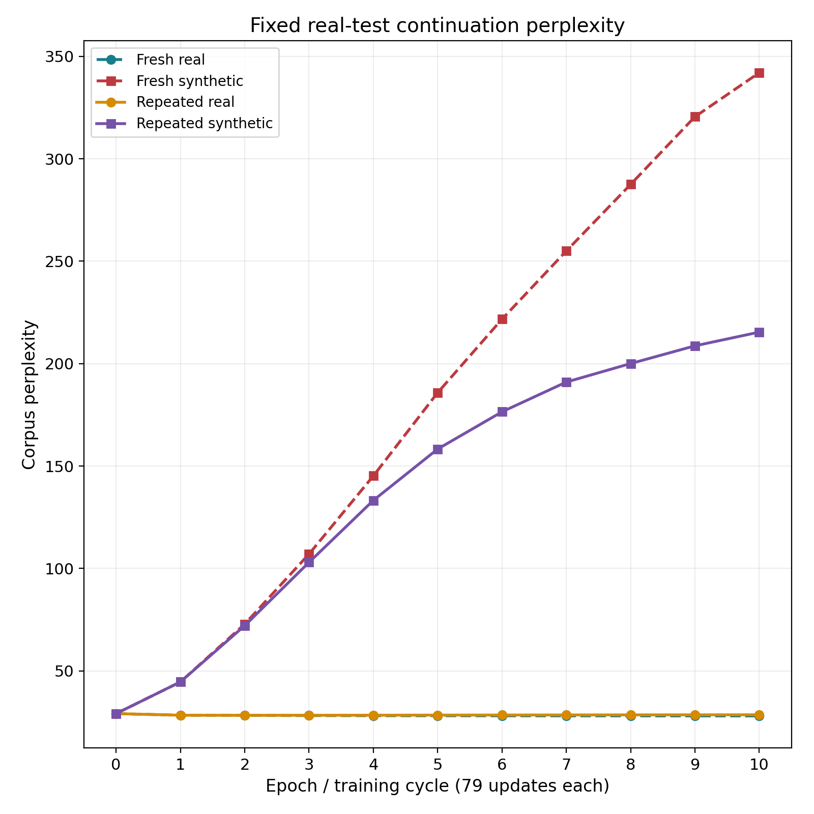

*Figure 40. All four models are scored on the same real held-out continuation tokens. Shared baselines and epoch-1 points overlap.*

- At epoch 10: fresh real 28.05, repeated real 28.61, fresh synthetic 342.01, repeated synthetic 215.39. Lower is better at predicting these real continuations.
- The synthetic curves describe recursive deterministic self-training with real prompts. Their worsening likelihood is much larger than the real-only data-reuse effect in this ten-epoch experiment.
- Identical first-step tensors rule out an initial-checkpoint or first-dataset mismatch as the cause of later fresh/repeated differences.

## 5. Fixed real-validation perplexity

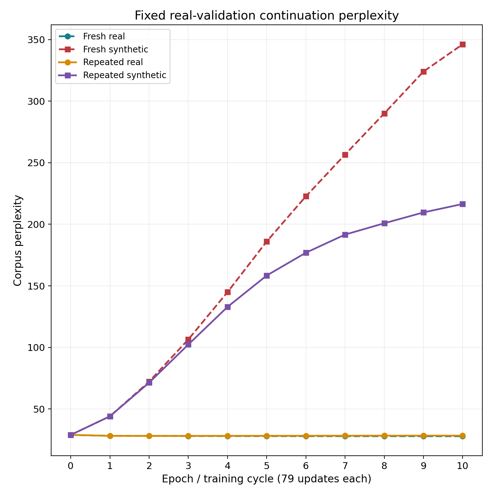

*Figure 41. Validation uses a different frozen real collection from the test collection, with the same conditional scoring rule.*

- Final validation perplexities are 27.83, 28.34, 346.17 and 216.47 for fresh real, repeated real, fresh synthetic and repeated synthetic respectively.
- Agreement in direction across two held-out collections makes the trajectory less dependent on one particular test sample. These are two collections, not independent training-seed replications.

## 6. Real targets: the data-reuse effect

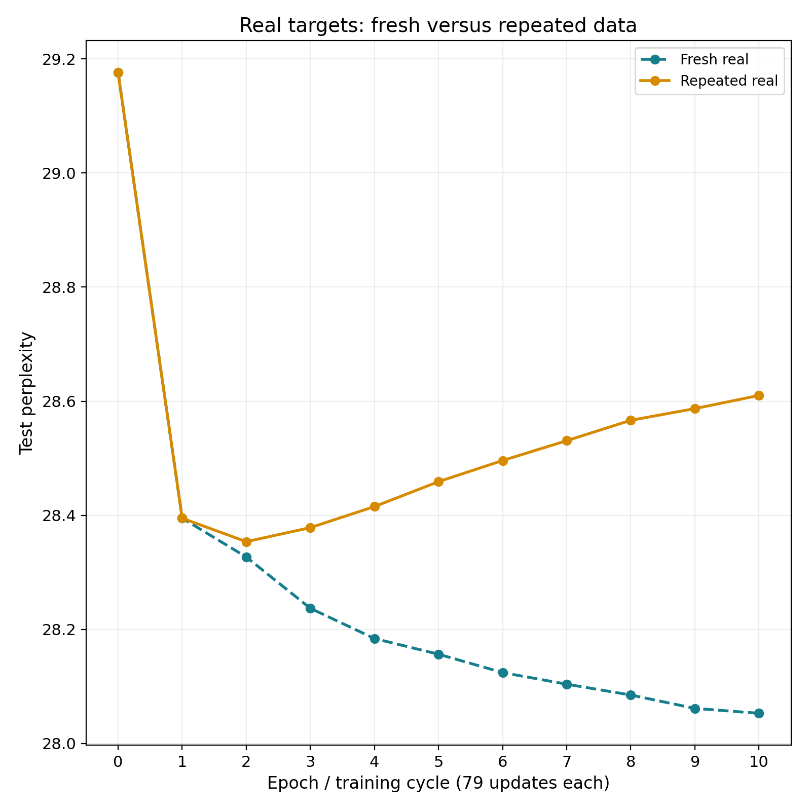

*Figure 42. The same real-only trajectories are enlarged so the small late increase is visible beside the fresh-data improvement.*

- Repeated-real test perplexity increases by 0.90% from its epoch-2 minimum, but ends 1.94% below the untouched baseline.
- Repeated exposure keeps optimizing one finite sample. Later updates can fit that sample better without transferring equally well to unseen documents. The mild increase is consistent with overfitting; it is not a catastrophic failure on real text.

## 7. Training loss versus held-out loss

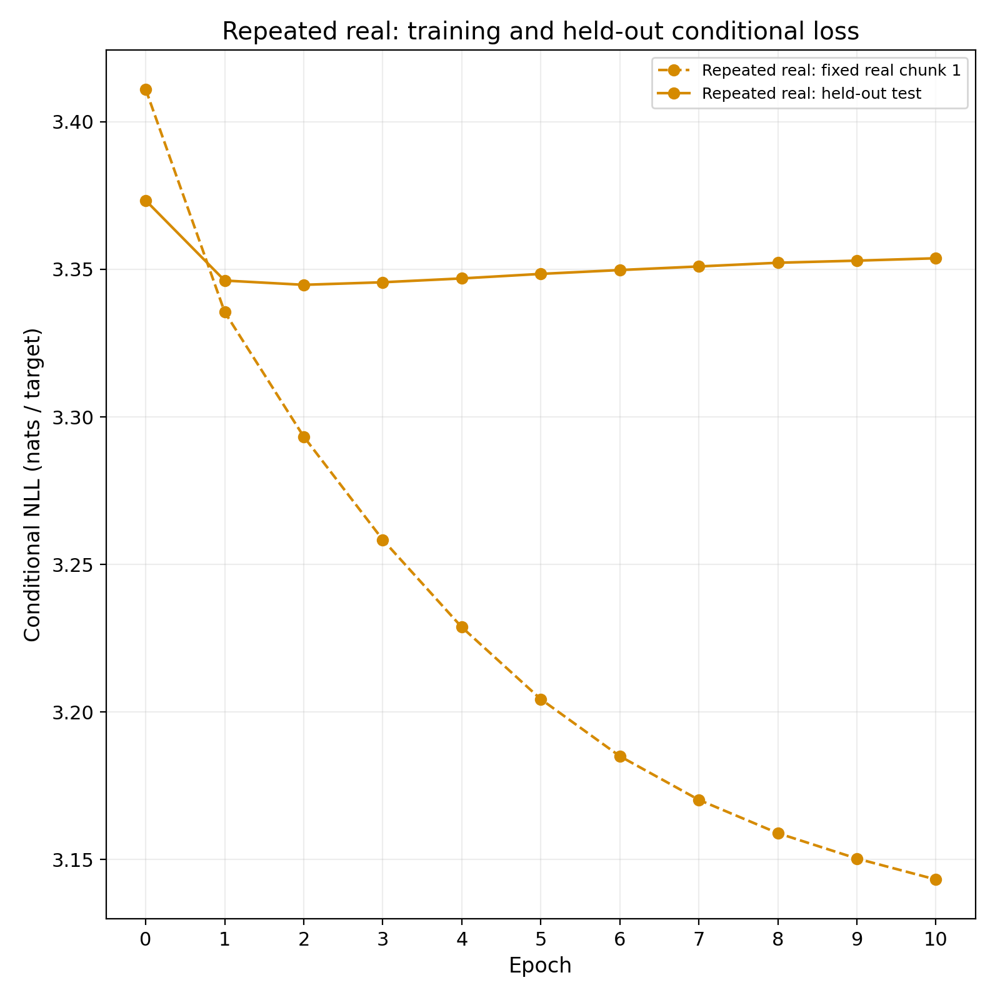

*Figure 43. Repeated-real checkpoint evaluation on the fixed real training chunk and the held-out test set. Both curves use dropout-free conditional NLL.*

- Real training NLL falls from 3.4110 to 3.1432; test NLL ends at 3.3538. Falling training loss with rising late held-out loss is the direct overfitting signature here.
- This is post-epoch evaluation of the fixed real answers, not the noisier optimization loss averaged during training. The same real-answer anchor is also recorded for synthetic models, but those answers are not their training targets.

## 8. The real-only generalization gap

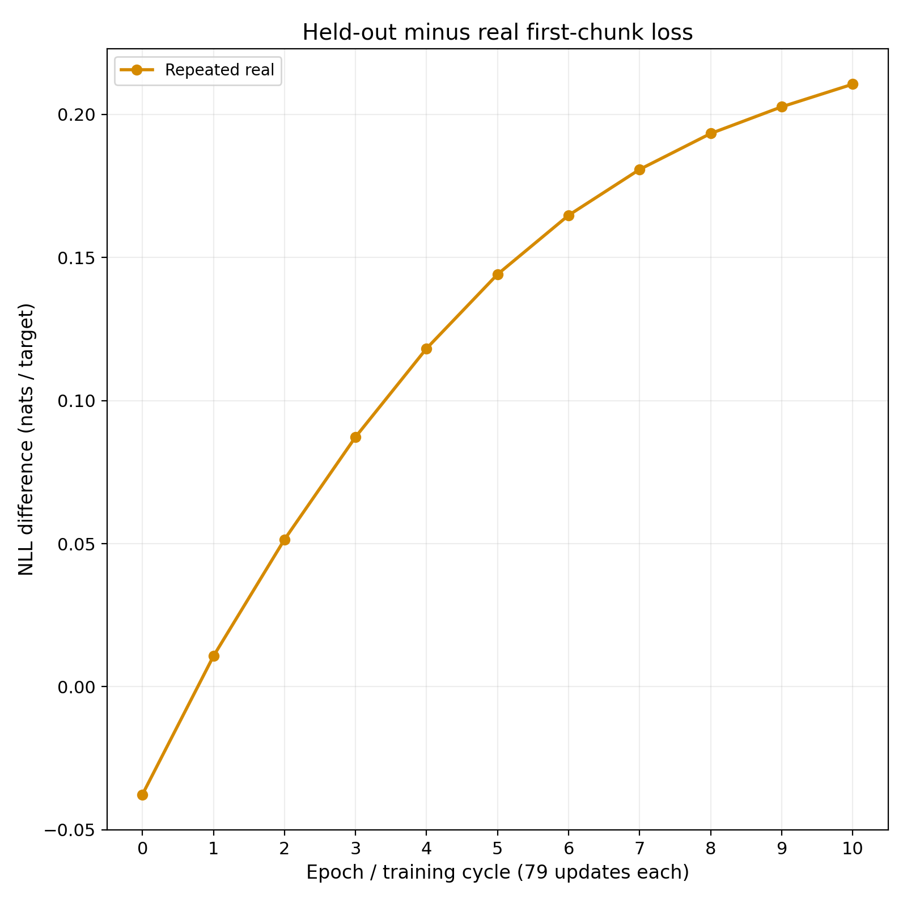

*Figure 44. Held-out test NLL minus fixed real training-chunk NLL for repeated-real checkpoints.*

- The gap changes from -0.0377 to 0.2105 nats per target. The training set is fitted increasingly better relative to the held-out set.
- A negative initial gap is possible because the two finite collections differ in difficulty. Its growth is informative; the initial sign alone is not a diagnosis of leakage or overfitting.

## 8.2. Real answers for the repeated training prompts

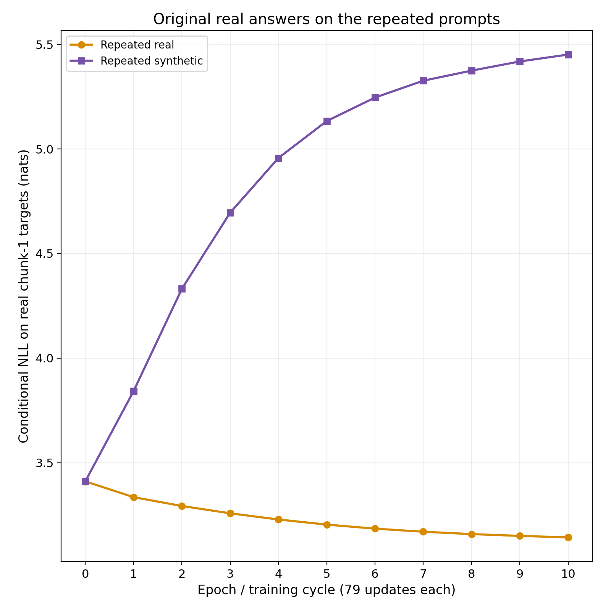

*Figure 45. Both new arms are scored on the same original real continuation answers for chunk 1, after every epoch.*

- Repeated-real NLL falls from 3.411 to 3.143, while repeated-synthetic real-answer NLL rises to 5.451. The synthetic model gets worse at the original answers even for prompts it repeatedly sees.
- Its own final synthetic-target NLL is only 0.01540. Fitting self-generated labels increasingly well therefore does not mean learning the source answers. This real-answer anchor is not the synthetic arm’s training loss or a held-out evaluation.

## 9. Harder held-out examples

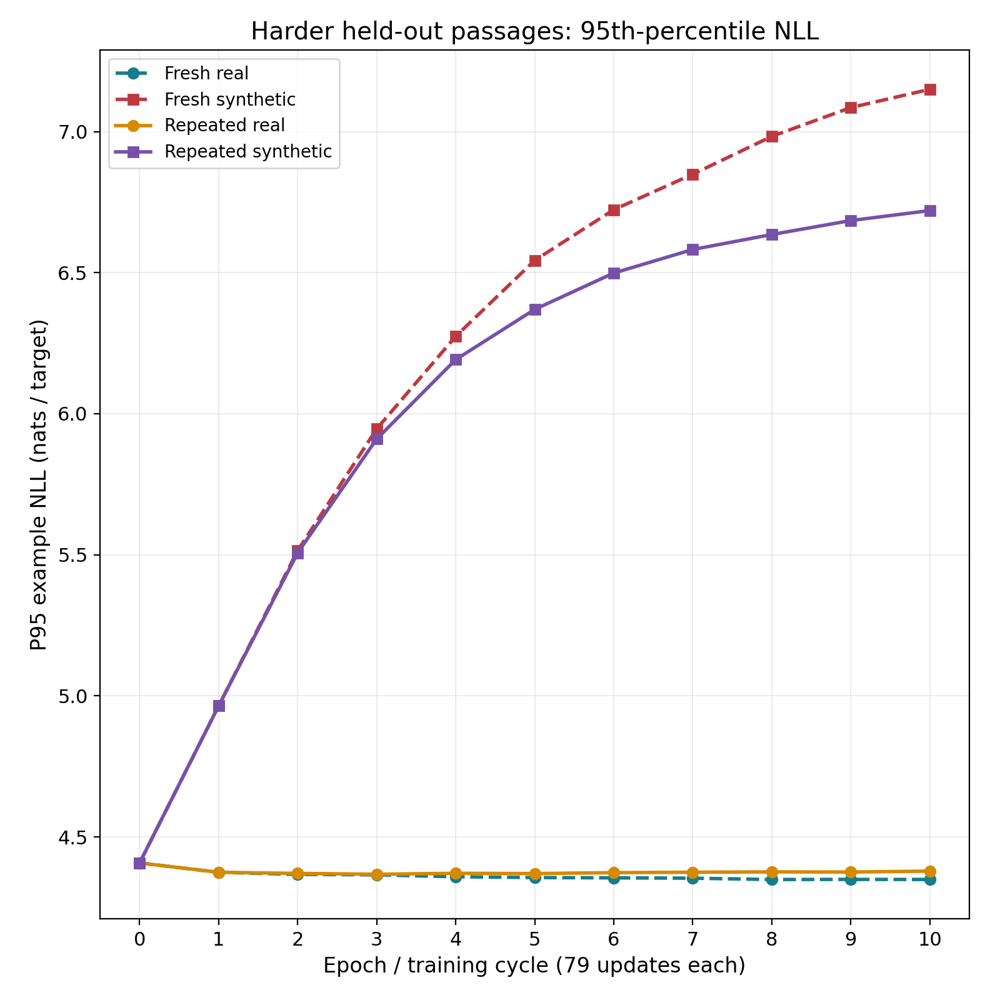

*Figure 46. The 95th percentile of mean continuation NLL per test example; lower is better.*

- Cycle-10 P95 NLL: fresh real 4.349, repeated real 4.379, fresh synthetic 7.150, repeated synthetic 6.720 nats per target.
- This asks how poorly the model scores the more difficult passages in this evaluation collection. It is not a direct measurement of rare-topic support, lost knowledge or a theoretical tail-collapse condition.

## 10. Token entropy across outputs

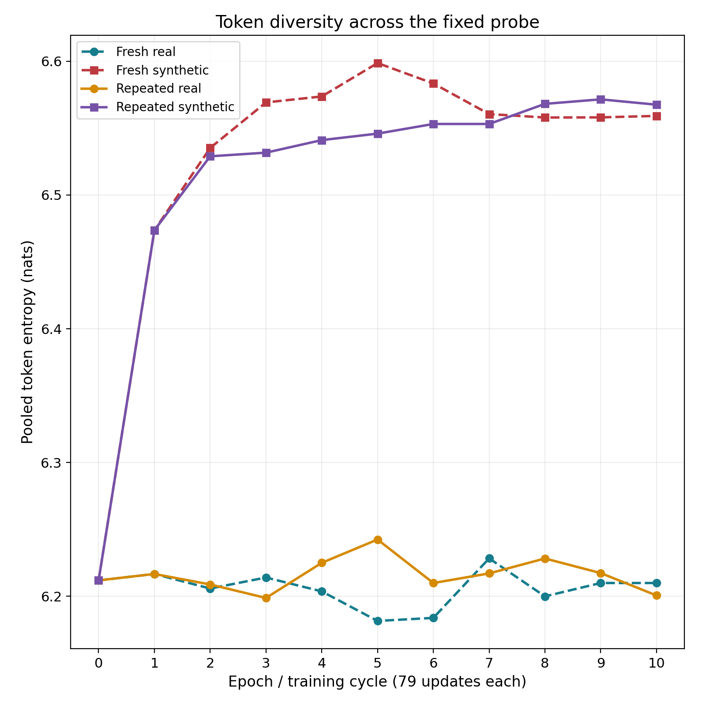

*Figure 47. Empirical entropy H = −Σᵥ fᵥ log fᵥ of token frequencies pooled across the 256 generated continuations.*

- Final pooled entropy: 6.210, 6.201, 6.559, 6.567 nats in the same condition order.
- Both synthetic arms rise above the shared baseline in pooled entropy while their real-text perplexity worsens. This is an observed disagreement between vocabulary spread and predictive quality, not evidence that synthetic training improved generalization.
- Higher pooled entropy means a broader or more even aggregate token vocabulary. Outputs may repeat different phrases on different topics and still have high pooled entropy. This is neither predictive/logit entropy nor a factual-quality score.

## 11. Entropy within each output

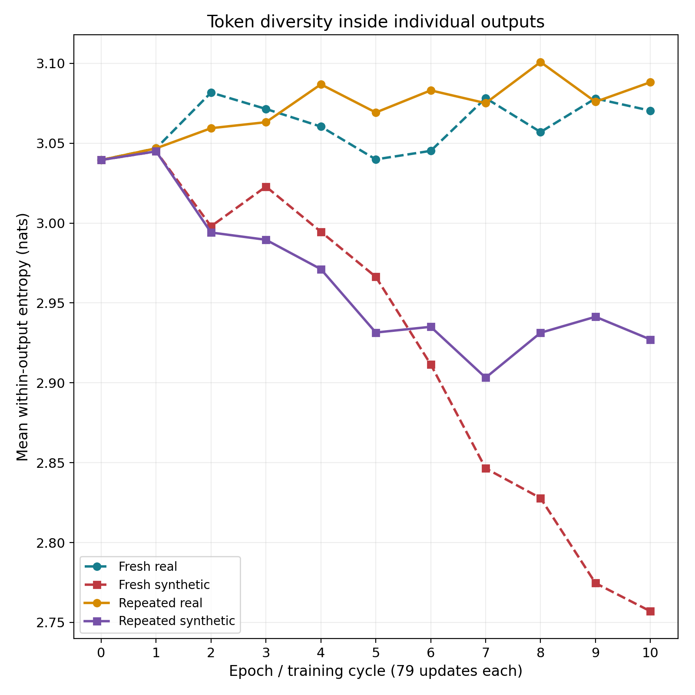

*Figure 48. Compute empirical token-frequency entropy separately inside each 64-token continuation, then average over the probe.*

- Final within-output entropy: 3.070, 3.088, 2.757, 2.927 nats.
- Both synthetic trajectories decline, most strongly with fresh prompts. Repeated-real output entropy is slightly higher than fresh-real entropy despite its slightly worse test perplexity; ordinary overfitting need not lower this surface statistic.
- A continuation dominated by a small set of tokens has low within-output entropy. This complements pooled entropy by showing local concentration; token order and truth are still not measured.

## 12. Unique two-token phrases

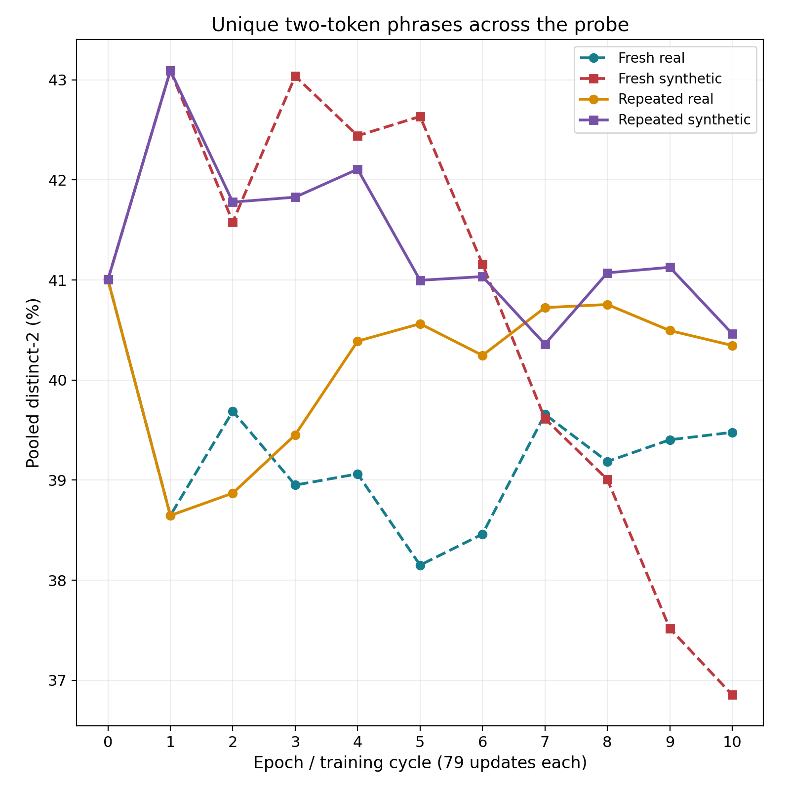

*Figure 49. Distinct-2 = unique bigrams / 16,128 bigram occurrences in the fixed-size probe. N-grams never cross output boundaries.*

- Final distinct-2: 39.48%, 40.35%, 36.86%, 40.46%.
- Repeated synthetic has the highest final distinct-2 of these four models, despite much worse perplexity than either real arm. Different repetitive outputs can collectively contain many different word-piece pairs; this pooled measure need not track local fluency.
- A lower value means more reuse of two-token combinations across the generated collection. It may reflect common phrasing, template reuse or local repetition; it is not the percentage of meaningful or correct text.

## 13. Unique three-token phrases

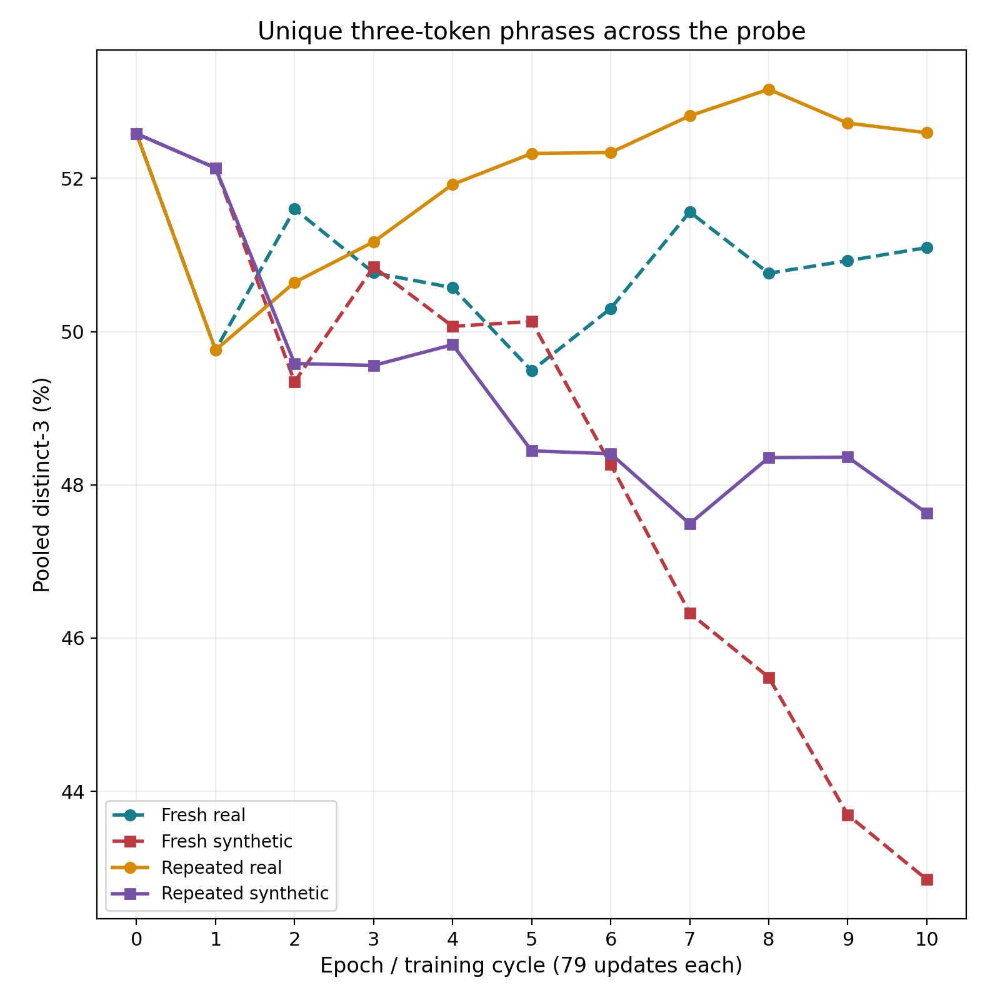

*Figure 50. Distinct-3 = unique trigrams / 15,872 trigram occurrences, on the same 256 outputs.*

- Final distinct-3: 51.10%, 52.60%, 42.85%, 47.63%.
- At this endpoint both synthetic arms have lower trigram diversity than the real arms, with repeated synthetic above fresh synthetic. That ordering agrees with local repetition here, although such agreement is not guaranteed in general.
- Three-token phrases capture more order than individual-token entropy, but a model can make diverse nonsensical phrases. Interpret this together with fixed real-text likelihood and within-output repetition.

## 14. Repeated four-token phrases

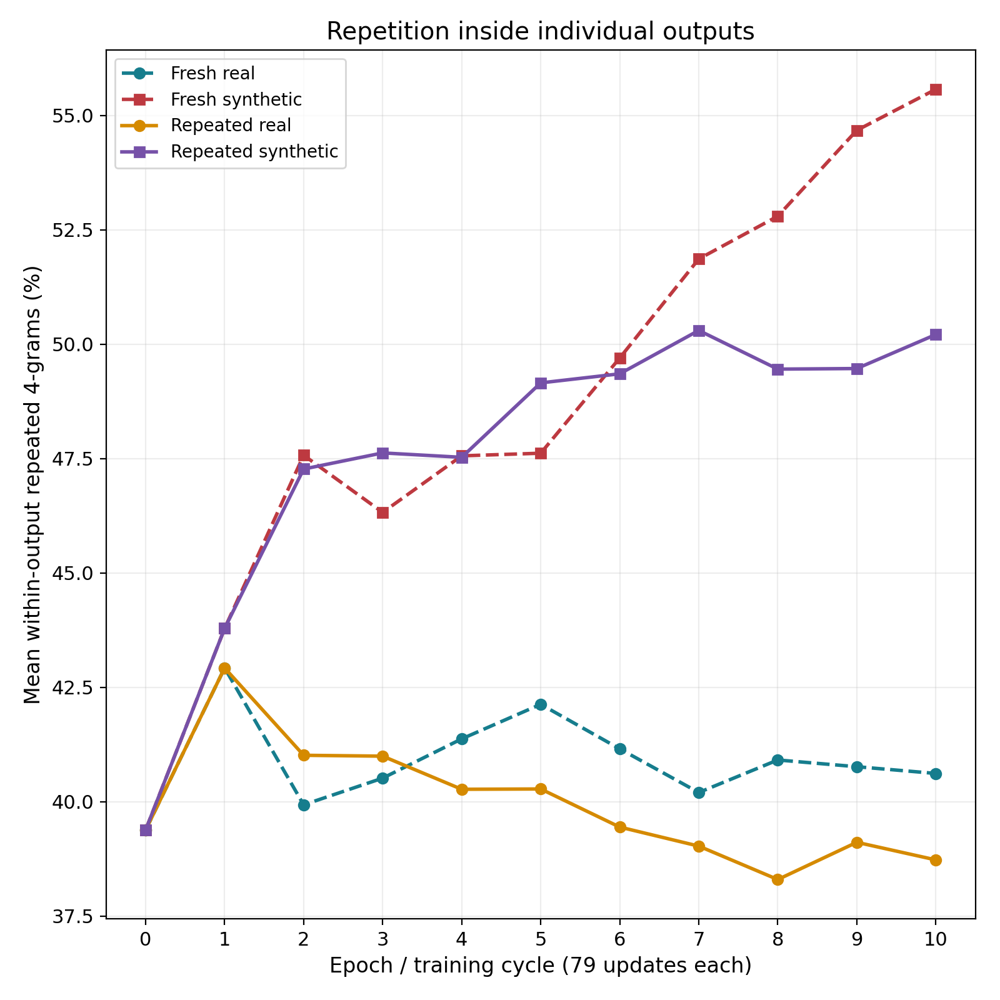

*Figure 51. For each 64-token output, count its 61 four-gram occurrences and calculate 1 − unique four-grams / 61; then average.*

- Mean local repetition at epoch 10: 40.62%, 38.73%, 55.57%, 50.21%.
- Repeated synthetic is less repetitive than fresh synthetic on this probe, while both exceed the real arms. Repeated real is slightly less repetitive than fresh real despite its worse held-out likelihood, again separating decoding behavior from overfitting.
- A repeated phrase within one output raises this measure. Reusing a phrase once in many different outputs affects the separate pooled repetition statistic. Beam decoding already produced repetition before fine-tuning, so not every repeated phrase was introduced by this experiment.

## 15. Transfer to other real-text collections

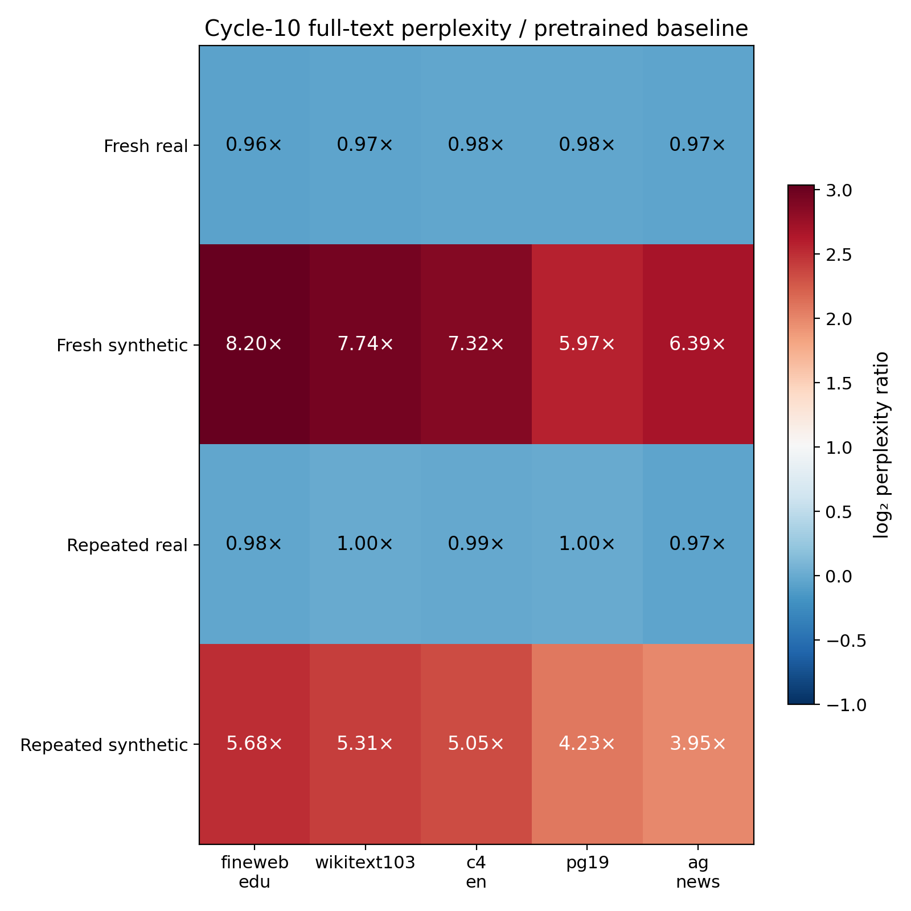

*Figure 52. Cycle-10 full-text perplexity divided by each corpus’s own pretrained baseline. Redder cells indicate larger ratios; annotations give the actual ratio.*

- FineWeb-Edu, WikiText-103, English C4, PG-19 and AG News use frozen up-to-512-token full-text evaluation arrays. This objective differs from the primary 64-token conditional-continuation test, so their absolute perplexities are reported separately.
- Real-only endpoint ratios remain close to 1 across these collections, whereas both synthetic arms are several times worse than pretrained OPT. The synthetic deterioration therefore also appears outside the primary FineWeb continuation objective.
- Ratios above 1 mean worse likelihood than original OPT on that collection. Comparing several sources describes transfer and forgetting; none is a direct factual-accuracy test.

## 16. The unchanged learning-rate schedule

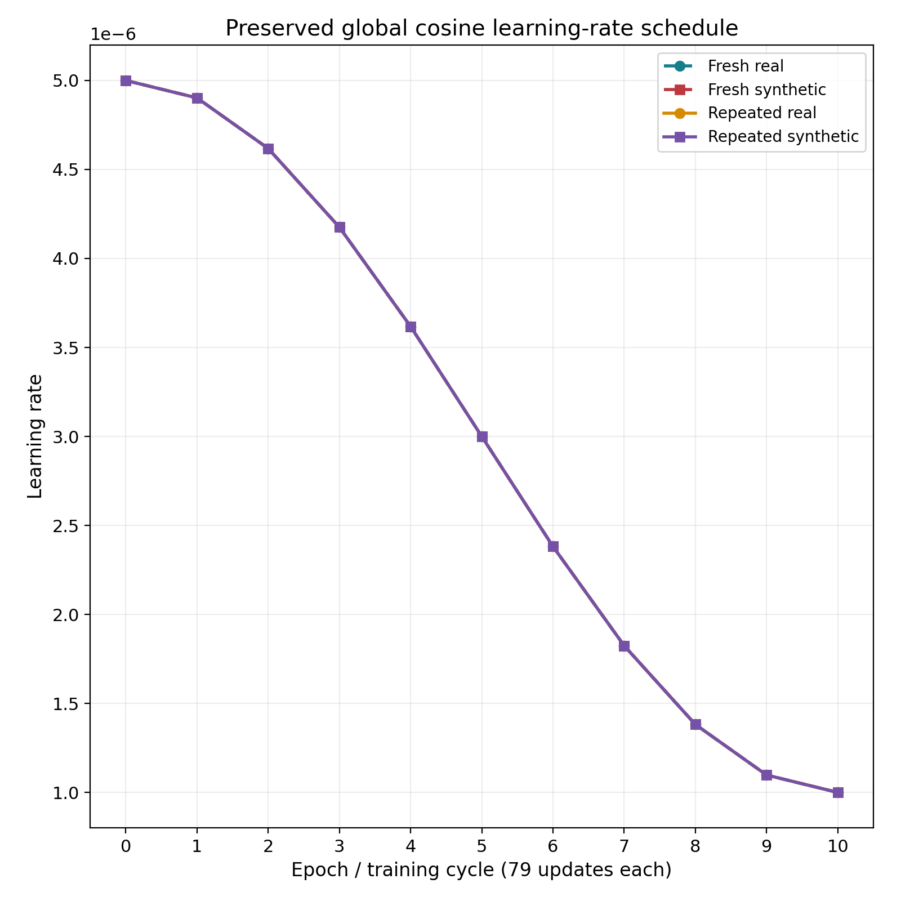

*Figure 53. All four arms use the same global cosine learning rate; overlapping lines are expected.*

- Learning rate decreases from 5 × 10⁻⁶ to 1 × 10⁻⁶ over 790 updates. This schedule and all other scientific settings were preserved deliberately to match the historical controls.
- Smaller later updates can slow deterioration or improvement. These ten-epoch trajectories cannot establish permanent stabilization, and the current design does not isolate learning-rate effects.

## 17. Complete primary test trajectory

*Table R3. Fixed real-test corpus perplexity after every epoch. Epoch 0 is the same untouched model.*

| Epoch | Fresh real | Fresh synthetic | Repeated real | Repeated synthetic |
| --- | --- | --- | --- | --- |
| 0 | 29.176 | 29.176 | 29.176 | 29.176 |
| 1 | 28.395 | 44.636 | 28.395 | 44.636 |
| 2 | 28.327 | 72.877 | 28.354 | 72.129 |
| 3 | 28.237 | 107.063 | 28.378 | 103.018 |
| 4 | 28.184 | 145.218 | 28.415 | 133.252 |
| 5 | 28.156 | 185.830 | 28.459 | 158.319 |
| 6 | 28.124 | 221.712 | 28.496 | 176.483 |
| 7 | 28.104 | 254.992 | 28.531 | 191.012 |
| 8 | 28.085 | 287.497 | 28.567 | 200.045 |
| 9 | 28.061 | 320.534 | 28.587 | 208.696 |
| 10 | 28.053 | 342.011 | 28.610 | 215.388 |

All four conditions have exactly 79 updates per epoch and the same total number of scored labels. Fresh/repeated epoch-1 equality is independently verified at the tensor and input-content level within each target source. Later differences arise after the source-chunk policy diverges.

## 18. Epoch-10 predictive endpoints

*Table R4. Corpus perplexity and example-level conditional NLL. Median and P95 summarize per-example mean NLL, not per-example perplexity.*

| Condition | Test PPL | Val. PPL | Test NLL | Median NLL | P95 NLL |
| --- | --- | --- | --- | --- | --- |
| Fresh real | 28.053 | 27.829 | 3.3341 | 3.3225 | 4.3493 |
| Fresh synthetic | 342.011 | 346.172 | 5.8348 | 5.8717 | 7.1498 |
| Repeated real | 28.610 | 28.344 | 3.3538 | 3.3395 | 4.3790 |
| Repeated synthetic | 215.388 | 216.469 | 5.3724 | 5.3955 | 6.7201 |

*Table R5. New-arm training evaluation versus the unchanged real chunk-1 answers. Synthetic own-target loss is not comparable to real-target loss as a quality score.*

| New arm | Optimization NLL | Own-target NLL | Real-anchor NLL | Test NLL |
| --- | --- | --- | --- | --- |
| Repeated real | 3.22576 | 3.14322 | 3.1432 | 3.3538 |
| Repeated synthetic | 0.02795 | 0.01540 | 5.4513 | 5.3724 |

The repeated-synthetic model can become very confident about its own generated answers while assigning worse probabilities to the original real answers for those exact prompts. This illustrates self-reinforcement, rather than improved real-text prediction.

Optimization NLL averages the losses seen while updates are being made, with training-mode dropout. Own-target NLL re-evaluates the terminal model without dropout on that epoch’s labels. They are different measurements and need not coincide.

## 19. Epoch-10 generated-output endpoints

*Table R6. Fixed-probe surface statistics. H uses natural logarithms; D2/D3, local repetition, newline share and whole-output duplicates are percentages.*

| Condition | Pooled H | Within H | D2 % | D3 % | Local rep4 % | Newline % | Dup. % |
| --- | --- | --- | --- | --- | --- | --- | --- |
| Fresh real | 6.210 | 3.070 | 39.48 | 51.10 | 40.62 | 2.50 | 0.00 |
| Fresh synthetic | 6.559 | 2.757 | 36.86 | 42.85 | 55.57 | 1.86 | 0.00 |
| Repeated real | 6.201 | 3.088 | 40.35 | 52.60 | 38.73 | 2.58 | 0.00 |
| Repeated synthetic | 6.567 | 2.927 | 40.46 | 47.63 | 50.21 | 2.55 | 0.00 |

These statistics describe the same-sized decoded outputs, not an independently assessed quality score. Pooled repeated four-grams, distinct-1, the proportion of outputs containing repetition and all other saved diagnostics remain in the accompanying CSV/JSON records.

*Table R7. Additional surface diagnostics. At least 32 newlines means at least 32 of the 64 tokens are the pinned OPT newline token (ID 50118). The final two columns count outputs out of 256.*

| Condition | Distinct-1 % | Pooled rep4 % | Outputs with rep4 % | ≥32 newlines | All newlines |
| --- | --- | --- | --- | --- | --- |
| Fresh real | 16.62 | 43.63 | 92.97 | 0 | 0 |
| Fresh synthetic | 17.13 | 55.66 | 91.80 | 1 | 0 |
| Repeated real | 16.50 | 41.78 | 93.36 | 0 | 0 |
| Repeated synthetic | 18.47 | 50.35 | 89.06 | 0 | 0 |

## 19.2. Secondary full-text endpoints

*Table R8. Absolute full-text corpus perplexity, using the same frozen up-to-512-token arrays at every checkpoint. These values use a different objective from the primary conditional continuation test.*

| Model | FineWeb-Edu | WikiText-103 | English C4 | PG-19 | AG News |
| --- | --- | --- | --- | --- | --- |
| Pretrained M0 | 28.35 | 39.52 | 28.98 | 75.87 | 54.62 |
| Fresh real | 27.22 | 38.40 | 28.26 | 74.18 | 52.81 |
| Fresh synthetic | 232.57 | 305.76 | 212.03 | 452.87 | 348.90 |
| Repeated real | 27.71 | 39.52 | 28.70 | 75.97 | 53.06 |
| Repeated synthetic | 161.05 | 209.80 | 146.27 | 321.05 | 215.94 |

## 20.1. Same held-out prompt: fixed probe 0

**Shared real validation prompt**

> The U.S. Food and Drug Administration (FDA) announced today it will convene its Veterinary Medicine Advisory Committee (VMAC) to consider a salmon that has been genetically engineered to reach its market weight in half the time of conventionally raised salmon.
> The VMAC meeting, part of a rigorous regulatory process

**Fresh real — epoch 10**

> , is expected to take place in Washington, D.C., this fall.
> The genetically engineered salmon, which has been genetically engineered to reach its market weight in half the time of conventionally raised salmon, has been genetically engineered to reach its market weight in half the time of conventionally raised salmon.
> The genetically

**Fresh synthetic — epoch 10**

> , will consider a salmon that has been genetically engineered to reach its market weight in half the time of conventionally raised salmon. The VMAC meeting, part of a rigorous regulatory process, will consider a salmon that has been genetically engineered to reach its market weight in half the time of conventionally raised salmon. The VMAC

**Repeated real — epoch 10**

> , will take place at the U.S. Fish and Wildlife Service (FWS) Fish and Wildlife Service (FWS) headquarters in Washington, D.C.
> The genetically engineered salmon, which has been genetically engineered to reach its market weight in half the time of conventionally raised salmon, has been genetically engineered

**Repeated synthetic — epoch 10**

> , will consider a salmon that has been genetically engineered to reach its market weight in half the time of conventionally raised salmon.
> The VMAC meeting, part of a rigorous regulatory process, will consider a salmon that has been genetically engineered to reach its market weight in half the time of conventionally raised salmon.
> The

*Exact decoded 64-token continuations; fixed probe indices 0 and 1 were selected before final results. These examples illustrate behavior and do not estimate average quality. Newlines and unfinished fragments are retained.*

Free generation can remain repetitive even after real-data training improves perplexity. Perplexity scores real answers with their true preceding tokens supplied; beam decoding instead follows the model’s own choices. This small model already produced repetitive beam outputs before fine-tuning, so a poor example alone does not establish that training failed.

## 20.2. Same held-out prompt: fixed probe 1

**Shared real validation prompt**

> The Straits of Mackinac connect Lake Michigan and Lake Huron. The Great Lakes represent 20 percent of Earth's surface freshwater. These lakes are relied upon heavily to supply clean drinking water to more than 30 million people, provide a plethora of diverse fish species, and support an abundant wildlife population. The Great Lakes roughly

**Fresh real — epoch 10**

>  cover an area of 1.5 million square miles (2.5 million square kilometers).
> The Great Lakes are the largest freshwater lakes in the world. They are the largest freshwater lakes in the world. They are the largest freshwater lakes in the world. They are the largest freshwater lakes in the world. They are the

**Fresh synthetic — epoch 10**

>  represent 20 percent of Earth's surface freshwater. These lakes are relied upon heavily to supply clean drinking water to more than 30 million people, provide a plethora of diverse fish species, and support an abundant wildlife population. The Great Lakes roughly represent 20 percent of Earth's surface freshwater. These lakes are relied upon heavily to supply clean

**Repeated real — epoch 10**

>  cover an area of 1,000 square miles (2,000 square km).
> The Great Lakes are the largest freshwater lakes in the world. They are the largest freshwater lakes in the world. They are the largest freshwater lakes in the world. They are the largest freshwater lakes in the world. They are the largest freshwater

**Repeated synthetic — epoch 10**

>  represent 20 percent of Earth's surface freshwater. These lakes are relied upon heavily to supply clean drinking water to more than 30 million people, provide a plethora of diverse fish species, and support an abundant wildlife population. The Great Lakes roughly represent 20 percent of Earth's surface freshwater. These lakes are relied upon heavily to supply clean

*Exact decoded 64-token continuations; fixed probe indices 0 and 1 were selected before final results. These examples illustrate behavior and do not estimate average quality. Newlines and unfinished fragments are retained.*

## 21. Why repeated synthetic may drift less

- A direct check of all 10,000 repeated training prompts shows that 97.49% of their complete generated answers are unchanged between the epoch-9 and epoch-10 target pools; 98.61% of aligned token positions agree. Between the first two pools, only 10.75% of whole answers agree.
- The targets were regenerated every time; their growing agreement is a measured outcome, not evidence that the pipeline reused an old dataset. This is consistent with self-training becoming self-consistent on familiar prompts. Fresh prompt pools are not row-aligned and cannot be compared with this statistic.
- Both synthetic arms finish with similarly tiny own-target NLL. Target stability alone does not prove a gradient-level explanation for their different test perplexities. Repeated contexts, evolving labels and decreasing learning rate can all contribute; their separate causal effects were not isolated.

*Table R9. Agreement of newly regenerated training targets with the preceding target pool, for the same fixed prompts. This is training-pool stability, not held-out output diversity or answer correctness.*

| Target pool for epoch | Token positions equal % | Whole 64-token answers equal % |
| --- | --- | --- |
| 1 | — | — |
| 2 | 21.34 | 10.75 |
| 3 | 54.40 | 45.44 |
| 4 | 76.39 | 70.85 |
| 5 | 85.68 | 81.77 |
| 6 | 92.17 | 89.88 |
| 7 | 96.02 | 94.75 |
| 8 | 97.74 | 96.91 |
| 9 | 98.51 | 97.58 |
| 10 | 98.61 | 97.49 |

Calculation: for adjacent integer target arrays Tₖ and Tₖ₋₁ of shape 10,000 × 64, token agreement = mean(Tₖ = Tₖ₋₁), and whole-answer agreement = mean(all 64 positions equal within each row)). All regenerated arrays, initializer/generator hashes and reconstructed training masks were verified against the pinned records.

## 22. Interpretation and limits

- Data reuse with real targets gives a modest late held-out loss increase while its fixed real training loss decreases. Fresh real data continues to improve. This supports an ordinary overfitting interpretation for the repeated-real control within this small learning-rate and ten-epoch regime.
- Synthetic targets cause far larger real-text likelihood deterioration under both prompt policies. Very low synthetic own-target loss and worsening real-anchor loss show that fitting self-generated answers is different from retaining the original distribution of real continuations.
- Reusing synthetic prompts need not make every collapse metric worse. Already-fitted contexts can produce increasingly confident, self-consistent targets, while fresh contexts spread the generated target distribution to new inputs. This is a possible mechanism, not a proven causal explanation without measuring gradients or intervening on targets.
- The comparison is one seed and one particular repeated chunk. The fresh controls were reused historical executions, not newly replicated samples. Matching hardware/settings and exact first-step equality improve comparability but do not supply uncertainty estimates.
- “Real” denotes unaltered source-corpus continuation text. Human authorship and overlap with OPT’s original pretraining data were not independently audited; document and exact-passage exclusion apply within the prepared experimental bank.
- All conditions share decreasing learning rate and deterministic five-beam decoding. Pooled entropy, within-output repetition and fixed real-text likelihood have distinct meanings. No result establishes a permanent plateau, universal collapse threshold or irreversible loss of capabilities.
- Both new terminal checkpoints and their optimization states were cold-restored from pinned private backups on the GPU; held-out evaluation was reproduced before shutdown. This verifies terminal-stage recovery, not independent restoration of every historical checkpoint or full dataset. Recovery storage remains preserved.
