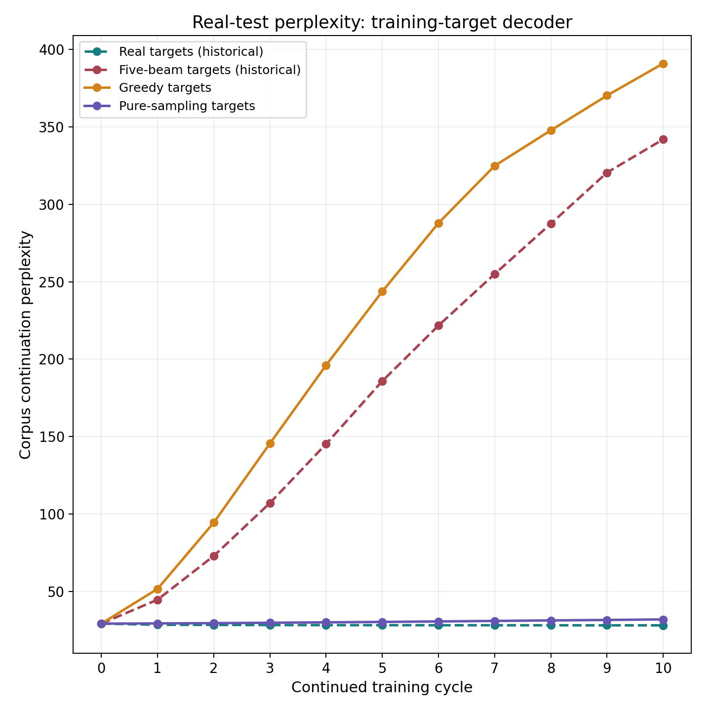
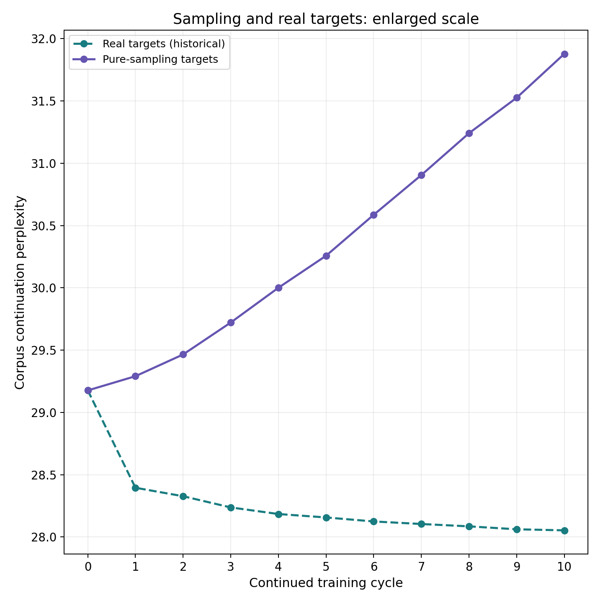
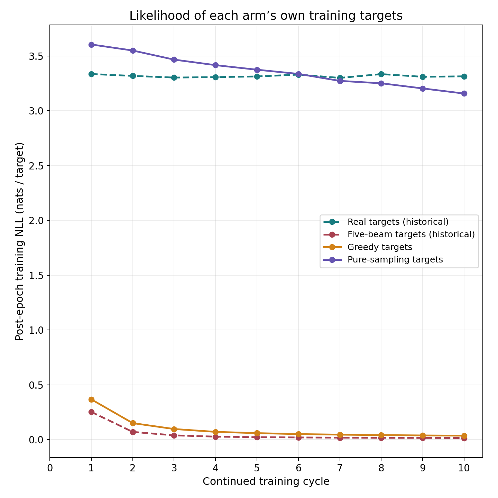
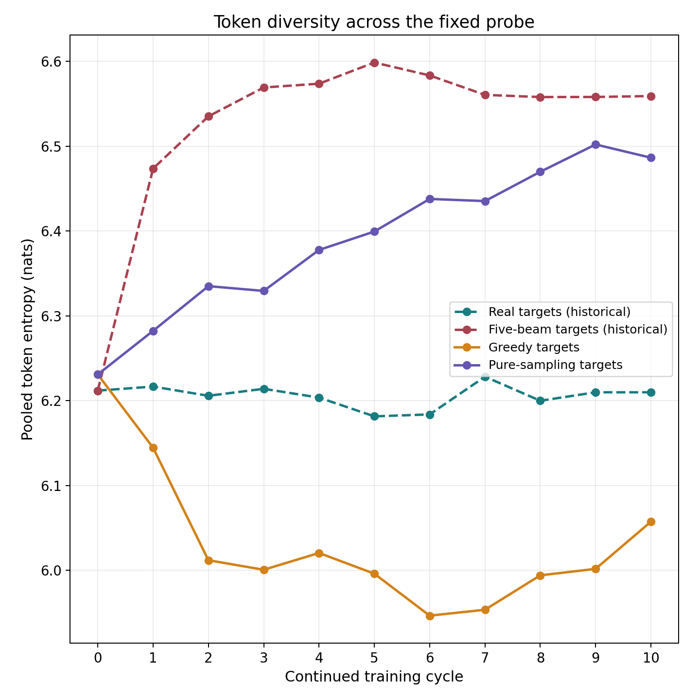
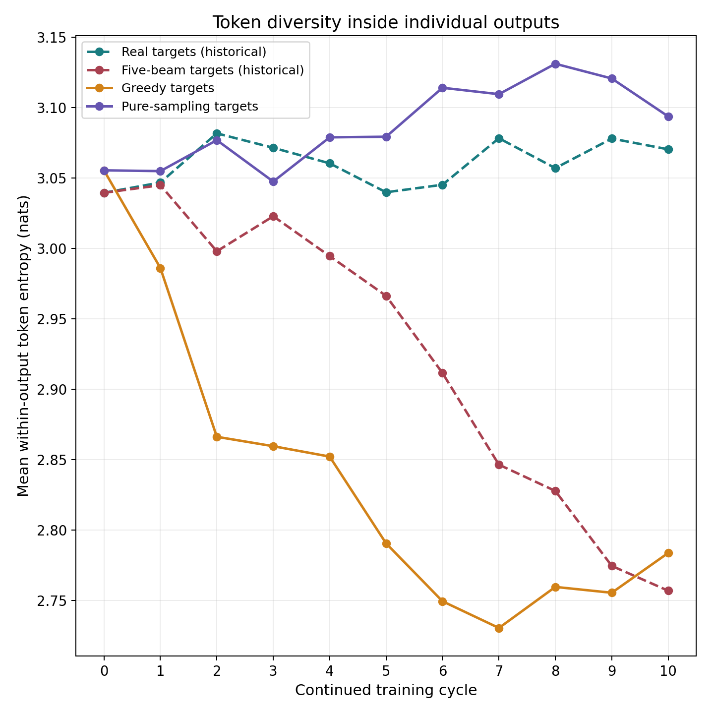
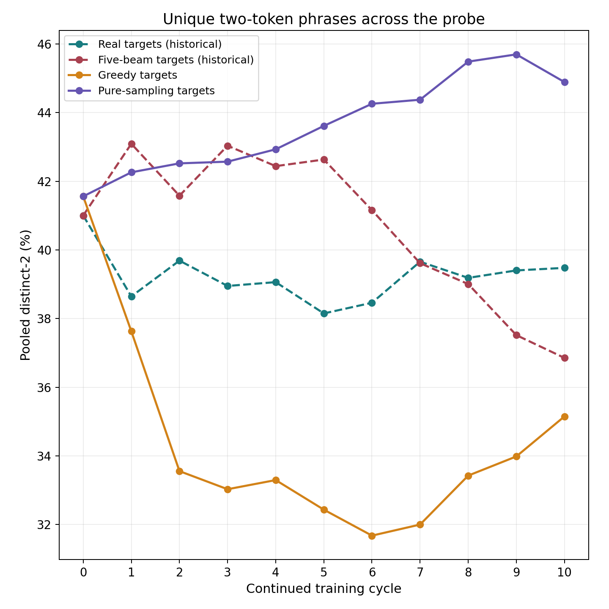
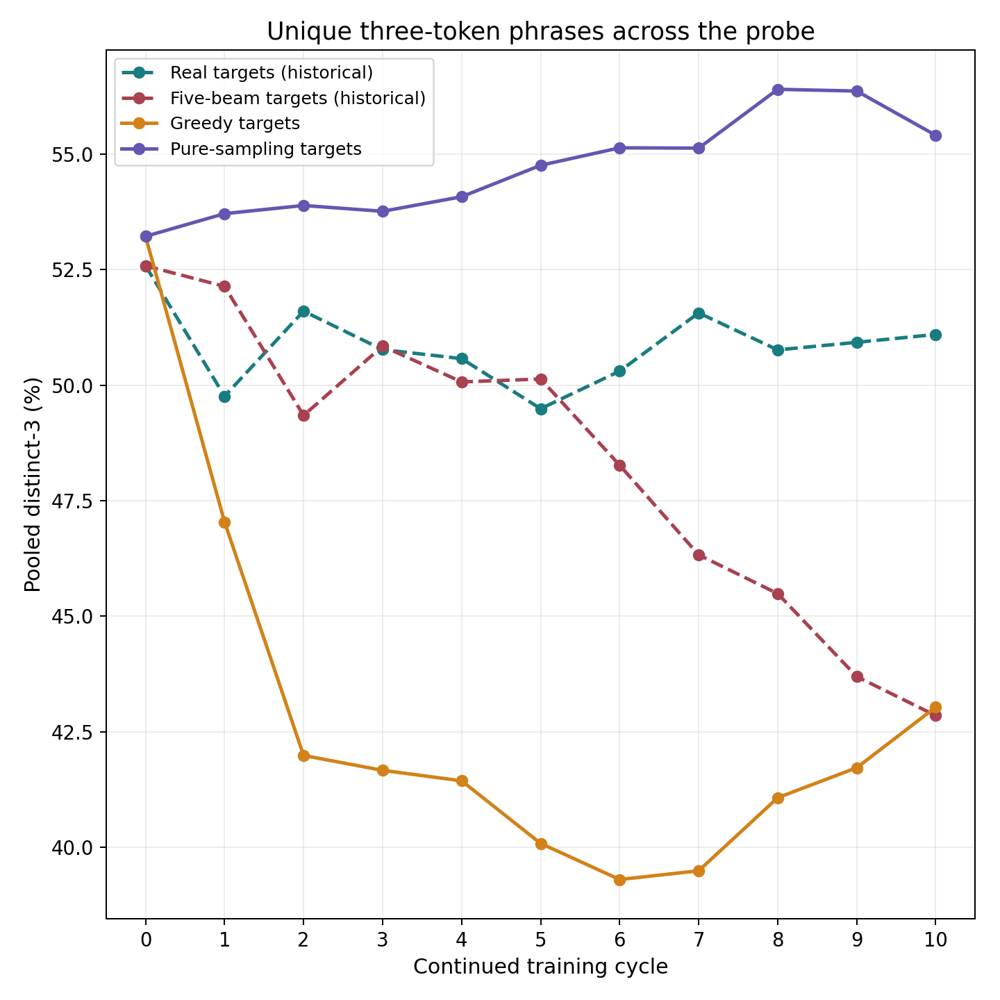
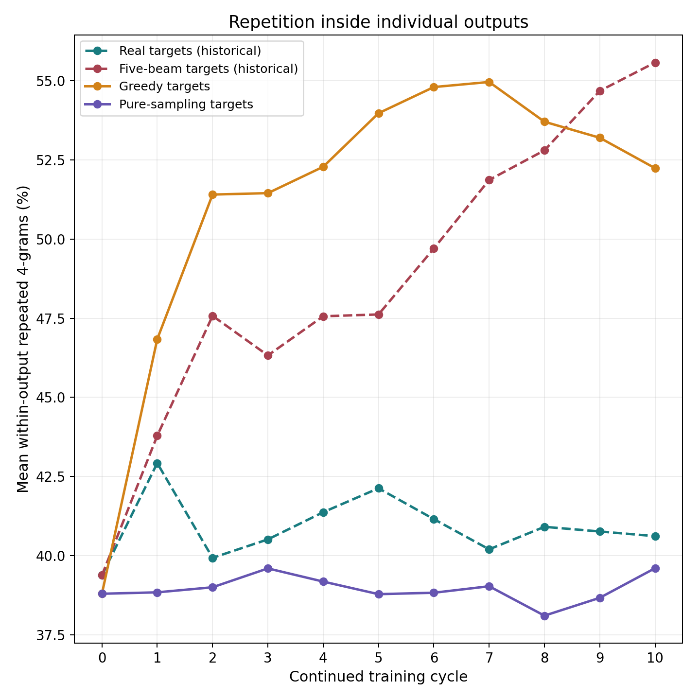
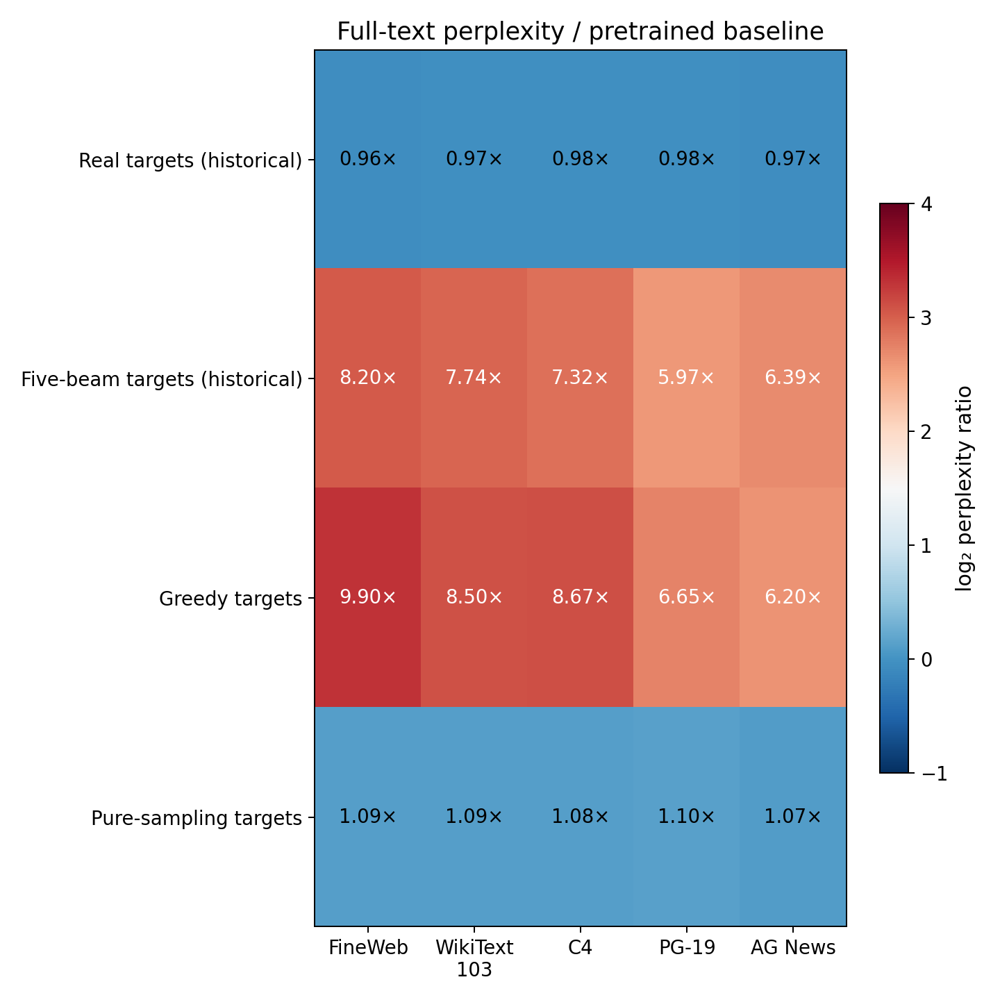

# Week 4 extension: decoding strategy in recursive synthetic training

## 1. Research question and principal findings

Does recursive synthetic training deteriorate because its labels are synthetic, or does the way those labels are generated substantially change the trajectory? We compare two new continued-training arms—greedy and pure sampling—with the completed five-beam synthetic control. A historical real-only arm provides context.

- All models begin at test perplexity 29.18. After ten cycles, greedy reaches 390.99, five-beam 342.01, and sampling 31.88. The real-only reference ends at 28.05.

- Sampling is substantially less damaging in this protocol, but is not perfectly stable: real-test perplexity rises at every cycle and ends 9.26% above its initial value. It does not reproduce the small improvement from using real continuations.

- All three synthetic arms train on 100% synthetic continuation labels. They retain identical real prompts, use the same ten fresh data chunks, and carry weights and optimization state forward. None resets between cycles.

- Greedy and beam targets lead to very confident fitting of self-generated answers while real-text likelihood deteriorates sharply. Sampling preserves far more local diversity in the actual training targets and avoids most of that likelihood deterioration.

- The comparison is descriptive: one seed, ten cycles and a decreasing learning rate. The new arms used RTX PRO 4500 Blackwell; the historical controls used RTX PRO 4000 Blackwell. This execution difference prevents treating the historical comparison as perfectly hardware-controlled.

Table D1. The intervention is the decoder used to generate training continuations. All generated-output measurements later use a common five-beam probe.

| Condition | Training labels | Training-target decoder | Evidence / GPU |
| --- | --- | --- | --- |
| Real reference | Original next 64 tokens | No target generation | Historical / 4000 |
| Five-beam | Own preceding model | 5 beams; deterministic | Historical / 4000 |
| Greedy | Own preceding model | 1 beam; highest next-token score | New / 4500 |
| Sampling | Own preceding model | 1 beam; T=1, top-k=0, top-p=1 | New / 4500 |

## 2. Data, recursive loop and optimization

- Model: original pretrained facebook/opt-125m, revision 27dcfa74d334bc871f3234de431e71c6eeba5dd6. Data: FineWeb-Edu sample-10BT, revision 87f09149ef4734204d70ed1d046ddc9ca3f2b8f9. The exact previously frozen bank is reused unchanged.

- Each example contains 64 real source prompt tokens and 64 continuation tokens. Input is BOS + prompt + continuation, or 129 positions. Attention sees the prompt; loss scores only the 64 continuation targets. This is ordinary text completion, not question-answer supervision.

- At cycle k, checkpoint M(k−1) receives the 10,000 prompts from chunk k and generates exactly 64 new tokens for each. Freeze the completed synthetic dataset, train that same checkpoint once on it, evaluate terminal Mk, then proceed to the next fresh chunk. Each arm generates its own labels.

- All arms use the same ordered ten document-separated chunks and the existing seeded training shuffle. Held-out documents and exact sliding 64-token passage exclusions are inherited from the frozen bank. No validation/test target tokens enter training.

- Bank sampling was a deterministic shuffled stream with a 10,000-document buffer; the prepared bank read 24,950 source rows from one source shard. These data are not a uniform random address sample of the full 10B-token corpus.

- Each arm receives ten one-epoch stages: 100,000 examples, 6.4 million scored target-token exposures and 790 optimizer updates. Microbatch 32, accumulation 4, effective batch 128; the final partial group is retained.

- AdamW: LR 5e-6, betas (0.9, 0.999), epsilon 1e-8, weight decay 0.01. Model, optimizer, scheduler and training RNG persist. The same global cosine schedule decreases LR to 1e-6 over 790 updates. Terminal weights are retained without validation-based selection.

- BF16 autocast with FP32 parameters, seed 42, pinned PyTorch image and tested software. New arms share RTX PRO 4500 Blackwell. Both completed all ten stages and shut down automatically; no new training was needed for this analysis.

Greedy chooses the highest-scoring next token at each position. Five-beam search retains five candidate prefixes while pursuing high-scoring sequences. Pure sampling draws tokens from the model’s distribution at temperature 1; top-k is disabled and top-p is 1. All methods enforce exactly 64 new tokens and repetition penalty 1.0. The fixed-length decoding constraint also prevents ending before token 64.

Table D2. Fixed evaluation and training counts. The two new arms each have their own 790-update optimization chain.

| Quantity | Value |
| --- | --- |
| Training pairs / scored targets per cycle | 10,000 / 640,000 |
| Cycles / total scored targets per arm | 10 / 6,400,000 |
| Optimizer updates per cycle / arm | 79 / 790 |
| Validation pairs / scored targets | 7,322 / 468,608 |
| Test pairs / scored targets | 7,151 / 457,664 |
| Fixed probe outputs / generated tokens | 256 / 16,384 |
| Learning rate across complete schedule | 5e-6 → 1e-6 |

## 3. What is measured—and which decoder is used?

- Primary NLL and perplexity: teacher-force the same real held-out continuation tokens at every checkpoint. The true preceding target tokens supply context. This evaluation does not freely generate text and does not use beam search, greedy decoding or sampling.

- Corpus NLL L = −(1 / 64N) Σᵢ Σⱼ log p(yᵢⱼ | BOS, promptᵢ, yᵢ,<ⱼ); corpus perplexity = exp(L). Lower means the model assigns greater probability to the actual real continuations. It is not factual accuracy or mean per-example perplexity.

- Generated-output statistics: all models answer the same 256 validation prompts using the same deterministic five-beam decoder. The training decoder changes, but the probe decoder does not. Differences in these probe curves therefore describe the resulting learned checkpoints under a common generation rule.

- Training-target diagnostics are a separate population: 10,000 continuations that actually trained cycle 10. Synthetic D10 was generated by M9; it is not output from M10. Do not directly compare pooled distinct-n from 10,000 training outputs with the 256-output probe.

- Secondary tests use frozen up-to-512-token full-text arrays from FineWeb, WikiText-103, C4, PG-19 and AG News. Their objective and context differ from the primary 64-token completion test, so absolute perplexities are reported separately.

## 4. Primary result: real-test perplexity

- Greedy rises from 29.18 to 390.99 (13.40× baseline), five-beam to 342.01 (11.72×), and sampling to 31.88 (1.09×). Real-only improves to 28.05.

- Under the tested protocol, synthetic labels alone do not determine the size of deterioration: their generation rule makes a large difference. Sampling still degrades gradually; it does not remain equal to the real control.

Figure D1. Every curve scores the same 457,664 real continuation tokens. Dashed curves are historical controls; solid curves are new executions.

## 5. Sampling is comparatively preserved, not unchanged

- Sampling increases at every measured cycle, from 29.18 to 31.88. The real-only curve decreases to 28.05. The small difference hidden by the full-range plot is therefore systematic within this execution.

- A shared decreasing LR may affect late slopes. Ten cycles do not establish permanent stability or the absence of longer-run collapse.

Figure D2. The same sampling and real-only test measurements on an enlarged vertical scale; no rescaling or normalization of the values.

Table D3. Fixed real-test corpus perplexity at every checkpoint. Cycle 0 is the original pretrained model.

| Cycle | Real reference | Five-beam | Greedy | Sampling |
| --- | --- | --- | --- | --- |
| 0 | 29.176 | 29.176 | 29.176 | 29.176 |
| 1 | 28.395 | 44.636 | 51.610 | 29.290 |
| 2 | 28.327 | 72.877 | 94.407 | 29.465 |
| 3 | 28.237 | 107.063 | 145.552 | 29.721 |
| 4 | 28.184 | 145.218 | 196.101 | 30.000 |
| 5 | 28.156 | 185.830 | 243.739 | 30.257 |
| 6 | 28.124 | 221.712 | 287.902 | 30.586 |
| 7 | 28.104 | 254.992 | 324.901 | 30.905 |
| 8 | 28.085 | 287.497 | 347.804 | 31.241 |
| 9 | 28.061 | 320.534 | 370.301 | 31.526 |
| 10 | 28.053 | 342.011 | 390.993 | 31.878 |

## 6. Fitting synthetic answers versus predicting real answers

- Final own-target NLL is 0.0365 for greedy, 0.0153 for beam and 3.1575 for sampling, while their real-test NLL is 5.9687, 5.8348 and 3.4619.

- The deterministic models learn to give their own repetitive answers very high probability, not to predict unseen real text better. Lower loss on self-generated targets is therefore not evidence of improved generalization. Different target distributions also make cross-arm training losses unequal in intrinsic difficulty.

Figure D3. Post-epoch NLL on the targets that actually trained each cycle. The targets change between cycles, so this is not a fixed held-out trajectory.

## 7. Pooled token entropy: vocabulary spread across outputs

- Final pooled entropy is 6.057 nats for greedy, 6.559 for beam and 6.486 for sampling.

- Beam has the highest pooled entropy here despite very poor real-text likelihood. Different outputs can repeat different topic-specific words, producing broad aggregate vocabulary while each individual answer is repetitive. Greedy’s partial late recovery in pooled entropy does not reverse its rising perplexity.

Figure D4. H = −Σᵥ fᵥ log fᵥ from token frequencies pooled across the fixed 16,384 generated probe tokens. This is empirical output entropy, not model predictive entropy.

## 8. Entropy inside each answer

- Final mean within-output entropy is 2.784 nats for greedy, 2.757 for beam and 3.094 for sampling.

- Sampling remains near its initial level and above the deterministic synthetic arms. This means fewer outputs are dominated by a tiny repeated vocabulary. It does not guarantee grammatical, useful or factually correct answers.

Figure D5. Compute token-frequency entropy separately inside every 64-token output, then average over 256 outputs.

## 9. Distinct-2: unique token pairs

- At cycle 10, distinct-2 is 35.15% for greedy, 36.86% for beam and 44.89% for sampling.

- Sampling exceeds the real reference on this pooled statistic even though its real-test perplexity is worse. More varied token combinations can include unusual or incorrect phrases; diversity and predictive quality measure different properties.

Figure D6. Pooled distinct-2 = unique bigrams / 16,128 bigram occurrences. N-grams do not cross output boundaries.

## 10. Distinct-3: unique three-token phrases

- Final distinct-3 is 43.03% for greedy, 42.85% for beam and 55.41% for sampling.

- Greedy and beam end almost equal on this statistic despite noticeably different perplexity. Similar surface phrase variety does not imply similar probability assigned to the real reference answers.

Figure D7. Pooled distinct-3 = unique trigrams / 15,872 trigram occurrences, on exactly the same fixed-size probe.

## 11. Repetition inside individual outputs

- Final local repetition is 52.23% for greedy, 55.57% for beam and 39.61% for sampling; the real reference is 40.62%.

- Greedy has worse perplexity than beam but slightly less local repetition. Likelihood and repetition are different failure axes. Sampling’s probe repetition is still substantial because every checkpoint is probed with five-beam decoding; repetition was already present in the untrained baseline.

Figure D8. For each output, repeated-4-gram rate = 1 − unique four-grams / 61; average over 256 outputs. Higher means more local reuse.

## 12. Endpoint predictive statistics

- The table separates corpus-average likelihood from the distribution of per-example losses. P95 is the 95th percentile of mean NLL over the 64 target tokens in each test example; it is not a confidence interval.

- Validation agrees with test: sampling is much less degraded than deterministic synthetic training, but remains worse than the real-only reference. The test collection was never used to select checkpoints.

Table D4. Cycle-10 real-text likelihood. NLL uses natural logarithms and units of nats per scored target token.

| Metric | Real ref. | Five-beam | Greedy | Sampling |
| --- | --- | --- | --- | --- |
| Test perplexity | 28.053 | 342.011 | 390.993 | 31.878 |
| Validation perplexity | 27.829 | 346.172 | 394.700 | 31.537 |
| Test NLL | 3.334 | 5.835 | 5.969 | 3.462 |
| Median example NLL | 3.323 | 5.872 | 6.002 | 3.448 |
| P95 example NLL | 4.349 | 7.150 | 7.431 | 4.541 |
| Own-target train NLL | 3.314 | 0.015 | 0.036 | 3.157 |

## 13. Endpoint output and formatting statistics

- These numbers use the shared five-beam probe and 256 identical prompts. Pooled entropy summarizes the whole collection; local entropy and repetition summarize each answer before averaging.

- No final checkpoint produces duplicate entire continuations across different probe prompts. That does not mean its individual continuations lack repeated phrases. Newline concentration is recorded separately to expose formatting sensitivity.

Table D5. Cycle-10 generated-output statistics under the common probe decoder. Percentages use each metric’s stated denominator.

| Metric | Real ref. | Five-beam | Greedy | Sampling |
| --- | --- | --- | --- | --- |
| Pooled entropy (nats) | 6.210 | 6.559 | 6.057 | 6.486 |
| Within entropy (nats) | 3.070 | 2.757 | 2.784 | 3.094 |
| Distinct-1 (%) | 16.620 | 17.126 | 15.771 | 18.970 |
| Distinct-2 (%) | 39.478 | 36.855 | 35.150 | 44.891 |
| Distinct-3 (%) | 51.096 | 42.849 | 43.032 | 55.406 |
| Within repeated-4 (%) | 40.619 | 55.571 | 52.235 | 39.607 |
| Pooled repeated-4 (%) | 43.628 | 55.661 | 53.797 | 40.689 |
| Duplicate outputs (%) | 0.000 | 0.000 | 0.000 | 0.000 |
| Newline tokens (%) | 2.496 | 1.862 | 2.661 | 2.850 |

## 14. What was actually in the synthetic training data?

- This diagnostic uses all 10,000 cycle-10 training continuations, not the 256-prompt probe. Each synthetic pool was generated by that arm’s M9 checkpoint using chunk-10 prompts. The real row contains the original corresponding continuation text.

- Sampling training targets have only 3.03% mean within-output repeated four-grams, versus 53.30% for greedy and 56.29% for beam. Their local entropy is much closer to real source text. This directly confirms that the training-label distributions differ.

- The sampling M10 model can still produce loops under the common five-beam probe. There is no contradiction: sampled training labels and deterministic probe outputs are different collections generated by different decoding rules.

- Pooled distinct-n depends on the number of outputs. Compare rows within this table; do not interpret the difference from the smaller probe table as a training effect.

Table D6. Diversity of the actual cycle-10 training continuations. Each row has 10,000 × 64 tokens.

| Metric | Real targets | Five-beam | Greedy | Sampling |
| --- | --- | --- | --- | --- |
| Pooled entropy (nats) | 7.570 | 7.505 | 6.783 | 7.796 |
| Within entropy (nats) | 3.784 | 2.744 | 2.785 | 3.737 |
| Distinct-2 (%) | 48.146 | 24.217 | 21.206 | 51.939 |
| Distinct-3 (%) | 82.788 | 37.849 | 34.087 | 84.367 |
| Within repeated-4 (%) | 0.652 | 56.294 | 53.300 | 3.027 |

## 15. Does the likelihood result transfer beyond the primary test?

- Greedy and beam deteriorate strongly on all five frozen real-text collections. Sampling remains much closer to its initial performance across these sources. The result is therefore not confined to the FineWeb 64-token continuation objective.

- These are separate corpus evaluations, not independent training replications. Their absolute perplexities use different text and longer contexts, and should not be substituted for the primary completion perplexity.

Figure D9. Cycle-10 full-text perplexity divided by each collection’s pretrained baseline. The annotations are ratios; red indicates worse likelihood.

Table D7. Secondary cycle-10 full-text perplexity; lower is better within each row.

| Corpus | Real ref. | Five-beam | Greedy | Sampling |
| --- | --- | --- | --- | --- |
| FineWeb-Edu | 27.22 | 232.57 | 280.74 | 30.80 |
| WikiText-103 | 38.40 | 305.76 | 336.04 | 43.10 |
| English C4 | 28.26 | 212.03 | 251.16 | 31.40 |
| PG-19 | 74.18 | 452.87 | 504.20 | 83.66 |
| AG News | 52.81 | 348.90 | 338.65 | 58.62 |

## 16. Same-prompt qualitative checks

The next two examples use the first two predeclared probe prompts, rather than prompts selected after inspecting the results. Every continuation is exactly the saved M10 output under the common five-beam probe; displayed line breaks are preserved. Short model outputs can be repetitive even when aggregate likelihood is comparatively well preserved.

## 16.1. Fixed probe example 1

Shared real prompt

The U.S. Food and Drug Administration (FDA) announced today it will convene its Veterinary Medicine Advisory Committee (VMAC) to consider a salmon that has been genetically engineered to reach its market weight in half the time of conventionally raised salmon.
The VMAC meeting, part of a rigorous regulatory process

Real reference — cycle 10, common five-beam probe

, is expected to take place in Washington, D.C., this fall.
The genetically engineered salmon, which has been genetically engineered to reach its market weight in half the time of conventionally raised salmon, has been genetically engineered to reach its market weight in half the time of conventionally raised salmon.
The genetically

Five-beam — cycle 10, common five-beam probe

, will consider a salmon that has been genetically engineered to reach its market weight in half the time of conventionally raised salmon. The VMAC meeting, part of a rigorous regulatory process, will consider a salmon that has been genetically engineered to reach its market weight in half the time of conventionally raised salmon. The VMAC

Greedy — cycle 10, common five-beam probe

, is a meeting of the FDA's Veterinary Medicine Advisory Committee (VMAC) to consider a salmon that has been genetically engineered to reach its market weight in half the time of conventionally raised salmon.
The VMAC meeting, part of a rigorous regulatory process, is a meeting of the FDA's Veterinary Medicine Advisory Committee

Sampling — cycle 10, common five-beam probe

, will take place at the U.S. Fish and Wildlife Service (FWS) Fish and Wildlife Service (FWS) Fish and Wildlife Service (FWS) Fish and Wildlife Service (FWS) Fish and Wildlife Service (FWS) Fish and Wildlife Service (FWS) Fish and Wildlife Service (F

These examples illustrate behavior, not an estimate of how often it occurs. In particular, the sampling-trained checkpoint is not sampling at display time: the probe still uses five beams, which can favor repetitive candidate continuations.

## 16.2. Fixed probe example 2

Shared real prompt

The Straits of Mackinac connect Lake Michigan and Lake Huron. The Great Lakes represent 20 percent of Earth's surface freshwater. These lakes are relied upon heavily to supply clean drinking water to more than 30 million people, provide a plethora of diverse fish species, and support an abundant wildlife population. The Great Lakes roughly

Real reference — cycle 10, common five-beam probe

 cover an area of 1.5 million square miles (2.5 million square kilometers).
The Great Lakes are the largest freshwater lakes in the world. They are the largest freshwater lakes in the world. They are the largest freshwater lakes in the world. They are the largest freshwater lakes in the world. They are the

Five-beam — cycle 10, common five-beam probe

 represent 20 percent of Earth's surface freshwater. These lakes are relied upon heavily to supply clean drinking water to more than 30 million people, provide a plethora of diverse fish species, and support an abundant wildlife population. The Great Lakes roughly represent 20 percent of Earth's surface freshwater. These lakes are relied upon heavily to supply clean

Greedy — cycle 10, common five-beam probe

 represent 20 percent of Earth's surface freshwater. These lakes are relied upon heavily to supply clean drinking water to more than 30 million people, provide a plethora of diverse fish species, and support an abundant wildlife population. The Great Lakes roughly represent 20 percent of Earth's surface freshwater. These lakes are relied upon heavily to supply clean

Sampling — cycle 10, common five-beam probe

 connect Lake Michigan and Lake Huron. The Great Lakes represent 20 percent of Earth's surface freshwater. These lakes are relied upon heavily to supply clean drinking water to more than 30 million people, provide a plethora of diverse fish species, and support an abundant wildlife population. The Great Lakes roughly connect Lake Michigan and Lake Huron

These examples illustrate behavior, not an estimate of how often it occurs. In particular, the sampling-trained checkpoint is not sampling at display time: the probe still uses five beams, which can favor repetitive candidate continuations.

## 17. Interpretation and limits

- Observed: both deterministic synthetic conditions strongly worsen real-text likelihood, become very confident on their own training labels, and have locally repetitive training targets. Pure sampling avoids most of this deterioration under the same optimization schedule.

- Plausible mechanism: greedy and beam replace a distribution of possible next tokens with a small set of preferred sequences. Training then increases confidence in those sequences, and recursive generation feeds the concentration back into the next dataset. Deterministic decoding can favor already repetitive patterns.

- Sampling draws from a broader set of the current model’s possibilities. In an idealized self-distillation step, if targets are drawn exactly from a fixed model and trained in expectation at those same parameters, the expected likelihood gradient is zero. This gives an intuition for smaller drift; it is not a guarantee that an actual recursive training run is stationary.

- Finite datasets, fixed-length decoding constraints, different train/evaluation modes, carried optimizer moments, weight decay and parameter updates violate that idealization. Sampling can preserve existing errors and still deteriorates 9.26% in test perplexity here. We did not measure a causal gradient decomposition.

- The rank ordering of greedy and beam is not universal: greedy is worse in real-test perplexity here, whereas beam is slightly worse in local repetition. No single entropy, distinct-n or repetition metric is a complete quality score.

- The learning rate decreases identically in every arm, and each run uses one seed. New greedy/sampling executions used a 4500 GPU; historical beam/real controls used a 4000. Identical pretrained weights and scientific contracts were verified, but floating-point differences can affect generated text. The greedy–sampling contrast shares hardware; the precise beam–greedy causal difference is less controlled.

- Real means original source-corpus text. Human authorship, pretraining overlap and factual correctness were not independently established. The bank’s held-out separation is an experimental data-leakage check, not proof of no overlap with OPT’s original pretraining data.

- A useful follow-up would hold hardware fixed, replicate training seeds and test longer or constant-LR schedules. The present result supports decoder sensitivity of recursive self-training; it does not establish permanent stability, a universal collapse threshold or an irreversible loss of capabilities.

## 18. Execution, verification and recovery

- Both new ten-cycle arms completed all twenty training stages, 1,580 combined optimizer updates and 12.8 million combined scored target exposures. The independent watchdog observed completion, and Runpod confirmed stopped compute at 01:48:13 UTC/London on 11 November 2026. The full Pod lifetime was approximately 2 hours 8 minutes.

- The provider currently reports USD 1.5364 for the full Pod (GPU plus Pod disk). This excludes validation, separate network-volume storage and other account resources. Conservative validation cost was approximately USD 0.3974; these are different accounting scopes, not a finalized all-in invoice.

- All 44 logical checkpoint rows were audited, including the two historical controls. Every new initializer, generator, fresh chunk and optimizer-parent handoff was checked. Saved per-example losses reproduced token-weighted corpus NLL, perplexity, median and P95; all 44 logical probe rows were recomputed from 42 unique-stage arrays (the baselines are shared within each comparison).

- All three synthetic D10 target pools were recovered and their actual training-target content hashes verified. The bank, held-out arrays and historical reports remain unchanged. Twenty historical probe event logs were not included by the old backup filter; their absence is recorded rather than treated as complete historical stage restoration.

- Pinned private snapshots contain model and optimizer artifacts. This analysis recovered scientific JSON, probes and final-cycle target pools, but did not independently cold-restore or re-evaluate the full-run checkpoints on a GPU. The earlier small GPU acceptance did perform cold restoration and reproduced evaluation; that is a separate recovery scope.

- The working and backup recovery volumes remain retained. Stopped compute does not stop storage billing. Full model/optimizer files remain private and were not downloaded to the laptop for this report.

