# Model replication: SmolLM2-135M and recursive synthetic-data mixtures

## 1. Question and principal findings

We repeat the matched FineWeb continuation experiment with a second base language model. Does adding a small amount of original source text again reduce deterioration from recursive synthetic targets? Seven independent continued-training arms vary only the fraction of target continuations replaced by their own generated text.

- All arms start at test perplexity 17.97. After ten cycles the endpoints are 0% synthetic: 17.71, 50% synthetic: 18.25, 80% synthetic: 19.74, 95% synthetic: 26.74, 99% synthetic: 58.36, 99.9% synthetic: 224.37, 100% synthetic: 312.49.

- Fresh real targets slightly improve held-out likelihood (-1.42%). The 50% condition ends 1.55% above baseline; 100% synthetic reaches 17.39× baseline.

- More real targets improve cycle-10 perplexity in every tested pairwise fraction comparison. However, output entropy, distinct-n and repetition are not all monotonic quality measures. Their populations and denominators matter.

- This qualitatively reproduces the earlier OPT result: large deterioration near fully synthetic targets, with a much smaller effect at intermediate fractions. It does not establish a universal threshold or permanent stabilization.

Table S1. One independent optimization chain per condition. All conditions use 10,000 original prompts per cycle; “synthetic” describes target continuations, not the prompts.

| Synthetic targets | Real pairs/cycle | Generated pairs/cycle | Real target-token exposures (10 cycles) |
| --- | --- | --- | --- |
| 0% | 10,000 | 0 | 6,400,000 |
| 50% | 5,000 | 5,000 | 3,200,000 |
| 80% | 2,000 | 8,000 | 1,280,000 |
| 95% | 500 | 9,500 | 320,000 |
| 99% | 100 | 9,900 | 64,000 |
| 99.9% | 10 | 9,990 | 6,400 |
| 100% | 0 | 10,000 | 0 |

## 2. Data and precisely what is trained

- Model: HuggingFaceTB/SmolLM2-135M base, revision 93efa2f097d58c2a74874c7e644dbc9b0cee75a2. Dataset: FineWeb-Edu sample-10BT, revision 87f09149ef4734204d70ed1d046ddc9ca3f2b8f9.

- The corpus is ordinary source text, not labelled question-answer data. Within each document, a non-overlapping 128-token window is split into a 64-token prompt and the next 64 original tokens. A leading BOS token gives 129 model positions.

- The model sees BOS, the prompt and the continuation. The prompt remains visible through attention; only the 64 continuation tokens contribute to loss. Teacher forcing supplies preceding true target tokens when training and evaluating.

- Ten frozen chunks each contain 10,000 pairs. Every cycle advances to a different chunk with disjoint source-document allocation. All seven arms reuse the same chunk sequence, prompt rows and held-out arrays. We do not train repeatedly on one frozen chunk.

- SmolLM2 requires its own tokenizer-native bank. It reuses the verified historical source-document allocations and held-out assignments, but its token boundaries/windows differ from OPT. Held-out document identities, normalized URL/text and exact sliding 64-token passages were excluded when the bank was built.

- The bank was selected through a deterministic shuffled stream with a 10,000-document buffer, not uniform random token addresses across the entire 10B-token corpus. Original source text is preserved; real does not certify human authorship or factual correctness.

Table S2. Frozen native-tokenizer data and optimization counts. Validation and test are fixed real continuations, never training labels.

| Quantity | Value |
| --- | --- |
| Training pairs / scored targets per cycle | 10,000 / 640,000 |
| Training cycles / scored targets per arm | 10 / 6,400,000 |
| Optimizer updates per cycle / arm | 79 / 790 |
| Fixed validation pairs / targets | 7,447 / 476,608 |
| Fixed test pairs / targets | 7,303 / 467,392 |
| Fixed probe prompts / generated tokens | 256 / 16,384 |
| Combined new stages / target exposures | 70 / 44,800,000 |

## 3. Mixtures, recursion and optimization

- Every arm starts independently from the identical original pretrained M0. At cycle k, that arm’s M(k−1) generates its selected synthetic continuations from chunk-k prompts. Finish and freeze the dataset, train that same checkpoint for one terminal epoch, evaluate Mk, then use Mk in the next cycle. No weights reset between cycles.

- For intermediate fractions, NumPy SeedSequence([42, cycle, 6401]) defines one permutation of the 10,000 rows. Select the required prefix for synthetic targets, generate only those continuations, and scatter them back into their original rows. Remaining rows keep their original real continuation. Selections are nested across ratios; each prompt contributes exactly one example.

- Targets are generated by that condition’s own preceding checkpoint, not by OPT, an external teacher or a predetermined pool. Decoding uses five deterministic beams, exactly 64 new tokens and repetition penalty 1.0. The 100% endpoint generates every row; the 0% endpoint keeps every real target.

- Seed 42, microbatch 32, accumulation 4, effective batch 128, BF16 autocast with FP32 parameters. The final partial accumulation group is retained, giving 79 updates per cycle.

- AdamW: betas (0.9, 0.999), epsilon 1e-8, weight decay 0.01. Weights, AdamW moments, scheduler and training RNG persist within each arm; separate arms never share their optimizer state.

- The global cosine learning rate decreases from 5e-6 to 1e-6 over 790 updates. Every cycle retains its terminal epoch; validation never chooses an earlier checkpoint. All seven new conditions share the same RTX PRO 4000 Blackwell, image and package versions.

Training-data flow: M(k−1) + real prompt chunk k → generated targets on selected rows → frozen real/synthetic mixture → one epoch continuing M(k−1) → Mk. The held-out real validation/test collections stay unchanged throughout.

## 4. Measurement definitions

- Primary conditional NLL: L = -sum_i sum_j log p(y[i,j] | BOS, prompt[i], y[i,<j]) / (64N). Corpus perplexity is exp(L). It measures surprise at the actual held-out real continuations; lower is better real-text prediction. It is not factual accuracy or mean per-example perplexity.

- Generated-output measures use the same 256 document-stratified validation prompts at every checkpoint, with the same five-beam decoder and 64-token outputs. These are free-running outputs, distinct from teacher-forced real-test evaluation.

- Pooled token entropy H = −Σᵥ fᵥ log fᵥ uses empirical token frequencies across all 16,384 probe tokens. Mean within-output entropy computes the same statistic separately inside each 64-token answer, then averages. Neither is the entropy of the model’s predicted probability distribution.

- Pooled distinct-n = unique within-output token n-grams / all within-output n-gram occurrences. N-grams never cross output boundaries. Distinct-2 has 16,128 occurrences and distinct-3 has 15,872 in this fixed probe.

- Within-output repeated 4-grams average 1 − unique 4-grams / 61 over the 256 answers. This detects loops inside answers; a pooled version also detects phrases reused across answers. Higher is more repetition. Duplicate rate concerns entire 64-token outputs, a different event.

- Median/P95 NLL summarize the 7,303 example losses. Secondary full-text tests use separately frozen up-to-512-token arrays from FineWeb, WikiText-103, C4, PG-19 and AG News. Their context/objective differs from primary continuation perplexity.

## 5. Primary result: held-out real-test perplexity

- Real-only ends at 17.71, while 99%, 99.9% and 100% synthetic end at 58.36, 224.37 and 312.49.

- Synthetic deterioration is not caused simply by repeatedly fitting the same real chunk: prompts advance through fresh chunks, and the matched real-only arm improves. Recursive concentration/selection of targets remains a plausible mechanism, not a uniquely identified cause.

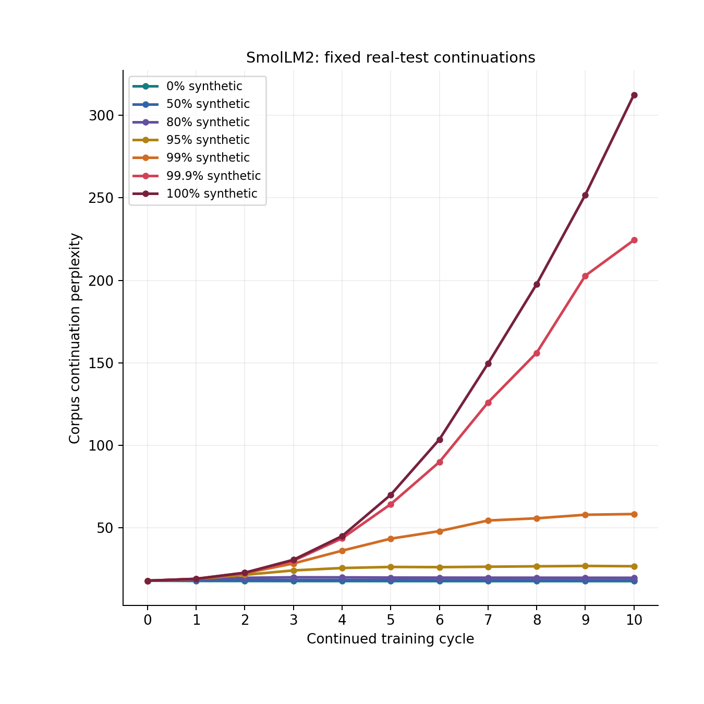

Figure S1. The same 467,392 real continuation targets are scored at every checkpoint. All seven cycle-0 points are the same shared baseline.

## 6. Enlarged view: 0–99% synthetic

- The 50% and 80% conditions rise initially and then decrease slightly; 95% worsens before fluctuating near 27. The 99% curve continues increasing through the last measured cycle.

- A small late slope is an observation over ten cycles, not an asymptotic plateau. The decreasing learning rate and finite optimization horizon affect every condition.

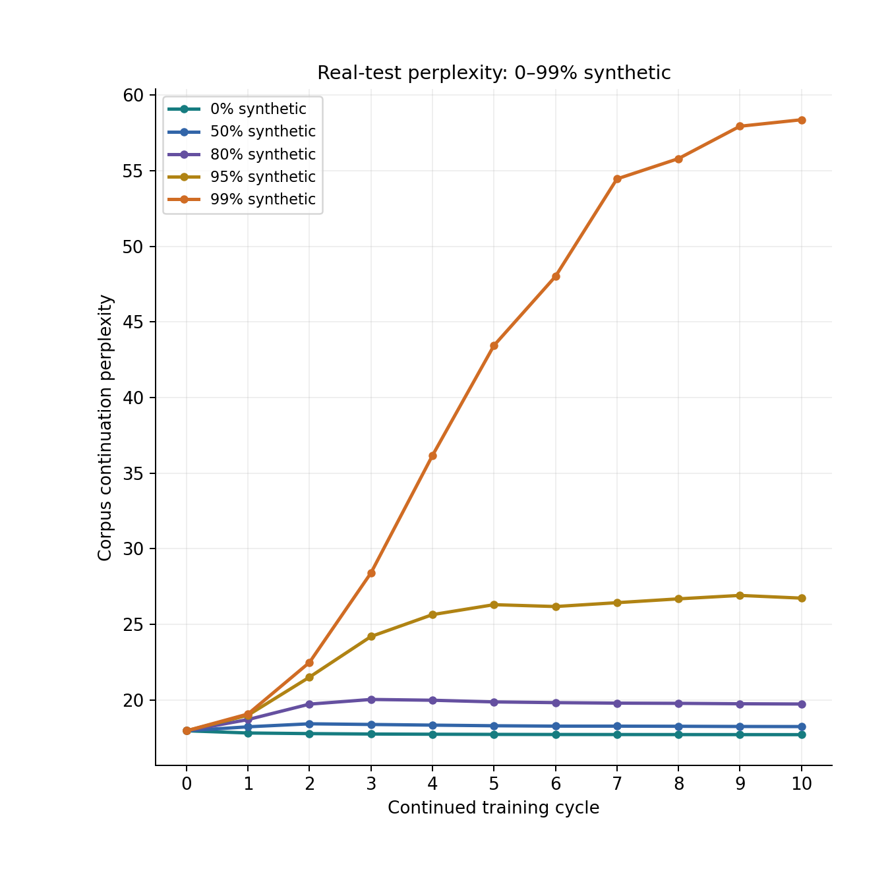

Figure S2. Identical measurements with the 99.9% and 100% curves omitted. The enlarged scale exposes differences hidden by severe deterioration.

## 7. Complete perplexity trajectory

Table S3. Fixed real-test corpus perplexity at baseline and after every terminal epoch.

| Cycle | 0% | 50% | 80% | 95% | 99% | 99.9% | 100% |
| --- | --- | --- | --- | --- | --- | --- | --- |
| 0 | 17.97 | 17.97 | 17.97 | 17.97 | 17.97 | 17.97 | 17.97 |
| 1 | 17.82 | 18.23 | 18.71 | 19.00 | 19.08 | 19.11 | 19.10 |
| 2 | 17.78 | 18.43 | 19.73 | 21.52 | 22.49 | 22.75 | 22.81 |
| 3 | 17.75 | 18.39 | 20.04 | 24.20 | 28.41 | 30.09 | 30.65 |
| 4 | 17.74 | 18.34 | 19.99 | 25.65 | 36.17 | 43.66 | 45.01 |
| 5 | 17.73 | 18.30 | 19.88 | 26.30 | 43.44 | 64.34 | 70.03 |
| 6 | 17.72 | 18.28 | 19.83 | 26.18 | 48.00 | 89.87 | 103.54 |
| 7 | 17.72 | 18.27 | 19.80 | 26.44 | 54.45 | 125.97 | 149.57 |
| 8 | 17.72 | 18.27 | 19.78 | 26.69 | 55.79 | 156.09 | 197.68 |
| 9 | 17.72 | 18.25 | 19.75 | 26.92 | 57.93 | 202.80 | 251.79 |
| 10 | 17.71 | 18.25 | 19.74 | 26.74 | 58.36 | 224.37 | 312.49 |

## 8. Predicting self-generated targets versus real text

- At cycle 10, real-only training NLL is 2.873; 100% synthetic training NLL is 0.018, although its real-test NLL is 5.745.

- The model becomes very confident about its own selected answers while assigning lower probability to real answers. Lower synthetic training loss is not evidence of better generalization; deterministic synthetic labels are intrinsically easier to predict.

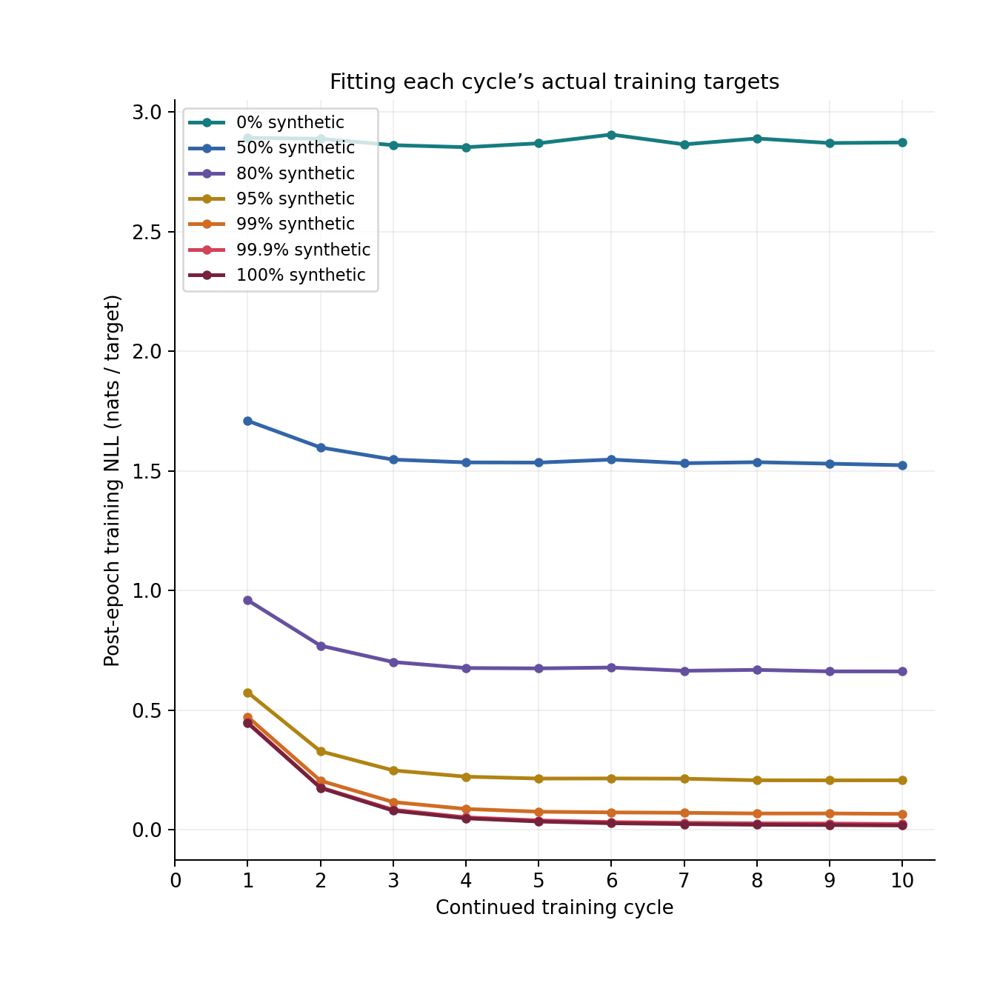

Figure S3. Post-epoch NLL on each cycle’s actual training mixture. Its targets change between cycles and differ across fractions.

## 9. Pooled entropy: why higher need not mean better

- Pooled entropy is 6.170 nats for real-only and 6.416 for 100% synthetic, despite dramatically worse held-out likelihood in the latter.

- An arm can produce different vocabulary for different prompts while looping within each answer. More balanced pooled token frequencies can raise this entropy without better syntax, meaning, factuality or real-text prediction.

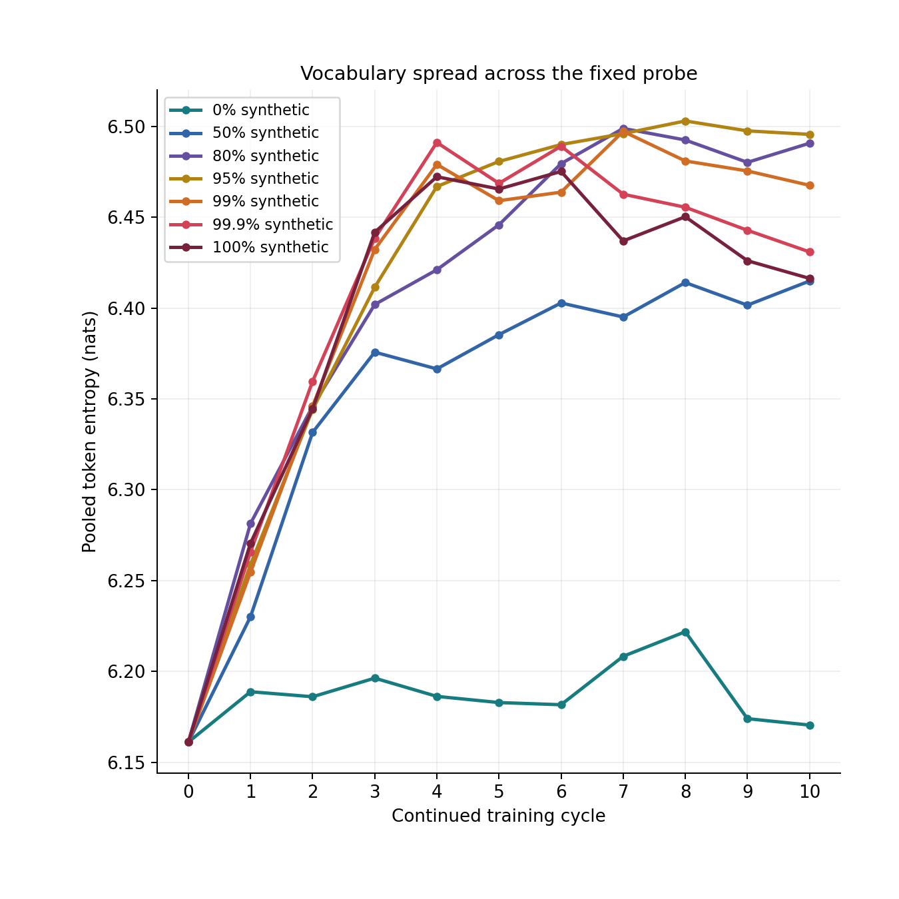

Figure S4. Empirical token entropy across the entire fixed 256-output probe; this is vocabulary spread, not predictive uncertainty.

## 10. Entropy inside individual answers

- The endpoint is 3.115 nats for real-only versus 2.857 for 100% synthetic. This reflects a narrower token inventory within individual answers.

- The 99.9% and 100% endpoints are almost identical on this measure although their real-test perplexities differ substantially. Token counts ignore word order and cannot by themselves measure general quality.

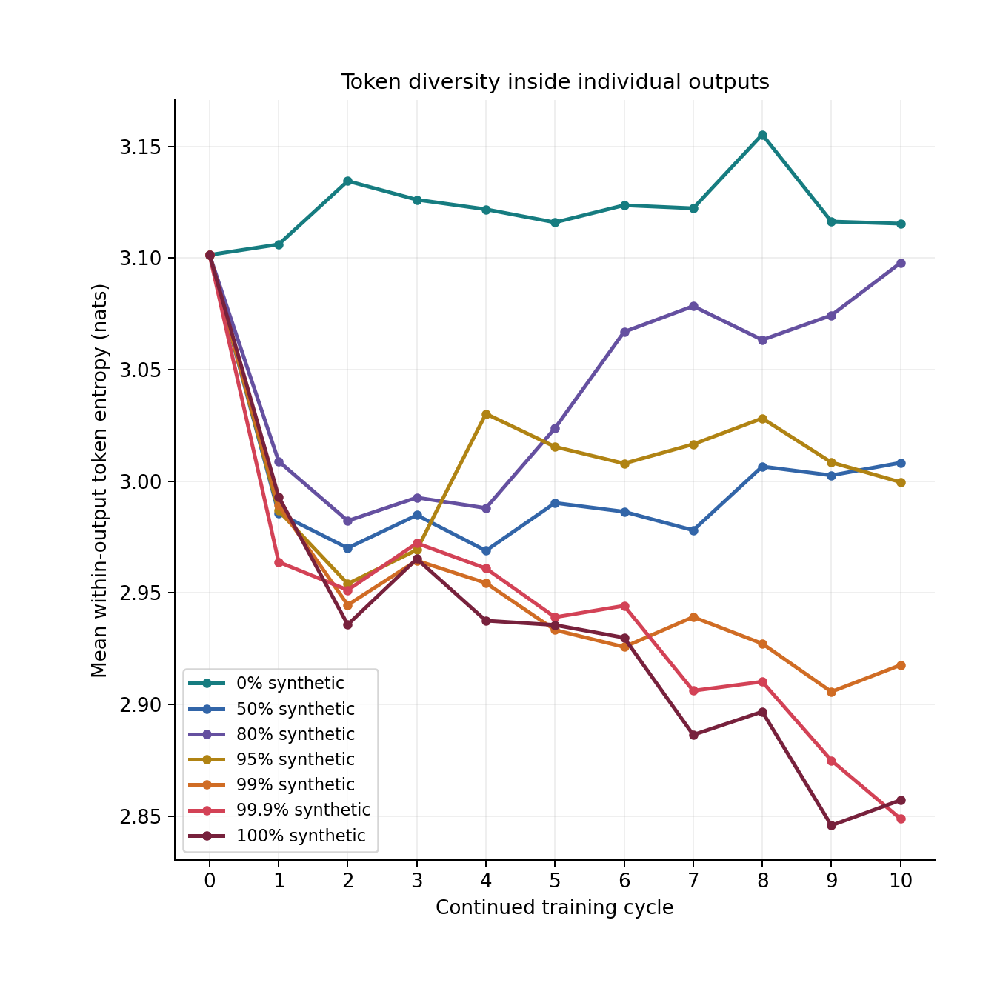

Figure S5. Mean empirical token entropy within each 64-token generated continuation.

## 11. Distinct-2 across the common probe

- The 80% endpoint (46.21%) exceeds real-only (42.79%), while 100% synthetic ends at 37.50%.

- Higher distinct-2 can reflect lexical variety across prompts rather than stronger real-text prediction. It can coexist with repetitive answers; the ordering of this graph is not a ranking of model capability.

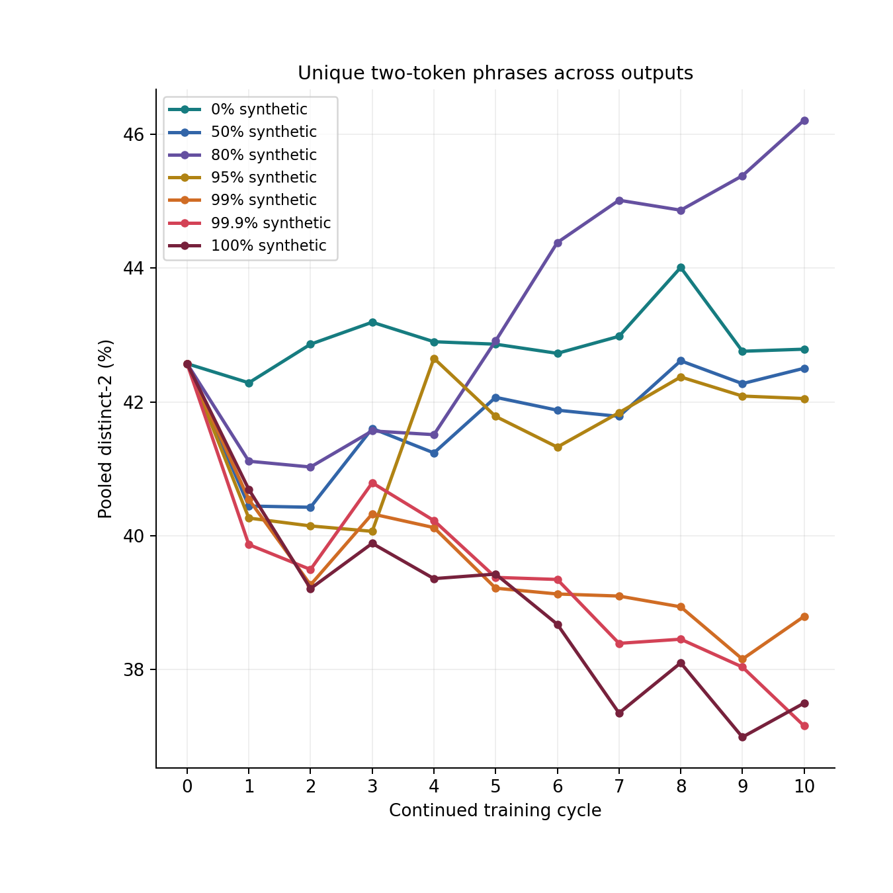

Figure S6. Percentage of distinct two-token phrases among 16,128 within-output bigram occurrences.

## 12. Distinct-3 across the common probe

- Real-only ends at 57.57%, versus 44.32% for fully synthetic targets. Longer phrases reveal repeated structure that a simple token-frequency measure can miss.

- Again, the curve is not strictly monotonic in mixture fraction. The 99.9% endpoint is slightly below 100%, illustrating how a diversity measure can disagree with real-test likelihood.

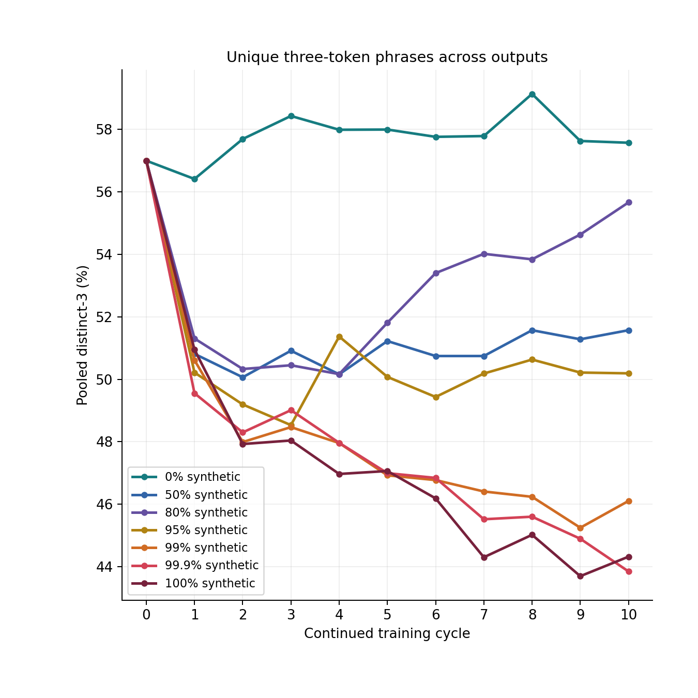

Figure S7. Percentage of distinct three-token phrases among 15,872 within-output trigram occurrences.

## 13. Repeated four-token phrases inside answers

- Real-only ends at 32.66% repeated positions; 99.9% and 100% end at 54.00% and 53.49%.

- The pretrained five-beam probe already repeats (33.75% initially). A small base model, deterministic beam search and forced 64-token outputs can produce loops even without recursive synthetic training. Synthetic training worsens this local repetition here, but not monotonically across every ratio.

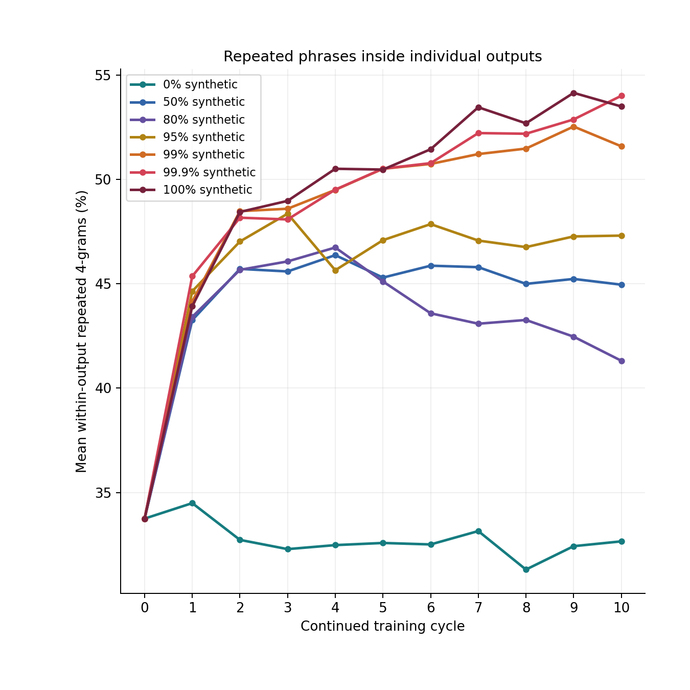

Figure S8. The mean fraction of 61 four-token positions per answer that repeat an earlier four-token sequence within that answer.

## 14. Endpoint statistics

Table S4. Cycle-10 predictive statistics. Ratios use each arm’s common pretrained baseline; NLL is nats per scored target.

| Synthetic | Test PPL | PPL / initial | Validation PPL | Test P95 NLL | Own-target NLL |
| --- | --- | --- | --- | --- | --- |
| 0% | 17.71 | 0.99× | 17.98 | 3.894 | 2.873 |
| 50% | 18.25 | 1.02× | 18.52 | 3.931 | 1.524 |
| 80% | 19.74 | 1.10× | 20.06 | 4.008 | 0.662 |
| 95% | 26.74 | 1.49× | 27.27 | 4.351 | 0.207 |
| 99% | 58.36 | 3.25× | 60.00 | 5.299 | 0.066 |
| 99.9% | 224.37 | 12.49× | 234.43 | 7.106 | 0.024 |
| 100% | 312.49 | 17.39× | 328.71 | 7.543 | 0.018 |

## 15. Endpoint output statistics

Table S5. Cycle-10 common five-beam probe: pooled and local quantities have deliberately separate columns.

| Synthetic | Pooled H | Local H | Distinct-2 | Distinct-3 | Local repeat-4 |
| --- | --- | --- | --- | --- | --- |
| 0% | 6.170 | 3.115 | 42.79% | 57.57% | 32.66% |
| 50% | 6.415 | 3.008 | 42.50% | 51.57% | 44.95% |
| 80% | 6.491 | 3.098 | 46.21% | 55.66% | 41.31% |
| 95% | 6.496 | 3.000 | 42.05% | 50.19% | 47.30% |
| 99% | 6.468 | 2.918 | 38.80% | 46.11% | 51.58% |
| 99.9% | 6.431 | 2.849 | 37.16% | 43.85% | 54.00% |
| 100% | 6.416 | 2.857 | 37.50% | 44.32% | 53.49% |

Exact duplicate continuations occur at 0–0.39% of outputs, even when local repetition is high: different answers can each loop without being identical to one another. Tokens containing a newline account for 2.64–2.97% at the endpoints, versus 4.25% initially; no endpoint has an all-newline continuation. These formatting counts do not measure factual correctness.

## 16. Cycle-10 perplexity versus synthetic fraction

- The last fractions cluster near 100% on the x-axis. Moving from 100% to 99% adds 100 original real continuations per chunk and changes the endpoint from 312.49 to 58.36; adding only ten real continuations (99.9%) ends at 224.37.

- The response need not be a straight line in fraction or cycle. Real-target gradients can counter self-training drift while correctly predicted self-targets contribute little gradient. This is a plausible balance argument; gradient magnitudes and equilibrium were not measured.

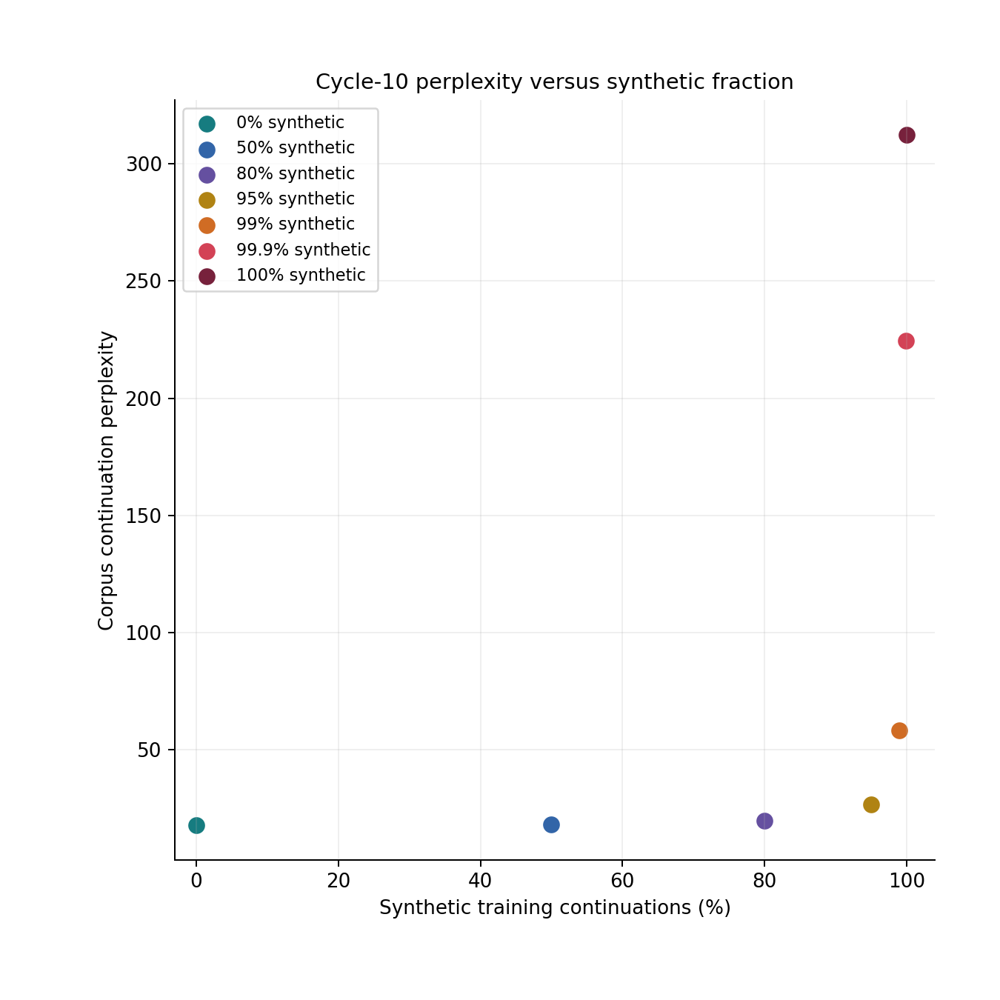

Figure S9. True numeric percentage on the horizontal axis; points are measured conditions, with no fitted threshold curve.

## 17. Cycle-10 pooled entropy versus synthetic fraction

- Moderate/high mixtures increase pooled lexical spread relative to real-only. Near 100%, pooled entropy declines somewhat but remains higher than real-only.

- This does not contradict worse perplexity or more repetitive answers: the pooled histogram concerns all outputs together, whereas perplexity concerns probabilities of unseen real targets and local repetition concerns sequence reuse inside each output.

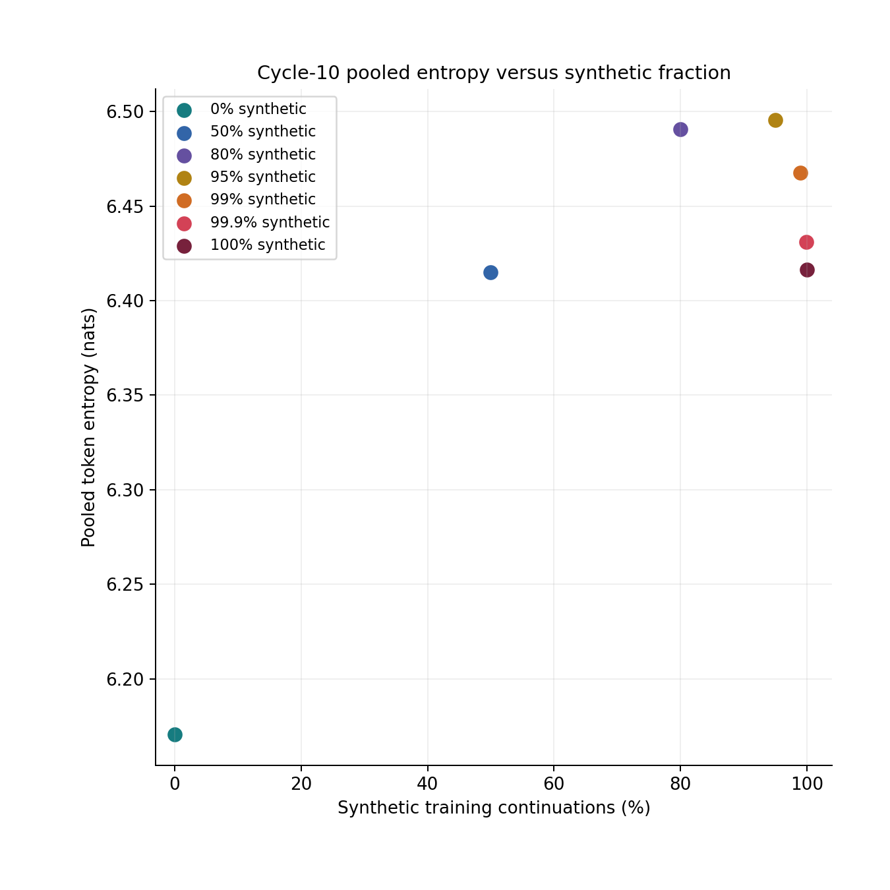

Figure S10. The entropy endpoint shows a different ordering from held-out perplexity.

## 18. Cycle-10 local entropy versus synthetic fraction

- Most synthetic conditions end below the real-only local entropy, while 99.9% and 100% have almost the same value.

- This supports local concentration in generated answers without claiming that every quality metric must vary monotonically with the synthetic percentage.

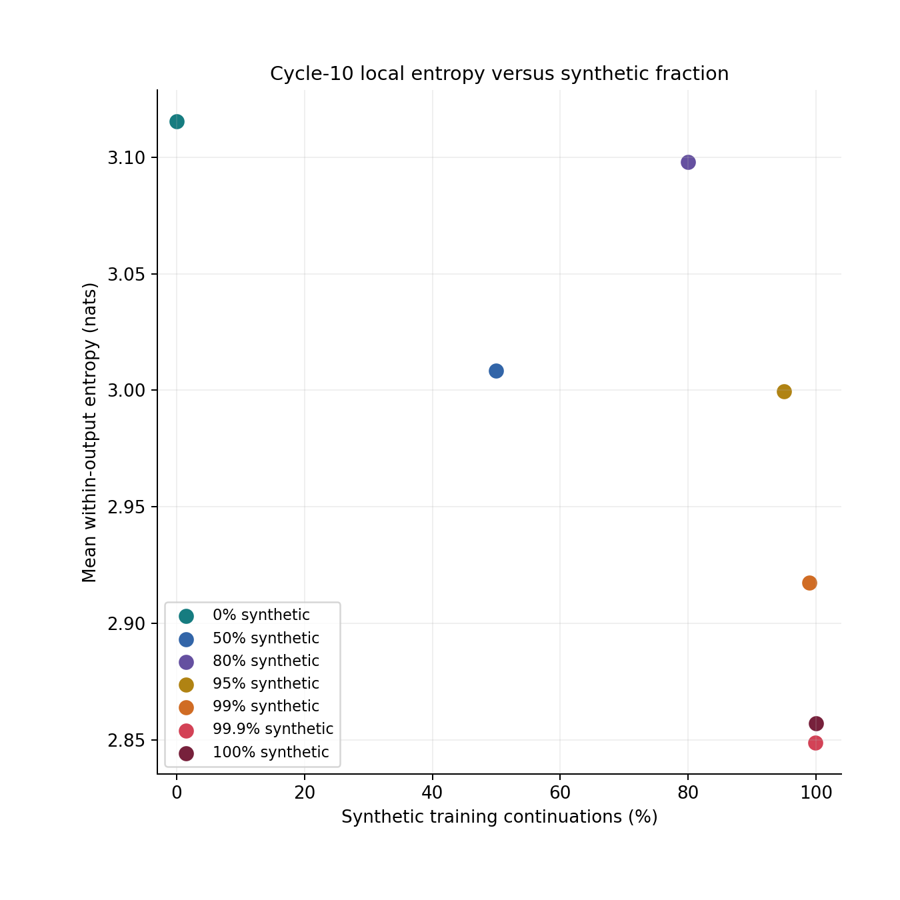

Figure S11. Local entropy uses separate empirical token histograms for each fixed-length answer.

## 19. Does deterioration extend beyond the primary test?

- Fully synthetic training worsens every secondary test: final/baseline perplexity is 8.73× on FineWeb, 8.41× on WikiText-103, 9.30× on C4, 4.86× on PG-19 and 6.62× on AG News. Deterioration extends beyond the primary 64-token completion test.

- Real-only improves four of the five full-text tests, but AG News worsens 6.31%. Thus even the real control is not uniformly beneficial across domains. These frozen samples are secondary checks; their absolute perplexities should not be equated with primary continuation perplexity.

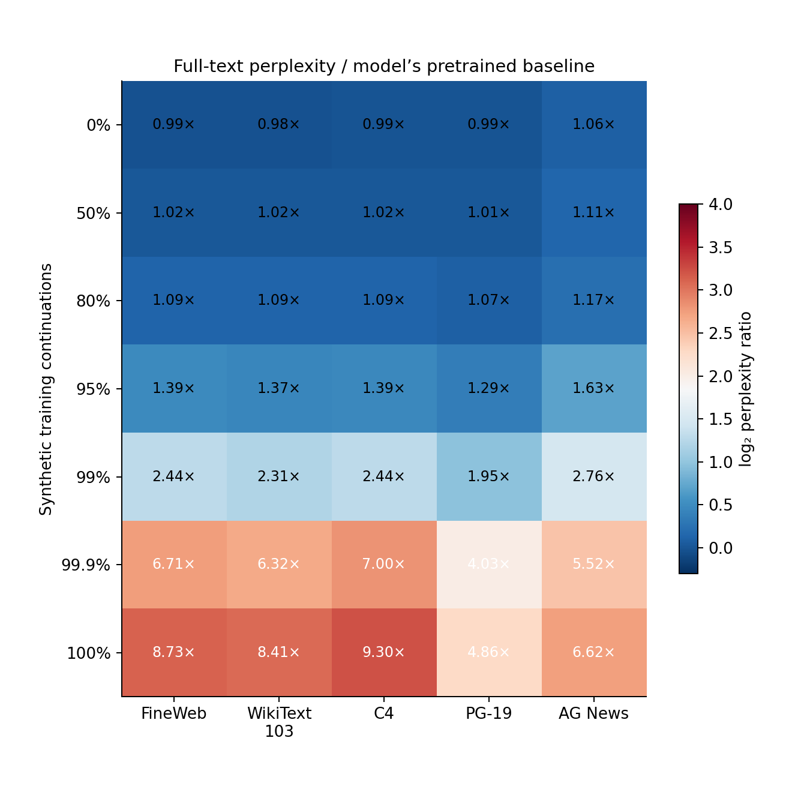

Figure S12. Secondary full-text perplexity divided by each corpus’s pretrained baseline. These are separate, up-to-512-token evaluations.

## 20. Relation to the earlier OPT experiment

- Both models show much smaller deterioration with moderate real/synthetic mixtures and a steep increase near fully synthetic targets. SmolLM2’s relative deterioration is larger at the highest fractions in this execution.

- This is contextual replication, not a clean causal model-only comparison. Tokenizers, native token windows, evaluation counts and pretraining differ. SmolLM2 pretraining includes FineWeb-Edu, so experimental held-out separation does not prove pretraining novelty. Absolute cross-model perplexity is not a model-quality ranking.

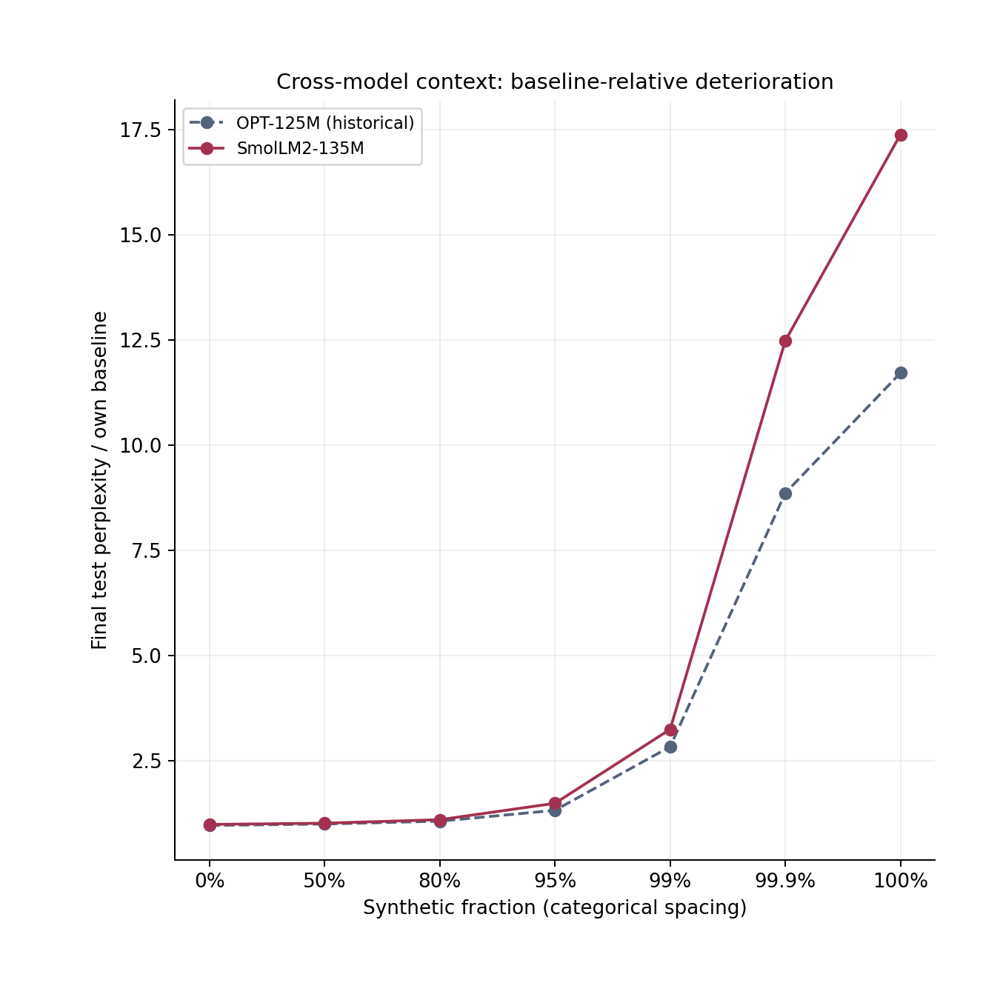

Figure S13. Endpoint perplexity / each model’s own baseline, with categorical spacing of fractions to expose near-100% conditions.

## 21. What actually trained the last cycle?

- The following statistics use 10,000 actual cycle-10 training continuations, rather than the 256-output checkpoint probe. Synthetic portions were generated by M9 before training M10; original real targets were retained at their assigned rows. Pooled diversity values from these differently sized populations should not be compared directly.

Table S6. Actual cycle-10 mixed target arrays, independently reconstructed from real and generated sources. “Local repeat-4” is averaged over training continuations.

| Synthetic | Real / generated pairs | Pooled H | Local H | Local repeat-4 |
| --- | --- | --- | --- | --- |
| 0% | 10,000 / 0 | 7.431 | 3.763 | 0.84% |
| 50% | 5,000 / 5,000 | 7.289 | 3.399 | 23.12% |
| 80% | 2,000 / 8,000 | 7.288 | 3.210 | 35.36% |
| 95% | 500 / 9,500 | 7.296 | 3.041 | 45.77% |
| 99% | 100 / 9,900 | 7.287 | 2.950 | 50.61% |
| 99.9% | 10 / 9,990 | 7.282 | 2.925 | 51.69% |
| 100% | 0 / 10,000 | 7.276 | 2.916 | 51.94% |

## 22.1. Same-prompt example 1

These are the first two stored fixed-probe examples, not selections for the largest effect. All displayed continuations use the common five-beam decoder and terminal M10 checkpoint. Saved text is shown verbatim, including numeric loops and truncated source tokens.

Shared real prompt

Here is Ascot Vale station, one of two hundred and something railway stations located on Melbourne’s suburban railway network.
If we jump back about 100 years in our trusty time machine, then this is what you see in front of you. (State Library of Victoria, record no.: H4

0% synthetic training — cycle 10

005)
In 1851, the first railway station was opened in Melbourne. It was the first station in Melbourne to be built on a railway line, and it was the first station in Melbourne to be built on a railway line.
In 1851, the first railway station

50% synthetic training — cycle 10

0000000000000000000000000000000000000000000000000000000000000000

100% synthetic training — cycle 10

0000000000000000000000000000000000000000000000000000000000000000

A coherent or repetitive individual answer does not estimate the rate of that behavior. Teacher-forced real-test likelihood and free-running beam output can differ; even the real-only model can loop.

## 22.2. Same-prompt example 2

These are the first two stored fixed-probe examples, not selections for the largest effect. All displayed continuations use the common five-beam decoder and terminal M10 checkpoint. Saved text is shown verbatim, including numeric loops and truncated source tokens.

Shared real prompt

The Straits of Mackinac connect Lake Michigan and Lake Huron. The Great Lakes represent 20 percent of Earth's surface freshwater. These lakes are relied upon heavily to supply clean drinking water to more than 30 million people, provide a plethora of diverse fish species, and support an abundant wildlife population. The

0% synthetic training — cycle 10

 Straits of Mackinac are the largest of the Great Lakes.
The Straits of Mackinac are part of the Straits of Michigan. The Straits of Mackinac connect Lake Michigan and Lake Huron. The Great Lakes represent 20 percent of Earth's surface freshwater. These lakes are relied upon

50% synthetic training — cycle 10

 Straits of Mackinac connect Lake Michigan and Lake Huron. The Great Lakes represent 20 percent of Earth's surface freshwater. These lakes are relied upon heavily to supply clean drinking water to more than 30 million people, provide a plethora of diverse fish species, and support an abundant wildlife population. The St

100% synthetic training — cycle 10

 Great Lakes represent 20 percent of Earth's surface freshwater. These lakes are relied upon heavily to supply clean drinking water to more than 30 million people, provide a plethora of diverse fish species, and support an abundant wildlife population. The Great Lakes represent 20 percent of Earth's surface freshwater. These lakes

A coherent or repetitive individual answer does not estimate the rate of that behavior. Teacher-forced real-test likelihood and free-running beam output can differ; even the real-only model can loop.

## 23. Interpretation and limits

- Observed: real-only improves slightly; 50% remains close to its starting likelihood; high synthetic fractions substantially worsen held-out real prediction while fitting their own targets very confidently. Local repetition increases, but pooled entropy does not fall below the real-only control.

- Plausible mechanism: deterministic selection favors a restricted set of high-scoring continuations. Fitting them reinforces these patterns, and later generations feed that concentration back into training. Original real targets continually reintroduce alternatives. This mechanism is consistent with the results, not directly established by a gradient or causal decomposition.

- Rare real targets can matter more than their row fraction suggests: cross-entropy gradients depend on prediction errors, not just counts. Under a mixture, expected gradients combine real and synthetic components; confidently predicted self-targets may contribute little. Carried AdamW moments, weight decay and LR decay also affect the trajectory.

- Fresh, document-separated chunks and the improving real-only control reduce the earlier repeated-data overfitting confound. They do not prove that all synthetic deterioration is uniquely model collapse; overfitting to recurrent synthetic patterns and distribution shift can coexist.

- The experiment has one seed, ten cycles, deterministic five-beam generation and a decreasing learning rate. It cannot establish permanent stabilization, a universal 1% rescue threshold, irreversibility or statistical significance. No checkpoint is selected by validation.

- The pretrained model already gives repetitive beam outputs. A conditional likelihood result is not a factual-accuracy result, and empirical token entropy is not predictive-distribution entropy. Keeping these distinctions explicit prevents apparently contradictory graphs from becoming contradictory claims.

## 24. Execution and verification

- All seven arms completed ten terminal epochs: 70 training stages, 5,530 combined optimizer updates and 44.8 million scored target exposures. Recorded initializer/generator/optimizer-parent hashes match their preceding checkpoints, and the fixed bank/evaluation identities remain unchanged.

- Saved per-example test losses reproduce corpus NLL, perplexity, median and P95. All 77 logical probe rows are recomputed from 71 unique-stage arrays: one shared baseline plus 70 trained stages. Actual cycle-10 inputs/masks for all seven conditions reconstruct exactly from their real and generated sources.

- Compute ran for approximately 20 hours 10 minutes. Runpod confirmed automatic shutdown at 17:19:26 UTC/London on 12 November. Provider Pod billing is USD 11.58, comprising USD 11.50 GPU and USD 0.084 Pod disk; separate network storage, setup validation and retained historical resources are additional.

- This analysis downloaded scientific records, probe arrays and final-cycle training arrays, not bulk checkpoints or optimization states, and performed no new GPU training/inference. Full-run checkpoint cold restoration and re-evaluation were not repeated. Earlier scoped GPU acceptance separately verified one terminal model/optimizer restoration with identical held-out loss.

- The 200 GB working volume and 200 GB private backup remain retained for recovery; Standard storage for these two volumes is approximately USD 6.44 per seven days. GPU shutdown does not stop storage billing. Historical results and source archives are preserved.

