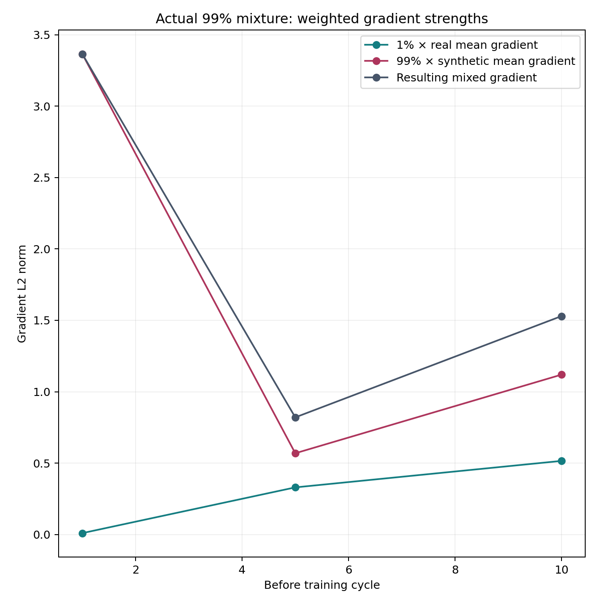
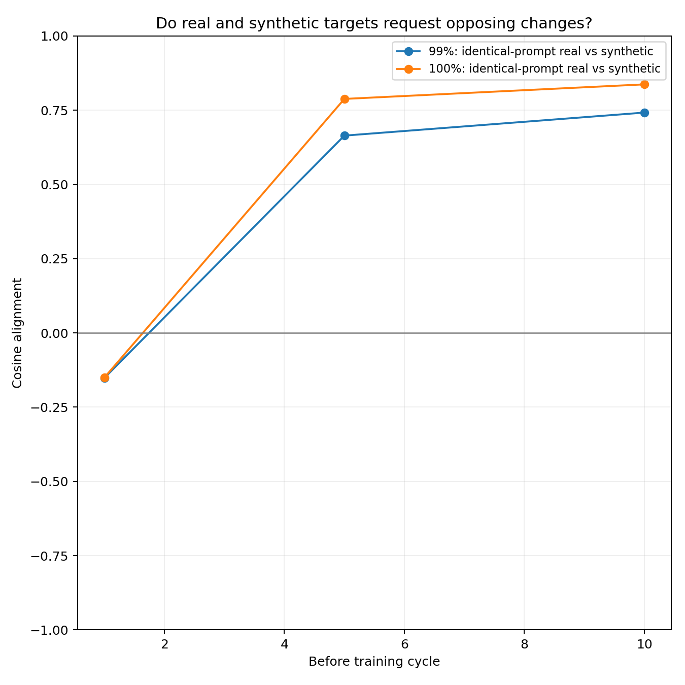
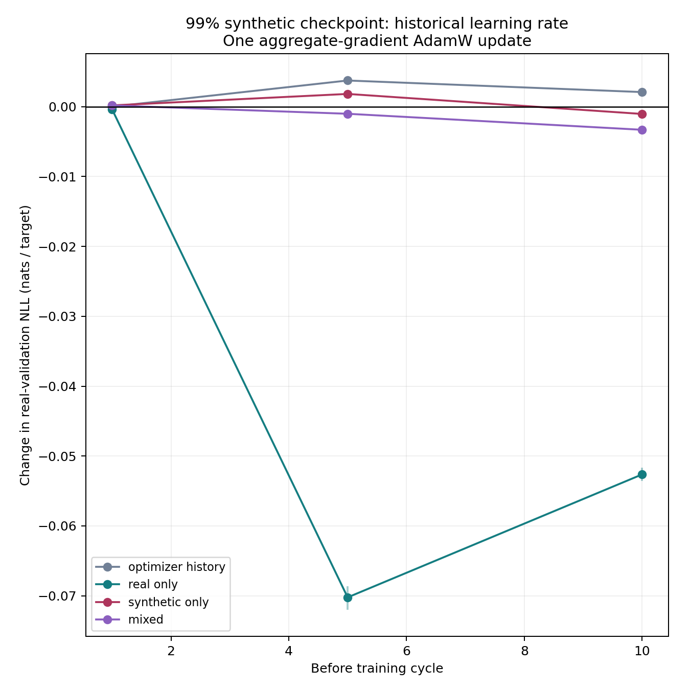
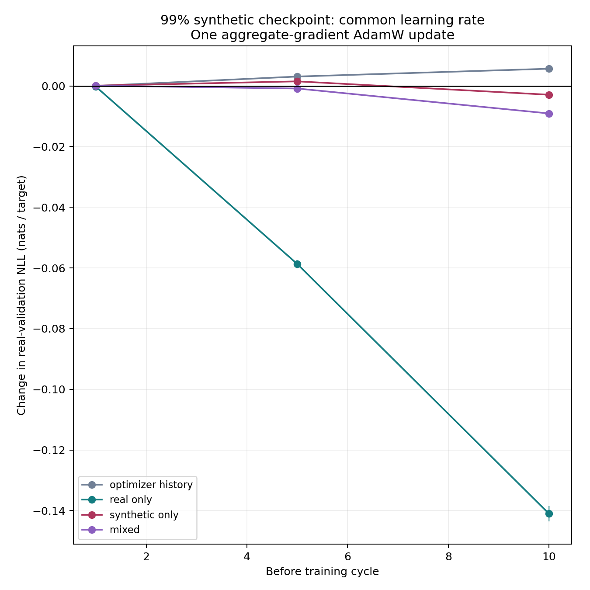
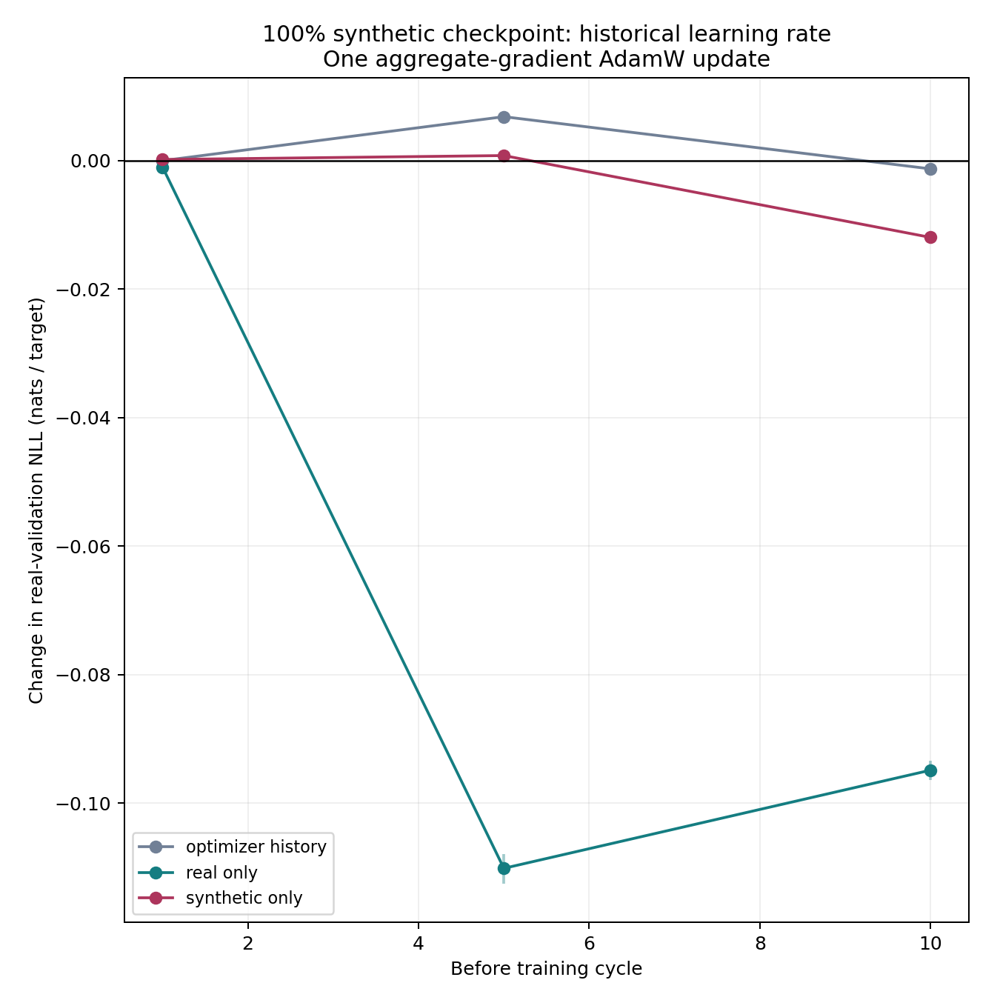
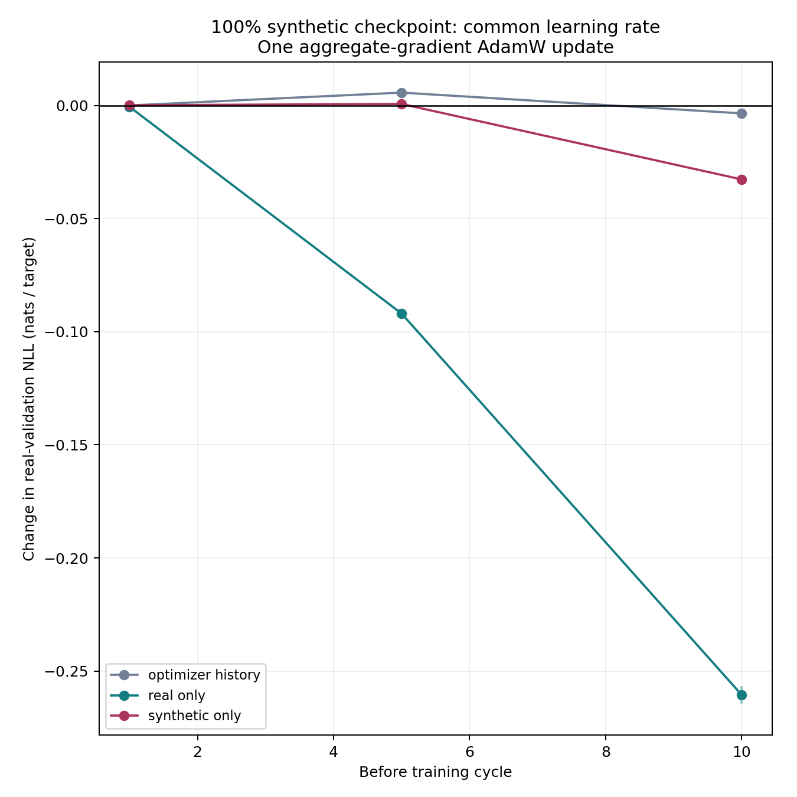

# SmolLM2 checkpoint-gradient diagnostic

Dropout-disabled FP32 gradients and isolated complete-source-average AdamW updates. These are not historical minibatch replays.

## Measurements

| Arm | Before cycle | Real mean norm | Synthetic mean norm | Same-prompt cosine | Mixture reconstruction error |
|---|---:|---:|---:|---:|---:|
| mixed99 | 1 | 0.984463 | 3.39862 | -0.15147405592560093 | 5.858264908223578e-07 |
| mixed99 | 5 | 33.0086 | 0.574791 | 0.664493785030177 | 5.909913233222207e-07 |
| mixed99 | 10 | 51.5483 | 1.13062 | 0.7420966423661853 | 7.417838663316679e-07 |
| synthetic | 1 | 0.377596 | 3.39932 | -0.1501009819228906 | None |
| synthetic | 5 | 47.1612 | 0.807664 | 0.7880916174163861 | None |
| synthetic | 10 | 75.5195 | 1.79835 | 0.8370775984987243 | None |

## Interpretation and limits

- Negative validation-loss changes mean improved predictions on the fixed real validation probe; positive changes mean deterioration.
- Gradient norm measures requested movement before AdamW; it does not establish beneficial direction or a percentage of causal influence.
- The optimizer-history control supplies explicit zero gradients, preserving AdamW momentum and weight-decay effects.
- Update records also compare each intervention directly with the optimizer-history control, isolating its incremental data-gradient effect under the same prior state.
- Real-only gradients use the 100 actual real rows for the 99% case, and counterfactual original real targets on all rows for the 100% case. Same-prompt comparisons are recorded separately.
- Source-mean gradient norms depend on sample size and cancellation; the actual 100-versus-9,900-row decomposition and equal-row matched comparison answer different questions.
- Both recorded historical learning rates and a common 3e-6 rate are measured. No held-out gradient updates weights.
- Intervals use paired validation-document resampling; checkpoints and conditions are not independent training-seed replicates.
- This measures immediate local effects, not long-term equilibrium, irreversible collapse or permanent stabilization.

