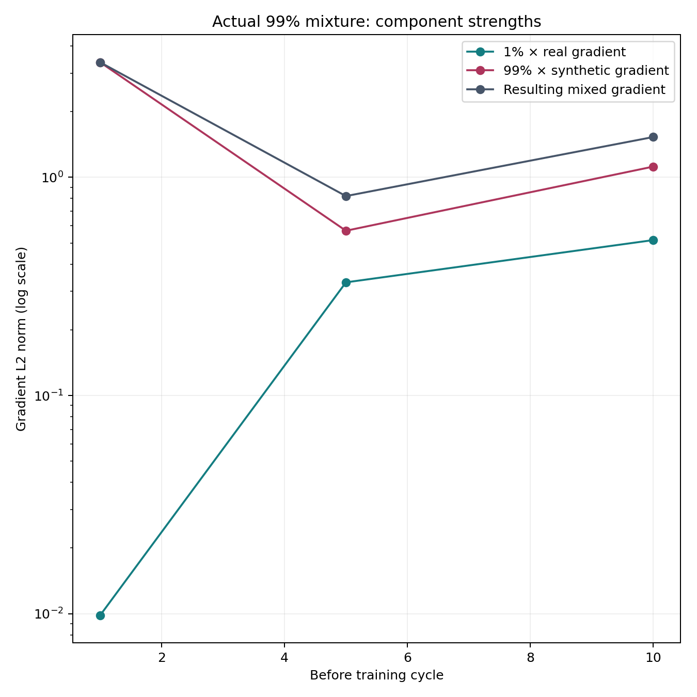
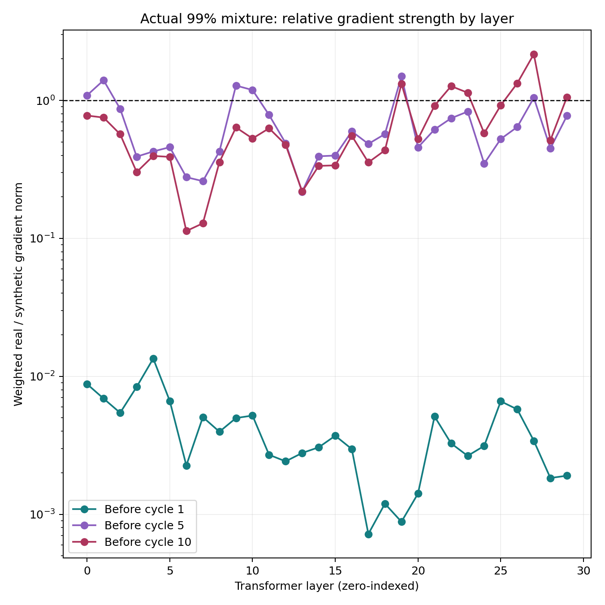
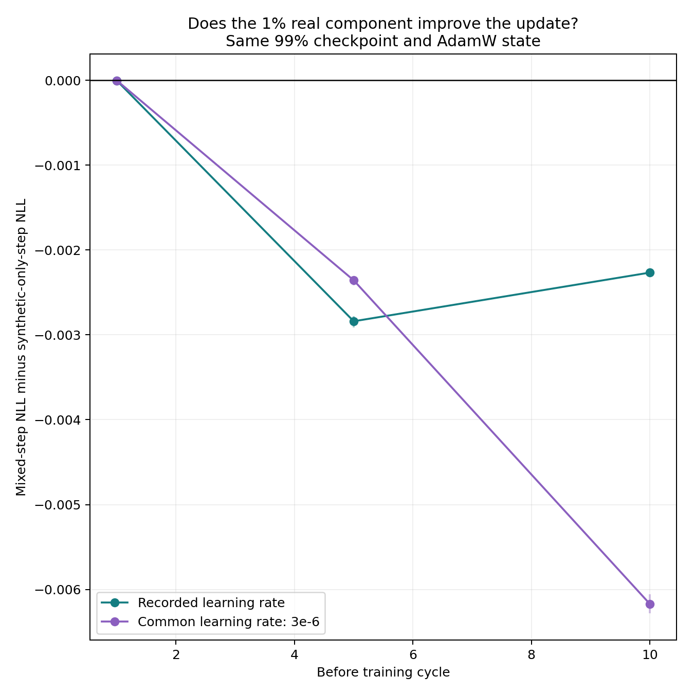
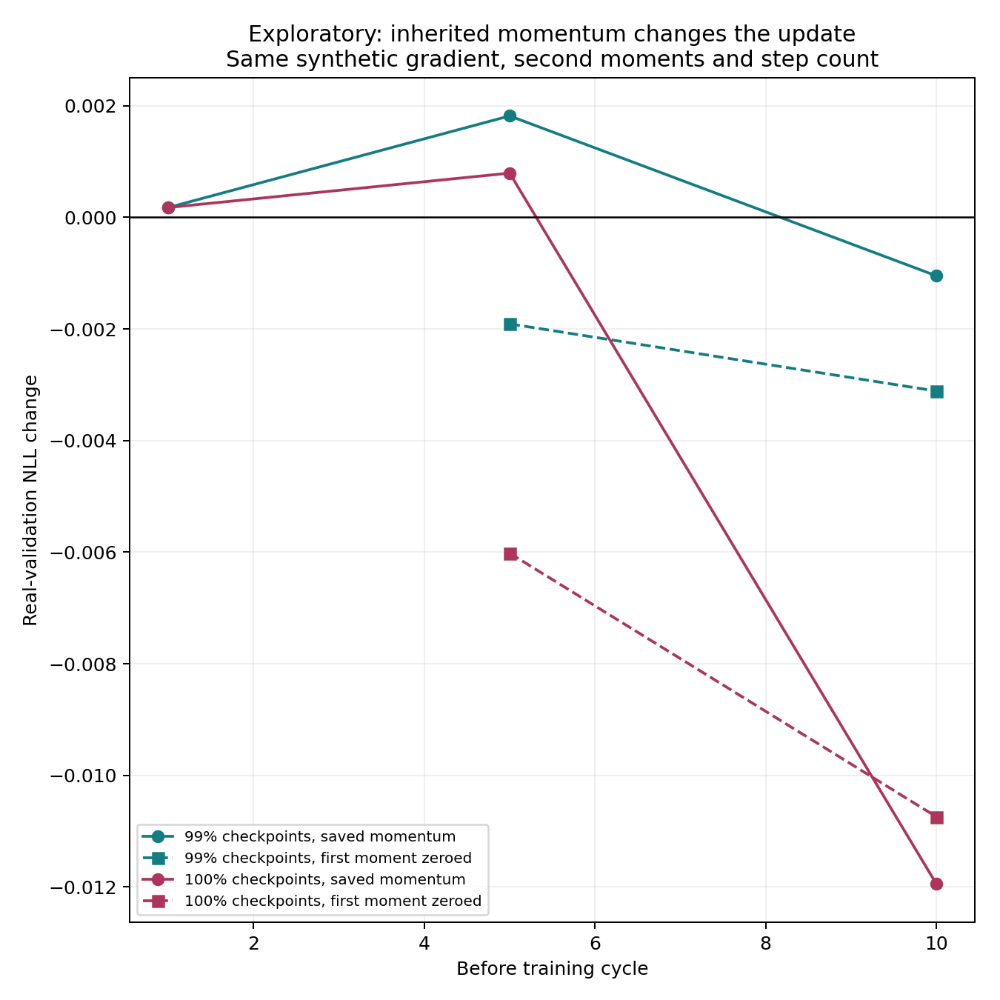

# Why does 1% real data matter in recursive training?

The saved-checkpoint diagnostic finds a measurable corrective effect from the real component, but does **not** support a universal story in which real and synthetic gradients always oppose one another. Real examples become much harder than generated targets, and their weighted gradient becomes substantial despite their small count. AdamW history and the sequential training path also matter.

In the [original sweep](../20261111T210854Z-full-completion64-mixtures/report.md), final real-test perplexity was **58.36 at 99% synthetic versus 312.49 at 100%**. The measurements below investigate local update effects at selected saved checkpoints; their validation-probe changes are different quantities from those full-test trajectory endpoints.

## What we measured

- Source experiment: completed SmolLM2-135M FineWeb comparison `20261111T210854Z-full-completion64-mixtures`, conditions 99% and 100% synthetic.
- Restore the untouched M0 and each condition's M4/M9: six cases, five distinct checkpoints. Use the exact saved cycle-1/5/10 targets and optimizer states. No new continuations or recursive training trajectory are produced.
- Compute dropout-disabled FP32 gradients of mean continuation-token NLL, using all source rows. Prompt tokens remain visible but unscored; each example contributes 64 target tokens.
- At a 99% checkpoint, separate the actual 100 real rows and 9,900 synthetic rows. Also compare original real and generated targets on the same 9,900 prompts. At a 100% checkpoint, the real-target diagnostic is counterfactual on its 10,000 prompts.
- From identical temporary weight/optimizer copies, take one aggregate-gradient AdamW step: real-only, synthetic-only or mixed. An explicit-zero-gradient step isolates inherited momentum and weight decay. The unchanged checkpoint is the reference.
- Evaluate a fixed document-stratified 1,024-pair real-validation probe; verify historical-rate mixed/history effects on the full 7,447-pair validation set. Intervals resample validation documents, not training seeds.
- Repeat interventions at the saved learning rate and a common 3e-6 rate. These are local interventions, not replays of the historical 79 minibatch updates per cycle.

For the actual 99% objective, all examples have equal target counts, so

`g_mixed = 0.01 g_real + 0.99 g_synthetic`.

Each component is the mean gradient of its own source group. The weighted norms describe strength before AdamW. They do not represent a percentage of useful influence: vector directions, per-coordinate normalization and prior optimizer moments intervene.

## The minority real component becomes substantial

**Table 1. Actual 99% source groups, before the indicated training cycle.** NLL is nats per target token. The real/synthetic norm ratio compares the two weighted components, not a causal attribution.

| Before cycle | Real NLL | Synthetic NLL | Weighted real norm | Weighted synthetic norm | Real/synthetic norm ratio | Actual-source cosine |
|---:|---:|---:|---:|---:|---:|---:|
| 1 (M0) | 2.8921 | 0.6398 | 0.009845 | 3.364638 | 0.00293 | -0.0185 |
| 5 (M4) | 3.8523 | 0.04327 | 0.330086 | 0.569043 | 0.580 | +0.6395 |
| 10 (M9) | 4.6688 | 0.02905 | 0.515483 | 1.119311 | 0.461 | +0.7105 |

Generated targets become extremely predictable while real continuations remain difficult. Consistent with a corrective signal on difficult real targets, 1% of rows can therefore contribute much more than 1% of the gradient norm. However, the later vectors have **positive** alignment. The matched-prompt cosines also turn positive: -0.1515, +0.6645 and +0.7421. This is not simply two opposing forces cancelling. The groups differ in size, so mean-gradient cancellation and sampling variability also matter; the three cycles use different frozen chunks.

The equal-row control also gives large late real gradients: original real targets on the same 9,900 synthetic-prompt rows have mean-gradient norms **0.377, 35.013 and 51.442**. Thus the large late real norm is also present when using a large matched source group, rather than only the 100-row real subset. Changes across checkpoints still include differences between their next-cycle chunks.

An intuition: a target the model already predicts confidently usually asks for a small correction at the output layer, while a surprising real answer asks for a larger correction. For next-token cross-entropy, the derivative with respect to logit `z_j` is `p_j - 1[j = correct token]`. In these saved sources, before cycle 10 the geometric mean probability assigned to synthetic targets is about 97%, versus about 0.94% for the actual real targets. These are geometric means derived from NLL, not arithmetic mean probabilities. Parameter gradients also depend on the network's internal derivatives, so confidence alone does not determine their norms or directions.



**Figure 1.** Weighted gradient norms for the actual 99% objective. The logarithmic scale makes the initially tiny real component visible. Connecting lines guide the eye between three measured checkpoints.



**Figure 2.** Weighted real/synthetic norm ratio within each transformer layer. Before cycles 5 and 10, the real component exceeds the synthetic component in **6 of 30 layers**, despite representing 1% of rows. Before cycle 1 it exceeds it in none. This describes gradient strength, not beneficial influence or the proportion of the final update. Embedding/final-normalization tensors are included in the per-parameter CSV rather than this transformer-layer plot.

## Does adding the real component improve the update?

**Table 2. One-step change in validation-probe NLL at each checkpoint's saved learning rate.** Negative means better predictions on unseen real continuations; positive means worse. Each column starts from the same weights and optimizer state. Synthetic-only uses the mean of the actual 9,900 synthetic rows; mixed adds the 100 real rows at their original weights. It is not a regenerated 10,000-row all-synthetic counterfactual.

| Before cycle | History-only | Real-only | Synthetic-only | Mixed | Mixed minus synthetic-only |
|---:|---:|---:|---:|---:|---:|
| 1 | approximately 0 | -0.0004064 | +0.0001767 | +0.0001719 | -0.00000477 |
| 5 | +0.003740 | -0.070221 | +0.001818 | -0.001022 | -0.002840 |
| 10 | +0.002083 | -0.052633 | -0.001047 | -0.003313 | -0.002266 |

At M4, including the real component changes the local result from deterioration to improvement. At M9, the synthetic-only step already improves validation loss, and mixed improves it further. Thus synthetic gradients are **not invariably harmful** at every late checkpoint. On the complete validation set, the mixed changes are +0.0001935, -0.0010951 and -0.0033239, agreeing with the probe's signs.



**Figure 3.** Difference between mixed and synthetic-only updates, with paired document-bootstrap intervals. Below zero favors including the real component. This remains true at both the historical and common learning rates; the full raw intervals are in the analysis JSON.

The saved learning rates are 5e-6, 3.6180e-6 and 1.0979e-6. The common-rate intervention helps separate the local correction from the declining step size. It does not establish that the original 99% trajectory would stabilize indefinitely at constant learning rate.

## What happens at the 100% synthetic checkpoints?

**Table 3. Local validation-probe NLL changes at the historical learning rate.** Original real targets are a diagnostic counterfactual, not part of the historical 100% training set.

| Before cycle | History-only | Real-only counterfactual | Synthetic-only |
|---:|---:|---:|---:|
| 1 | approximately 0 | -0.0009944 | +0.0001767 |
| 5 | +0.006843 | -0.110144 | +0.0007930 |
| 10 | -0.001277 | -0.094869 | -0.011945 |

The last synthetic-only aggregate step improves loss even though the original full epoch deteriorated. This is an important limit of the proxy. One full-source gradient at a frozen checkpoint is different from 79 sequential minibatch updates, which change weights and optimizer state along the way. No repeated epoch was replayed here. Real-only interventions improve held-out predictions in all six cases, but their size is not directly comparable across arms: the 99% case uses 100 real rows, whereas the 100% counterfactual uses 10,000.

## Why can aligned gradients give different held-out effects?

An exploratory follow-up was added after seeing the positive M4 alignment. It measures the validation-loss gradient without ever using it to update weights. The dot product of that gradient with the actual AdamW displacement predicts the first-order validation-loss change. It also repeats the synthetic step with only the old Adam first moment (`exp_avg`) zeroed; second moments, step count, data, starting weights and learning rate remain fixed.

**Table 4. Middle 99% checkpoint (M4), historical learning rate.** These are follow-up measurements; small FP32 differences from the primary pass are retained.

| Update | First-order validation NLL change | Observed validation NLL change |
|---|---:|---:|
| Synthetic, saved momentum | +0.0018124 | +0.0018182 |
| Mixed, saved momentum | -0.0010266 | -0.0010218 |
| Synthetic, old first moment zeroed | -0.0019163 | -0.0019088 |

Here the raw synthetic gradient has cosine **+0.6400** with the validation gradient: descending it directly would improve validation loss to first order. Nevertheless, the actual saved-momentum AdamW step points toward worse validation loss. Zeroing the inherited first moment changes the sign of the observed effect. This isolates a local role for optimizer history; it does not mean all momentum is harmful. The operation changes the update's magnitude as well as its direction. The mixed update moves in an improving direction even with the saved state. The small first-order residuals show that higher-order loss changes are not the main reason for these signs in this case.

The middle 100% checkpoint shows the same sign change: **+0.0007931 with saved momentum versus -0.0060182 with its old first moment zeroed**. At the late 100% checkpoint the saved state instead helps: -0.0119453 versus -0.0107416. Its effect depends on the checkpoint.



**Figure 4.** Same synthetic gradient with the original optimizer state versus only its inherited first moment zeroed. These are temporary one-step interventions, not new recursive training runs. No zeroing control is needed at M0, whose optimizer has no prior moments.

The follow-up is exploratory, uses the validation probe rather than a new test set, and does not establish that the same mechanism alone explains the full recursive trajectory. Source checkpoint tensors are unchanged. Repeated gradient norms/loss effects agree numerically; temporary updated tensor hashes are not claimed to be bitwise identical across GPU passes.

## Interpretation and limits

- **Plausible feedback mechanism:** generated targets become easy for their own model, while fixed real targets remain a source of corrective error. The observed growth in the relative real gradient and its beneficial local effects are consistent with an anchoring mechanism. This is an inference from the diagnostic, not proof of the ten-cycle stabilization mechanism.
- **Supported:** a very small real-data component can materially change a local update and improve real held-out predictions. Its weighted gradient need not be tiny merely because its row count is small.
- **Rejected as a general explanation:** real and synthetic gradients always point in opposite directions, or every synthetic update necessarily worsens real validation loss.
- **Optimizer dependence:** the zero-gradient controls often move validation loss substantially. Gradients are inputs to AdamW, not the final weight displacement; separately computed AdamW steps do not add linearly.
- **Still unresolved:** how these local effects accumulate over the complete training path to produce the observed 99% versus 100% trajectories. A local diagnostic does not establish a universal threshold, permanent stabilization or irreversibility.
- **Scope:** one historical seed; five-beam synthetic targets; original decreasing learning rate; different next-cycle chunks. FP32/dropout-off diagnostics are not exact BF16 historical training replays.
- **Held-out scope:** validation documents are excluded from these experimental training chunks. SmolLM2's pretraining included FineWeb-Edu, so this does not establish that they were absent from pretraining.

## Reproduction and evidence

The [analysis guide](generated/diagnostic-20261113/report.md), CSV/JSON tables, source hashes and square figures accompany this report. The detailed protocol and commands are in the [comparison definition](../../comparisons/smollm2_gradient_diagnostic/README.md). Historical checkpoint/data stores remain preserved. Operational completion, supplementary checks, costs and cleanup are recorded separately in the final receipt.


## Execution and recovery

- **72 focused offline tests passed**, followed by two six-check miniature GPU acceptances. All six primary cases and all six supplementary cases completed on matching RTX PRO 4000 Blackwell GPUs, sequentially.
- The 42 primary update records and 13 exploratory update records are backed by recovered per-example losses. The probe contains 1,024 pairs from 983 documents, scoring 65,536 continuation tokens.
- Direct mixture-gradient reconstruction has relative error below 6e-7. Recomputed synthetic gradient norms agree within 9.4e-9 relative error; replayed probe effects agree within 1.77e-7 NLL. Updated shadow weights are not claimed to match bit for bit across passes.
- Approximately 7.11 GB of selected historical source bytes, including five checkpoints and four optimizer states, were restored and checksum-verified remotely. Unselected historical checkpoints were not individually restored. Original recovery storage remains preserved.
- All **134 indexed diagnostic evidence files / 4,824,248 bytes** were recovered and verified. Both exact runtime source archives were privately backed up, downloaded and checked. Bulk source models/states stay out of Git and were not downloaded to the laptop.
- Both temporary Pods and working volumes are removed, and no diagnostic GPU remains active. Provider shutdown times were **19:35:59 and 20:01:39 UTC on 13 November**. Combined paid-compute time was **81.33 minutes**, including bootstrap/restoration.
- Conservative task resource cost is **USD 0.897**, including a **USD 0.0834 validation subset**. GPU time at the quoted rate is USD 0.773. These are rate-based estimates; the observed USD 1.040 account decrease also includes historical retained storage and is not a task invoice. GPU billing had not yet posted in the provider read. No credits were purchased or payment settings changed.

The [completion receipt](../../docs/validation/2026-11-13_gradient-diagnostic-completion.json) gives pinned backup commits, recovery scope and provider proofs. Primary runtime: `925f9ba422cf9d56c3e0b403b91757999f89ce1f67a206a3209134f86a9520fc`; supplement: `9b2811e1b2b0de95c70140031a59de7026ceab4ccc9def34963e9cf3c29a5c90`. The latter also contains the separately versioned future reporting fix for the initial missing synthetic per-parameter breakdown. Historical measurements remain unchanged.

To reproduce the analysis from the small published records, with no private caches or network access required:

```powershell
python scripts/analysis/interpret_gradient_diagnostic.py `
  --run reports/20261113T183849Z-gradient-diagnostic/records/primary `
  --layers reports/20261113T183849Z-gradient-diagnostic/records/supplement `
  --out reports/20261113T183849Z-gradient-diagnostic/generated/reproduced-NEW-ID
```

Use a new output directory. The analysis preserves the authored report and original records. Twelve square PNG/PDF figure families, CSV/JSON measurements, paired intervals and input/output hashes are available in the generated analysis directory.
