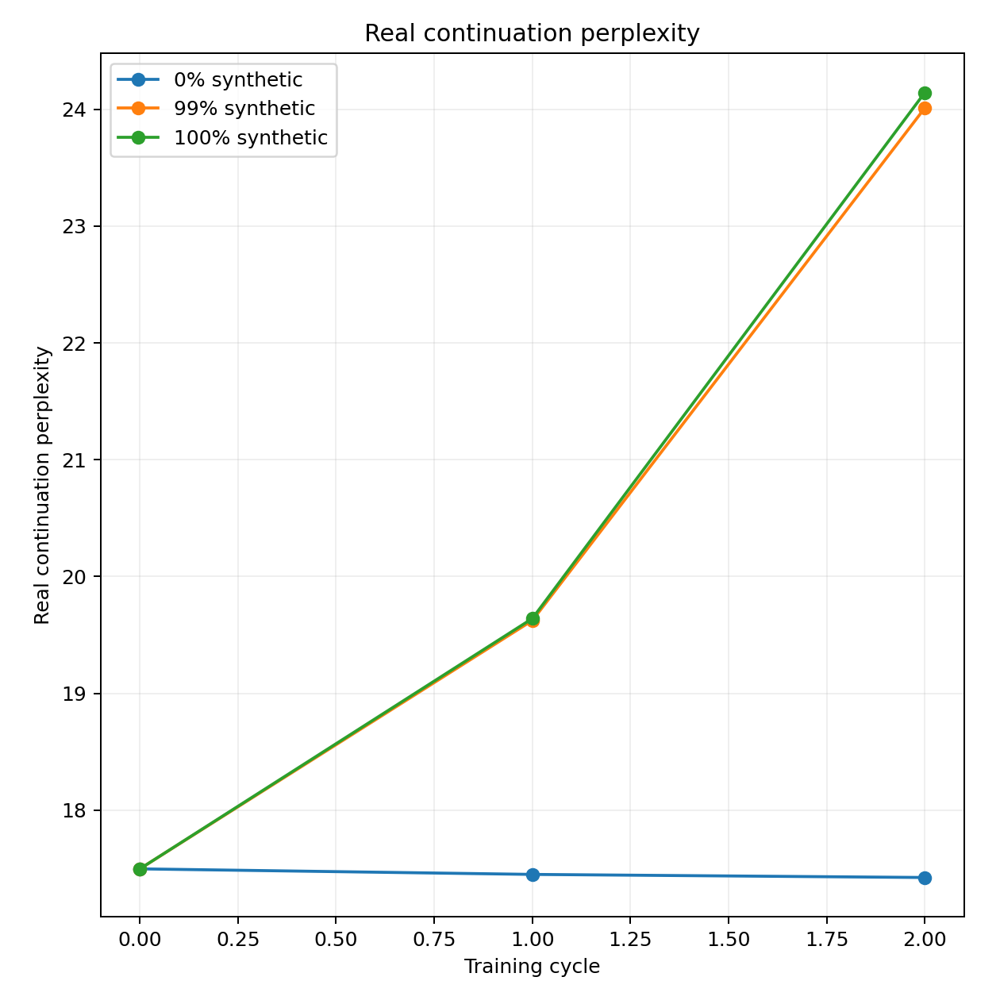
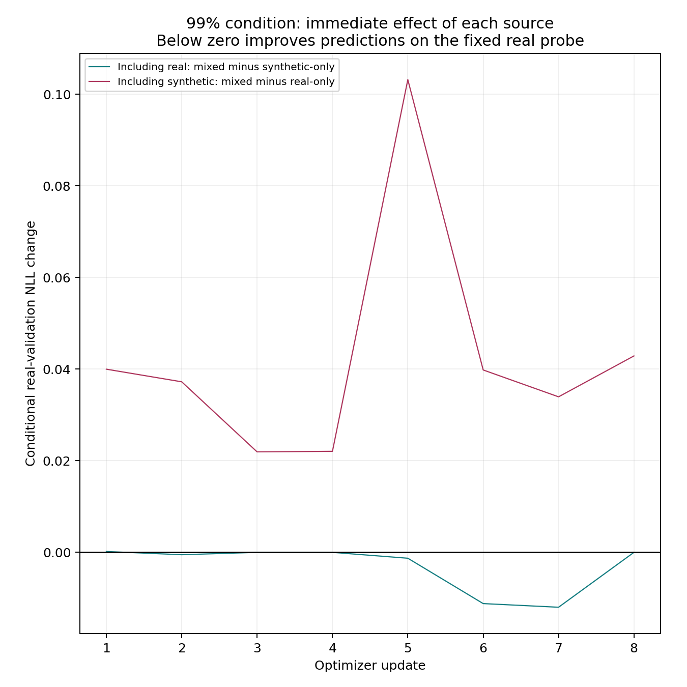

# SGD/greedy comparison: validation and launch handoff

**Technically validated; the three full ten-cycle conditions have not been launched.**

The frozen configurations prepare independent 0%, 99% and 100% synthetic conditions with SmolLM2-135M and the existing model-native FineWeb bank. Each condition continues its own weights over ten fresh 10,000-pair chunks. Inputs are BOS + 64 real prompt tokens + 64 continuation tokens; only continuations contribute to loss. Synthetic targets come from that condition's preceding checkpoint and are frozen before its epoch.

- Plain SGD: constant **0.01**, zero momentum/decay, no scheduler, warm-up or clipping; fused/foreach disabled.
- FP32 throughout; TF32 disabled. Seed 42, microbatch 32, effective batch 128 with a final 16-example batch.
- Greedy decoding produces exactly 64 continuation tokens for training and the fixed output probe.
- Every actual update records directly measured batch-weighted real/synthetic gradients, their norms/alignment and four scratch-model probe states. Only the combined training gradient advances the real model. Held-out gradients never update it.

## Learning-rate calibration

Each rate started independently from pretrained M0. Screening used 32 updates on the same 4,096 chunk-1 examples; the best two continued on 4,096 fresh chunk-2 examples. The selected rate used complete validation NLL, never test scores. Calibration weights were discarded as initializers.

The validation-probe baseline was **16.9413 PPL**; the complete-validation baseline was **18.2152 PPL**. Their populations differ, so compare entries within each column.

| Constant LR | Screen: 1,024-pair validation PPL | Confirmation: complete validation PPL | Decision |
|---|---:|---:|---|
| 0.0001 | 16.9351 | — | Eligible; not selected |
| 0.001 | 16.8976 | 18.1391 | Eligible; not selected |
| 0.01 | 16.8130 | 18.0526 | Selected |
| 0.1 | Non-finite training loss | — | Rejected: unstable |

**181 calibration updates** executed, below the 192-update cap. The 0.1 candidate stopped early. This is the best tested short-screen rate, not a proven optimum or assurance of ten-cycle stability.

## What passed

- **150 focused offline tests**, with 43 rechecked after freezing the numerical configuration. Independent review resolved recovery, benchmark-transfer and probe-loading findings.
- Three conditions × two fresh 400-pair chunks: **six actual GPU epochs / 24 logical updates**, including every 16-example tail. The 99% condition used 396 synthetic + four real examples per chunk.
- One deliberate interruption after update 5 of the 99% condition; replay preserved completed work. Its abandoned update remains excluded from completed statistics. Physical work was **181 calibration + 24 accepted + one replay = 206 optimizer updates**.
- Finite losses, changed/reloaded terminal tensors, constant LR and empty SGD history; correct model/generator/optimizer-parent chains and frozen masks/targets.
- Direct conditional NLL agrees numerically. Source gradients reconstruct the authoritative gradient; mixed scratch updates equal actual parameter updates exactly. Mode and RNG remain unchanged by diagnostics.
- All three terminal stages were privately cold-restored: **78 files / 1.617 GB**, including state and diagnostics. Restored held-out NLL matched exactly for every arm. Earlier trained stages were not individually cold-restored.
- Detached progress, independent watchdog and provider-confirmed ordinary shutdown passed. Both temporary Pods and volumes are removed; historical recovery resources remain intact.

The first attempt completed calibration but failed before acceptance training because the probe loader treated a metadata dictionary as window arrays. The corrected loader is covered by an actual-bank regression. The retry imported the checksum-sealed calibration evidence with **zero new calibration updates** and no candidate weights. Both attempts are included in time and costs.

## Small-run measurements: pipeline evidence

These evaluate only 128 fixed test pairs, with a 32-prompt output probe. They are not the full-data scientific result.

| Condition | Initial test PPL | After small cycle 1 | After small cycle 2 |
|---|---:|---:|---:|
| real | 17.4966 | 17.4491 | 17.4226 |
| mixed99 | 17.4966 | 19.6233 | 24.0117 |
| synthetic | 17.4966 | 19.6403 | 24.1437 |



The following example records immediate, batch-weighted source effects on the 128-pair real-validation probe. Negative NLL change means better predictions on that probe. These scratch interventions are local effects along the actual path, not alternative ten-cycle trajectories.



[All square figures, loss/diversity/repetition metrics and update-level tables](generated/acceptance/report.md) · [Learning-rate CSV](calibration.csv) · [Raw numerical evidence](records/)

## Cost, recovery and the later full launch

- Combined paid compute: **25.92 minutes**; conservative task cost **USD 0.2882**, including both attempts and temporary storage. Limits were 30 minutes / USD 0.40. Account debits include other retained resources and are not used as task-cost attribution.
- Measured conservative full forecast: **9.99 hours / USD 5.78** for compute and running working storage, including 1.5× variable-work margin. The watchdog admission requires about **USD 6.65** for that execution component. Seven days of the new 60 GB working + 30 GB backup storage is approximately **USD 1.45**, within the USD 2 reserve.
- At the recorded check, current global allowance after reserve was **USD 9.20**. Padded execution plus historical storage during the run was about **USD 8.45**, so it fits narrowly. Credit was USD 23.46; no credits or payment settings changed. Live admission must recheck retained-storage accrual, stock and price.
- Numerical LR and immutable calibration/benchmark snapshots are pinned in both definitions. The future full allocation and dedicated backup store are intentionally deferred to the separately authorized launch; no full-run storage was rented today.
- Small metadata/probe records are local and published here. All six trained acceptance checkpoints remain in pinned private backups; three terminal stages were cold-restored remotely. The shared pretrained baseline was also checksum-restored locally for cleanup. Temporary calibration candidate weights were intentionally discarded.

Future command, **not executed**:

```powershell
python -m model_collapse launch --config comparisons/smollm2_sgd_greedy_effects/full.yaml --generations 10
```

Use the returned comparison ID with `status`, `resume`, `fetch --metadata-only`, `report` and recovery-gated `cleanup`. Keep the laptop open until launch confirms detached supervision, watchdog operation and actual progress. Afterwards execution is remote.

This experiment simultaneously changes optimizer, schedule, regularization, decoder and precision from the historical AdamW/five-beam runs. It is a simpler recipe comparison, not an optimizer-only ablation. One seed and this reduced acceptance do not establish long-run stability, collapse thresholds or generality.
