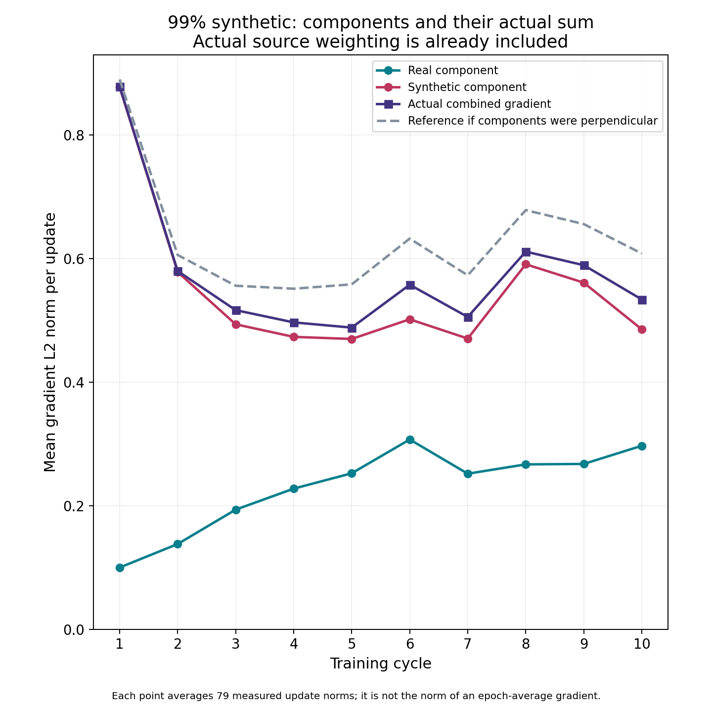
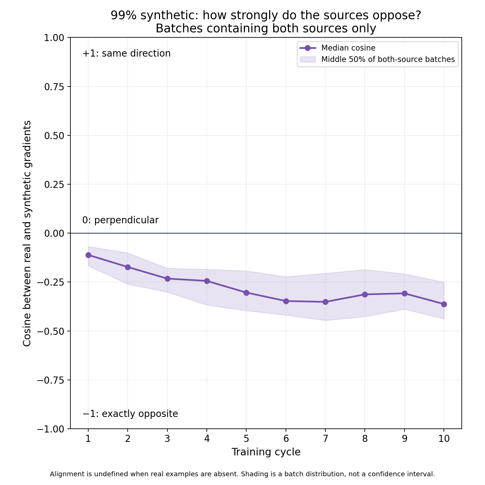
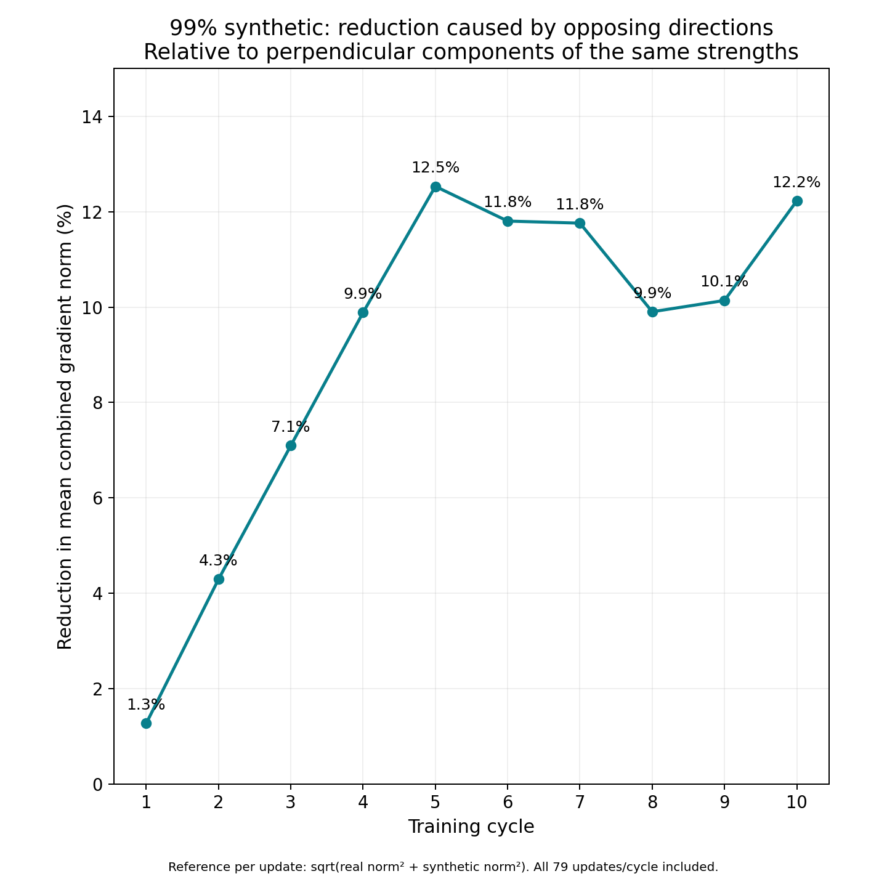

# Actual combined gradients and source opposition in the 99% SGD run

Offline analysis of all 790 sealed update records from `20261114T001352Z-full-completion64-mixtures`. No new training, inference, checkpoint restoration or cloud work. Source-weighted component norms and the authoritative combined norm come from the published full-precision journals, rather than adding plotted scalar heights.

## Findings

- Real and synthetic gradients oppose in **538/563 both-source updates (95.6%)**. The remaining 227 updates have no real component; their alignment is undefined.
- Median cosine moves from **−0.111** in cycle 1 to **−0.363** in cycle 10. The vectors are moderately opposed, not almost perfectly opposite.
- At cycle 10, mean component norms are **0.297 real / 0.485 synthetic** and the actual combined norm is **0.534**. Combined size can exceed synthetic size even while the components oppose: the real vector also contributes perpendicular movement.
- At the same component strengths, a hypothetical perpendicular orientation gives mean norm **0.608**. Actual opposition reduces that mean to **0.534**, a **12.2% reduction**. The corresponding cycle-1 reduction is **1.3%**.
- This is partial directional cancellation. It does not mean that 12.2% of synthetic data was removed or that validation loss improves by 12.2%. Prediction effects require the separately recorded held-out interventions.



Figure 1. Mean of per-update L2 norms, retaining the actual batch weights and zero real contributions. The solid combined curve uses the measured authoritative gradient. The dashed reference is hypothetical perpendicular geometry at each update, not another training run.



Figure 2. Median cosine in both-source batches, with their middle 50%. Positive means aligned, zero perpendicular and negative opposed. The shaded interval is a descriptive batch spread, not uncertainty across seeds.

## What cancellation means here

For each update, let `a = ||gR||`, `b = ||gS||`, `t = ||gR + gS||` and `c = cosine(gR,gS)`. The vector identity is:

`t² = a² + b² + 2ab c`.

The negative cross-term `2ab c` directly reduces the squared norm when sources oppose. A zero-dot-product reference has length `q = sqrt(a² + b²)`. The plotted cycle reduction is:

`100 × [1 − mean(t) / mean(q)]`.

Both means use the same 79 actual updates. The norm is taken before averaging; we never form an epoch-average vector from these scalar logs. This reference isolates opposition from the ordinary geometric reduction that also occurs when adding perpendicular vectors. Comparing `t` with `a + b` alone would count perpendicular geometry as cancellation too.



Figure 3. Reduction in mean combined length relative to the explicit perpendicular reference. Real-absent batches have zero reduction; aligned batches can have negative reduction. Net cycle reductions are positive here.

## Cycle values

| Cycle | Mean real norm | Mean synthetic norm | Mean actual combined norm | Perpendicular reference | Reduction | Median cosine |
| ---: | ---: | ---: | ---: | ---: | ---: | ---: |
| 1 | 0.1001 | 0.8771 | 0.8782 | 0.8895 | 1.3% | -0.111 |
| 2 | 0.1381 | 0.5781 | 0.5797 | 0.6057 | 4.3% | -0.173 |
| 3 | 0.1937 | 0.4935 | 0.5164 | 0.5559 | 7.1% | -0.232 |
| 4 | 0.2277 | 0.4732 | 0.4966 | 0.5511 | 9.9% | -0.244 |
| 5 | 0.2526 | 0.4698 | 0.4882 | 0.5581 | 12.5% | -0.304 |
| 6 | 0.3072 | 0.5016 | 0.5575 | 0.6321 | 11.8% | -0.347 |
| 7 | 0.2519 | 0.4705 | 0.5054 | 0.5728 | 11.8% | -0.351 |
| 8 | 0.2670 | 0.5906 | 0.6110 | 0.6782 | 9.9% | -0.313 |
| 9 | 0.2677 | 0.5608 | 0.5891 | 0.6556 | 10.1% | -0.308 |
| 10 | 0.2970 | 0.4853 | 0.5337 | 0.6080 | 12.2% | -0.363 |

## Interpretation and limits

The combined gradient remains substantial throughout the late, flatter perplexity trajectory. Real data redirects the update rather than merely shrinking it to zero. Corrections to real-text predictions can nearly balance deterioration while parameters keep moving. The held-out effects, not vector norms alone, establish whether a direction helps real text. The large final-16-batch corrections remain relevant to endpoint timing.

This is one seed and ten cycles with constant LR 0.01, plain FP32 SGD and greedy synthetic targets. No stationary point or permanent stabilization is established. The analysis retains both-source conditioning for cosine and includes all batches for norms/reductions. Supplementary CSV columns record squared-norm cross-term reduction and a synthetic-energy-weighted opposing projection; those are different metrics and are not the percentages plotted in Figure 3.

## Reproduction

```powershell
$env:PYTHONPATH = (Get-Location).Path
python scripts/analysis/sgd_gradient_cancellation.py --out NEW_OUTPUT_DIRECTORY
```

All source bytes are checked against their existing publication manifest. Every recorded total satisfies the vector norm identity and triangle inequalities within tolerance. CSV/JSON records, script/input hashes and square PNG/PDF figures accompany this report. Published earlier analyses remain unchanged. Google Doc was not edited for this request.
