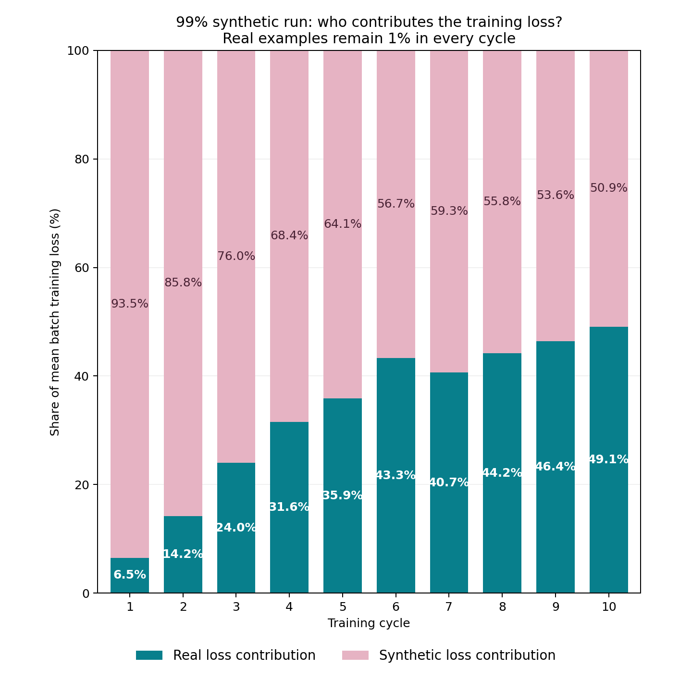

## 5A. One percent of examples supplies a growing share of loss

- The real targets remain exactly 1% of examples, but supply 6.5% of mean batch training loss in cycle 1, 24.0% in cycle 3, 43.3% in cycle 6 and 49.1% in cycle 10. Their loss share grows as synthetic targets become easier and real continuations become harder.

- Across cycles 6–10, the real share is 44.6%; restricting to full 128-example batches gives 44.0%. This is broader than the final-batch effect. Loss share describes the training objective; the separate gradient and held-out interventions establish the corrective effect.

Figure W5.1a. Contributions to training loss in the 99% arm. For each cycle, average the real and synthetic batch-weighted terms over all 79 updates, then divide each by their sum. Each bar totals 100%; it is not a percentage of examples or of the final gradient.

## 5B. From loss contributions to backpropagation

L_B = (Σreal ℓᵢ)/N_B + (Σsynthetic ℓᵢ)/N_B = L_R + L_S

g_R = ∇θ L_R;   g_S = ∇θ L_S;   Δθ = −0.01(g_R + g_S)

- Each ℓᵢ averages that example's 64 continuation-token losses. N_B is the actual effective batch size: 128, or 16 at the tail. Microbatches of 32 accumulate into this same token-weighted objective. Real and synthetic terms retain this common denominator.

- Backpropagation differentiates the two loss terms. It does not use loss values directly as gradient magnitudes: 44.6% of loss does not mean 44.6% of the parameter update. Gradients are vectors whose directions can oppose.

- Early real influence is relatively weak and synthetic training drives deterioration. Later, in cycles 6–10, mean weighted real-gradient norm is 53.3% as large as synthetic. Including real improves held-out probe NLL by 0.0447/update on average; including synthetic worsens it by 0.0437. This direct evidence supports a moving near-balance; nonlinear effects and the small tail batch prevent a simple scalar cancellation or proof of permanent stability.

Table W5.4a. Actual mean batch loss terms, in nats per continuation token. Real share = mean(L_R) / [mean(L_R) + mean(L_S)]. The final column compares mean gradient norms, not shares of a scalar total; all proportions are already included.

| Cycle | Real loss term | Synthetic loss term | Real loss share | Mean norm ratio R/S |
| --- | --- | --- | --- | --- |
| 1 | 0.0351 | 0.5021 | 6.5% | 11.4% |
| 2 | 0.0375 | 0.2272 | 14.2% | 23.9% |
| 3 | 0.0442 | 0.1400 | 24.0% | 39.3% |
| 4 | 0.0471 | 0.1020 | 31.6% | 48.1% |
| 5 | 0.0494 | 0.0883 | 35.9% | 53.8% |
| 6 | 0.0586 | 0.0767 | 43.3% | 61.2% |
| 7 | 0.0513 | 0.0749 | 40.7% | 53.5% |
| 8 | 0.0521 | 0.0659 | 44.2% | 45.2% |
| 9 | 0.0529 | 0.0611 | 46.4% | 47.7% |
| 10 | 0.0569 | 0.0590 | 49.1% | 61.2% |
