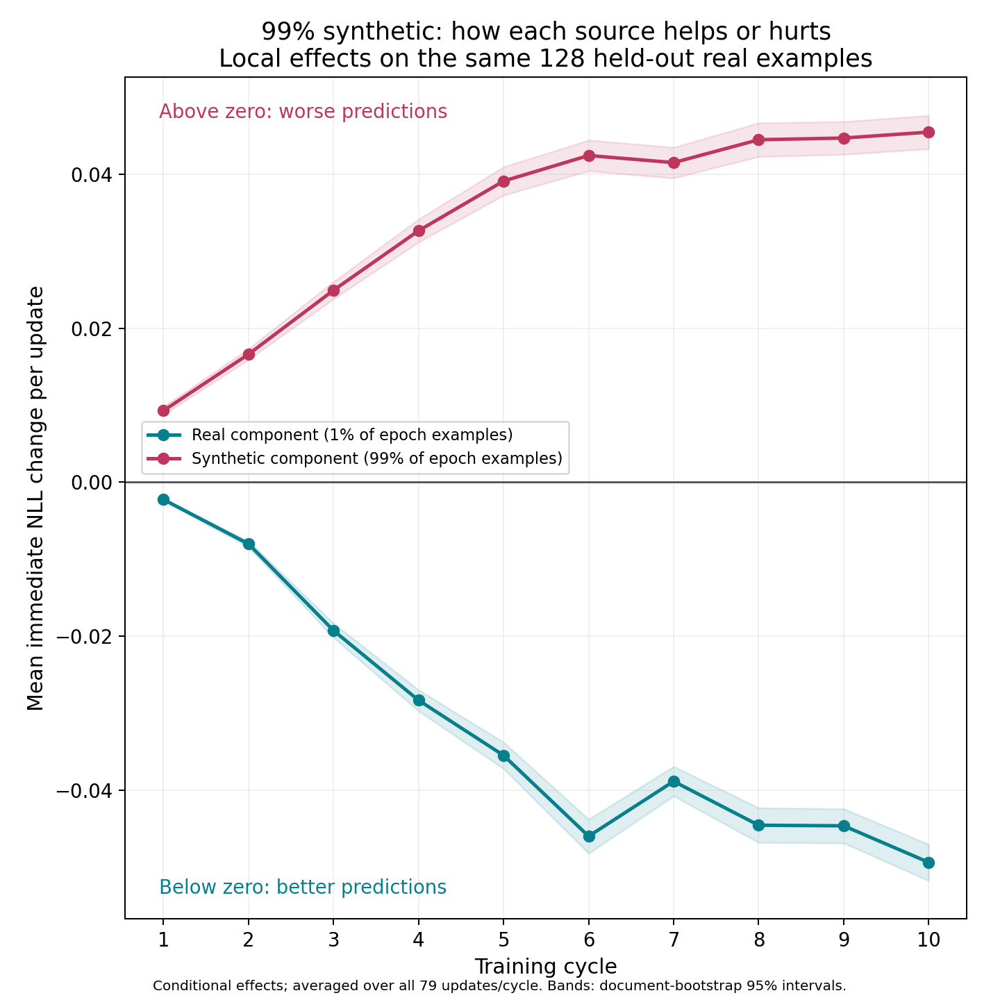
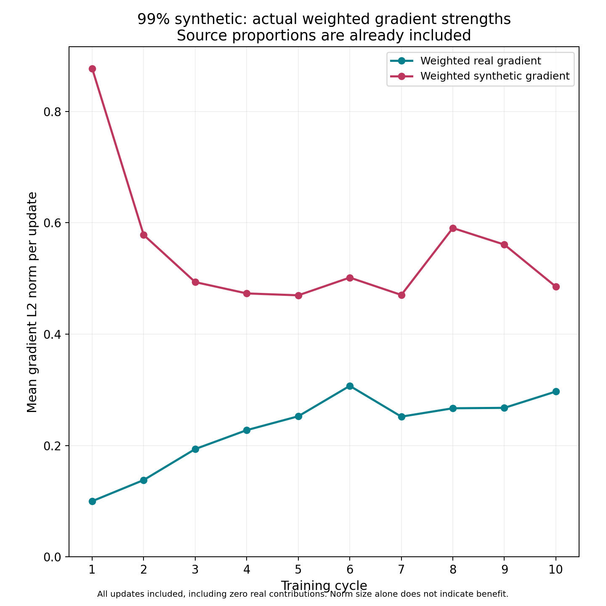
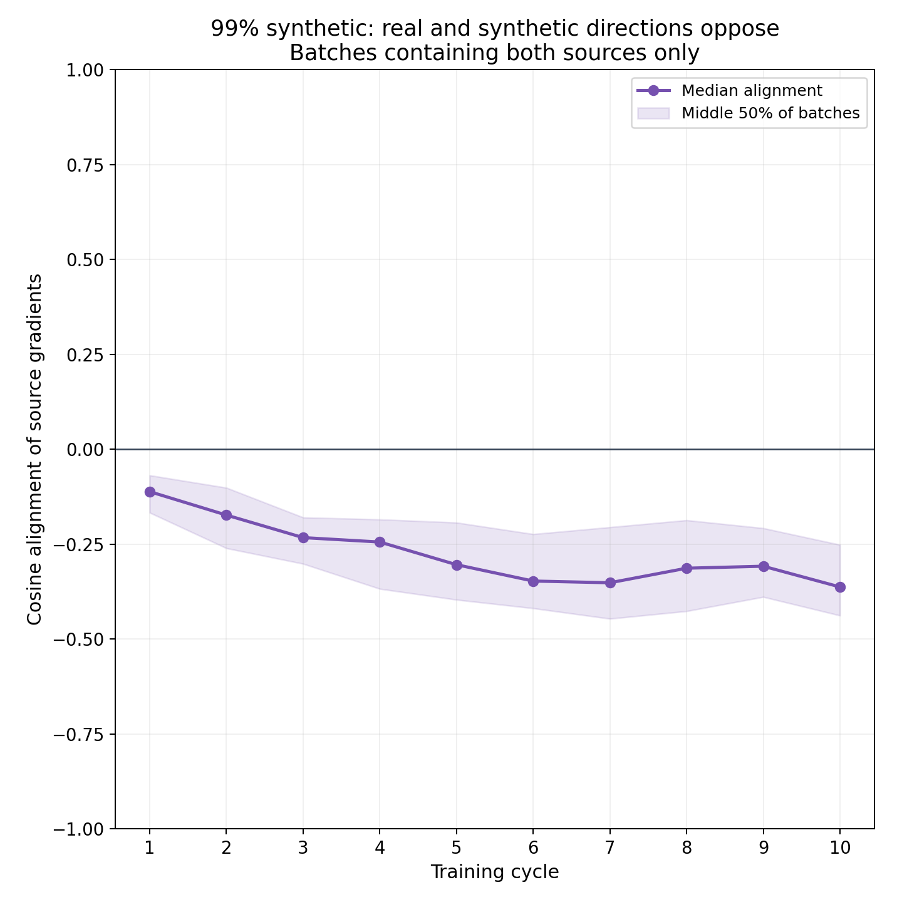
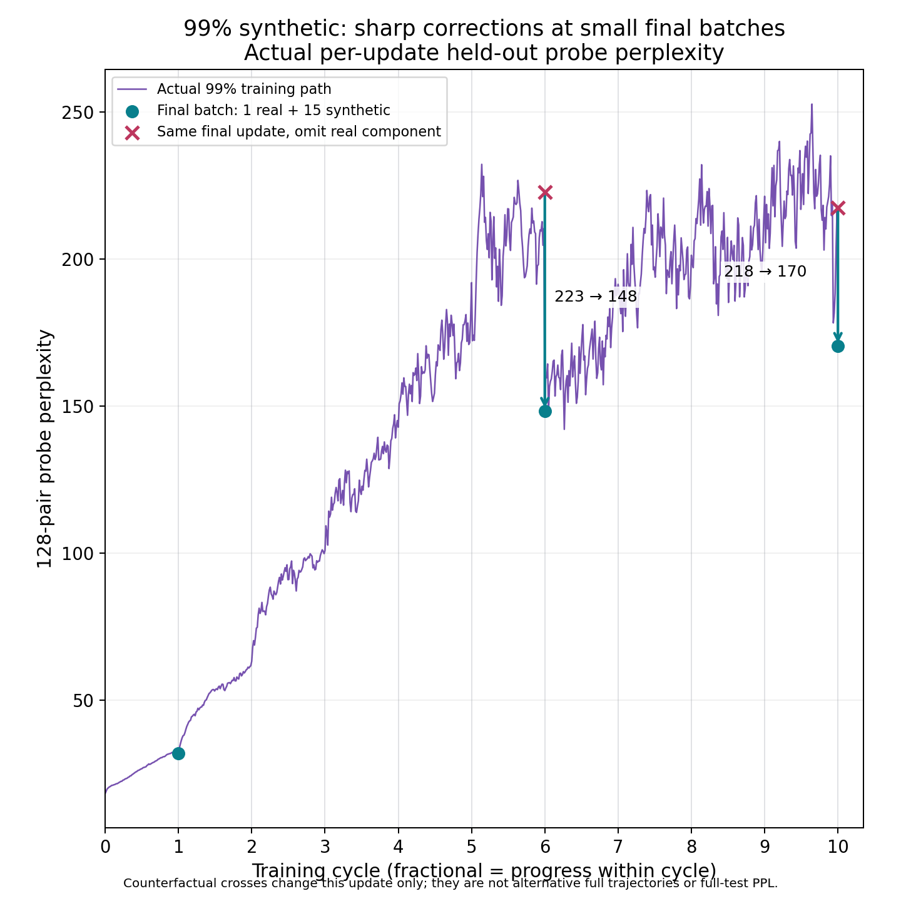
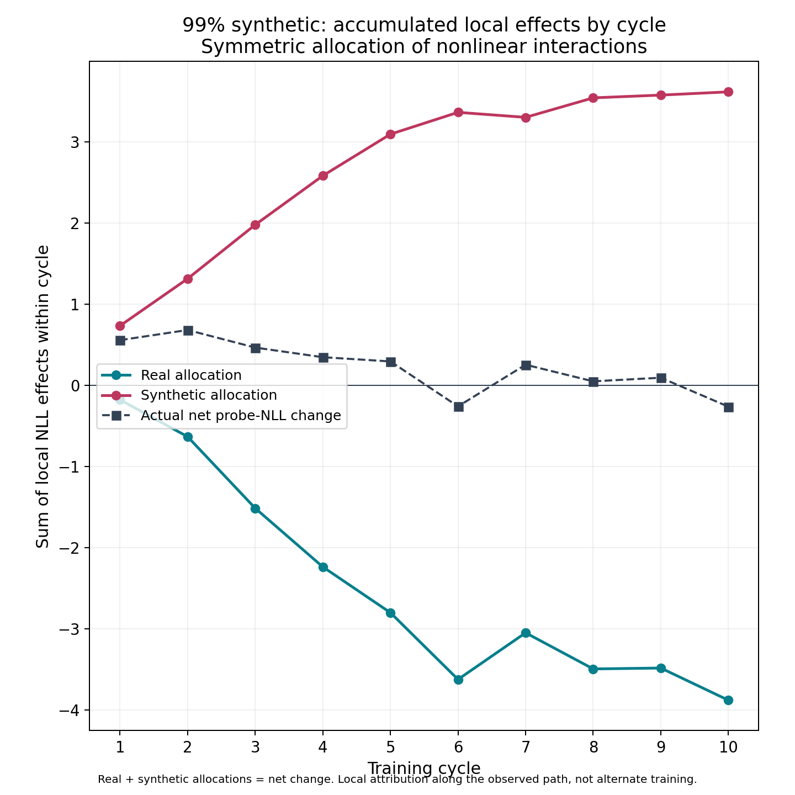
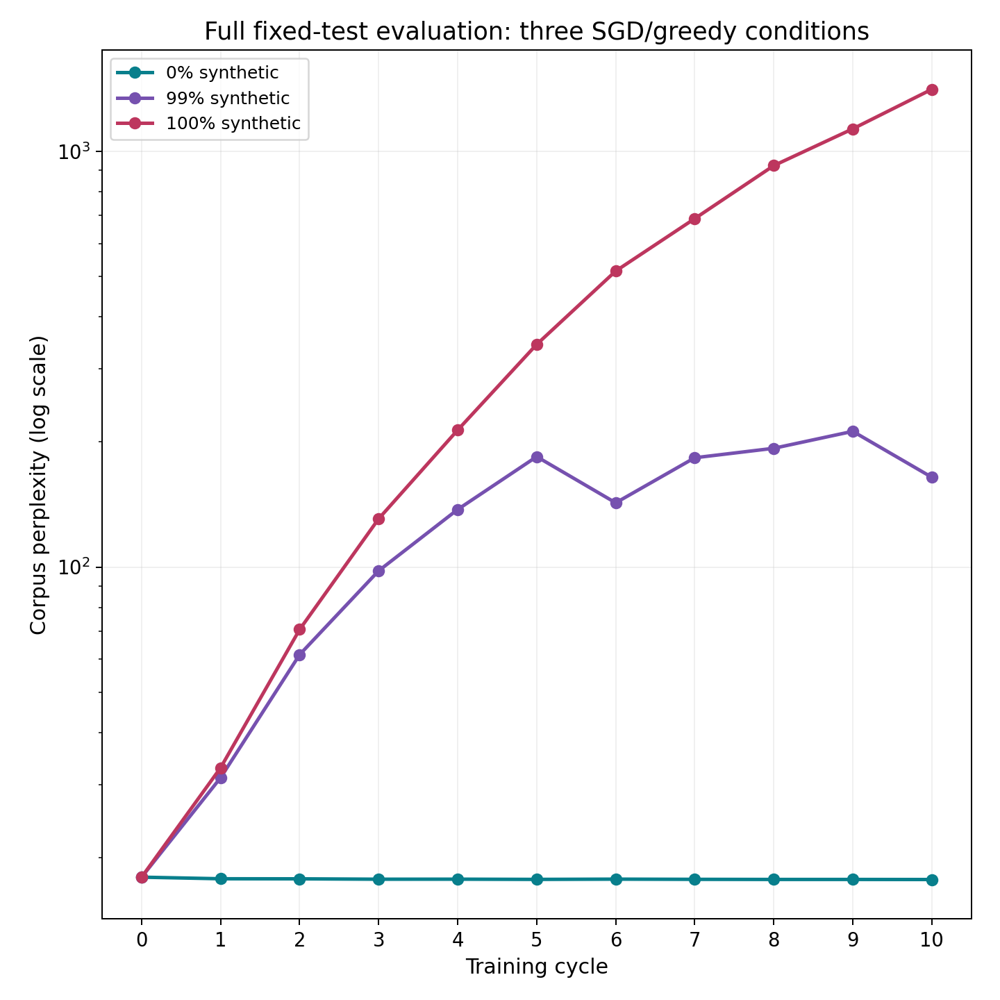

# Per-update real/synthetic effects under SGD and greedy decoding

Completed run `20261114T001352Z-full-completion64-mixtures`; offline analysis on 14 November 2026. No new inference, training or paid resources. The selected diagnostic journals, per-example scores and seals were recovered from immutable private backups and checked against their indexed hashes. This does not restore full model/optimizer checkpoints.

## Main findings

- In the 99% condition, all **563 updates containing real examples** have a beneficial real conditional effect on the fixed real-validation probe; **227 updates have no real examples**. Synthetic conditional effects worsen this probe in **778/790 updates**, improve it in 12, and are never numerically unresolved at the declared 1e-6 NLL floor.
- The real correction strengthens as the model deteriorates. Mean weighted real gradient norm rises from **0.100** in cycle 1 to **0.297** in cycle 10; the synthetic norm falls from **0.877** to **0.485**. These include the actual batch proportions and real-absent zero contributions.
- Among batches containing both sources, median real/synthetic weighted-norm ratio rises from **0.165** to **0.703**. Median source cosine becomes more negative (**-0.111 to -0.363**): the sources increasingly oppose, although they are far from exactly opposite. Norms and alignment alone do not establish benefit; the actual held-out interventions do.
- The final 16-example batch is important. In cycles 6 and 10 it contains one real example, giving that example weight **1/16**, versus **1/128** in a full batch. Recorded counterfactuals show large immediate corrections. Dataset composition remains exactly 100 real / 9,900 synthetic per cycle; this is a batch-weighting and endpoint-timing effect, not a changed dataset ratio.
- The full-test 99% trajectory still deteriorates strongly: **17.958 → 164.413**, versus **1,408.607** at 100% synthetic and **17.726** at 0%. The small real component restrains deterioration; these data do not establish stable or good performance.

## What was measured

Each condition starts independently from pretrained SmolLM2-135M, processes ten fresh 10,000-pair FineWeb chunks, and uses one terminal epoch per chunk. The 64 real prompt tokens remain visible; loss scores only 64 continuation tokens. The 99% run replaces 9,900 targets with its own preceding checkpoint's greedy completions. Plain FP32 SGD uses constant **0.01**, no momentum, weight decay, clipping or scheduler. Microbatch 32 / effective batch 128 gives 78 full updates and one 16-example update each cycle.

At each actual update, real and synthetic gradients were measured directly from the same training forward graphs and normalized by **all scored tokens in that effective batch**. The authoritative combined gradient trained the model. Four scratch evaluations used exactly the same initial weights: unchanged (L0), real component only (LR), synthetic component only (LS), and actual mixed update (LM). All use the same 128 real-validation pairs / 128 documents / 8,192 continuation targets. No held-out gradients train the model.

- **Real conditional effect = LM - LS:** how predictions change when the real component is included alongside the existing synthetic component.
- **Synthetic conditional effect = LM - LR:** analogous inclusion effect of synthetic data.
- Negative NLL change means better probabilities for unseen real continuations; positive means worse. These are conditional predictive effects, not a universal text-quality score.
- All component magnitudes retain their original batch weights. A real-only shadow in the 99% arm does not renormalize one real example into a whole real batch.
- Conditional effects are nonlinear and do not generally add. Their interaction is `LM - LR - LS + L0`.



Figure 1. Mean local conditional effects over all 79 actual updates per cycle, including zero real contributions. Bands resample the same probe documents (2,000 paired bootstrap draws, seed 42). They describe evaluation-sample variability, not training-seed uncertainty or independent update replicates.

## Numerical cycle summary

Table 1. Conditional NLL effects per update and actual probe movement. All values concern the 128-pair probe; full-test perplexity is reported separately.

| Cycle | Updates with real / 79 | Mean real effect | Mean synthetic effect | Probe PPL before → after |
| ---: | ---: | ---: | ---: | ---: |
| 1 | 52 | -0.002253 | +0.009300 | 18.31 → 31.99 |
| 2 | 55 | -0.008015 | +0.016630 | 31.99 → 63.33 |
| 3 | 52 | -0.019271 | +0.024947 | 63.33 → 100.94 |
| 4 | 58 | -0.028330 | +0.032680 | 100.94 → 142.91 |
| 5 | 61 | -0.035495 | +0.039134 | 142.91 → 192.06 |
| 6 | 58 | -0.045996 | +0.042451 | 192.06 → 148.38 |
| 7 | 53 | -0.038861 | +0.041531 | 148.38 → 191.49 |
| 8 | 57 | -0.044566 | +0.044502 | 191.49 → 201.38 |
| 9 | 58 | -0.044641 | +0.044721 | 201.38 → 221.43 |
| 10 | 59 | -0.049390 | +0.045491 | 221.43 → 170.45 |



Figure 2. Arithmetic mean L2 norms, already weighted by the actual source share in each batch. A component's size says how strongly it changes parameters, not whether that change helps. Later real targets are much more corrective even though they remain just 1% of examples.



Figure 3. Median cosine and the middle 50% of actual both-source batches. Empty real sources are undefined and excluded. Negative cosine means the two parameter-update directions oppose; it does not on its own identify which improves validation.

## Why the late-cycle dips are sharp

The final batch contains one real example in cycles 1, 6 and 10, and none in the other cycles. SGD averages within each batch, so each example in the 16-row tail has eight times the weight of an example in a 128-row update. This conventional tail handling was retained from the original protocol. It affects all conditions' tail weights, but the source imbalance matters particularly when one corrective real example lands there.

Table 2. Direct final-update counterfactuals at cycles 6 and 10. The synthetic-only shadow omits the real component without renormalizing synthetic weights. These are probe values, not counterfactual full-test evaluations.

| Cycle | Real / total in tail | PPL before last update | After synthetic component only | After actual combined update | Net NLL change in preceding 78 updates | Net NLL change in last update |
| ---: | ---: | ---: | ---: | ---: | ---: | ---: |
| 6 | 1 / 16 | 210.45 | 222.77 | 148.38 | +0.091461 | -0.349465 |
| 10 | 1 / 16 | 216.64 | 217.61 | 170.45 | -0.021859 | -0.239796 |



Figure 4. Per-update probe trajectory, with measured one-update synthetic-only shadows at the two large drops. Cycle 6's first 78 updates worsen probe loss overall, followed by one larger improvement at the tail. Cycle 10's first 78 already slightly improve it, with most of the cycle's improvement again occurring at the tail. The full-test endpoint dips at the same cycles, making this a strong mechanistic explanation for their timing; the full test was not evaluated before/after each shadow.

## Additive local accounting, with a stated convention

To summarize net effects exactly, split each update's nonlinear interaction equally:

`real allocation = 0.5 × [(LR - L0) + (LM - LS)]`

`synthetic allocation = 0.5 × [(LS - L0) + (LM - LR)]`

These two allocations sum to `LM - L0`. This symmetric average-marginal convention is one attribution rule, not a unique causal decomposition. Summing over the actual path is meaningful because consecutive saved probe states agree exactly. It does not simulate a trajectory without one source.

Across 790 updates, the real allocation is **-24.883648 NLL**, synthetic **+27.114431**, and net **+2.230783**. Under this convention the real component offsets about **91.8%** of the accumulated local synthetic harm. The large opposing totals describe repeated local corrections along an evolving model, rather than achievable isolated multi-epoch endpoints.



Figure 5. Local allocations per cycle plus their exact net. Late cycles approach a moving balance, with sharp tail corrections; this does not prove permanent stabilization.



Figure 6. Full held-out real-test evaluation, distinct from the miniature intervention probe. All three arms use the same constant-LR SGD recipe and greedy probes.

## Interpretation and limits

Real targets remain a corrective signal when greedy synthetic targets increasingly reinforce the model's own preferred predictions. As predictions drift away from real continuations, those real targets can create large gradients despite their small count. In the 99% arm, token-weighted real training-target NLL grows from **3.215** in cycle 1 to **5.333** in cycle 10, while synthetic-target NLL falls from **0.508** to **0.060**. These average pre-update training losses concern fresh chunks and changing synthetic targets, not a fixed evaluation set. They support growing disagreement with real text and increasing confidence on the model's own completions.

The measured growth in weighted real norm, negative source alignment and consistently beneficial real interventions supports the corrective-signal explanation under this recipe. The synthetic influence is usually harmful on the already-degraded 99% path; this is not a claim that every synthetic update in every condition harms real text. In the separate 100% path, 254/790 individual updates improve the probe, although its epoch endpoints worsen dramatically.

The decreasing learning rate and Adam momentum are absent here, so they cannot explain these particular corrections. Fresh real-only training stays near baseline; its individual batch effects are small and have both signs. This is consistent with small random movements near an already capable real-text model, while corrective real examples have a much larger effect after synthetic deterioration.

This is one seed, one corpus, one model, greedy fixed-length generation, constant LR 0.01 selected using a short real-only screen, and 128 probe documents. The probe's repeated evaluations are correlated. No multiple-seed or learning-rate sensitivity experiment is performed. Bootstrap intervals do not quantify training randomness. The calibration receipt predates full execution; the probe was not used to select production checkpoints or tune source updates. Very small effects below 1e-6 NLL are classified unresolved; absent sources are exact zero.

All 2,370 journal records pass source-count/row-order audits, component reconstruction, exact mixed-shadow equality, RNG/mode preservation, seal checks and contiguous step checks. Probe scores telescope exactly across all stages. The maximum mixed-source relative gradient-reconstruction error is below 2.65e-7. Only indexed diagnostic evidence and small metadata were restored in this analysis; full model/optimizer restoration remains a separate recovery obligation. No historical bytes or cloud resources were changed.

## Reproduction and records

From the repository root (private source access is required only for recovery):

```powershell
$env:PYTHONPATH = (Get-Location).Path
python comparisons/smollm2_sgd_greedy_effects/recover_updates.py
python comparisons/smollm2_sgd_greedy_effects/analyse_updates.py --out NEW_OUTPUT_DIRECTORY
```

`per_update.csv` retains 2,370 flattened records; `cycle_summary.csv` has all 30 cycle summaries; `tail_batches.csv` identifies all 30 tails. `bootstrap_intervals.json`, `verification.json`, `source_recovery.json` and `analysis_manifest.json` record uncertainty, immutable source revisions, file hashes, analysis version/environment and recovery scope. Per-example arrays and full journals remain in ignored recovery storage/private backups.
