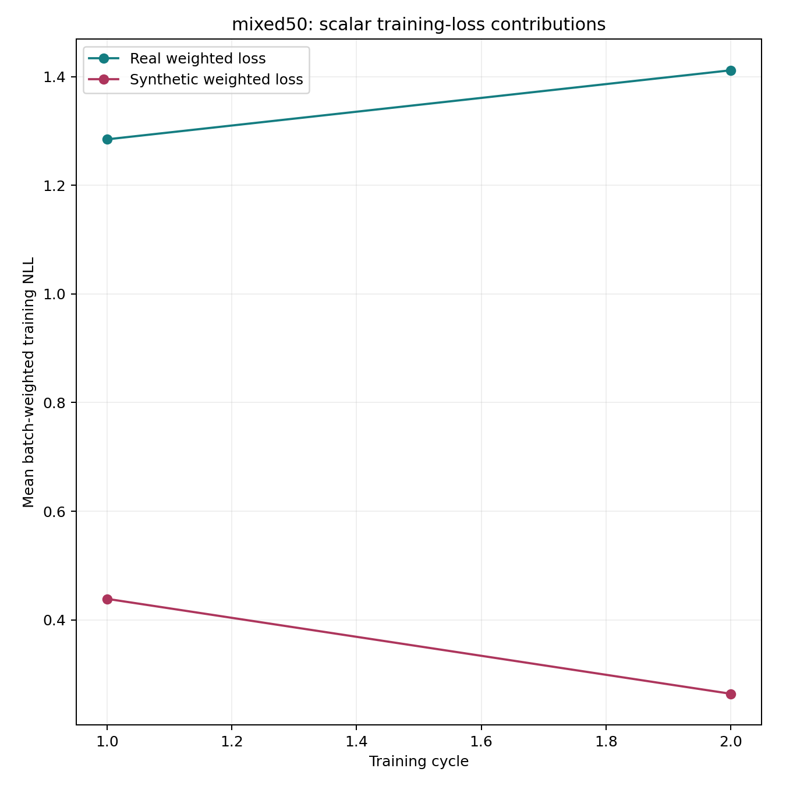
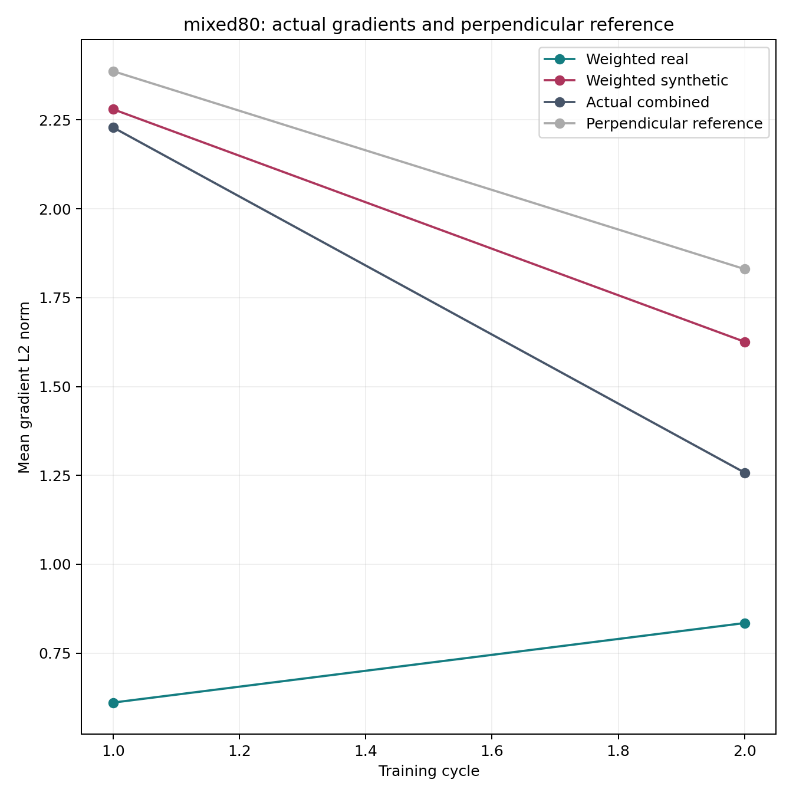

# SGD 50%/80% mixture pipeline validation

**Small pipeline test only; these numbers are not full-data research results.**

- 146 focused offline checks passed; independent post-code review found no material issue.
- Runtime `790a2322864a98a5cd7efa66d776817511f2bfa035c613b50d9dec9c55e2971d` passed all twelve GPU/operational checks.
- Four one-epoch stages, 16 successful logical updates and one additional interrupted/replayed physical update. No calibration updates were repeated.
- Both arms started at identical original pretrained weights, continued their own state, and generated from their own preceding checkpoint. Correct mixtures contained 200/200 and 80/320 real/synthetic pairs per reduced cycle.
- Complete terminal stages were restored from pinned private backups: both reproduced test NLL exactly (absolute error 0).
- Actual gradient reconstruction relative error stayed below 2.54e-7. Mixed shadow updates matched actual tensors; prompt masks, greedy output lengths and RNG isolation passed.
- Paid compute: 896.81 seconds, within the 900-second cap. Conservative validation cost: $0.16499, below $0.20. Provider shutdown and deletion of only the temporary Pod/working volume are verified.
- Full forecast: approximately 7.99 hours for twenty training stages, 1,580 updates and 130,000 generated continuations, including observer overhead and a 1.5 timing margin. Estimated compute/running working storage is $4.62; retained/historical storage and watchdog padding are separate admission items.
- GPU: RTX PRO 4000 Blackwell, CUDA host 13.2; pinned `runpod/pytorch:1.0.2-cu1281-torch280-ubuntu2404` image and existing package versions.

## Diagnostic examples

These two figures verify reporting of measured scalar loss contributions and vector geometry. They cannot establish stabilization from two tiny epochs.

Tables distinguish all updates, full batches and 16-example tails. Loss shares, gradient norms/cancellation and local held-out effects have different meanings. Per-example probe intervals describe document sampling, not seed uncertainty.

## Evidence and recovery

The validation JSON, benchmark, provider shutdown proof and source-sealed CSVs accompany this report. Full private indexes and child snapshot commits are preserved in `child_snapshots.json`. Terminal cold recovery covers each final smoke stage, not every historical checkpoint. Historical resources and published evidence remain unchanged.

The new full comparison is separately authorized after acceptance. Its live/recorded launch status belongs in the [current-state snapshot](../../docs/current-state.md); this report records validation only.
