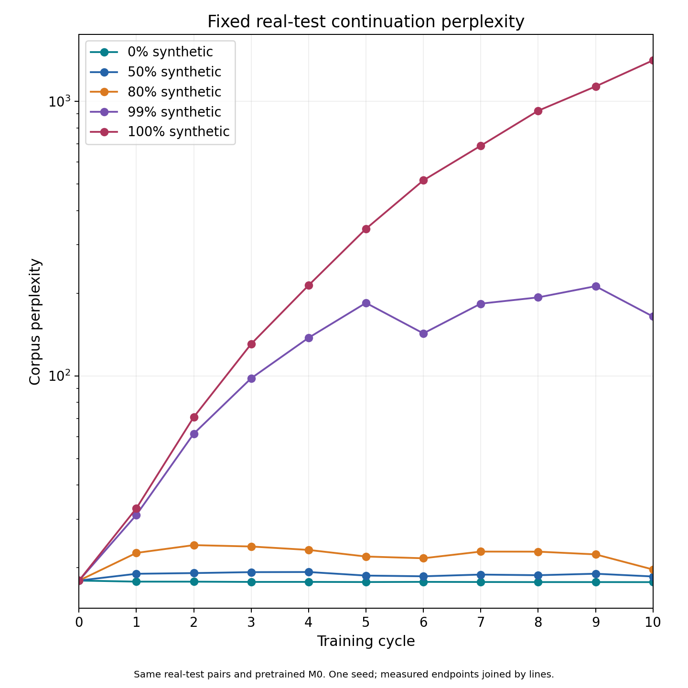
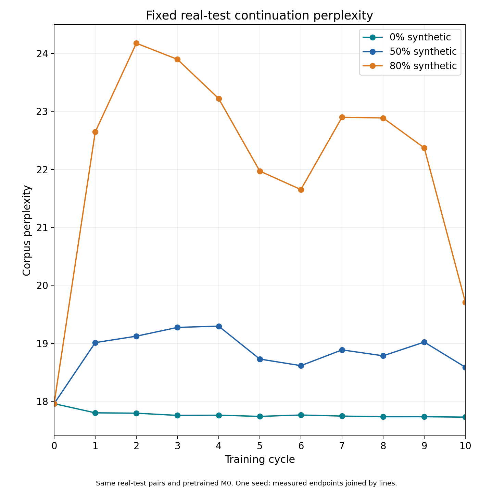
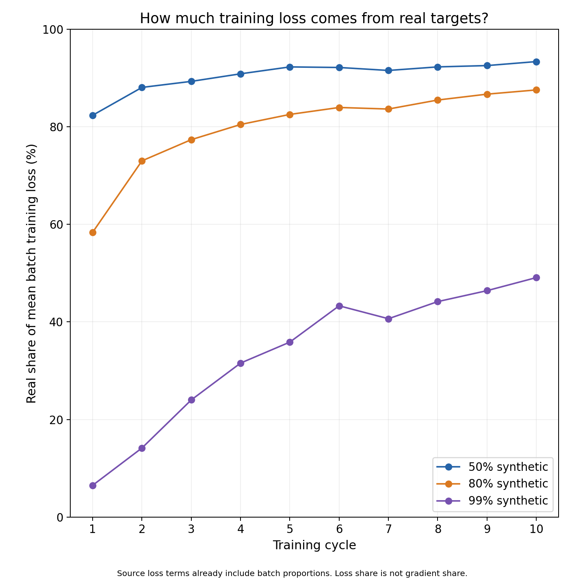
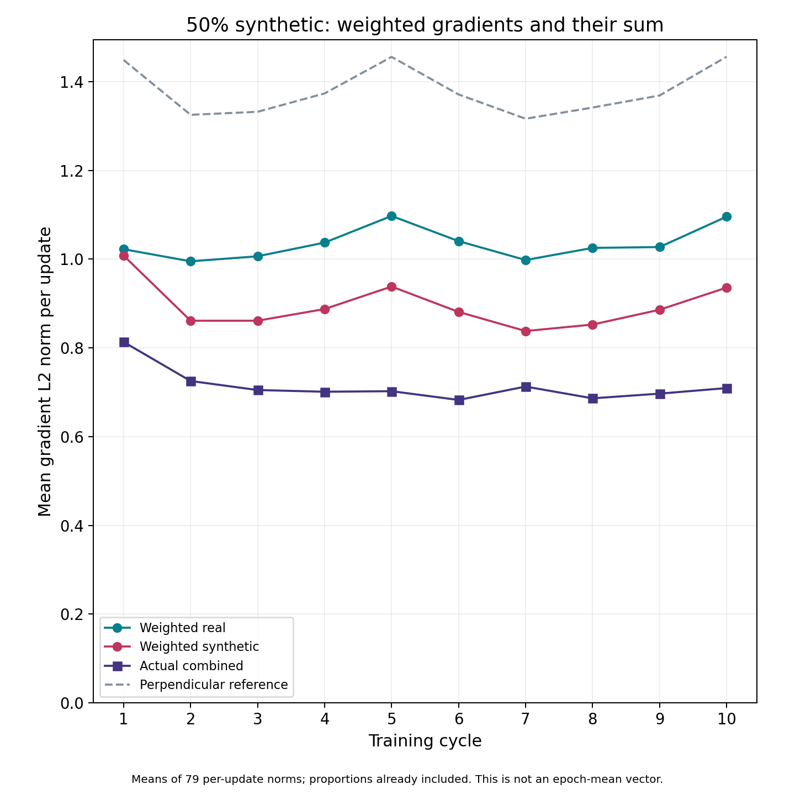
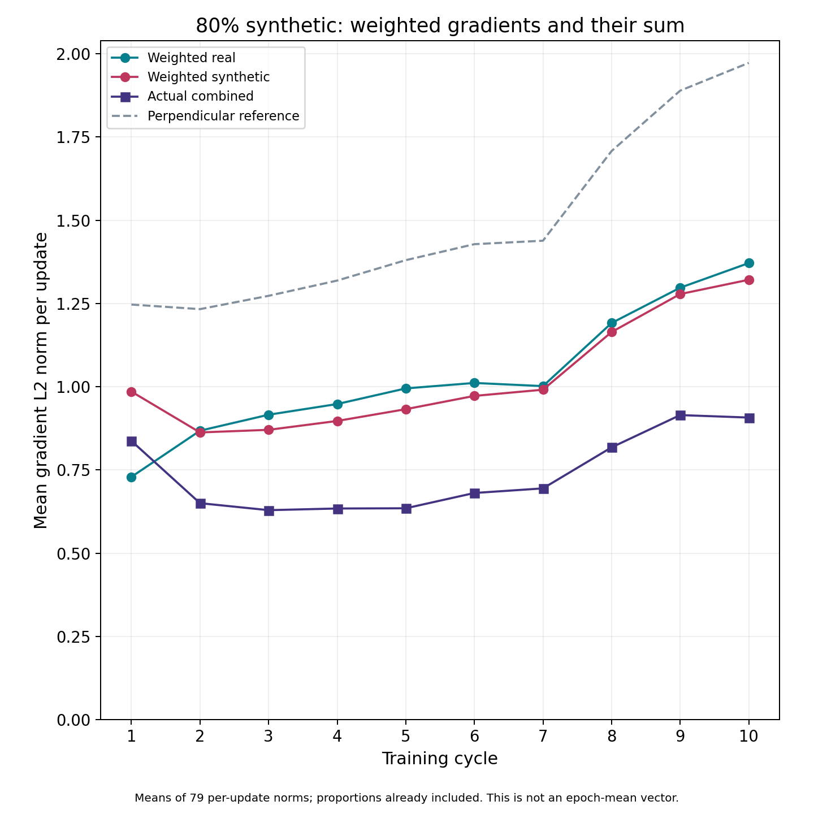
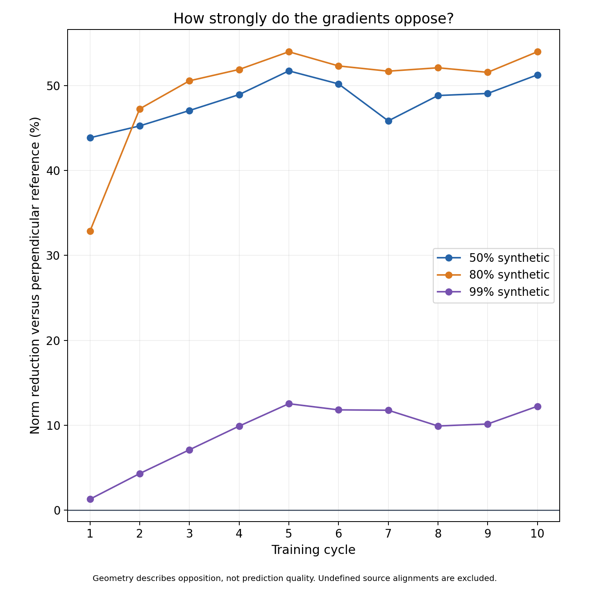
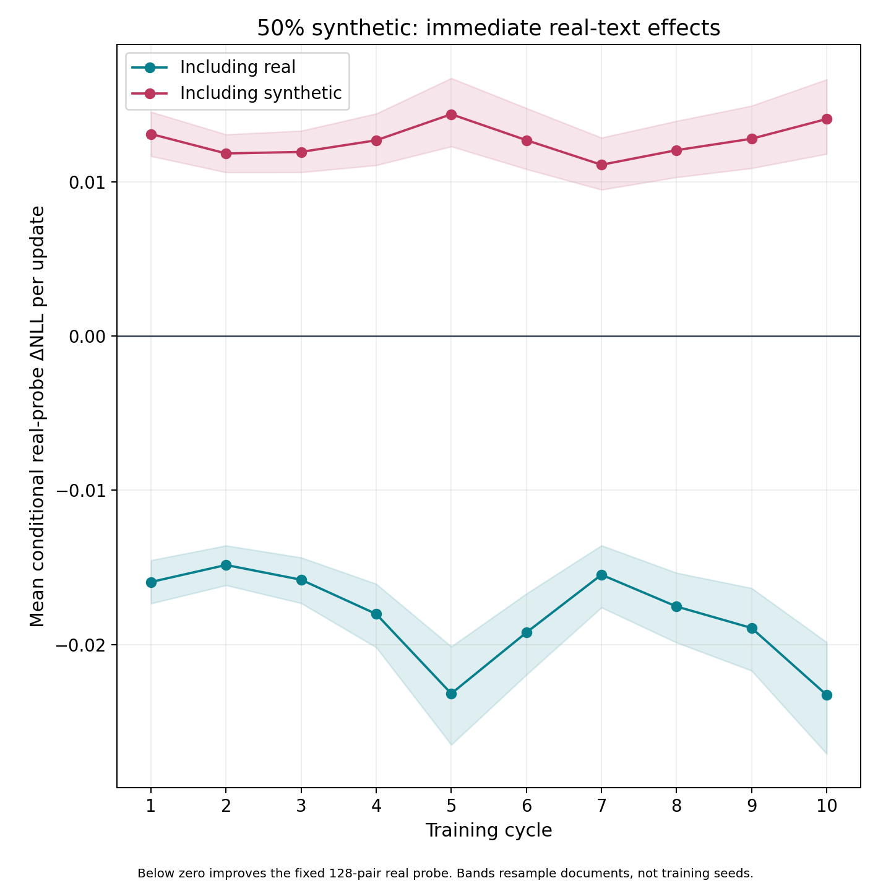
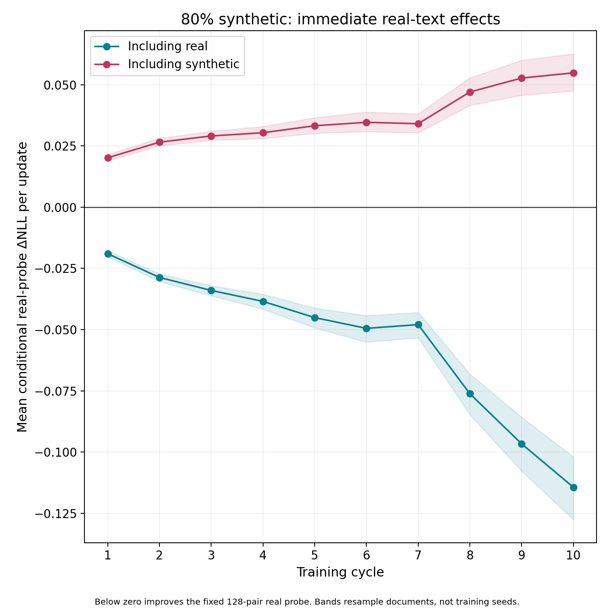
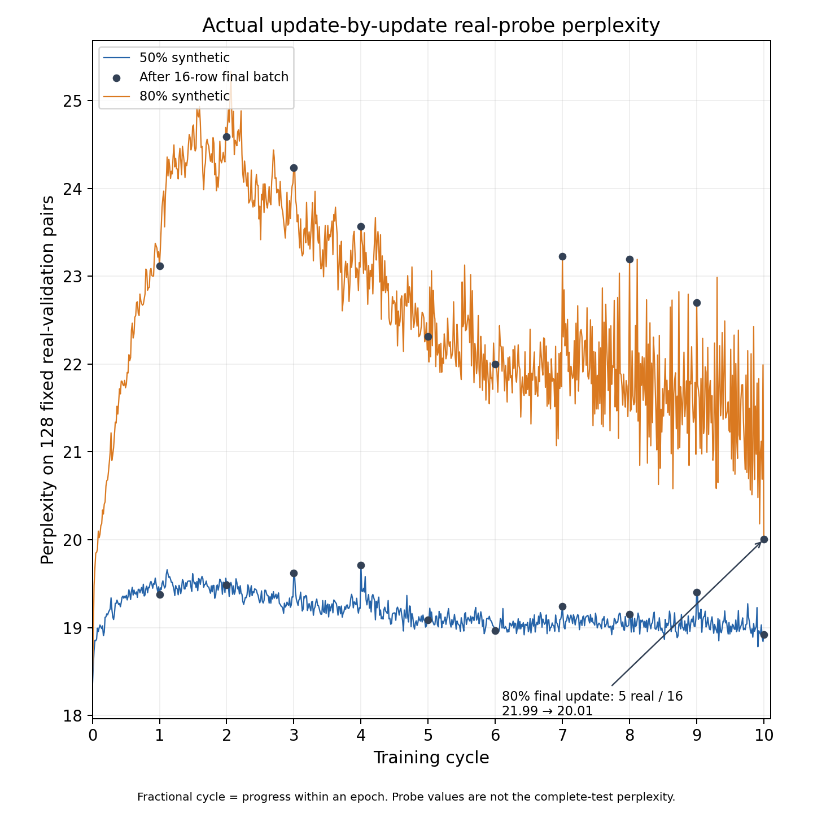
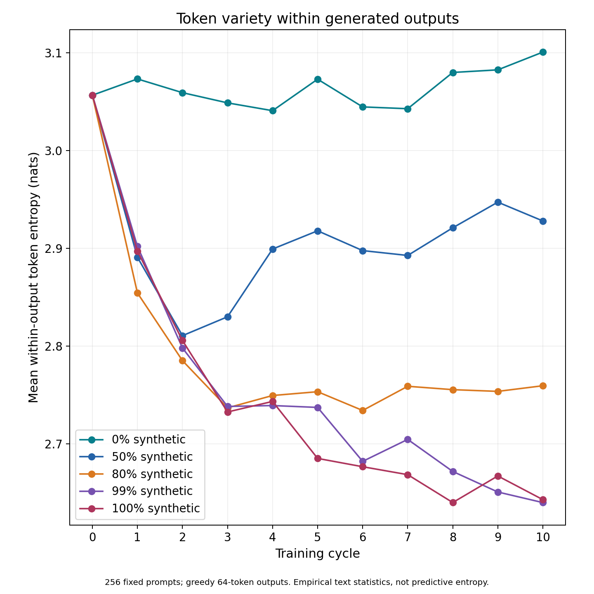

# Week 5 continued: Balancing real and synthetic updates

The matched 50% and 80% synthetic conditions remain close to pretrained real-test performance. Direct source diagnostics show strong, continuing real corrections opposing synthetic updates. Evaluation can remain nearly stable while both gradients and parameter updates remain substantial.

- Each arm independently starts the same pretrained SmolLM2-135M and continues its own weights through ten different, document-separated 10,000-pair FineWeb-Edu chunks. One terminal epoch is retained per cycle; there is no reset.

- Reuse the native-tokenizer bank, fixed evaluation collections, seed 42, plain SGD at constant 0.01, FP32 with TF32 off, and greedy exactly-64-token generation. There is no momentum, decay, clipping or scheduler. Critical computation files match the earlier SGD controls.

- Inputs contain BOS + 64 real prompt tokens + 64 targets. Loss scores only targets. Each arm generates its own selected continuations using its preceding checkpoint, retains real targets elsewhere, freezes the mixture and then trains. The nested row selections are deterministic.

- Every cycle scores 640,000 targets. Microbatches of 32 accumulate into 78 updates of 128 examples and a final update of 16. Each arm has 790 updates. Held-out document identities and evaluation arrays never enter training.

Table W5B.1. Matched cycle-10 outcomes. The 0%, 99% and 100% SGD controls are preserved historical runs; 50% and 80% are new. All share initial test PPL 17.958.

| Synthetic | Real / cycle | Synthetic / cycle | Final test PPL | Change vs M0 |
| --- | --- | --- | --- | --- |
| 0% | 10,000 | 0 | 17.726 | -1.3% |
| 50% | 5,000 | 5,000 | 18.586 | +3.5% |
| 80% | 2,000 | 8,000 | 19.707 | +9.7% |
| 99% | 100 | 9,900 | 164.413 | +815.5% |
| 100% | 0 | 10,000 | 1408.607 | +7743.9% |

## 1. The new conditions avoid the large likelihood deterioration

- Final real-test PPL is 18.586 at 50% synthetic and 19.707 at 80%, compared with 17.726 for real-only, 164.413 at 99% and 1,408.607 at 100%. These are full held-out continuation evaluations, not the small update probe.

- Both new mixtures are worse than real-only, but greatly outperform the high-synthetic controls. All conditions have constant learning rate; LR decay cannot explain their different trajectories. This remains one seed per condition.

Figure W5B.1. Full real-test corpus PPL on 7,303 fixed pairs / 467,392 scored tokens. The logarithmic scale reveals all five conditions. Lines connect recorded cycle endpoints; the shared baseline is reused evidence.

## 2. A closer view shows an overshoot and partial recovery

- At 50%, test PPL remains between 18.586 and 19.295 after adaptation, ending 3.5% above M0. At 80%, it peaks at 24.175 in cycle 2, then ends 9.7% above M0. The 80% trajectory improves after its early deterioration rather than becoming perfectly flat.

- The late 80% endpoints still fluctuate. Its final drop is partly amplified by the small final batch, examined below. Ten cycles show a bounded-looking observed trajectory; they do not establish a permanent equilibrium or a universal safe mixture fraction.

Figure W5B.2. The same complete-test metric on a linear, expanded scale for 0%, 50% and 80% synthetic. The first point after baseline represents one complete epoch on a fresh 10,000-pair chunk.

## 3. Real examples supply much more loss than their row fraction

L_B = L_R + L_S;  L_R = (Σreal ℓᵢ)/N_B;  L_S = (Σsynthetic ℓᵢ)/N_B

- Each ℓᵢ is mean NLL over that example's 64 continuation tokens. N_B is 128, or 16 for the tail. Source terms already contain their actual batch proportions; we do not multiply their gradients by the mixture percentage a second time.

- At 50% synthetic, real examples supply 82.4% of mean batch loss in cycle 1 and 93.3% in cycle 10. At 80% synthetic, the 20% real examples supply 58.4% initially and 87.5% by cycle 10. Synthetic targets become easy for the model to predict while real targets remain comparatively surprising.

- These percentages describe scalar training loss. They are not percentages of the gradient, parameter change or predictive benefit. All-batch and corpus-token weighting agree closely here, and the full-batch-only results retain the same pattern.

Figure W5B.3. Real share = mean(L_R) / [mean(L_R) + mean(L_S)], averaging all 79 updates/cycle. This is a ratio of source loss sums, not the mean of per-batch percentages. The 99% reference contains only 1% real examples.

## 4. Per-cycle loss accounting

- The following tables show the actual weighted terms entering backpropagation. For example, at 80% synthetic in cycle 10, mean real loss is 0.6120 and synthetic loss is 0.0871: real supplies 87.5% of their sum. Corresponding within-source corpus NLLs are 3.045 real versus 0.109 synthetic.

- Different chunks are used each cycle. These pre-update training averages follow changing weights and synthetic targets; they are not evaluations on one fixed training collection.

Table W5B.2. 50% synthetic: mean batch-weighted source loss, in nats per target token. Counts remain fixed while loss shares evolve.

| Cycle | Real loss term | Synthetic loss term | Real share |
| --- | --- | --- | --- |
| 1 | 1.4796 | 0.3171 | 82.4% |
| 2 | 1.4808 | 0.2009 | 88.1% |
| 3 | 1.4550 | 0.1744 | 89.3% |
| 4 | 1.4571 | 0.1468 | 90.8% |
| 5 | 1.4688 | 0.1233 | 92.3% |
| 6 | 1.4864 | 0.1268 | 92.1% |
| 7 | 1.4593 | 0.1350 | 91.5% |
| 8 | 1.4705 | 0.1233 | 92.3% |
| 9 | 1.4562 | 0.1175 | 92.5% |
| 10 | 1.4566 | 0.1038 | 93.3% |

Table W5B.3. 80% synthetic: mean batch-weighted source loss, in nats per target token. Counts remain fixed while loss shares evolve.

| Cycle | Real loss term | Synthetic loss term | Real share |
| --- | --- | --- | --- |
| 1 | 0.6172 | 0.4400 | 58.4% |
| 2 | 0.6414 | 0.2371 | 73.0% |
| 3 | 0.6295 | 0.1843 | 77.4% |
| 4 | 0.6213 | 0.1509 | 80.5% |
| 5 | 0.6286 | 0.1331 | 82.5% |
| 6 | 0.6299 | 0.1205 | 83.9% |
| 7 | 0.6069 | 0.1188 | 83.6% |
| 8 | 0.6181 | 0.1050 | 85.5% |
| 9 | 0.6091 | 0.0936 | 86.7% |
| 10 | 0.6120 | 0.0871 | 87.5% |

## 5. Backpropagation measures vectors rather than loss shares

g_R = ∇θ L_R;   g_S = ∇θ L_S;   θ_next = θ − 0.01(g_R + g_S)

- Source gradients are directly differentiated from the same forward graphs at unchanged weights. Their sum reconstructs the ordinary batch gradient. Only that combined update advances training; the diagnostics do not supply an additional update.

- In the 50% condition at cycle 10, mean weighted real and synthetic norms are 1.096 and 0.936; the actual combined norm is 0.709. Thus 93.3% of loss does not mean 93.3% of an update. Direction matters, and the nonzero combined gradient shows continued learning.

Figure W5B.4. Means of 79 per-update gradient norms. The grey reference is mean √(‖g_R‖²+‖g_S‖²), as if the measured component vectors were perpendicular. It is not calculated from their epoch-mean vectors.

## 6. At 80% synthetic the minority real gradient is comparably strong

- Despite supplying 20% of examples, the weighted real norm grows from 0.729 to 1.371; synthetic grows from 0.985 to 1.321. By cycle 10 they have similar strengths. The actual combined norm is 0.907, considerably shorter than either component.

- Synthetic scalar loss falls even though its gradient norm rises late. Loss values do not determine parameter derivatives: model sensitivity, changing targets and cancellation among examples also matter. These records establish the divergence, but do not isolate which factor causes it.

- At constant LR 0.01, cycle-10 combined norms imply typical update lengths around 0.0071 (50%) and 0.0091 (80%). Evaluation stability therefore does not mean that updates or parameter movement have stopped.

Figure W5B.5. Actual batch weighting is already included. Norms quantify movement in parameter space, not whether that movement improves real-text predictions. The held-out interventions below measure that separately.

## 7. The sources oppose much more strongly than at 99%

- Both new conditions have opposing source gradients in all 790 updates. Median cosine at cycle 10 is −0.809 at 50% and −0.899 at 80%, compared with −0.363 at 99% among batches containing both sources. Negative cosine means partial opposition.

- At cycle 10, opposition reduces mean combined length by 51.3% (50%) and 54.0% (80%) relative to the perpendicular reference. The corresponding 99% reduction is about 12.2%. Cancellation is substantial but incomplete, and its magnitude alone does not establish held-out benefit.

Figure W5B.6. Reduction = 100 × [1 − mean(‖g_R+g_S‖) / mean(√(‖g_R‖²+‖g_S‖²))]. Positive values indicate opposition. Every source proportion is already included; this is not a percentage of synthetic-data damage removed.

## 8. At 50% real updates help and synthetic updates hurt locally

- From the same actual starting weights, a scratch model scores unchanged weights (L0), real-only change (LR), synthetic-only change (LS) and the actual mixed change (LM) on 128 fixed real-validation pairs. Original source weights are retained; an omitted source is not renormalized.

- Real conditional effect is LM−LS; synthetic conditional effect is LM−LR. In all 790 updates, including real improves the probe and including synthetic worsens it. The isolated comparisons to unchanged weights have the same signs in this run.

- The two plotted effects use different counterfactual baselines and need not add to the actual change. They describe immediate effects along the observed path, not ten-cycle trajectories with one source removed.

Figure W5B.7. Mean conditional ΔNLL/update at 50% synthetic. Below zero improves the fixed real probe. Bands are 95% paired document-bootstrap intervals from 2,000 resamples; they do not measure training-seed uncertainty.

## 9. At 80% the opposing predictive effects grow larger

- Again, real inclusion helps and synthetic inclusion hurts in all 790 updates. By cycle 10, mean conditional effects are −0.114386 real and +0.054855 synthetic NLL/update, while the actual mixed change is only −0.001600.

- This is not an arithmetic contradiction: conditional effects include a nonlinear interaction. In cycle 10 that interaction averages −0.057932; actual change equals real conditional + synthetic conditional − interaction.

- The larger local effects indicate strong opposing pressures around the observed model, not a large net improvement each update. The next section gives an explicit additive accounting convention.

Figure W5B.8. Same 128 real pairs / 8,192 scored tokens, distinct from the complete epoch test. No held-out gradient trains the model. These one-step interventions retain the actual learning rate and batch weighting.

## 10. Why prediction quality can stay nearly stable

I = LM − LR − LS + L0

φ_R = ½[(LR−L0)+(LM−LS)];  φ_S = ½[(LS−L0)+(LM−LR)]

φ_R + φ_S = LM − L0

- Splitting the nonlinear interaction equally gives symmetric local allocations that add exactly to the actual probe change. This is a transparent attribution convention, not an experiment removing a source for ten epochs.

- Early synthetic deterioration slightly exceeds the correction. Later, the allocations almost balance: at 80%, cycle-10 means are −0.085420 real and +0.083820 synthetic, leaving −0.001600 net. At 50%, late average net change is only −0.000022 NLL/update.

- A plausible feedback explanation is that self-generated greedy targets encourage confidence in existing favourite continuations, while real targets restore probability to alternatives. The measured corrections support that explanation; a fixed point or complete causal account has not been established.

Table W5B.4. Mean symmetric allocations per actual update, including tails. Early means cycles 1–3; late means cycles 6–10. Their sum equals the net column exactly before rounding.

| Synthetic | Window | Real allocation | Synthetic allocation | Actual net |
| --- | --- | --- | --- | --- |
| 50% | 1–3 | -0.013777 | +0.014068 | +0.000291 |
| 50% | 6–10 | -0.015739 | +0.015717 | -0.000022 |
| 80% | 1–3 | -0.025664 | +0.026846 | +0.001182 |
| 80% | 6–10 | -0.060946 | +0.060669 | -0.000277 |
| 99% | 1–3 | -0.009802 | +0.017004 | +0.007202 |
| 99% | 6–10 | -0.044366 | +0.044064 | -0.000302 |

Table W5B.5. Cycle-10 conditional effects and interaction. Actual net = real conditional + synthetic conditional − I; the conditional columns alone are not additive.

| Synthetic | Real conditional | Synthetic conditional | Interaction I | Actual net |
| --- | --- | --- | --- | --- |
| 50% | -0.023280 | +0.014095 | -0.008870 | -0.000316 |
| 80% | -0.114386 | +0.054855 | -0.057932 | -0.001600 |

## 11. The final small batch still affects cycle endpoints

- The final 16 examples have eight times the per-example averaging weight of a full 128-row batch. At 80% in cycle 10, that tail contains 5 real and 11 synthetic examples; its probe change is −0.094650 NLL, about 75% of the cycle's −0.126389 total improvement.

- This is not the whole mechanism: late full batches also improve on average (−0.000572 NLL/update at 80%, −0.000102 at 50%). Over cycles 6–10, tails worsen the probe on average in both new runs. The strong opposing gradients and loss-share pattern persist when tails are excluded.

- Counts alone do not determine the sign. The 80% tails in cycles 5, 6 and 10 all contain five real examples, but their effects differ. Model state and example content matter alongside source proportions and batch size.

Figure W5B.9. Actual per-update probe PPL, with final 16-row updates marked. The final 80% jump is real, but these are 128-pair probe values, not complete-test values or full alternative trajectories.

## 12. Likelihood preservation does not preserve every text statistic

- On the fixed 256-prompt greedy-output probe, within-output entropy ends at 3.101 nats for real-only, 2.928 at 50% and 2.760 at 80%. Local repeated four-grams rise from 31.2% for real-only to 46.3% and 54.5%. Real targets restrain likelihood deterioration more strongly than they prevent all greedy-output repetition.

- Pooled entropy at 50% is higher than real-only (6.052 versus 5.959 nats), despite lower local variety. Different outputs can collectively use more vocabulary while each repeats internally. Neither quantity is the entropy of the model's next-token distribution.

- Distinct-2/3 count unique token phrases divided by phrase occurrences in this fixed sample, without crossing continuation boundaries. Their scope differs from within-output repetition and probability assigned to held-out real continuations.

Figure W5B.10. Mean empirical token entropy inside each 64-token generated continuation, averaged over 256 fixed prompts. Lower values mean less local token variety; they do not directly measure predictive uncertainty or factual accuracy.

## 13. Conclusions and remaining limitations

- Measured: the 50% and 80% mixtures have large, opposing real/synthetic gradients. Real source updates consistently improve the fixed real probe, while synthetic source updates worsen it. Their near-balanced additive allocations are consistent with the modest observed likelihood drift.

- At cycle 10, 50% real examples supply 93.3% of mean batch loss; 20% real examples supply 87.5%. These are loss shares, not percentages of gradient or causal benefit. The separate vector and intervention measurements establish their corrective influence.

- Stabilization is an evaluation-level, finite-horizon observation. Parameter updates remain nonzero; the 80% curve overshoots then partly recovers, and endpoint values remain sensitive to tail batches. One seed, ten cycles and one fixed diagnostic probe cannot establish permanent stability or a universal threshold.

- All 3,950 sealed updates across five conditions were rechecked. Gradient reconstruction error is at most 3.13e-7 relative, shadow/actual updates match, and probe states telescope exactly. The 21 unique new output arrays were recomputed; historical output rows are preserved saved measurements.

- No new model training or inference was needed for this analysis. Full checkpoint cold recovery was not repeated. A tail-normalization control and repeated training-order seeds would test how robust the apparent balance is; those follow-ups have not been run.

Table W5B.6. Cycle-10 fixed-greedy-probe outputs. H is empirical token entropy in nats; D2/D3 and repeated four-grams are percentages. Pooled and within-output scopes are distinct.

| Synthetic | Pooled H | Local H | Distinct-2 | Distinct-3 | Local repeat-4 |
| --- | --- | --- | --- | --- | --- |
| 0% | 5.959 | 3.101 | 41.03 | 57.96 | 31.17 |
| 50% | 6.052 | 2.928 | 37.96 | 48.12 | 46.33 |
| 80% | 5.925 | 2.760 | 32.00 | 40.56 | 54.51 |
| 99% | 5.686 | 2.640 | 27.26 | 35.65 | 58.82 |
| 100% | 5.731 | 2.643 | 27.56 | 35.67 | 58.88 |

Table W5B.7. Execution and analysis scope. Retained cloud recovery resources remain preserved.

| Item | Outcome |
| --- | --- |
| New full training | 20 epochs; 1,580 updates; two independent arms |
| GPU completion | 14 Nov 2026, 20:45:56 UTC; provider EXITED |
| New full Pod lifetime | 5 h 37 min; storage remains retained |
| Diagnostic analysis | 3,950 sealed updates including historical controls |
| Recovery scope | Small diagnostics/probes verified against sealed backup indexes; no full bulk cold restore |
| New analysis GPU compute | None |
