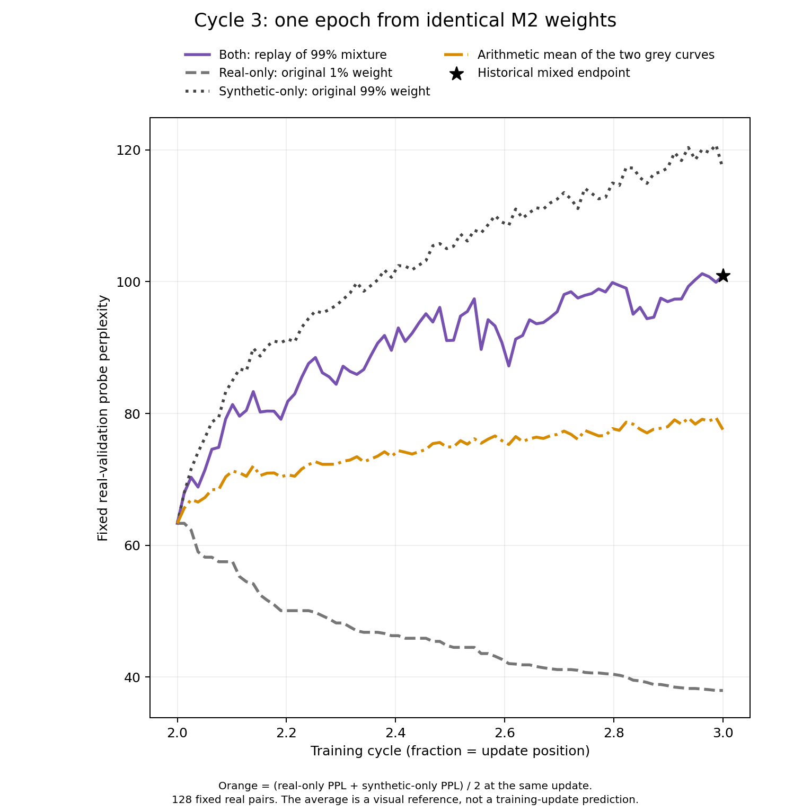
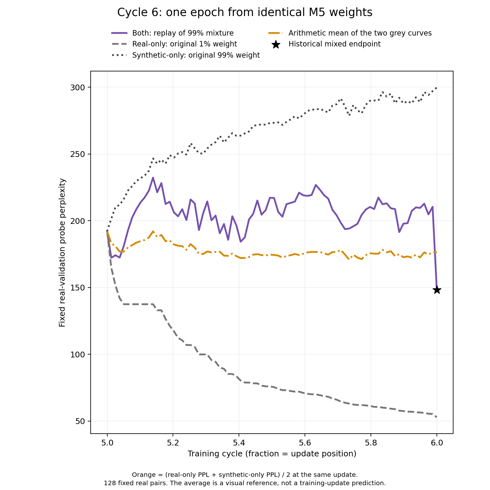
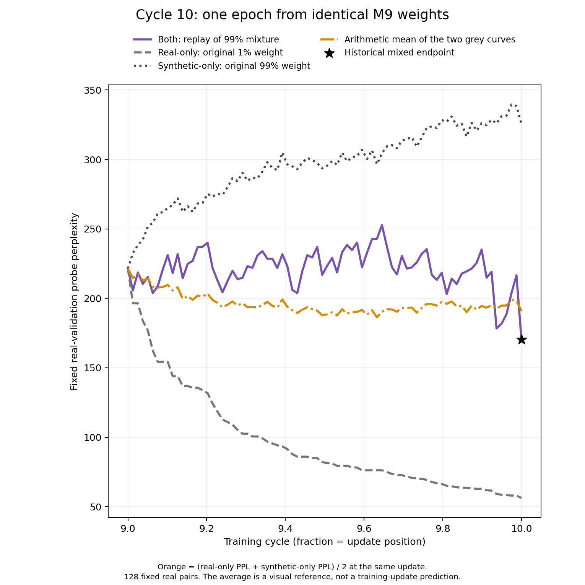

# Week 5 continued: Whole-epoch source ablations

Do real targets continue to correct recursive synthetic training over a whole epoch? Earlier diagnostics removed one source for a single update. Here, independent model copies keep only real losses, only synthetic losses, or both throughout an entire historical epoch.

## 1. Matched methodology

- Fork the completed 99%-synthetic SmolLM2-135M SGD run from M2, M5 and M9, immediately before cycles 3, 6 and 10. Each copy starts from the same weights and recorded training RNG for its case, then evolves independently.

- Restore the exact saved training inputs: 100 original real continuations and 9,900 synthetic continuations, paired with their original prompts. No synthetic targets are regenerated, and no new real examples are sampled.

- Keep SGD at constant learning rate 0.01, FP32 with TF32 off, seed 42, microbatch 32, and the historical order of 78 full 128-example updates plus a final 16-example update. There is no momentum, weight decay, scheduler or clipping.

- Inputs remain BOS + 64 prompt tokens + 64 continuation tokens; loss scores only the continuation. Both-source training keeps the whole loss. Real-only or synthetic-only removes the other terms while retaining each original batch denominator. Source-empty batches produce zero movement.

- Measure the same fixed 128-pair real-validation probe after every update, plus complete validation/test collections before and after each branch. Held-out gradients never train the model. Nine branches follow 711 scheduled update positions in total.

Table W5C.1. Historical fork points. Each row creates three independent one-epoch branches: both, real-only and synthetic-only.

| Cycle | Initializer | Exact saved target collection |
| --- | --- | --- |
| 3 | M2 | Cycle 3: 100 real + 9,900 synthetic |
| 6 | M5 | Cycle 6: 100 real + 9,900 synthetic |
| 10 | M9 | Cycle 10: 100 real + 9,900 synthetic |

## 2. Endpoint results

- Lower perplexity means the model assigns higher probability to unseen real continuations. All three copies share the same starting score within a case.

- The figures use the 128-pair probe, scoring 8,192 continuation tokens after every update. Complete validation (7,447 pairs) and test (7,303 pairs) are separate, fixed epoch-end measurements. Both evaluations give the same ordering: real-only best, mixed intermediate, synthetic-only worst.

Table W5C.2. Fixed-probe perplexity at the start and end of each one-epoch fork. These values match the plotted curves.

| Cycle | Shared start | Both | Real-only | Synthetic-only |
| --- | --- | --- | --- | --- |
| 3 | 63.33 | 100.94 | 37.97 | 117.13 |
| 6 | 192.06 | 148.38 | 52.91 | 299.77 |
| 10 | 221.43 | 170.45 | 56.26 | 325.44 |

Table W5C.3. Complete held-out test perplexity after each branch, scoring 467,392 continuation tokens. These values are independent of the smaller diagnostic probe.

| Cycle | Both | Real-only | Synthetic-only |
| --- | --- | --- | --- |
| 3 | 97.94 | 37.32 | 113.16 |
| 6 | 142.70 | 52.26 | 284.06 |
| 10 | 164.41 | 55.65 | 309.00 |

## 3. Cycle 3: Early deterioration is reduced by real targets

- At M2, both-source training still worsens probe perplexity overall, from 63.33 to 100.94. Removing the real correction raises it further to 117.13; keeping only the small real contribution lowers it to 37.97.

- Purple is the both-source replay; dashed grey retains real losses; dotted grey retains synthetic losses. Orange is the equal-weight arithmetic mean of the two grey scores at each matching update. The black star marks the original historical mixed endpoint.

Figure W5C.1. Cycle 3 from identical M2 weights. Fractional x positions show progress within the epoch. Original source weights, prompts, targets, masks and update positions are preserved.

## 4. Cycle 6: The middle-epoch correction depends on real targets

- From M5, the real-only branch improves from 192.06 to 52.91, while synthetic-only rises to 299.77. The combined branch oscillates and ends at 148.38. Cycle 6 was deliberately chosen because the historical curve showed a correction.

- Purple is the both-source replay; dashed grey retains real losses; dotted grey retains synthetic losses. Orange is the equal-weight arithmetic mean of the two grey scores at each matching update. The black star marks the original historical mixed endpoint.

Figure W5C.2. Cycle 6 from identical M5 weights. Fractional x positions show progress within the epoch. Original source weights, prompts, targets, masks and update positions are preserved.

## 5. Cycle 10: The corrective real signal remains at the late checkpoint

- From M9, real-only lowers probe perplexity from 221.43 to 56.26, while synthetic-only rises to 325.44. Both sources finish at 170.45. This is one extra epoch from M9, not a counterfactual replay of all ten cycles.

- Purple is the both-source replay; dashed grey retains real losses; dotted grey retains synthetic losses. Orange is the equal-weight arithmetic mean of the two grey scores at each matching update. The black star marks the original historical mixed endpoint.

Figure W5C.3. Cycle 10 from identical M9 weights. Fractional x positions show progress within the epoch. Original source weights, prompts, targets, masks and update positions are preserved.

## 6. What the orange average measures

PPL_mean(t) = [PPL_real-only(t) + PPL_synthetic-only(t)] / 2

- This is a 50/50 average of the two plotted perplexities at the same update position, including their shared baseline. It averages the scores directly; averaging NLL first and then exponentiating would give a different quantity.

- The real-only and synthetic-only branches already retain their original source weighting. The orange curve is a visual reference, not an additional training condition, an averaged gradient or a mixed probability model.

- After the first update, the independent branches have different weights, so later gradients are evaluated at different locations. Neither their losses nor their perplexities must average to the purple trajectory. Above or below the orange curve does not by itself identify a gradient interaction.

Table W5C.4. Pointwise-average comparison at each epoch endpoint, using fixed-probe perplexity. Purple ends above the mean in cycle 3 and below it in cycles 6 and 10.

| Cycle | Orange mean | Purple actual | Actual - mean |
| --- | --- | --- | --- |
| 3 | 77.55 | 100.94 | +23.39 |
| 6 | 176.34 | 148.38 | -27.96 |
| 10 | 190.85 | 170.45 | -20.40 |

## 7. Interpretation and limitations

- Measured source-removal effect: retaining only the small real contribution substantially improves unseen-real prediction at all three checkpoints. Removing it lets the saved synthetic targets drive further deterioration. Complete test endpoints confirm that this ordering is not confined to the 128-pair probe.

- Cycles 6 and 10 retain a sharp final mixed correction. Their final batch contains one real and 15 synthetic examples: 6.25% real in that update, versus 1% across the epoch. With the original denominator, each tail example has eight times the averaging weight of an example in a full batch. This contributes to endpoint sensitivity.

- The real-only curves also improve before the tail, and real-only batches with no real examples stay exactly flat. Real targets provide a continuing corrective signal; the correction is not confined to the last example.

- Whole-epoch ablations include feedback along diverging model trajectories. They cannot be added like the two gradient components measured at the same weights in the earlier one-update diagnostics. Three selected cases and one seed do not establish permanent stabilization, a universal safe ratio or a validated predictor.

## 8. Replay fidelity and evidence

- Every both-source replay passed the predeclared 1e-5 tolerances before interpreting its ablations. Bitwise tensor equality was not achieved, but relative tensor errors stayed below 6.3e-9 and maximum per-update probe-NLL discrepancies below 1.75e-6.

- All 711 update records, source counts, original row schedules, denominators, empty-source movement and branch seals were checked. The analysis recovered 176 small files and regenerated CSVs identical to those saved remotely. This retrieval did not cold-restore all nine terminal checkpoints; recovery storage is retained.

Table W5C.5. Numerical discrepancies of both-source replays versus their historical epochs. Every listed discrepancy is below the 1e-5 acceptance limit.

| Cycle | Relative tensor error | Max probe NLL difference | Max full-val/test NLL difference |
| --- | --- | --- | --- |
| 3 | 5.58e-09 | 1.36e-06 | 6.91e-07 |
| 6 | 5.89e-09 | 1.40e-06 | 3.12e-07 |
| 10 | 6.29e-09 | 1.74e-06 | 3.06e-07 |

Execution record: all nine branches completed on the matching RTX PRO 4000 Blackwell. Compute stopped normally on 16 November 2026 at 20:39 UTC, after 47.9 paid minutes including acceptance. Run: 20261116T195118Z-epoch-ablation.
