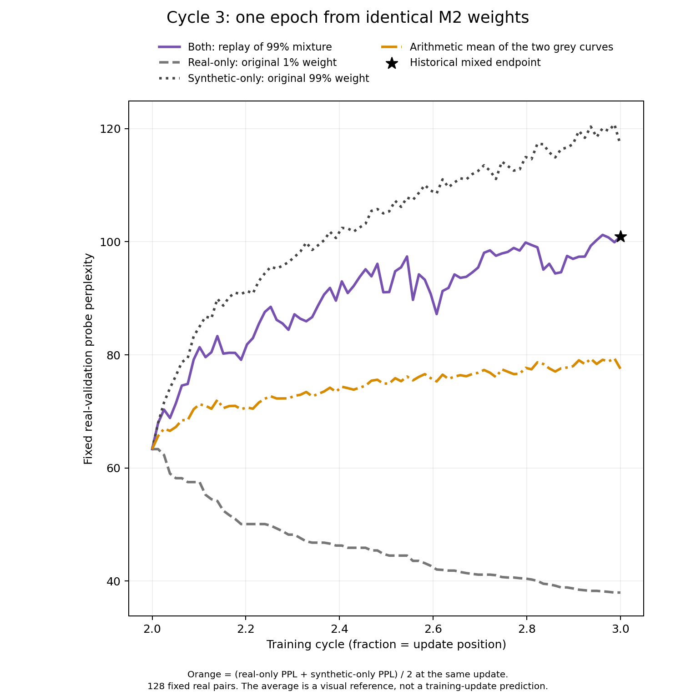
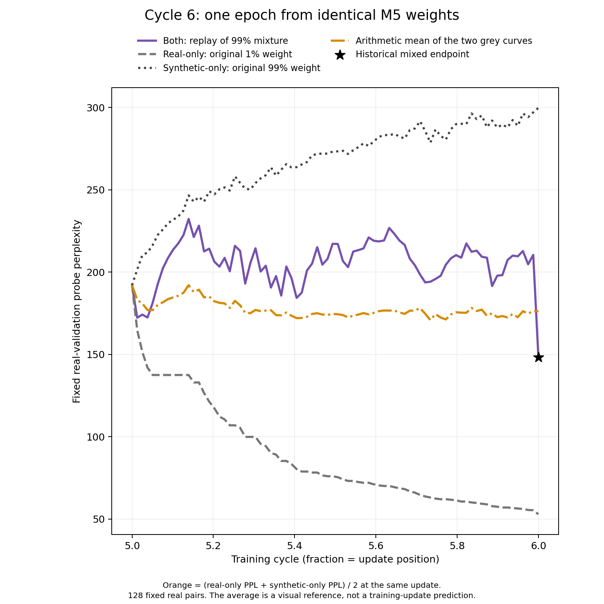
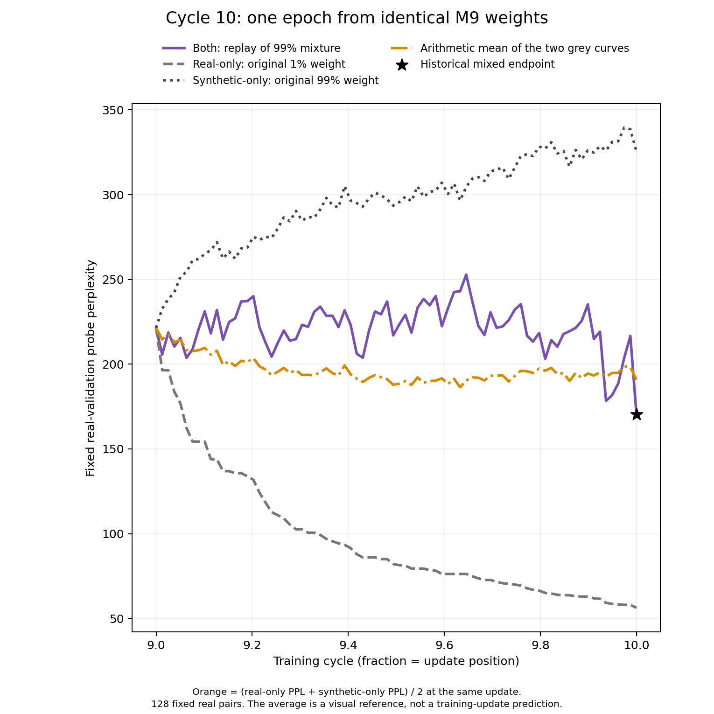

# Point-by-point average of the real-only and synthetic-only branches

The orange curve is the equal-weight arithmetic mean of the two branch perplexities at each corresponding update, including the shared starting point. It is calculated directly in perplexity space, not by averaging NLL and exponentiating. The original branch source weighting is unchanged.

The mean is a visual reference. It does not describe an averaged gradient, combined model, or expected trajectory of the mixed training branch. Nonlinear loss evaluation and diverging branch weights prevent that interpretation.

| Cycle | Mean of branch endpoint PPLs | Actual mixed endpoint PPL |
| --- | ---: | ---: |
| 3 | 77.55 | 100.94 |
| 6 | 176.34 | 148.38 |
| 10 | 190.85 | 170.45 |

All 240 points (baseline plus 79 updates for each of three cases) are in pointwise_average.csv. This analysis uses only previously verified published data and starts no compute.

