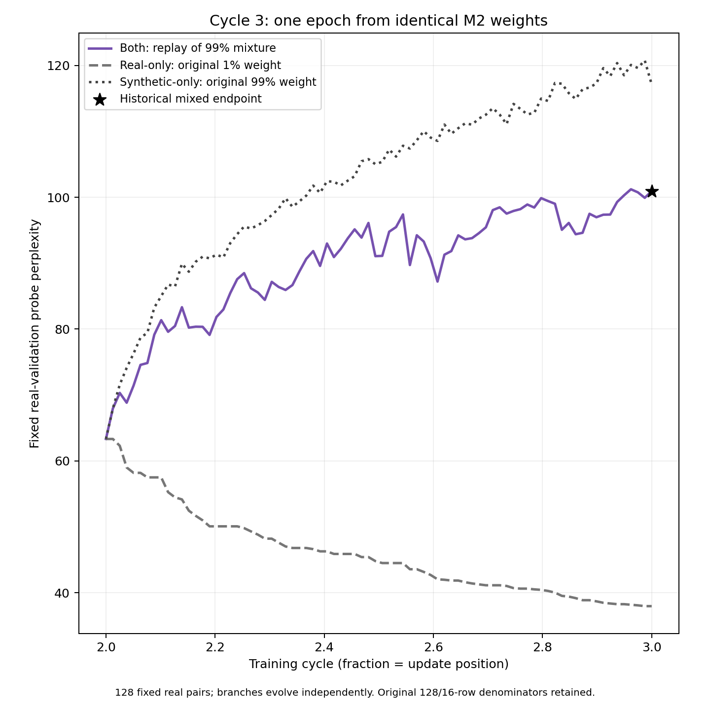
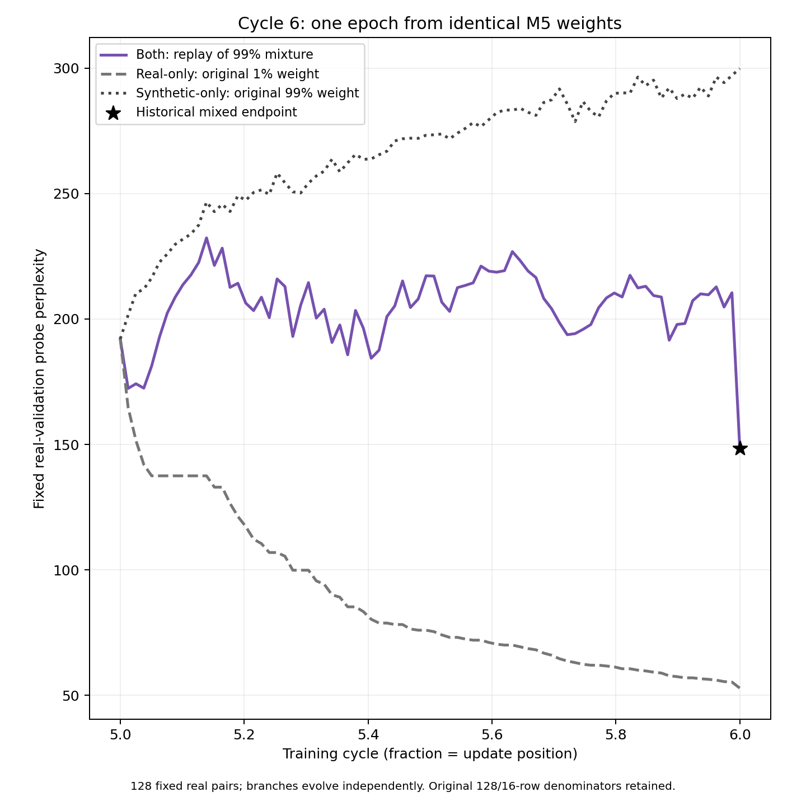
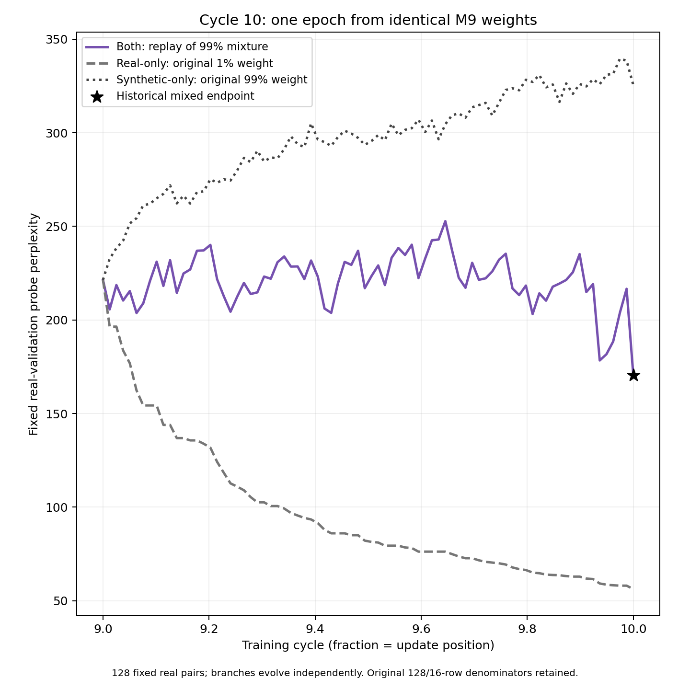

# Whole-epoch source ablations at cycles 3, 6 and 10

All nine branches completed: 711 scheduled update positions. The task-owned GPU stopped normally at 20:39:23 UTC on 16 November 2026, after 47.9 paid minutes including setup and acceptance. No GPU was started for this analysis.

## Method

- Fork the historical 99%-synthetic SmolLM2 SGD run from M2, M5 and M9. Each branch trains for one epoch on the exact corresponding saved targets; synthetic targets are not regenerated.
- The three branches apply both source losses, only the existing 100 real examples, or only the existing 9,900 synthetic examples. Each follows the same 79 batch slots and original denominators, including the 16-example tail. Empty retained-source batches have zero gradient.
- Preserve SGD 0.01, FP32/TF32-off, prompt attention, continuation-only loss, historical row order and RNG. Each branch evolves independently after the shared initializer.
- Measure the same 128-pair real-validation probe after every update. Complete frozen validation/test endpoints are evaluated separately. Lower perplexity is better.

## Fixed-probe results

| Cycle | Shared starting PPL | Both | Real-only | Synthetic-only |
| --- | ---: | ---: | ---: | ---: |
| 3 | 63.33 | 100.94 | 37.97 | 117.13 |
| 6 | 192.06 | 148.38 | 52.91 | 299.77 |
| 10 | 221.43 | 170.45 | 56.26 | 325.44 |

The values above are the same fixed probe shown in the figures; they are not the complete test-set perplexity.

## Complete held-out test endpoints

| Cycle | Both | Real-only | Synthetic-only |
| --- | ---: | ---: | ---: |
| 3 | 97.94 | 37.32 | 113.16 |
| 6 | 142.70 | 52.26 | 284.06 |
| 10 | 164.41 | 55.65 | 309.00 |

## Figures







## Interpretation

- At all three checkpoints, retaining only the small real contribution improves held-out prediction substantially; removing it allows the synthetic branch to deteriorate. Complete test endpoints show the same ordering as the probe.
- At cycle 3 the combined branch still deteriorates overall, but less than synthetic-only. At cycles 6 and 10 it fluctuates and finishes below its starting perplexity, while synthetic-only rises.
- The late drops in cycles 6/10 occur in the original final 16-example batch, containing one real and 15 synthetic examples. That update therefore has a 6.25% real share; a real example has eight times the weight it would have in a 128-example batch. This ordering/tail sensitivity contributes to the apparent endpoint corrections.
- These independent whole-epoch forks support a corrective role for real targets. Their effects do not add after their weights diverge. Cycle 6 was deliberately selected as a correction case; one seed and three epochs do not prove permanent stabilization or universal behavior.

## Replay and recovery checks

All three both-source branches pass the predeclared 1e-5 tolerances. They are not bitwise identical to the historical checkpoints. The maximum observed per-update probe-NLL discrepancy is 1.742e-6; complete validation/test NLL discrepancies stay below 7e-7. Terminal relative tensor errors are below 6.3e-9.

176 small indexed files / 6,450,494 bytes were restored and checksum-verified. All 711 update records, initializer/order/source bindings, exact original row coverage and source-empty updates were checked. Local regenerated CSVs equal the remote saved CSVs. This retrieval does not cold-restore all nine bulk terminal checkpoints; keep the 30 GB working volume prhwl06pe1, 10 GB backup b3cklax6ra and historical recovery resources.

Outputs include NLL/PPL figures, full endpoint tables, per-update source counts/losses/gradient norms, parameter movement, timing, original row IDs and historical replay discrepancies. The canonical [endpoint CSV](generated/verified-20261116/endpoints.csv), [per-update CSV](generated/verified-20261116/per_update.csv) and [analysis manifest](generated/verified-20261116/analysis_manifest.json) retain their scopes.

## Reproduce the figures

After metadata-only recovery into the original run workspace, choose a new output directory:

```powershell
python -m model_collapse report 20261116T195118Z-epoch-ablation --out NEW_OUTPUT_DIRECTORY
```
