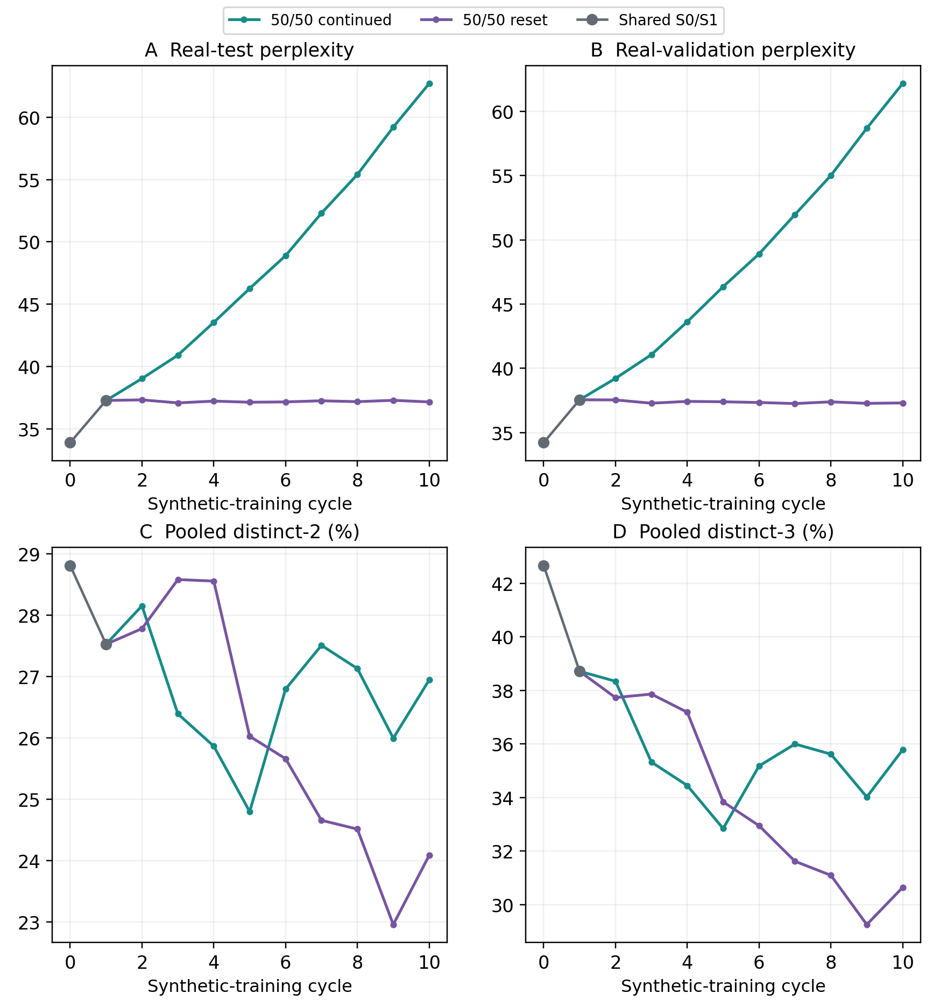
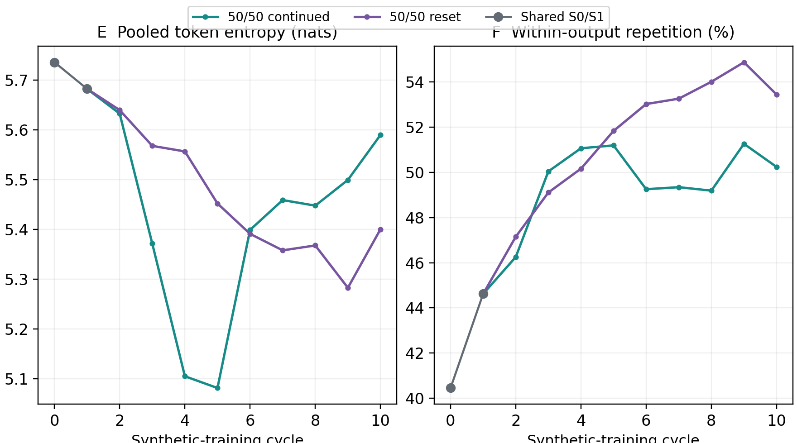
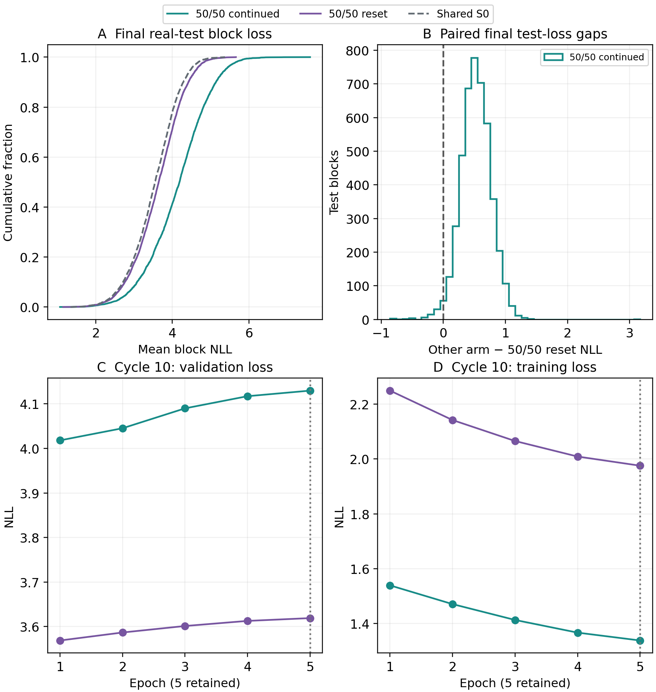
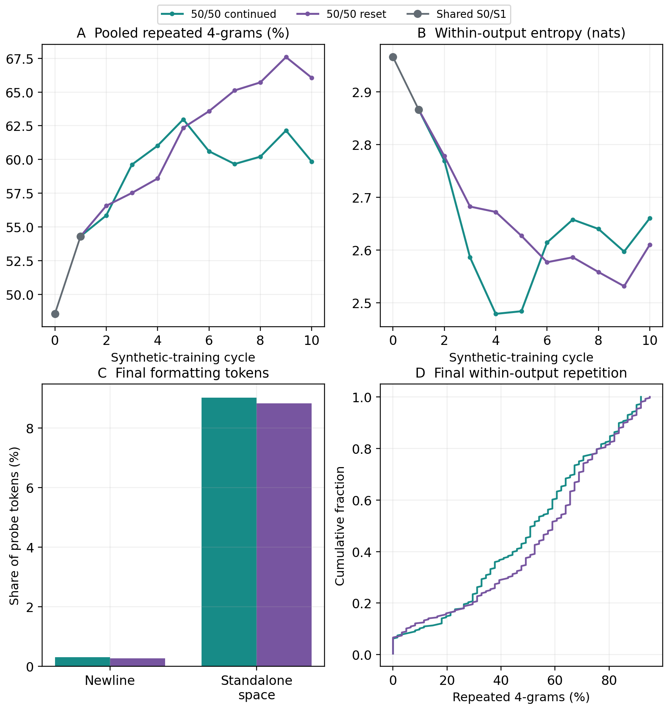
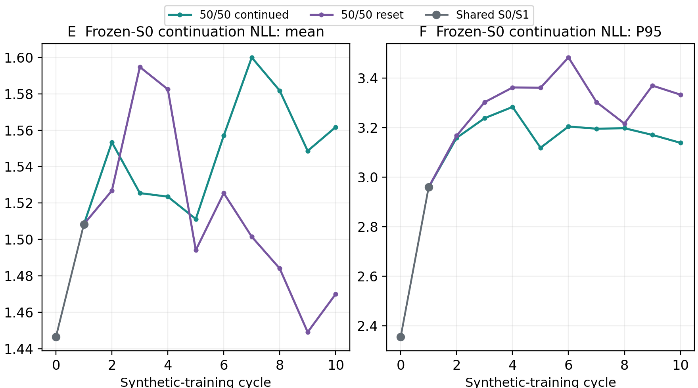

# Week 3, Part 3: Matched 50/50 reset and continued training

OPT-125M / WikiText-2; seed 42. Reset cycles 2–10 completed 1 November 2026; analysis uses its sealed private backup.

## 1. Objective and shared-start methodology

Does resetting to a fixed real-trained model limit recursive deterioration when half of every training dataset is real text? We compare the completed 50/50 continued trajectory with a new reset branch sharing its exact first update.

- Shared beginning: S0 generates D1; train S0 on M1 = mix(real, D1) for five epochs to obtain S1; S1 generates D2. Both arms reuse exactly the same S0, S1, D2 and cycle-2 mixture M2. Their first jump is therefore identical, rather than a separately repeated training run.

- From cycle 2: continued initializes from its previous epoch-5 checkpoint; reset initializes from fixed real-trained S0. Each model then generates its own next synthetic pool. “Reset” refers to training initialization, not replacing the recursively generated data with S0 outputs.

- Mixtures: sample 18,973 real and 18,973 synthetic blocks without replacement from each source, then shuffle. Cycle-specific seeded streams match across arms; mixtures stay fixed through all five epochs. Real blocks may recur across cycles. Synthetic targets contain continuations only, with no prompts or held-out real text.

Table 18. Matched scientific settings. Only the checkpoint used to initialize cycles 2–10 differs by design; later synthetic targets consequently diverge.

| Setting | Both 50/50 arms |
| --- | --- |
| Model / corpus | Pinned facebook/opt-125m / WikiText-2 raw; unchanged row/split packing |
| Shared prefix | Exact real-trained S0, mixed-trained epoch-5 S1, D2 and M2; imported, not retrained |
| Mixture per cycle | 18,973 real + 18,973 synthetic blocks × 64 tokens; 2,428,544 total input tokens |
| Generation | Same real 64-token prompts → exactly 64 new tokens; five beams, penalty 1.0; full pool before mixing |
| Training / selection | Five epochs; always retain epoch 5. Fresh AdamW/cosine each cycle; LR 2e-5, seed 42, effective batch 128, BF16 |
| Evaluation / probe | 3,922 validation and 4,494 test real blocks; fixed 256-output probe; 63 shifted scored targets per block |
| Recorded environment | RTX PRO 4000 Blackwell; PyTorch 2.8.0+cu128, Transformers 4.37.2, Datasets 3.4.1; matching driver/software |

## 2. Matched trajectories: prediction and diversity

Figure 12a. Larger square panels: matched real-test/validation perplexity (A/B), pooled distinct-2/3 (C/D). Teal: continued; purple: fixed-S0 reset; grey: exact shared S0/S1. Measurements and source data are unchanged.

- Real-text prediction: common test PPL rises from 33.89 to 37.27. Reset then stays near 37.1–37.3, ending at 37.15; continued rises every cycle to 62.71. Reset ends 40.76% lower than continued, but 9.64% above S0.

- Likely explanation: resetting removes accumulated parameter changes, while recurring real targets anchor each new update. Data feedback still persists through each generated pool. A stable held-out PPL can therefore coexist with changing or worsening generated output; it does not establish that collapse has stopped.

## 2b. Generated-text diversity

Figure 12b. Pooled token entropy (E) and mean within-output four-gram repetition (F), on the same fixed 256-output probe. These describe emitted text, separately from real-test prediction.

- Diversity does not follow the PPL ranking. Reset ends with lower distinct-2/3 and entropy, and more within-output repetition. Continued entropy partly rebounds as standalone-space concentration falls from 21.17% at cycle 4 to 9.02% at cycle 10; its real-test PPL nevertheless keeps rising.

### Reading the diversity statistics

- Distinct-n = unique n-token phrases / all n-token windows, pooled across outputs. Both arms have the same denominators: 16,128 bigrams, 15,872 trigrams and 15,616 four-grams. Lower reset values mean fewer different phrase types in this fixed sample, even though it predicts held-out real text better.

- Token entropy H = −Σ p(t) ln p(t) describes how evenly emitted token IDs are used. Within-output entropy computes this separately for each continuation, then averages. These are empirical output-frequency statistics, not the model’s predictive uncertainty.

## 3. Endpoint statistics

Lower real-text NLL/PPL means less surprise at actual held-out tokens. Output diversity describes generated strings; it measures neither factual correctness nor the same prediction task.

Table 19. Common S0 and final cycle-10 checkpoints. NLL and entropy use natural logarithms; percentages are token/window fractions. Duplicate outputs count copies beyond the first among 256 continuations. Shared S1 test PPL is 37.27.

| Measure | S0 | Continued C10 | Reset A10 |
| --- | --- | --- | --- |
| Test corpus perplexity | 33.89 | 62.71 | 37.15 |
| Validation perplexity | 34.21 | 62.16 | 37.30 |
| Test NLL (nats/target) | 3.523 | 4.138 | 3.615 |
| P95 test-block NLL | 4.478 | 5.388 | 4.626 |
| Distinct-1 (%) | 10.57 | 11.10 | 10.44 |
| Distinct-2 (%) | 28.81 | 26.94 | 24.08 |
| Distinct-3 (%) | 42.66 | 35.78 | 30.64 |
| Distinct-4 (%) | 51.45 | 40.15 | 33.94 |
| Pooled repeated 4-grams (%) | 48.55 | 59.85 | 66.06 |
| Mean within-output repeated-4 (%) | 40.45 | 50.24 | 53.45 |
| Duplicate outputs / 256 | 0 | 10 | 12 |
| Pooled entropy (nats) | 5.736 | 5.590 | 5.400 |
| Mean within-output entropy | 2.966 | 2.660 | 2.610 |
| Frozen-S0 mean NLL | 1.446 | 1.562 | 1.470 |
| Frozen-S0 P95 NLL | 2.355 | 3.139 | 3.333 |
| Newline tokens (%) | 0.38 | 0.31 | 0.27 |
| Standalone-space tokens (%) | 1.14 | 9.02 | 8.83 |
| Whitespace-only outputs / 256 | 0 | 0 | 1 |

## 4. Real-text coverage and five-epoch training

Figure 13. A: cumulative final block-NLL distributions, with S0 dashed; curves farther left assign higher probability to real text. B: continued minus reset NLL for each identical test block; positive favours reset. C/D: cycle-10 losses over five epochs. The terminal checkpoint is always retained.

- Broad descriptive advantage: reset has lower final NLL on 4,414/4,494 test blocks (98.22%), continued on 80, with no ties. Mean gap is 0.524 nats/target. Reset remains worse than S0 on 3,973 blocks; continued on 4,389.

- Epoch selection: every unique stage executed all five epochs and retained epoch 5. Epoch 1 had the lowest real-validation loss in all 19 unique stages. In cycle 10, validation NLL rises 3.569 → 3.619 for reset and 4.018 → 4.130 for continued, while training NLL falls 2.250 → 1.976 and 1.539 → 1.337, respectively.

- Interpretation: fitting the current mixture more strongly does not improve generalization here. Continued also starts already adapted to earlier synthetic targets; reset starts at S0. Their training losses involve different arm-specific mixtures, so lower continued training loss is not evidence of better general language modelling.

## 5. Repetition, formatting and the frozen-S0 score

Figure 14a. Larger square panels: pooled four-gram repetition (A), within-output entropy (B), formatting-token shares (C) and the final within-output repetition distribution (D). Same inputs, arithmetic and colour mapping as the earlier report.

- Repetition: pooled repeated-4 = 1 − distinct-4, so it is not independent evidence. Within-output repeated-4 instead counts excess occurrences inside each continuation before averaging. Reset is more repetitive on 131 paired prompts, continued on 88, with 37 ties; lower reset PPL does not imply less looping.

- Formatting: newlines are only 0.27% (reset) and 0.31% (continued), with no newline-heavy outputs. Excluding them leaves the entropy and pooled repetition rankings unchanged. Standalone spaces remain about 9% in both, with 26 space-heavy outputs each; reset has one whitespace-only decoded output, continued none. Blank-line concentration does not explain this endpoint contrast.

## 5b. Frozen-S0 predictability

Figure 14b. Frozen-S0 continuation NLL: mean (E) and P95 (F). Each continuation is scored alone, without its original prompt. Larger square panels change the presentation, not the metric or the underlying scores.

- Frozen-S0 score: feed each generated continuation alone to S0 and average −ln p(next token | preceding continuation tokens), over 63 targets. The original prompt is omitted. Reset has lower mean NLL (1.470 vs 1.562) but higher P95 (3.333 vs 3.139): typical predictability and the upper tail can rank differently. Easy repetitive strings can score well; this is not model distance, factuality or real-test performance.

## 6. Saved examples, conclusion and limitations

Fixed anchor: prompt 0, retained from earlier comparisons before inspecting these outcomes. Generated factual claims below are unverified; the example is not a representative quality assessment.

> </s></s> = Valkyria Chronicles III = \n</s></s> Senjō no Valkyria 3 : Unrecorded Chronicles ( Japanese : 戦場のヴァルキュリア3, lit. Valkyria of the Battlefield 3 ), commonly referred to as Valkyria Chronicles III outside

Table 20. Complete saved 64-token continuations for the same prompt. Here continued loops more strongly (86.89% within-output repeated-4 versus reset 49.18%), despite reset being more repetitive on average. Original token IDs and whitespace remain in the saved records.

| Checkpoint | Complete saved continuation |
| --- | --- |
| Shared S1 |  Japan as Valkyria Chronicles II, was the first game in the Valkyria Chronicles series to be released in Japan. It was the first game in the series to be released in the United States, and the first game in the series to be released in Japan. The game was the first game in the series to |
| Continued C10 |  Japan as Valkyria Chronicles 3 : Valkyria Chronicles 3 : Valkyria Chronicles 3 : Valkyria Chronicles 3 : Valkyria Chronicles 3 : Valkyria Chronicles 3 : Valkyria Chronicles 3 : Valkyria Chronicles 3 : Valkyria Chronicles 3 : Valkyria Chronicles 3 : Valky |
| Reset A10 |  Japan as Valkyria Chronicles II, is a video game developed by Capcom and published by Capcom for the Nintendo DS in the United States in the United Kingdom in the United States in the United States in the United States in the United States in the United States in the United States in the United States in the United States in |

## 7. Conclusions, accounting and limitations

- Main finding: with 50/50 mixing, fixed-S0 reset largely stabilizes real-test prediction after the first update, while continued training deteriorates. It does not preserve S0 performance or improve all diversity measures. Both still generate loops, and the reset probe has lower phrase diversity.

- A plausible reason for the diversity trade-off is that repeated resetting and deterministic beam decoding favour familiar high-probability templates, while data feedback progressively narrows them. This is a hypothesis: the observations establish the trade-off, not that specific mechanism.

- Limits: one seed, OPT-125M, WikiText-2, ten cycles and five-beam decoding. The fixed probe covers the first 256 consecutive training prompts from six adjacent articles, not a random corpus sample. Paired test blocks are descriptive observations, not independent model runs. Reused real text is not fresh external data; no universal safe synthetic fraction is established.

- Accounting: continued has ten new updates / fifty epochs; this reset branch adds nine updates / forty-five epochs and imports S1. The matched pair contains 19 unique stages / 95 epochs, not twenty independent stages. Each endpoint’s recursive lineage has ten cycles, but reset A10 inherits only its own five-epoch update from S0.

Evidence: checksum-verified 1,421 metadata files / 53,699,537 bytes from pinned backups, plus nine new 256×64 probes / 590,976 bytes; shared S0/S1 and the continued evidence were reused. All 22 metric rows, twenty unique probes, 100 saved epoch entries (95 unique), mixture-selection hashes and recorded handoffs were audited. No full weights/training arrays were downloaded or models re-evaluated.

Execution scope: recorded new reset training time 1.04 h and generation time 4.19 h. This is one completed job in a larger campaign, not a separately shut-down Pod or itemized invoice. Analysis used Hugging Face backups only: no Runpod API calls, SSH sessions or changes to the running campaign.

[Per-cycle metrics](../../20261101T030306Z-full-mixed-campaign-reset-mixed50/analysis/metrics.csv) | [Epoch histories](../../20261101T030306Z-full-mixed-campaign-reset-mixed50/analysis/training_history.csv) | [Examples](../../20261101T030306Z-full-mixed-campaign-reset-mixed50/analysis/examples.json) | [Audit and provenance](../../20261101T030306Z-full-mixed-campaign-reset-mixed50/analysis/publication_reproduction.json) | [Analysis script](../../../comparisons/mixed_fraction_final5/analyse_reset50.py)
