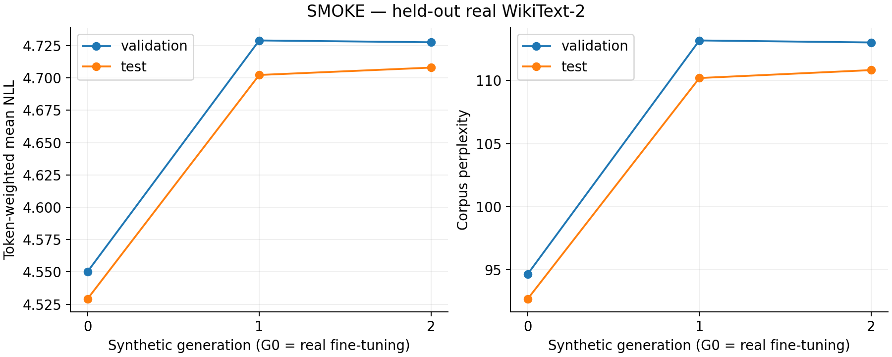
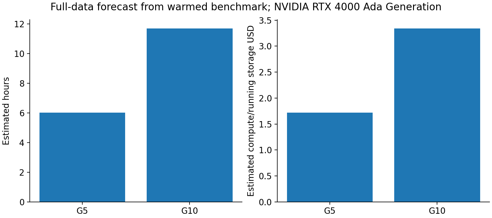

# Week 1 setup validation - 20 October 2026

**Implemented and validated. The full-data experiment has not been started.**

Experiment `20261020T193206Z-smoke`: actual OPT-125M, seed 42, 256 training blocks, 64 validation blocks, 64 test blocks, one epoch and two optimizer updates per model. G1 and G2 use only the previous model's continuation tokens.

## Measurements

| Model | Validation corpus PPL | Test corpus PPL |
|---|---:|---:|
| Untouched pretrained | 130.7115 | 122.8392 |
| G0: real training | 94.6448 | 92.6759 |
| G1: synthetic training | 113.1807 | 110.1995 |
| G2: synthetic training | 113.0218 | 110.8285 |

These small runs validate the pipeline, not a full reproduction or statistically established collapse. Each test score uses the same 4,032 shifted targets. The full experiment uses all 37,946 training blocks and five epochs per model. Published perplexities were not acceptance targets.

[Scientific report](20261020T193206Z-smoke/report.md) | [CSV](20261020T193206Z-smoke/metrics.csv) | [Validation data](validation.json)



## Verification

- **19 local tests passed**, covering numerical loss/perplexity, partial batches, five-epoch optimizer/scheduler recovery, budget refusal, concurrent-launch refusal, transfer retries, cleanup ownership, and affordable G5/G10 admission without paid provisioning.
- Real G0 -> D1 -> G1 -> D2 -> G2 handoffs passed. All three initial model hashes matched the original pretrained weights; all selected models changed their weights.
- Exactly 64 continuation tokens followed each fixed 64-token real training prompt. Real prompts were excluded from subsequent training targets.
- Two deliberate worker exits recovered: after the first generation shard and after G1. Saved work was reused; completed G1 files remained unchanged.
- The detached supervisor and watchdog survived the launcher/SSH disconnect. Independent budget-guard shutdown stopped paid compute, verified by provider reads.
- **120 artifacts, 1.514 GB**, including all three selected models, were downloaded from private Hugging Face backups and SHA-256 verified.
- Restored G2 test perplexity matched **110.8284648989** exactly. Direct log-probability versus cross-entropy calculation had maximum error **0.0**.
- A fresh Pod resumed the completed chain without retraining and exercised the optimized cold start and automatic shutdown again. The final runtime was also deployed in the separate guard fault test; its source hash matched the local and validated code.

## Infrastructure and cost

The observed Runpod balance debit for this setup was **$0.1042**, below the $3 setup ceiling. This comes from authenticated before/after balance reads. The current-day aggregated billing API had not yet returned records; its empty response was not treated as zero spend. The internal cost ledger uses conservative runtime estimates separately.

**Final provider read: no Pods, no network volumes, $0/hour.** Automatic payments remained disabled. No extra credits or paid Hugging Face services were purchased. Models and data remain in private Hub repositories and locally in the ignored run directory.

Training and generation used **NVIDIA RTX 4000 Ada, 20 GB, $0.28/hour**, with official image `runpod/pytorch:1.0.2-cu1281-torch280-ubuntu2404`, PyTorch 2.8.0 and CUDA 12.8. An initial RTX 2000 Ada bootstrap trial ($0.24/hour) failed before training and stopped safely. The final cold-start control test used an available RTX PRO 4000 Blackwell ($0.57/hour), verifying and reusing completed scientific stages. Only one GPU was active at a time.

The optimized dependency phase took **68.9 seconds**, versus approximately 573 seconds installing on network storage. Dependencies now use local container disk; research artifacts and caches use persistent storage.

The initial smoke driver version was not captured. The final code records drivers and environments per launch and preserves the original environment when resuming. Initial training and final source hashes are retained in validation metadata.

The final guard-only trial used an available Secure Cloud GPU partition at $0.69/hour. A receipt sender was deliberately stalled for 60 seconds; its daemon thread was allowed five seconds, and the provider reported the GPU stopped after **7.3 seconds**. The Pod was then removed. No models were retrained. [Raw guard-fault evidence](shutdown_receipt_fault.json).

## Full-data forecast

Warmed throughput on the tested RTX 4000 Ada: **29,716 training target tokens/s** and **1,135 selected continuation tokens/s**, with five beams, generation batch 32, 64-token prompts/continuations and BF16.

| Target | Estimated duration | Estimated compute + running storage |
|---|---:|---:|
| G5 | 6.03 hours | $1.72 |
| G10 | 11.70 hours | $3.34 |

These estimates use the tested $0.28/hour GPU rate plus running storage, a 50% compute margin, and setup/checkpoint/upload allowances. Future GPU availability and performance can change them. Setup spend and retained-storage costs are additional. The cumulative task ceiling remains **$25**, with $2 reserved for storage/shutdown. The watchdog cutoff is calculated from dollars and the live price; there is no unrelated training time limit.



## Start later

From the project directory:

```powershell
.venv\Scripts\python.exe -m model_collapse launch --generations 10
```

Choose `--generations 5` for a shorter chain. Wait for confirmation that the detached supervisor and watchdog are running, then close the laptop. The remote job saves each generation, builds plots, uploads private backups and stops its GPU.

On returning, use the **new full-run ID**:

```powershell
.venv\Scripts\python.exe -m model_collapse status RUN_ID
.venv\Scripts\python.exe -m model_collapse fetch RUN_ID
.venv\Scripts\python.exe -m model_collapse report RUN_ID
.venv\Scripts\python.exe -m model_collapse cleanup RUN_ID
```

The full run retains a 30 GB recovery volume after GPU shutdown until cleanup. Standard storage is approximately $2.10/month while retained. Provider/API outages can delay shutdown despite retries; the tested automation is not a provider billing guarantee.

## Artifacts

- [Private selected models](https://huggingface.co/Bill11235813/iib-model-collapse-week1-models/tree/main/20261020T193206Z-smoke)
- [Private datasets, manifests, samples and reports](https://huggingface.co/datasets/Bill11235813/iib-model-collapse-week1-data/tree/main/20261020T193206Z-smoke)
- [Diversity and repetition](20261020T193206Z-smoke/diversity.png)
- [Frozen G0 reference scores](20261020T193206Z-smoke/reference_scores.png)
- [Stage timings](20261020T193206Z-smoke/runtime.png)

Local proposal, paper, credentials, datasets and model weights were excluded from ordinary Git history. See the README and scientific report for exact preprocessing, scoring and deviations from the paper.
